# Kettle作业设计

## 实验目标

统计数据库`course`表中`课程名称为空`，`课时数为零`的记录数。

### 输入数据

| 1    | 大数据导论             | 基础课 | 4    | 张三 | 2020/3/1 0:00  | 64   |
| ---- | ---------------------- | ------ | ---- | ---- | -------------- | ---- |
| 2    | Hadoop大数据技术       | 专业课 | 4    | 李四 | 2020/3/2 0:00  | 64   |
| 3    | 分布式数据库原理与应用 | 专业课 | 4    | 张三 | 2020/3/3 0:00  | 64   |
| 4    | 数据导入与预处理应用   | 专业课 | 4    | 李四 | 2020/3/4 0:00  | 0    |
| 5    | 数据挖掘技术与应用     | 专业课 | 4    | 王五 | 2020/3/5 0:00  | 64   |
| 6    |                        | 专业课 | 4    | 赵六 | 2020/3/6 0:00  | 64   |
| 7    | 大数据应用开发语言     | 专业课 | 4    | 张三 | 2020/3/7 0:00  | 64   |
| 8    | 大数据分析与内存计算   | 专业课 | 4    | 张三 | 2020/3/8 0:00  | 64   |
| 9    |                        | 专业课 | 4    | 王五 | 2020/3/9 0:00  | 64   |
| 10   |                        | 专业课 | 4    | 赵六 | 2020/3/10 0:00 | 64   |
| 15   | 数据库原理与应用       | 专业课 | 4    | 赵六 | 2020/3/11 0:00 | 0    |

具体`SQL`语句见附录。

### 期望结果

#### 中间文件输出

| 编号 | 课程名称               | 课程大类 | 学分 | 讲师 | 开课时间 | 课时数 | **<u>`课程名称为空`</u>** | **<u>`课时数为零`</u>** |
| ---- | ---------------------- | -------- | ---- | ---- | -------- | ------ | ------------------------- | ----------------------- |
| 1    | 大数据导论             | 基础课   | 4    | 张三 | 2020/3/1 | 64     | 0                         | 0                       |
| 2    | Hadoop大数据技术       | 专业课   | 4    | 李四 | 2020/3/2 | 64     | 0                         | 0                       |
| 3    | 分布式数据库原理与应用 | 专业课   | 4    | 张三 | 2020/3/3 | 64     | 0                         | 0                       |
| 4    | 数据导入与预处理应用   | 专业课   | 4    | 李四 | 2020/3/4 | 0      | 0                         | **<u>1</u>**            |
| 5    | 数据挖掘技术与应用     | 专业课   | 4    | 王五 | 2020/3/5 | 64     | 0                         | 0                       |
| 6    |                        | 专业课   | 4    | 赵六 | 2020/3/6 | 64     | **<u>1</u>**              | 0                       |
| 7    | 大数据应用开发语言     | 专业课   | 4    | 张三 | 2020/3/7 | 64     | 0                         | 0                       |
| 8    | 大数据分析与内存计算   | 专业课   | 4    | 张三 | 2020/3/8 | 64     | 0                         | 0                       |
| 9    |                        | 专业课   | 4    | 王五 | 2020/3/9 | 64     | **<u>1</u>**              | 0                       |
| 10   |                        | 专业课   | 4    | 赵六 | #######  | 64     | **<u>1</u>**              | 0                       |
| 15   | 数据库原理与应用       | 专业课   | 4    | 赵六 | #######  | 0      | 0                         | **<u>1</u>**            |

#### 统计结果输出

此步骤是对`课程名称为空`和`课时数为零`两列的求和。

| 课程名称为空 | 课时数为零 |
| ------------ | ---------- |
| 3            | 2          |

#### 邮件通知

作业执行成功，发送成功邮件； 执行失败，发送失败邮件。

## 整体设计

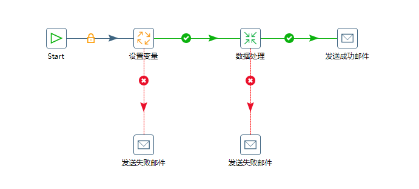

此作业主要分为两个模块：

1. 数据处理
2. 设置变量

### <u>`数据处理`</u>转换设计

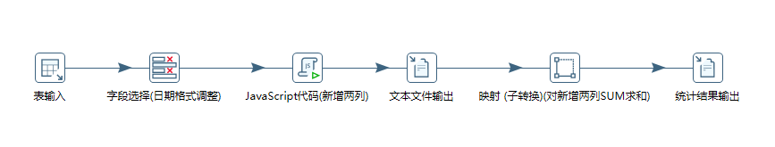

### <u>`设置变量`</u>作业设计

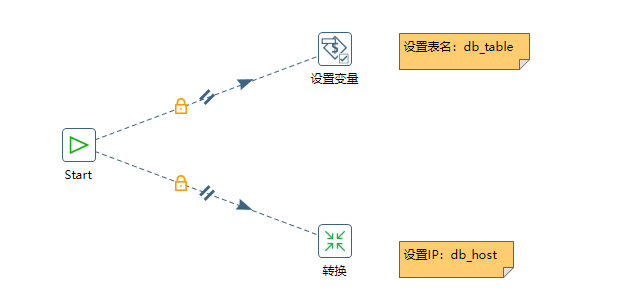


## <u>`数据处理`</u>转换设计

### 读取数据

##### 表输入

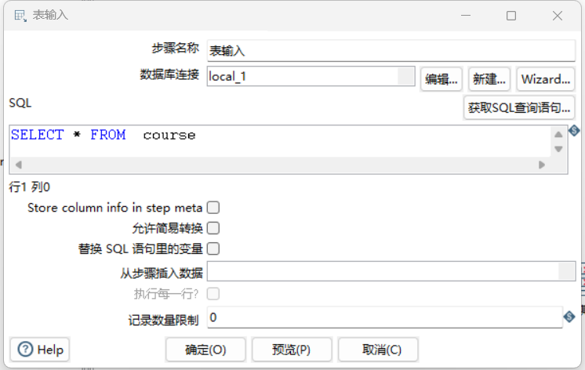

##### 数据库连接

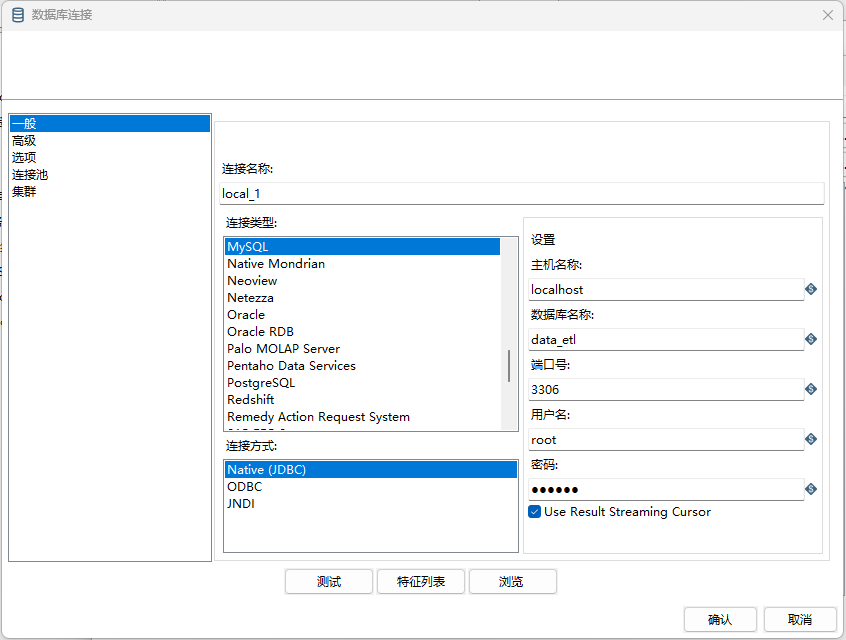

### 日期格式调整

#### 字段选择步骤

##### 选择和修改标签页

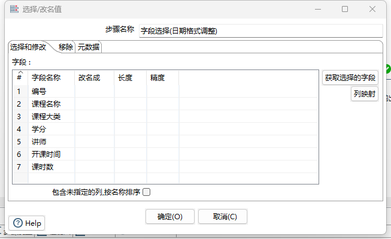

##### 元数据标签页

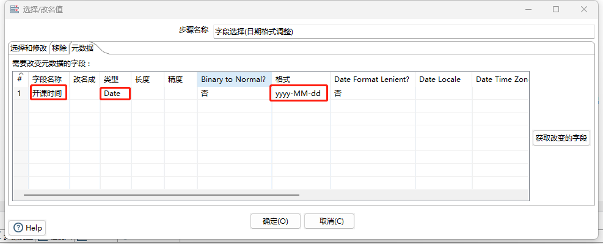

### 使用JS新增两列

#### JavaScript代码步骤

新增`课程名称为空`和`课时数为零`两列。

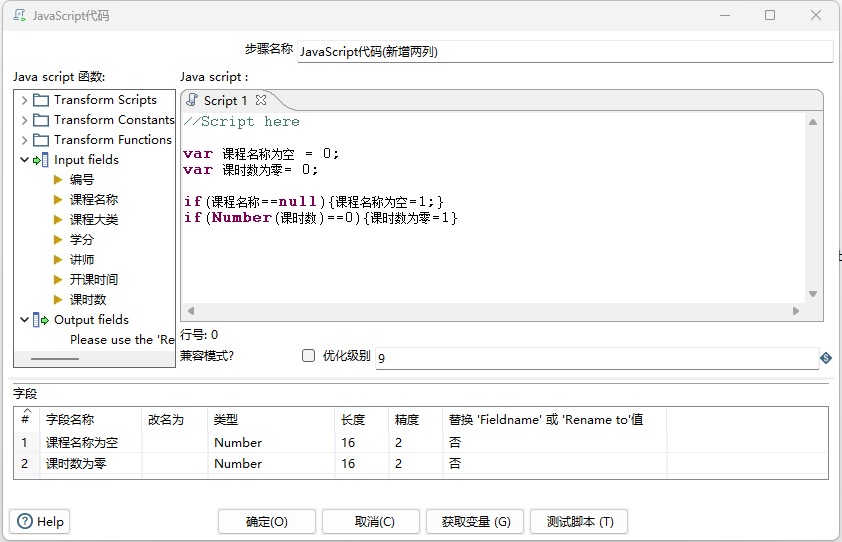

### 统计

通过在`映射子转换`中统计`课程名称为空`和`课程数为零`的记录数。

#### 映射子转换

新建`转换`，此处命名为：`SUM求和转换`

具体设计：

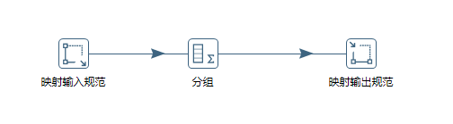

##### 映射输入规范

`JavaScript步骤`新增的`两列`作为映射子转换的`输入`。

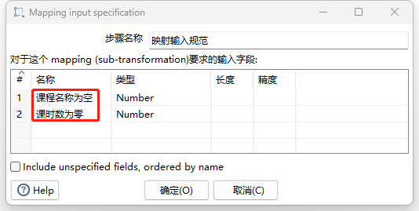

##### 分组

不需要对两列数据分组，只需要对两列数据求和。

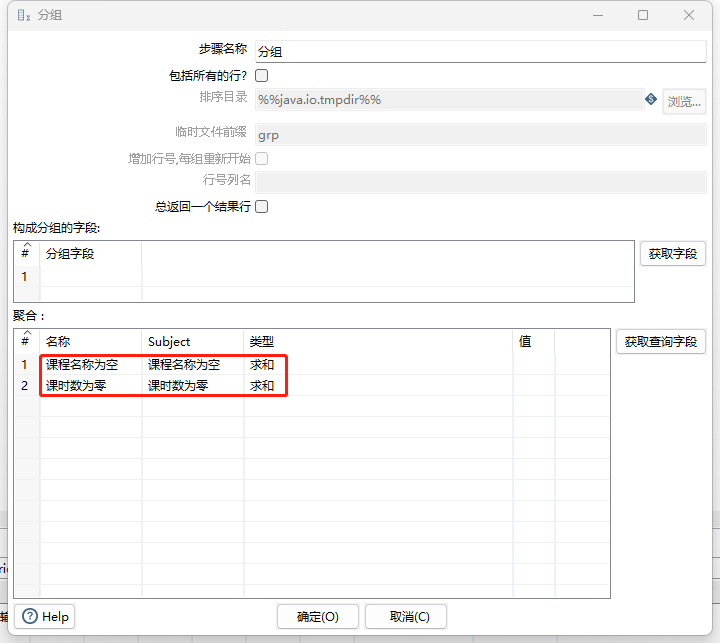

##### 映射输出规范

无需调整。

##### SUM求和转换引用

在数据处理转换中引用上面配置的`SUM求和转换`，具体做法：在下面红色方框上`右键`选择引用的`SUM求和转换.ktr`文件。

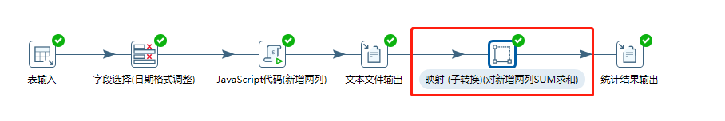

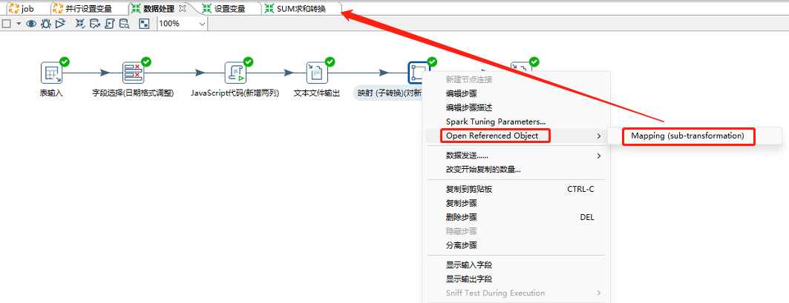

### 统计结果输出

将映射子转换的求和结果输出到文本文件中，具体配置略。

## <u>`设置变量`</u>作业设计

### 整体设计

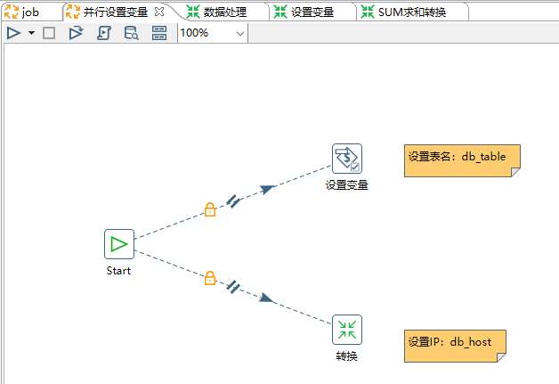

### <u>`设置变量`</u>作业项

`设置变量`作业项中，有`两`种方式设置变量：

1. 在属性文件中设置变量
2. 直接设置变量

我们选择第二种方式，直接设置变量 `db_table=course`

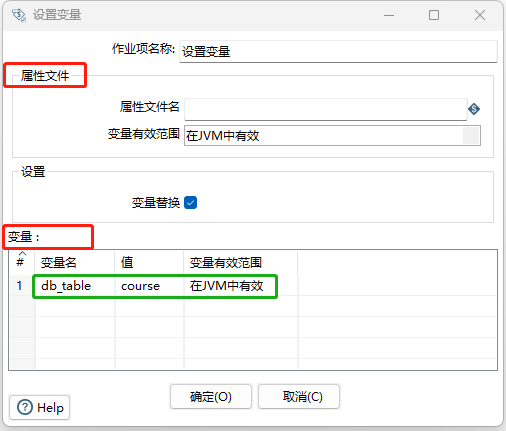

### <u>`设置变量`</u>转换

 创建转换，用来获取系统IP，并将该IP设置为变量，供数据处理转换中使用。此处我们将该转换命名为`设置变量`。

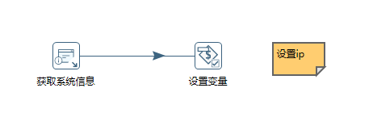

#### 获取系统信息

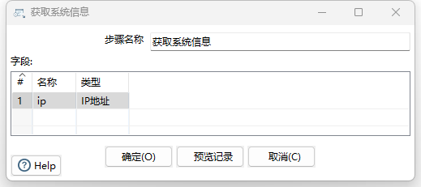

此处，我们将获取到的IP地址，命名为`ip`

#### 设置变量

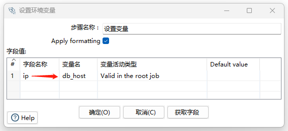

在`设置变量`步骤中，我们将上一步骤中获取的`ip`设置为变量，命名为`db_host`。


### 命名参数

在命名参数中定义数据库`用户名`和`密码`。在`画布空白处`单击`鼠标右键 `- `作业设置` - `命名参数` - `标签页`

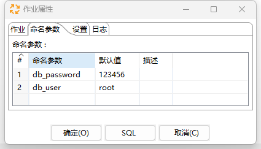

### 属性文件

在`kettle.properties`中定义变量

文件位置`C:\Users\Qingyuan_Qu\.kettle`

```shell
db_name=data_etl
```

定义变量后，记得重启`Kettle`，才能使变量生效。

### 引用

记得在`并行设置变量作业`中，通过`转换作业项`对刚才创建的`设置变量转换`进行引用。

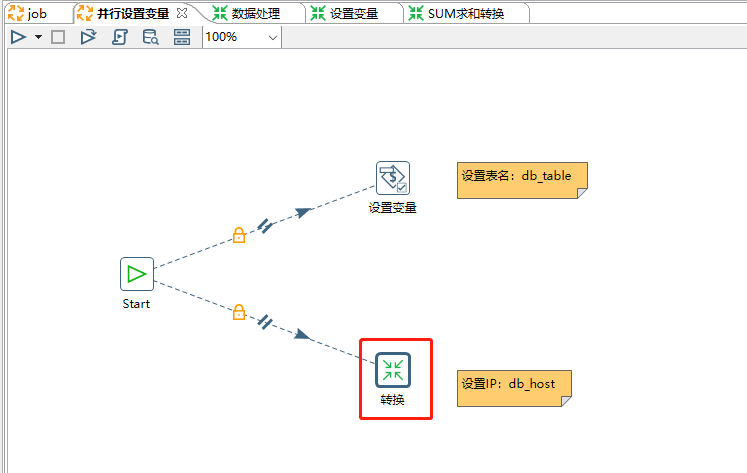

然后再`start`作业项上右键

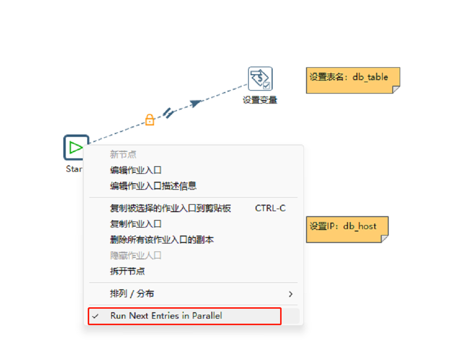

记得在`设置变量作业项`中对`并行设置变量作业`进行引用。

## 变量引用

同时安装键盘 `Ctrl + Alt  + 空格`选择预定义的变量。

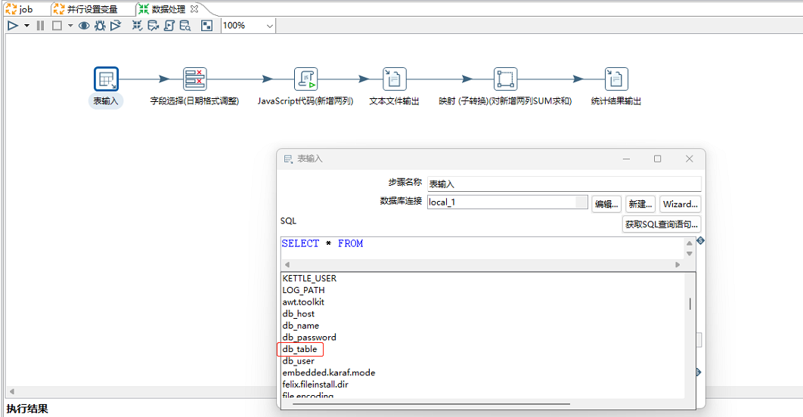

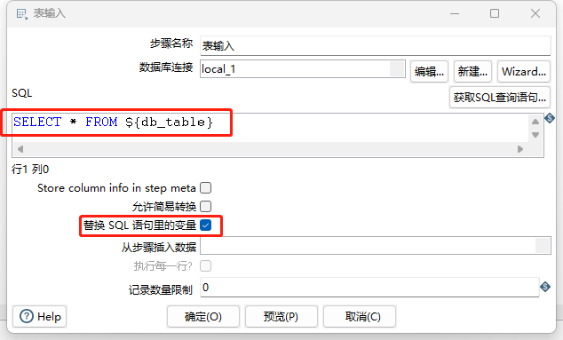

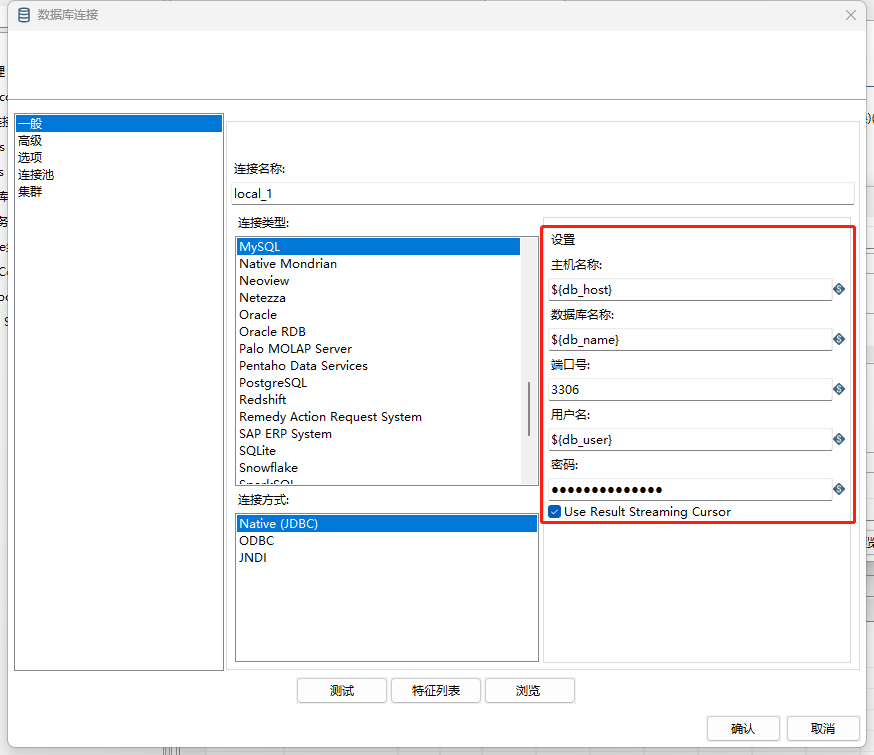

## 邮件通知作业项

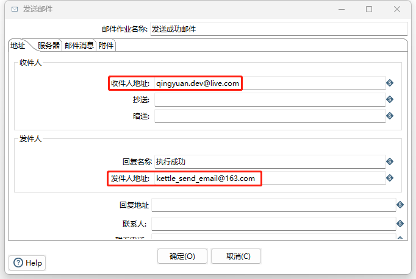

注意：下面的密码`不是`邮箱登录密码，而`是`邮箱`SMTP授权码`，需要在邮箱服务商网站获取。

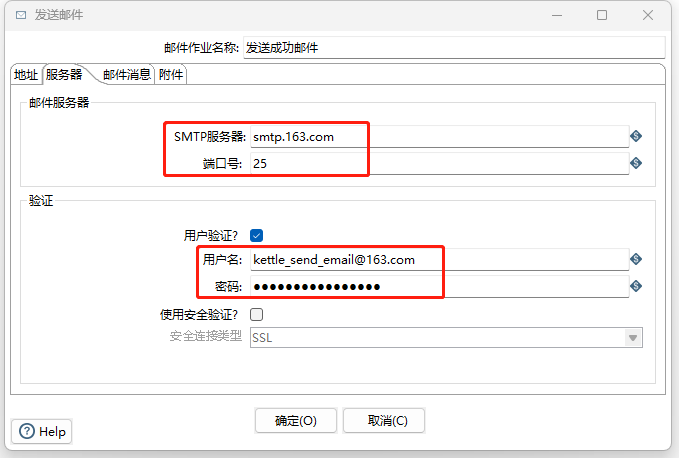

`发送失败邮件作业项`与此相似，不再赘述。


## 命令行启动

```powershell
# 首先进入kettle软件目录
PS D:\green-soft\pdi-ce-9.3.0.0-428\data-integration> cd D:\green-soft\pdi-ce-9.3.0.0-428\data-integration\

# 启动job作业
PS D:\green-soft\pdi-ce-9.3.0.0-428\data-integration> .\Kitchen.bat /file C:\job\job.kjb /level Debug /logfile C:\job\logs
```


## 附录

```sql
DROP TABLE IF EXISTS `course`;
CREATE TABLE `course` (
  `编号` int(11) NOT NULL,
  `课程名称` varchar(20) DEFAULT NULL,
  `课程大类` varchar(10) DEFAULT NULL,
  `学分` int(11) NOT NULL,
  `讲师` varchar(10) DEFAULT NULL,
  `开课时间` datetime DEFAULT NULL,
  `课时数` int(11) NOT NULL,
  PRIMARY KEY (`编号`),
  KEY `学分_index` (`学分`),
  KEY `课时数_index` (`课时数`)
) ENGINE=InnoDB DEFAULT CHARSET=utf8;

-- ----------------------------
-- Records of course
-- ----------------------------
INSERT INTO `course` VALUES ('1', '大数据导论', '基础课', '4', '张三', '2020-03-01 00:00:00', '64');
INSERT INTO `course` VALUES ('2', 'Hadoop大数据技术', '专业课', '4', '李四', '2020-03-02 00:00:00', '64');
INSERT INTO `course` VALUES ('3', '分布式数据库原理与应用', '专业课', '4', '张三', '2020-03-03 00:00:00', '64');
INSERT INTO `course` VALUES ('4', '数据导入与预处理应用', '专业课', '4', '李四', '2020-03-04 00:00:00', '0');
INSERT INTO `course` VALUES ('5', '数据挖掘技术与应用', '专业课', '4', '王五', '2020-03-05 00:00:00', '64');
INSERT INTO `course` VALUES ('6', null, '专业课', '4', '赵六', '2020-03-06 00:00:00', '64');
INSERT INTO `course` VALUES ('7', '大数据应用开发语言', '专业课', '4', '张三', '2020-03-07 00:00:00', '64');
INSERT INTO `course` VALUES ('8', '大数据分析与内存计算', '专业课', '4', '张三', '2020-03-08 00:00:00', '64');
INSERT INTO `course` VALUES ('9', null, '专业课', '4', '王五', '2020-03-09 00:00:00', '64');
INSERT INTO `course` VALUES ('10', null, '专业课', '4', '赵六', '2020-03-10 00:00:00', '64');
INSERT INTO `course` VALUES ('15', '数据库原理与应用', '专业课', '4', '赵六', '2020-03-11 00:00:00', '0');
```

