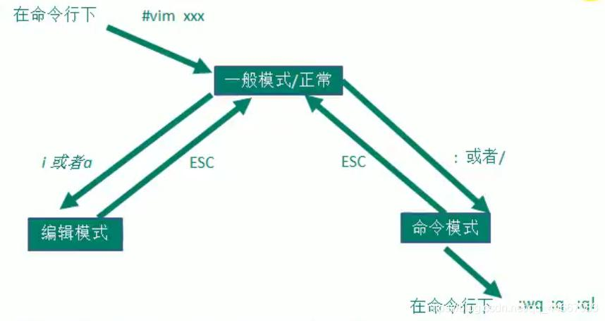

### VIM文本编辑器



>   /var/log/boot.log

#### vim创建文件

```shell
vim filename.txt
一般模式
插入模式
命令模式
```

#### vim打开文件

- `vim +3 hello.txt` :打开文件并定位到第三行

- `vim + hello.txt` :      定位到最后一行

- `vim +/string hello.txt`: 打开文件并定位到首次出现string的行

- `vim -d file1 file2`: 对比文件差异

#### vim退出

- `:q!` 退出不保存
- `:w` 保存
- `:wq` 保存并退出

#### Insert编辑模式

  进入编辑模式：**<A,a>  <I,i>  <o,O>**

#### Normal一般模式

  字符级：hjkl

  单词级：w（词首）e（词尾）b（返回上一个词的词首）

  行内：0（行首）^（行首）$（行尾）

  行间：gg（首行） G（末行） 5G（第5行）

  段头: (

  段尾：)

  翻屏：ctrl+f/b

  删除字符：x

  删除单词：dw  5dw

  删除行：dd 5dd

  复制：yy 3yy

  粘贴：p

  剪切：dd

  撤销：u (undo)

  全选：ggVG

  删除光标到光标所在行的行尾：d$

  删除光标到光标所在行的行首：d0  d^

  删除光标所在到第一行的所有数据：d1G

  删除光标所在到最后一行的所有数据：dG

##### 多行注释

  1,一般模式，Ctrl+v进入列选择模式

  2,jk上下移动选择需要注释的行

  3,shift+i, 进入插入模式,插入//或#号

  4,按ESC,多行注释完成

##### 删除多行注释

  1,ESC末行模式，Ctrl+v进入列选择模式

  2,jk上下移动选择需要注释的行,hl选择列

  3,d删除所选列

#### Command-line命令模式

##### 行号

```python
# 显示行号
:set nu 
:set number

# 取消行号
:set nonu
:set nonumber
```


##### 语法高亮

```python
:syntax on	# 开启
:syntax off 	# 关闭
```

>   需要根据内容给文件分配恰当的文件扩展名


##### 查找

以当前光标为参照点

-   向后查找，使用`/`，继续向后按`n`， 向前按`Shift+n`

-   向前查找，使用`?`，继续向前按`n`， 向后按`Shift+n`


##### 多行控制

  :m,n>(将第m行到第n行向右缩进一个制表符)

  :20,26< (将20-26行向左缩进一个制表符)

  :ctrl+v,配合jk上下移动


##### 命令模式下展示参数列表

```python
:set wildmode=longest:list
```

或者将其写入 vimrc文件


##### 命令模式下查看VIM自带的主题列表

```python
:colorscheme <Tab> #可展示自带主题列表
```


#### VIM配置文件

1.  系统配置文件：`/etc/vim/vimrc`，这个配置文件如果被更改，会影响所有的用户。

1.  用户配置文件：`~/.vimrc`，这个配置文件如果被更改，只会影响自己使用。

>   https://www.cnblogs.com/hawkboy/articles/2991371.html


