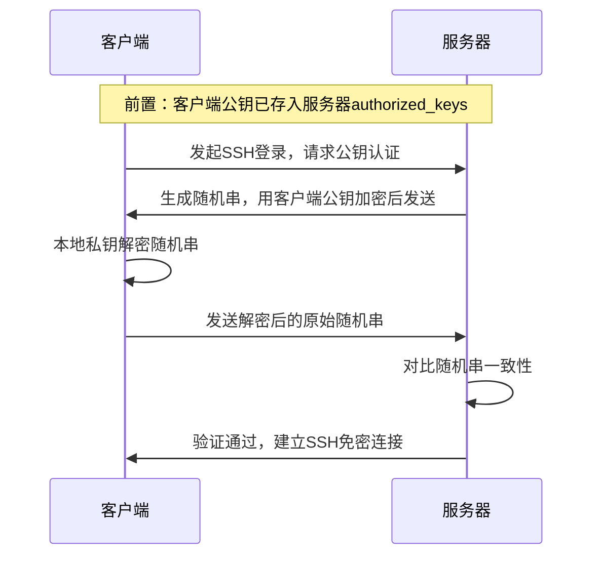

# SSH无密登录配置


Linux免密登录核心基于**非对称加密（公钥/私钥）** 机制，简单说就是「把公钥存在目标服务器，用本地私钥做身份验证」，全程无需输入密码。

### 核心原理
- 本地(`node1`)生成**一对密钥（公钥+私钥）**;

```bash
[zhangsan@node1 .ssh]$ ssh-keygen -t rsa
```

- 将(`node1`)**公钥**放到要免密登录的目标Linux服务器(`node2`)上（`~/.ssh/authorized_keys`）；

```bash
[zhangsan@node1 .ssh]$ ssh-copy-id node2
```

- `node1`登录`node2`时，

```
[zhangsan@node1 .ssh]$ ssh node2
```

本地用**私钥**加密一段随机信息发给服务器，服务器用已保存的**公钥**解密，验证通过后直接登录，全程无密码交互。

### 核心验证流程

Linux免密登录本质是**SSH协议的公钥认证方式**，替代了默认的密码认证，交互流程极简：
1. **本地发起请求**：客户端（本地）向目标服务器发送SSH登录请求，告知要使用公钥认证；
2. **服务器挑战验证**：服务器从本地公钥存放目录（`~/.ssh/authorized_keys`）查找对应客户端的公钥，若存在，生成一段**随机字符串**，用该公钥加密后发给客户端；
3. **客户端解密应答**：客户端收到加密字符串，用本地唯一的**私钥**解密，将解密后的字符串发回服务器；
4. **服务器确认登录**：服务器对比发出去的随机字符串和客户端发回的结果，一致则验证通过，直接建立连接（不一致则拒绝）。




### 关键细节（避坑必备）
1. **密钥的特性**
   - 公钥（`id_rsa.pub`）：**公开无风险**，可随意复制到任意目标服务器，仅用于加密；
   - 私钥（`id_rsa`）：**绝对保密**，仅存于本地客户端，不可泄露/传输，仅用于解密，泄露后他人可免密登录你的目标服务器。

2. **核心文件作用**
   - 本地：`~/.ssh/id_rsa`（私钥）、`~/.ssh/id_rsa.pub`（公钥），由`ssh-keygen`命令生成；
   - 目标服务器：`~/.ssh/authorized_keys`（公钥库），存放所有可免密登录该服务器的客户端公钥，一行一个公钥。

3. **权限要求（最易踩坑）**
   SSH协议对相关目录/文件权限有严格限制（防止被篡改），否则免密登录会失败：
   - 本地/服务器：`~/.ssh` 目录权限必须是 `700`（仅所有者可读可写可执行）；
   - 服务器：`authorized_keys` 文件权限必须是 `600`（仅所有者可读可写）；
   - 服务器：用户家目录（`~`）权限不能是 `777`（避免其他用户修改）。

### 免密登录的扩展
- 可给私钥设置**密码（passphrase）**：生成密钥时添加密码，本地首次使用私钥需输入一次，后续可通过`ssh-agent`缓存，既保证私钥安全，又不影响免密体验；
- 多机免密互通：集群场景下（如Hadoop/Spark集群），需将每台机器的公钥互相添加到其他机器的`authorized_keys`，实现集群内任意机器互登免密。
