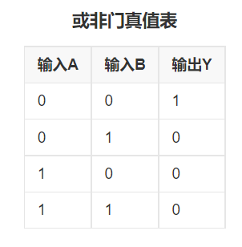

# MongoDB

## 1. 简介

略。

## 2. 导入、导出、查询数据

### 导入导出数据

需要安装`mongo database tools`，并把`$Tools/bin`目录加入`PATH`。

```shell
https://www.mongodb.com/try/download/database-tools
```

##### 准备示例数据（MongoDB Cloud）

`DEPLOYMENT -> Database -> Browse Collections -> load a Sample Dataset`

https://www.mongodb.com/docs/atlas/sample-data/#std-label-load-sample-data


##### BSON

操作粒度为`DataBase`或`Collection`。

##### 导出数据(cloud)

cloud.mongodb.com

```shell
PS C:\Users\Qingyuan_Qu> mongodump --uri "mongodb+srv://cluster0.0excx.mongodb.net/sample_supplies" --username quqingyuan
Enter password:

2022-05-17T10:25:34.205+0800    writing sample_supplies.sales to dump\sample_supplies\sales.bson
2022-05-17T10:25:35.099+0800    done dumping sample_supplies.sales (5000 documents)
```

##### 恢复数据(mongorestore)

```shell
PS C:\Users\Qingyuan_Qu> mongorestore.exe --host localhost:27017 --db sample_supplies --dir C:\Users\Qingyuan_Qu\dump\sample_supplies
```

可以添加一个`--drop`参数，在`restore`之前`drop`掉每个`Collection`。

##### 导出数据(mongodump)

```shell
PS C:\Users\Qingyuan_Qu> mongodump --host localhost:27017 --db sample_supplies
```


##### JSON

`操作粒度为Collection`

##### 导出数据(mongoexport)

```shell
PS C:\Users\Qingyuan_Qu> mongoexport --host 127.0.0.1:27017 --db sample_training --collection grades --out grades.json
```


##### 导入数据(mongoimport)

```shell
PS C:\Users\Qingyuan_Qu> mongoimport --host localhost:27017 --db mydb --collection grades --file grades.json
```

可以添加一个`--drop`参数，在`import`之前`drop`掉每个`Collection`。


 

### 查询命令

- 查询所有数据库 `show dbs`;
- 选择数据库`use sample_training`
- 查询所有集合`show collections`

```sql
> show dbs
sample_airbnb        52.38 MiB
sample_analytics      9.16 MiB
sample_geospatial     1.38 MiB
sample_guides        40.00 KiB
sample_mflix         49.00 MiB
sample_restaurants    6.59 MiB
sample_supplies       1.12 MiB
sample_training      54.51 MiB
sample_weatherdata    2.75 MiB
admin               280.00 KiB
local                 1.60 GiB

> use sample_training
'switched to db sample_training'

> show collections
companies
grades
inspections
posts
routes
trips
zips

> db.zips.find({state:'NY'})
```


#### 查询

提供其他方法来定位数据。 语法：`{ <field> : <value> }`


returns a cursor with documents that match the find query。

`find()`函数返回一个`游标(cursor)`。`游标(cursor)`默认自动`it(iterate)`迭代`20`次。

```shell
sample_training> db.zips.find({state:'NY'})
sample_training> it
```

##### it

 iterates through a cursor  

通过游标迭代。

##### cursor

 a pointer to a result set of a query

游标是一个指向查询结果集的指针。

##### pointer

a direct address of the memory location

指针是指向内存位置的直接地址。


##### 邮编查询例子

- 查询纽约州(`NY`)邮编个数(`zip`, `postal code`)

```shell
sample_training> db.zips.find({state:'NY'}).count()
1596
```

- 查询纽约州，奥尔巴尼市邮编个数

```shell
sample_training> db.zips.find({state:'NY',city:"ALBANY"}).count()
```

- 查询前`3`条

```shell
sample_training> db.zips.find().limit(3)
```

- 按人口排序

```shell
sample_training> db.zips.find().sort({"pop":1})
```

- 遍历

```json
sample_training> var cursor = db.zips.find({state:'NY',city:"ALBANY"})
sample_training> while(cursor.hasNext()){
var doc = cursor.next();
print(doc.state+"-"+doc.city);
}
```


##### 投影

`find( {filter}, {projection} )`

投影参数的`value`设置为1，选择该字段；设置为0，不选择该字段。

```json
sample_training> db.trips.find({"birth year":1961,"start station name": "Howard St & Centre St"},{_id:0,"end station name":1})
```


## 3.创建并操作文档

#### Insert

`insert([{},{},{}]) `

- 默认顺序插入，如果有Key重复，不再继续插入后面的数据；

`insert([{},{},{}], {ordered:false}) `

- 可传递第二个参数`{ordered:false}`，Key重复的数据不被插入，不重复的继续插入。

插入一个不存在的集合时，会自动创建该集合。

#### Delete

 略。


#### 更新操作符(Update Operator)

修改数据库中的数据。比如： `$inc`,  `$set`,  `$unset`，`$push`

`$inc`操作符使字段增加一个指定值，其形式如下：

`{ $inc: { <field1>: <amount1>, <field2>: <amount2>, ... } }`


`$set`操作符将字段的值替换为指定的值。

`{ $set: { <field1>: <value1>, ... } }`


`$unset`操作符删除一个特定的字段。

`{ $unset: { <field1>: "", ... } }`

如： `{ $unset: { population: ""} }`，value为  " " 不影响操作。


`$push`操作符将指定的值追加到数组中。

`{ $push: { <field1>: <value1>, ... } }`


`$pull`操作符从现有数组中删除一个或多个匹配指定条件的值的所有实例。

`{ $pull: { <field1>: <value|condition>, <field2>: <value|condition>, ... } }`


测试数据是城市邮编数据`zip`，其中`pop`字段值为城市人口，数据是几年前的数据，也就是意味着人口统计不准确。

```shell
myFirstDatabase> use sample_training
Atlas sample_training> db.zips.find()
```

我们查询一下`HUDSON`市的邮编信息，可以得到16条数据。

```shell
sample_training> db.zips.find({city:"HUDSON"})
```

接下来，我们更新每条数据的人口，让人口增加`10`人。

```javascript
sample_training> db.zips.updateMany({city:"HUDSON"}, {$inc:{pop:10}})
```


我们更新一下`zip`为`12534`的人口，设置为`17630`：

```javascript
sample_training> db.zips.updateOne({zip:'12534'},{$set:{population:'17630'}})
```

查询执行结果，发现我们新增了一个字段：

```javascript
  {
    _id: ObjectId("5c8eccc1caa187d17ca73239"),
    city: 'HUDSON',
    zip: '12534',
    loc: { y: 42.246978, x: 73.755248 },
    pop: 21215, //应该更新的字段
    state: 'NY',
    population: '17630' //结果新增了一个字段
  }
```

再次更新人口数量：

```javascript
sample_training> db.zips.updateOne({zip:'12534'},{$set:{pop:'17630'}})
```

删除`population`字段：

```shell
sample_training> db.zips.updateOne({zip:'12534'},{$unset:{population:''}})
```


查询集合`grades`中， `class_id`为`339`，`student_id`为`151`的学生成绩。

```javascript
sample_training> db.grades.find({"student_id":151, "class_id":339})
```

然后我们给这个学生增加一个类型`type`为`extra credit`的成绩，`score`为`100`。

```javascript
sample_training> db.grades.updateOne({"student_id":151, "class_id":339},{$push:{scores:{type:'extra credit-1',score:200}}})
```

可再次查询该学生的成绩。

如果我们想把刚才插入的成绩删除：

```javascript
sample_training> db.grades.updateOne({"student_id":151, "class_id":339},{$pull:{scores:{type:'extra credit-1',score:200}}})
```


## 4. 高级CRUD操作

#### 比较操作符(Comparison Operators)

比较操作符允许我们查找某个范围的数据。 语法：`{ <field> : { <operator> : <value> } }`

| 等于  | 不等于 | 大于  | 小于  | 大于等于 | 小于等于 |
| ----- | ------ | ----- | ----- | -------- | -------- |
| `$eq` | `$ne`  | `$gt` | `$lt` | `$gte`   | `$lte`   |


#### 案例

使用`sample_training`数据库中的`trips`集合进行实验。`trips`是纽约自行车租赁公司提供的开源数据样本。

```json
  {
    _id: ObjectId("572bb8222b288919b68abf6d"),
    tripduration: 858,//骑行时间单位为秒
    'start station id': 532, 
    'start station name': 'S 5 Pl & S 4 St',
    'end station id': 401,
    'end station name': 'Allen St & Rivington St',
    bikeid: 17057,
    usertype: 'Customer',
    'birth year': '',
    'start station location': { type: 'Point', coordinates: [ -73.960876, 40.710451 ] },
    'end station location': { type: 'Point', coordinates: [ -73.98997825, 40.72019576 ] },
    'start time': ISODate("2016-01-01T00:09:31.000Z"),
    'stop time': ISODate("2016-01-01T00:23:49.000Z")
  }
```


查询骑行时间`tripduration<=1min`的旅行。

```shell
{
  tripduration: {
    $lte: 60
  }
}
```

查询骑行时间`tripduration<=70s`的旅行，并统计一下旅行次数。

```shell
{
  tripduration: {
    $lt: 70
  }
}
```

可以看到，总共有`10`次旅行的骑行时间`<=70s`，其中大部分都是会员用户。接下来，我们统计一下这些用户中有多少没有开会员。

```shell
{
  tripduration: {
    $lte: 70
  },
  usertype: {
    $eq: 'Customer'
  }
}
```

可以看到`骑行时间小于等于70s`且`不是会员`的用户只有一个。且他的`出发站点`和`结束站点`是同一个站点，是不是车子坏了。。。

此查询条件`{tripduration:{$lte:70},usertype:{$eq:'Customer'}}`中的`$eq`是默认值，我们可以省略为`{tripduration:{$lte:70},usertype:'Customer'}`。

在以上练习中，我们使用`单列比较`和`多列比较`查询`集合`中符合条件的文档（`元组`）。


#### 实验1

使用`sample_training`数据库中的`zips`集合进行实验。`zips`中存储了美帝的邮编信息。

查询一下有多少个文档的`pop`字段值`<1000`。

```shell
{
  pop: {
    $lt: 1000
  }
}
```

#### 实验2

统计`trips`集合中`1998`年出生的人数。

```shell
{
  "birth year": 1998
}
```

统计`trips`集合中`1998`年后出生的人数。

```shell
{
  "birth year": {
    $gt: 1998
  }
}
```


#### 实验3

截至 2014 年 6 月，OpenFlights/Airline Route Mapper 航线数据库包含全球`548`家航空公司的`3321`个机场之间的`67663`条航线。https://openflights.org/data.html

```json
{
    _id: ObjectId("56e9b39b732b6122f877fc57"),
    airline: { id: 9818, name: 'Air Arabia Maroc', alias: '3O', iata: '\\N' },
    src_airport: 'TNG',
    dst_airport: 'BRU',
    codeshare: '',
    stops: 0,//	Number of stops on this flight ("0" for direct)
    airplane: 320
}
```

查询经停次数大于0的航线。

```shell
{
  stops: {
    $gt: 0
  }
}
```


### 课程 - 查询操作符 - 逻辑

| 与     | 或    | 非     | 或非   |
| ------ | ----- | ------ | ------ |
| `$and` | `$or` | `$not` | `$nor` |

**与、或、或非：** `{ <operator> : [ {clause1}, {clause2}, ... ] }`

**非：** `{ $not : {clause} }`



`inspections`集合的数据来自 [NYC OpenData](https://opendata.cityofnewyork.us/) 。每个文档包含以下信息:`被检查企业名称`、`部门`和`地址`、`检查id`、`结果`、`日期`和`证书号码`。

```json
  {
    _id: ObjectId("56d61033a378eccde8a8354f"),
    id: '10021-2015-ENFO',
    certificate_number: 9278806,
    business_name: 'ATLIXCO DELI GROCERY INC.',
    date: 'Feb 20 2015',
    result: 'No Violation Issued',
    sector: 'Cigarette Retail Dealer - 127',
    address: {
      city: 'RIDGEWOOD',
      zip: 11385,
      street: 'MENAHAN ST',
      number: 1712
    }
  }
```


#### $nor

```shell
{
  $nor: [
    {
      result: "No Violation Issued"
    },
    {
      result: "Violation Issued"
    }
  ]
}
```


```shell
{
  $nor: [
    {
      result: "No Violation Issued"
    },
    {
      result: "Violation Issued"
    },
    {
      result: "Pass"
    },
    {
      result: "Fail"
    }
  ]
}
```


#### $and

##### 案例1

查询`sector="Mobile Food Vendor - 881"`,  `result= "Warning"`的文档（元组），我们之前都这么写：

```shell
{
  sector: "Mobile Food Vendor - 881",
  result: "Warning"
}
```

其实，上述语句我们省略了`$and:[ ]`逻辑运算符。

```shell
{
  $and: [
    {
      sector: "Mobile Food Vendor - 881",
      result: "Warning"
    }
  ]
}
```


##### 案例2

查询`grades`集合中，`student_id>25` 且 `student_id<100` 的元组。

```shell
{
  $and: [
    {
      student_id: {
        $gt: 25
      }
    },
    {
      student_id: {
        $lt: 100
      }
    }
  ]
}
```

可以简写为：

```shell
{
  student_id: {
    $gt: 25,
    $lt: 100
  }
}
```


##### 案例3

使用`routes`集合找出有多少`CR2`和`A81`飞机穿越了`KZN`机场。

```json
{
  $and: [
    {
      $or: [
        {
          airplane: 'CR2'
        },
        {
          airplane: 'A81'
        }
      ]
    },
    {
      $or: [
        {
          src_airport: 'KZN'
        },
        {
          dst_airport: 'KZN'
        }
      ]
    }
  ]
}
```


##### 测验1

商业检查(`inspections`)集合(`collection`)中有多少企业(`businesses `)的检查结果(`result`)为`Out of Business`，且行业(`sector`)属于`Home Improvement Contractor - 100`。

```shell
{
  $and: [
    {
      result: {
        $eq: 'Out of Business'
      }
    },
    {
      sector: {
        $eq: 'Home Improvement Contractor - 100'
      }
    }
  ]
}
```

或省略`$eq`：

```shell
{
  $and: [
    {
      result: 'Out of Business'
    },
    {
      sector: 'Home Improvement Contractor - 100'
    }
  ]
}
```

或省略`$and`：

````shell
{
  result: 'Out of Business',
  sector: 'Home Improvement Contractor - 100'
}
````


## 5. 索引

##### 创建索引

```json
sample_training> db.zips.createIndex({city:1})
city_1
```

```json
sample_training> db.zips.find({city:'ALPINE'}).explain()
{
  explainVersion: '1',
  queryPlanner: {
    namespace: 'sample_training.zips',
    indexFilterSet: false,
    parsedQuery: { city: { '$eq': 'ALPINE' } },
    maxIndexedOrSolutionsReached: false,
    maxIndexedAndSolutionsReached: false,
    maxScansToExplodeReached: false,
    winningPlan: {
      stage: 'FETCH',
      inputStage: {
        stage: 'IXSCAN',//查询方式，常见的有COLLSCAN/全表扫描、IXSCAN/索引扫描、FETCH/根据索引去检索文档、SHARD_MERGE/合并分片结果、IDHACK/针对_id进行查询
        keyPattern: { city: 1 },
        indexName: 'city_1',//索引名
        isMultiKey: false,
        multiKeyPaths: { city: [] },
        isUnique: false,
        isSparse: false,
        isPartial: false,
        indexVersion: 2,
        direction: 'forward',
        indexBounds: { city: [ '["ALPINE", "ALPINE"]' ] }
      }
    },
    rejectedPlans: []
  },
  command: {
    find: 'zips',
    filter: { city: 'ALPINE' },
    '$db': 'sample_training'
  },
  serverInfo: {
    host: 'honor',
    port: 27017,
    version: '5.0.8',
    gitVersion: 'c87e1c23421bf79614baf500fda6622bd90f674e'
  },
  serverParameters: {
    internalQueryFacetBufferSizeBytes: 104857600,
    internalQueryFacetMaxOutputDocSizeBytes: 104857600,
    internalLookupStageIntermediateDocumentMaxSizeBytes: 104857600,
    internalDocumentSourceGroupMaxMemoryBytes: 104857600,
    internalQueryMaxBlockingSortMemoryUsageBytes: 104857600,
    internalQueryProhibitBlockingMergeOnMongoS: 0,
    internalQueryMaxAddToSetBytes: 104857600,
    internalDocumentSourceSetWindowFieldsMaxMemoryBytes: 104857600
  },
  ok: 1
}
```

##### 查看索引

```json
sample_training> db.zips.getIndexes()
[
  { v: 2, key: { _id: 1 }, name: '_id_' },
  { v: 2, key: { city: 1 }, name: 'city_1' }
]
```

##### 索引大小

```
sample_training> db.zips.totalIndexSize()
684032
```

##### 删除索引

```json
sample_training> db.zips.dropIndex({city:-1})
MongoshInternalError: can't find index with key: { city: -1 }

sample_training> db.zips.dropIndex({city:1})
{ nIndexesWas: 3, ok: 1 }
```

##### 删除所有索引

除_id唯一索引都被删除。

```json
sample_training> db.zips.dropIndexes()
{
  nIndexesWas: 2,
  msg: 'non-_id indexes dropped for collection',
  ok: 1
}
```

##### 复合索引

```json
sample_training> db.zips.createIndex({state:1,city:1})
state_1_city_1
sample_training> db.zips.getIndexes()
[
  { v: 2, key: { _id: 1 }, name: '_id_' },
  { v: 2, key: { state: 1, city: 1 }, name: 'state_1_city_1' }
]
```

##### 多键值索引

```json
sample_training> db.grades.createIndex({scores:1})
scores_1
```

