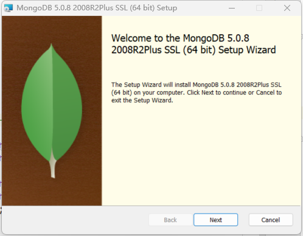
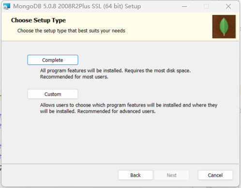
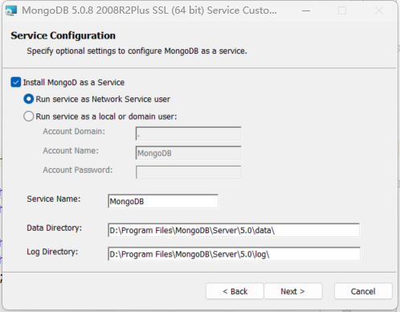
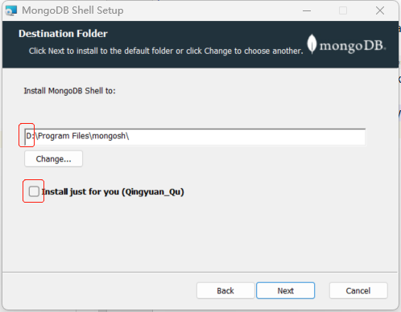

# Windows

### 下载

https://www.mongodb.com/try/download/community

### install-mongodb-on-windows

https://www.mongodb.com/docs/manual/tutorial/install-mongodb-on-windows/










### Install `mongosh`

https://www.mongodb.com/try/download/shell



### 连接MongoDB

https://www.mongodb.com/docs/mongodb-shell/connect/#std-label-mdb-shell-connect

默认端口`27017`

##### 连接本地`Server`

```shell
PS C:\Users\Qingyuan_Qu> mongosh
Current Mongosh Log ID: 62708c7078e29ade98bc9a22
Connecting to:          mongodb://127.0.0.1:27017/?directConnection=true&serverSelectionTimeoutMS=2000&appName=mongosh+1.3.1
Using MongoDB:          5.0.8
Using Mongosh:          1.3.1
```


##### 连接远程`Server`

在MongoDB官网创建Serverhttps://cloud.mongodb.com/v2/6282ff0bc14e6e66f7e35b2b#clusters

```shell
PS C:\Users\Qingyuan_Qu> mongosh "mongodb+srv://cluster0.0excx.mongodb.net/myFirstDatabase" --apiVersion 1 --username quqingyuan
Enter password: **********
Current Mongosh Log ID: 6283008702ad5651115e0c21
Connecting to:          mongodb+srv://cluster0.0excx.mongodb.net/myFirstDatabase?appName=mongosh+1.3.1
Using MongoDB:          5.0.8 (API Version 1)
Using Mongosh:          1.3.1

For mongosh info see: https://docs.mongodb.com/mongodb-shell/

Atlas atlas-wighfk-shard-0 [primary] myFirstDatabase> show dbs;
admin   287 kB
local  1.76 GB
Atlas atlas-wighfk-shard-0 [primary] myFirstDatabase>
```


# Linux

```http
# MongoDB支持YUM、RPM、压缩包等方式进行安装。此文档通过YUM方式安装。
https://www.mongodb.com/docs/manual/tutorial/install-mongodb-on-red-hat/
```

#### 下载

```http
# 下载Centos7, tgz
https://www.mongodb.com/try/download/community
```

#### 安装

```shell
(python37) [zhangsan@node0 bigdata]$ mkdir mongodb

# 上传到安装目录
# 解压
# 软连接
# 略
```


##### 软件目录结构

```shell
(python37) [zhangsan@node0 bin]$ ll -h
-rwxr-xr-x. 1 zhangsan zhangsan  15K Apr 22 05:15 install_compass 
-rwxr-xr-x. 1 zhangsan zhangsan  56M Apr 22 06:01 mongo  # Client
-rwxr-xr-x. 1 zhangsan zhangsan 105M Apr 22 06:02 mongod  # Server
-rwxr-xr-x. 1 zhangsan zhangsan  73M Apr 22 05:40 mongos  # Router
```

#### 启动

##### mongod命令介绍

查看`mongod`帮助：`mongod -h`

```shell
--logpath arg
# Log file to send write to instead of stdout - has to be a file, not directory
# (指定记录日志的文件，不要指定文件夹！)

--dbpath arg                          
# Directory for datafiles - defaults to /data/db
#（指定文件夹存储数据。默认/data/db）

--fork
# Fork server process
#（fork一个服务（子）进程，fork成功后，本（父）进程退出。）

--bind_ip_all
# 允许所有ip访问Server
```


在`$MONGODB_HOME`中创建一个日志(`logs`)存放目录和数据(`data`)存放目录。

```shell
(python37) [zhangsan@node0 default]$ mkdir data
(python37) [zhangsan@node0 default]$ mkdir logs
```


##### 服务端启动

```shell
(python37) [zhangsan@node0 default]$ bin/mongod --fork --dbpath data/ --logpath logs/log
about to fork child process, waiting until server is ready for connections.
forked process: 3415
child process started successfully, parent exiting
```

##### 客户端连接

```shell
(python37) [zhangsan@node0 default]$ bin/mongo
```


### 停止服务器

```shell
> use admin
switched to db admin
> db.shutdownServer()
server should be down...
> exit
bye
```


# 副本集

相当于`HDFS`的`Replication`

```http
https://www.mongodb.com/docs/manual/tutorial/deploy-replica-set/
```


##### 配置文件

MongoDB [配置文件](https://www.mongodb.com/docs/manual/reference/configuration-options/)使用[YAML](http://www.yaml.org/)格式 [[ 1 \]](https://www.mongodb.com/docs/manual/reference/configuration-options/#footnote-yaml-json)。

`mongod.yaml`

```yaml
systemLog:
   destination: file
   path: "/opt/bigdata/mongodb/default/logs/mongod.log"
storage:
   dbPath: "/opt/bigdata/mongodb/default/data/"
processManagement:
   fork: true
net:
   bindIp: 0.0.0.0
   port: 27017
replication:
   replSetName: "rs0"
```

如果允许任意`IP`地址访问，请输入`0.0.0.0`。

##### 启动

```shell
bin/mongod --config conf/mongod.yaml
```

##### 初始化

进入客户端 `bin/mongo`。

```shell
var init_config = {
   _id : "rs0",
   members: [
      { _id: 0, host: "node1:27017" },
      { _id: 1, host: "node2:27017" },
      { _id: 2, host: "node3:27017" }
   ]
}
rs.initiate(init_config)
```

##### 确定主从

```javascript
rs.status()
```

##### 从节点访问

```javascript
rs0:SECONDARY> rs.secondaryOk()
```


##### 主节点离线

`Kill`掉`Primary`，查看副本集集群状态。

# 分片集群

分片介绍：

```http
https://www.mongodb.com/docs/manual/sharding/
```

部署分片集群

```http
https://www.mongodb.com/docs/manual/tutorial/deploy-shard-cluster/
```

## [概述](https://www.mongodb.com/docs/manual/tutorial/deploy-shard-cluster/#overview)

本教程涉及创建一个新的分片集群，该集群由三个 [`mongos`](https://www.mongodb.com/docs/manual/reference/program/mongos/#mongodb-binary-bin.mongos)配置服务器副本集和两个分片副本集组成。

## [步骤](https://www.mongodb.com/docs/manual/tutorial/deploy-shard-cluster/#procedure)

### [创建 Config Server Replica Set](https://www.mongodb.com/docs/manual/tutorial/deploy-shard-cluster/#create-the-config-server-replica-set)

#### 1. [启动config server副本集中的每个成员](https://www.mongodb.com/docs/manual/tutorial/deploy-shard-cluster/#start-each-member-of-the-config-server-replica-set)

##### 配置文件

`vim conf/config-server.yaml`

```yaml
systemLog:
   destination: file
   path: "/opt/bigdata/mongodb/default/logs/config-server.log"
storage:
   dbPath: "/opt/bigdata/mongodb/default/data/configdb"
sharding:
  clusterRole: configsvr
replication:
  replSetName: myConfigReplSet
net:
   bindIp: 0.0.0.0
   port: 27019
processManagement:
   fork: true
```

创建文件夹`configdb`、`data/configdb`、`logs`。

##### 启动

```shell
bin/mongod --config conf/config-server.yaml
```

#### 2. [连接其中一个 config server](https://www.mongodb.com/docs/manual/tutorial/deploy-shard-cluster/#connect-to-one-of-the-config-servers)

```shell
$ bin/mongo --host node1 --port 27019
```

#### 3.[ 初始化副本集](https://www.mongodb.com/docs/manual/tutorial/deploy-shard-cluster/#initiate-the-replica-set)

```json
var config_server = {
    _id: "myConfigReplSet",
    configsvr: true,
    members: [
      { _id : 0, host : "node1:27019" },
      { _id : 1, host : "node2:27019" },
      { _id : 2, host : "node3:27019" }
    ]
}
rs.initiate(config_server)
```

##### 确定主从

```shell
myReplSet:PRIMARY> rs.status()
# "configsvr" : true,
```

此时，配置服务器副本集中会创建三个数据库：`admin`，`config`，`local`。

### [创建Shard Replica Sets](https://www.mongodb.com/docs/manual/tutorial/deploy-shard-cluster/#create-the-shard-replica-sets)

#### 1. [启动shard副本集中的每个成员](https://www.mongodb.com/docs/manual/tutorial/deploy-shard-cluster/#start-each-member-of-the-shard-replica-set)

##### 配置文件

`shard-server.yaml`

```yaml
systemLog:
    destination: file
    path: "/opt/bigdata/mongodb/default/logs/shard-server.log"
storage:
    dbPath: "/opt/bigdata/mongodb/default/data/sharddb"
sharding:
    clusterRole: shardsvr
replication:
    replSetName: myShardReplSet
net:
    bindIp: 0.0.0.0
    port: 27018
processManagement:
    fork: true
```

创建文件夹。

```shell
(python37) [zhangsan@node1 default]$ mkdir data/sharddb
```


##### 启动

```
bin/mongod --config conf/shard-server.yaml
```


#### 2. [连接其中一台shard replica set](https://www.mongodb.com/docs/manual/tutorial/deploy-shard-cluster/#connect-to-one-member-of-the-shard-replica-set)

```shell
bin/mongo --host node1 --port 27018
```

#### 3. [初始化副本集](https://www.mongodb.com/docs/manual/tutorial/deploy-shard-cluster/#initiate-the-replica-set-1)

```json
var shard_server = {
    _id : "myShardReplSet",
    members: [
        { _id : 0, host : "node1:27018" },
        { _id : 1, host : "node2:27018" },
        { _id : 2, host : "node3:27018" }
    ]
}
rs.initiate(shard_server)
```

##### 确定主从

```shell
myReplSet:SECONDARY> rs.status()
```


### [启动一个路由服务 `mongos`](https://www.mongodb.com/docs/manual/tutorial/deploy-shard-cluster/#start-a-mongos-for-the-sharded-cluster)

##### 配置文件

`vim conf/router-server.yaml`

```yaml
systemLog:
	destination: file
	path: "/opt/bigdata/mongodb/default/logs/router-server.log"
sharding:
	configDB: myConfigReplSet/node1:27019,node2:27019,node3:27019
net: 
	bindIp: 0.0.0.0
	port: 27017
processManagement:
	fork: true
```


##### 启动mongos

```shell
bin/mongos --config conf/router-server.yaml
```


### [连接分片集群](https://www.mongodb.com/docs/manual/tutorial/deploy-shard-cluster/#connect-to-the-sharded-cluster)

```shell
bin/mongo --host node1 --port 27017
```

```shell
mongos> show dbs;
```


### [添加分片到集群](https://www.mongodb.com/docs/manual/tutorial/deploy-shard-cluster/#add-shards-to-the-cluster)

```shell
mongos> sh.addShard( "myShardReplSet/node1:27018,node2:27018,node3:27018")
```

重复这些步骤，直到集群包含所有所需的碎片。


### [为数据库启用分片](https://www.mongodb.com/docs/manual/tutorial/deploy-shard-cluster/#enable-sharding-for-a-database)

```shell
mongos> use mydb;

mongos> sh.enableSharding("mydb")
{
	"ok" : 1,
	"$clusterTime" : {
		"clusterTime" : Timestamp(1653368824, 4),
		"signature" : {
			"hash" : BinData(0,"AAAAAAAAAAAAAAAAAAAAAAAAAAA="),
			"keyId" : NumberLong(0)
		}
	},
	"operationTime" : Timestamp(1653368824, 2)
}
```

一旦为一个数据库启用了分片，MongoDB就会为该数据库分配一个[主分片](https://www.mongodb.com/docs/manual/reference/glossary/#std-term-primary-shard)，MongoDB将所有数据存储在该数据库中。


### [对集合分片](https://www.mongodb.com/docs/manual/tutorial/deploy-shard-cluster/#shard-a-collection)

> 在对`Collection`进行分片之前，必须首先为`Collection` 所在的`Database`启用分片。

要对`Collection` 进行分片，请将`mongosh`连接到`mongos`，使用`sh.shardCollection()`方法操作。

`MongoDB`提供了两种策略对`Collection` 进行分片。

- [Hashed sharding](https://www.mongodb.com/docs/manual/core/hashed-sharding/#std-label-sharding-hashed) 

散列分片使用单个字段的散列索引作为分片键，跨分片集群对数据进行分区。

```shell
#sh.shardCollection("<database>.<collection>", { <shard key field> : "hashed" } )
```


例子：

```javascript
sh.shardCollection("mydb.hashedShardColl", { code : "hashed" })
for(var i =1;i<=100;i++){db.hashedShardColl.insertOne({code:i})}
db.hashedShardColl.getShardDistribution()
```


- [Range-based sharding](https://www.mongodb.com/docs/manual/core/ranged-sharding/#std-label-sharding-ranged)

基于范围的分片可以使用多个字段作为shard key，根据shard key的值将数据划分为连续的范围。

```shell
sh.shardCollection("<database>.<collection>", { <shard key field> : 1, ... } )
```

例子：

```javascript
sh.shardCollection("mydb.rangeBasedShardColl", { code : 1 })
for(var i =1;i<=100;i++){db.rangeBasedShardColl.insertOne({code:i})}
db.rangeBasedShardColl.getShardDistribution()
```


### 分片集群状态	

```javascript
use config;
db.databases.find()
db.shards.find()
db.chunks.find()


sh.status()
db.hashedShardColl.getShardDistribution()

```


### [新增Shard Replica Sets](https://www.mongodb.com/docs/manual/tutorial/deploy-shard-cluster/#create-the-shard-replica-sets)

略。


# 可视化管理

### compass

```http
https://www.mongodb.com/try/download/compass?tck=docs_compass
```

# WSL-MongoDB

```http
https://docs.microsoft.com/zh-cn/windows/wsl/tutorials/wsl-database#install-mongodb
```

