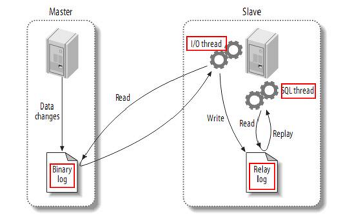
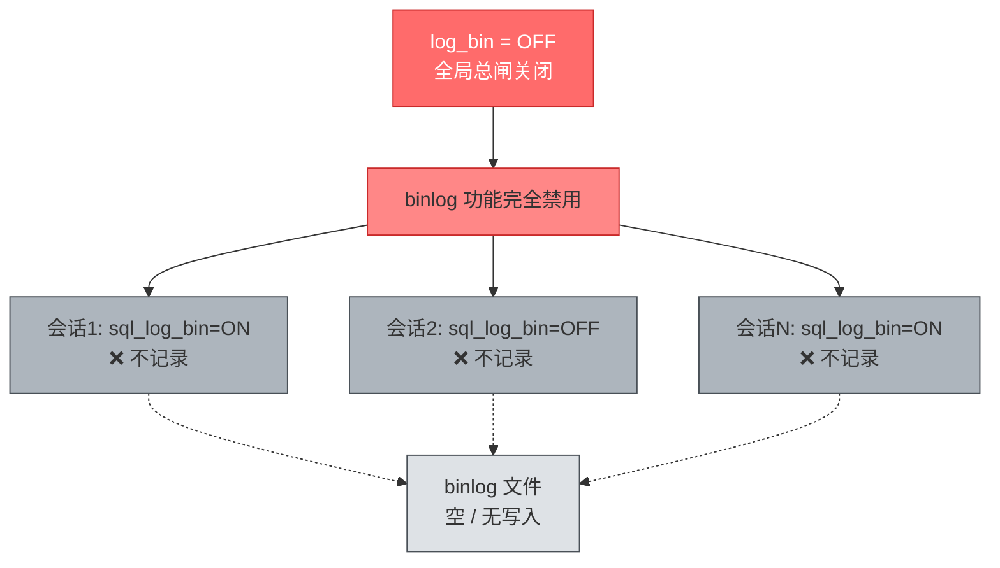
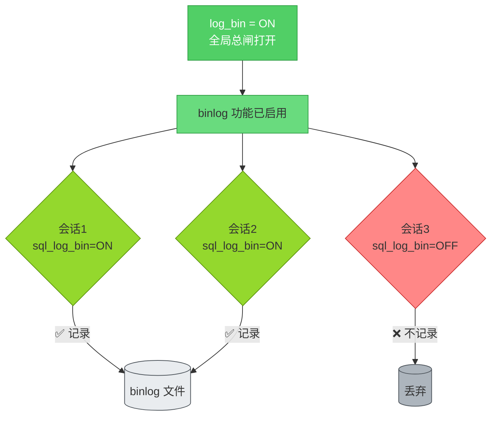

---
动手实践
观察现象
总结经验
---


# MySQL BinLog

## BinLog简介

二进制日志（Binlog）是 MySQL 服务端非常重要的一种日志，它会保存 MySQL 数据库的所有数据变更记录到日志文件中。

记录所有对数据库执行的 **写操作**（INSERT、UPDATE、DELETE、DDL 等），不记录 SELECT 和 SHOW 操作。

### Binlog 的三大作用

| 作用         | 说明                               |
| ------------ | ---------------------------------- |
| **主从复制** | Slave 节点重放 Binlog 实现数据同步 |
| **数据恢复** | 基于某个时间点或位置恢复数据       |
| **增量备份** | 结合全量备份实现增量备份策略       |

### 主从复制流程



1. Master 主库将数据变更写入二进制日志（binary log）
2. Slave 从库向 Master 发送 dump 协议，拷贝 binary log events 到中继日志（relay log）
3. Slave 从库读取并回放中继日志，同步数据到自身库

### BinLog格式

binlog_format

| 格式      | 记录内容   | 核心特点                   |
| --------- | ---------- | -------------------------- |
| **Row**   | 数据行变更 | 主从绝对一致，日志量大     |
| Statement | SQL 语句   | 日志量小，可能有一致性问题 |
| Mixed     | 自动切换   | 折中方案，自动判断         |

假设某SQL操作语句，刚好命中 **3 行**。

```sql
UPDATE user SET age = age + 1 WHERE department = 'tech';
```


#### ROW 模式

ROW模式不是记 SQL，是记 3 组行变化：

```bash
1. 第1行：
   - 旧：id=1, age=24
   - 新：id=1, age=25
2. 第2行：
   - 旧：id=3, age=29
   - 新：id=3, age=30
3. 第3行：
   - 旧：id=7, age=27
   - 新：id=7, age=28
```


#### STATEMENT模式

```sql
UPDATE user SET age = age + 1 WHERE department = 'tech';
```

不管影响 1 行还是 10000 行，Statement都只存这一条字符串。


#### Mixed模式

Mixed = 混合模式：MySQL 自动在 STATEMENT 和 ROW 之间切换，取两者优点。

核心规则

1. 安全语句（无不确定函数、无触发器/存储过程）  
   → 用 STATEMENT，只记 SQL，日志小。
2. 不安全语句（含 `NOW()`/`RAND()`/`UUID()`、存储过程、触发器、无 ORDER BY 的 LIMIT 等）  
   → 自动切 ROW，按行记录，保证主从一致。

#### 总结

- **ROW：按行记，影响几行就几条变更，更安全、但日志更大**
- **STATEMENT：按语句记，一条 SQL 只存一次**
- **Mixed：自动选，安全 + 省空间**
- **MySQL 5.7/8.0 默认已是 ROW，Mixed 多为老版本兼容使用。**


### 查询Binlog状态

```mysql
mysql> show variables like '%log_bin%';
+---------------------------------+-------+
| Variable_name                   | Value |
+---------------------------------+-------+
| log_bin                         | OFF   |
| log_bin_basename                |       |
| log_bin_index                   |       |
| log_bin_trust_function_creators | OFF   |
| log_bin_use_v1_row_events       | OFF   |
| sql_log_bin                     | ON    |
+---------------------------------+-------+
6 rows in set (0.00 sec)
```

- **`log_bin`** 是总闸，控制整个功能是否开启
- **`sql_log_bin`** 是分闸，只在总闸开启时才有意义

#### 情况一：`log_bin = OFF`（总闸关闭）



#### 情况二：`log_bin = ON`（总闸打开）




```mysql
-- 当前会话临时关闭
SET sql_log_bin = OFF;

-- 执行敏感操作（不记录到 binlog）
... ... 

-- 恢复记录
SET sql_log_bin = ON;
```

---


## BinLog操作实践

### 准备实验数据

```sql
CREATE DATABASE binlog_db
CHARACTER SET utf8mb4
COLLATE utf8mb4_unicode_ci;

use binlog_db;

DROP TABLE IF EXISTS `student`;
CREATE TABLE `student` (
  `学号` int(255) NOT NULL AUTO_INCREMENT,
  `姓名` varchar(255) DEFAULT NULL,
  `性别` varchar(255) DEFAULT NULL,
  `班级` varchar(255) DEFAULT NULL,
  `年龄` varchar(255) DEFAULT NULL,
  `成绩` varchar(255) DEFAULT NULL,
  `身高` varchar(255) DEFAULT NULL,
  `手机` varchar(255) DEFAULT NULL,
  `插入时间` varchar(255) DEFAULT NULL,
  `更新时间` varchar(255) DEFAULT NULL,
  PRIMARY KEY (`学号`)
) ENGINE=InnoDB AUTO_INCREMENT=4 DEFAULT CHARSET=utf8 ROW_FORMAT=DYNAMIC;

-- ----------------------------
-- Records of student
-- ----------------------------
INSERT INTO `student` VALUES ('1', '张三', '男', '1701', '16', '78', '170', '18946554571', '2022-08-06', '2022-08-06');
INSERT INTO `student` VALUES ('2', '李四', '男', '1701', '17', '80', '175', '18946554572', '2022-08-06', '2022-08-06');
INSERT INTO `student` VALUES ('3', '王五', '男', '1702', '18', '95', '169', '18946554573', '2022-08-06', '2022-08-06');
```

查询创建结果。

```mysql
mysql> select * from student;
+--------+--------+--------+--------+--------+--------+--------+-------------+--------------+--------------+
| 学号   | 姓名   | 性别   | 班级   | 年龄   | 成绩   | 身高   | 手机        | 插入时间     | 更新时间     |
+--------+--------+--------+--------+--------+--------+--------+-------------+--------------+--------------+
|      1 | 张三   | 男     | 1701   | 16     | 78     | 170    | 18946554571 | 2022-08-06   | 2022-08-06   |
|      2 | 李四   | 男     | 1701   | 17     | 80     | 175    | 18946554572 | 2022-08-06   | 2022-08-06   |
|      3 | 王五   | 男     | 1702   | 18     | 95     | 169    | 18946554573 | 2022-08-06   | 2022-08-06   |
+--------+--------+--------+--------+--------+--------+--------+-------------+--------------+--------------+
3 rows in set (0.00 sec)
```


### 启用BinLog

修改配置文件

- Linux  `/etc/my.cnf`

```ini
[mysqld]
server-id=1
log-bin=mysql-bin-file
binlog_format=row
```

value值 `mysql-bin-file` 是自定义的binlog文件名

- 重启 MySQL

```bash
[root@node1 ~]# systemctl restart mysqld
```


### 查询BinLog状态及其文件

#### 查看是否启用

```sql
mysql> SHOW VARIABLES LIKE 'log_bin';
+---------------+-------+
| Variable_name | Value |
+---------------+-------+
| log_bin       | ON    |
+---------------+-------+
1 row in set (0.01 sec)
```

#### 数据存放位置

```mysql
mysql> show variables like 'datadir';
+---------------+-----------------+
| Variable_name | Value           |
+---------------+-----------------+
| datadir       | /var/lib/mysql/ |
+---------------+-----------------+
1 row in set (0.00 sec)
```

#### Binlog 文件列表

```sql
mysql> SHOW BINARY LOGS;
```

**示例输出**：

```mysql
mysql> SHOW BINARY LOGS;
+-----------------------+-----------+
| Log_name              | File_size |
+-----------------------+-----------+
| mysql-bin-file.000001 |       154 |
+-----------------------+-----------+
1 row in set (0.00 sec)
```

#### 正在写入的BinLog

```mysql
mysql> SHOW MASTER STATUS;
+-----------------------+----------+--------------+------------------+-------------------+
| File                  | Position | Binlog_Do_DB | Binlog_Ignore_DB | Executed_Gtid_Set |
+-----------------------+----------+--------------+------------------+-------------------+
| mysql-bin-file.000001 |      154 |              |                  |                   |
+-----------------------+----------+--------------+------------------+-------------------+
1 row in set (0.00 sec)
```

#### 确认文件位置

```bash
[root@node1 mysql]# ll /var/lib/mysql/mysql-bin*
-rw-r-----. 1 mysql mysql 154 Apr  8 18:12 /var/lib/mysql/mysql-bin-file.000001
-rw-r-----. 1 mysql mysql  24 Apr  8 18:12 /var/lib/mysql/mysql-bin-file.index
```


### 修改数据

```sql
mysql> use binlog_db;

INSERT INTO student (姓名,性别,班级,年龄,成绩,身高,手机,插入时间,更新时间)
VALUES('赵六','男','1701','16','78','170','123456781234',DATE_SUB(CURDATE(), INTERVAL 1 DAY),DATE_SUB(CURDATE(), INTERVAL 1 DAY));
update student set 成绩=82 where 学号=1;
delete from student where 学号=2;
```

查询修改结果

```mysql
mysql> select * from student;
+--------+--------+--------+--------+--------+--------+--------+--------------+--------------+-------------+
| 学号   | 姓名   | 性别   | 班级   | 年龄   | 成绩   | 身高   | 手机         | 插入时间     | 更新时间     |
+--------+--------+--------+--------+--------+--------+--------+--------------+--------------+-------------+
|      1 | 张三   | 男     | 1701   | 16     | 82     | 170    | 18946554571  | 2022-08-06   | 2022-08-06   |
|      3 | 王五   | 男     | 1702   | 18     | 95     | 169    | 18946554573  | 2022-08-06   | 2022-08-06   |
|      4 | 赵六   | 男     | 1701   | 16     | 78     | 170    | 123456781234 | 2026-04-07   | 2026-04-07   |
+--------+--------+--------+--------+--------+--------+--------+--------------+--------------+-------------+
3 rows in set (0.00 sec)
```


### BinLog转SQL

#### 方式一：mysqlbinlog转文本文件

```shell
[root@node1 ~]# mysqlbinlog --base64-output=decode-rows -v /var/lib/mysql/mysql-bin-file.000001 --result-file=mysql-bin-file-000001.sql

[root@node1 ~]# ll
total 80940
-rw-------. 1 root root     1430 Apr  4 23:42 anaconda-ks.cfg
-rw-r--r--. 1 root root 82866499 Apr  4 16:00 jdk-8u471-linux-x64.rpm
-rw-r-----. 1 root root     4258 Apr  8 18:18 mysql-bin-file-000001.sql
```

- **注意：我们解析的是`flush logs`之前的`binlog`文件。**
- `--base64-ouput=decode-rows` ：代表解码

- `-v `：代表换行显示这些语句，如果没有-v 你依然看不到具体的语句

```mysql
[root@node1 ~]# cat mysql-bin-file-000001.sql
/*!50530 SET @@SESSION.PSEUDO_SLAVE_MODE=1*/;
/*!50003 SET @OLD_COMPLETION_TYPE=@@COMPLETION_TYPE,COMPLETION_TYPE=0*/;
DELIMITER /*!*/;
# at 4
#260408 18:12:33 server id 1  end_log_pos 123 CRC32 0xb45ab5b4  Start: binlog v 4, server v 5.7.44-log created 260408 18:12:33 at startup
# Warning: this binlog is either in use or was not closed properly.
ROLLBACK/*!*/;
# at 123
#260408 18:12:33 server id 1  end_log_pos 154 CRC32 0x21da2110  Previous-GTIDs
# [empty]
# at 154
#260408 18:15:38 server id 1  end_log_pos 219 CRC32 0x6fa000a1  Anonymous_GTID  last_committed=0        sequence_number=1       rbr_only=yes
/*!50718 SET TRANSACTION ISOLATION LEVEL READ COMMITTED*//*!*/;
SET @@SESSION.GTID_NEXT= 'ANONYMOUS'/*!*/;
# at 219
#260408 18:15:38 server id 1  end_log_pos 304 CRC32 0xeca10b52  Query   thread_id=3     exec_time=0     error_code=0
SET TIMESTAMP=1775643338/*!*/;
SET @@session.pseudo_thread_id=3/*!*/;
SET @@session.foreign_key_checks=1, @@session.sql_auto_is_null=0, @@session.unique_checks=1, @@session.autocommit=1/*!*/;
SET @@session.sql_mode=1436549152/*!*/;
SET @@session.auto_increment_increment=1, @@session.auto_increment_offset=1/*!*/;
/*!\C utf8 *//*!*/;
SET @@session.character_set_client=33,@@session.collation_connection=33,@@session.collation_server=8/*!*/;
SET @@session.time_zone='SYSTEM'/*!*/;
SET @@session.lc_time_names=0/*!*/;
SET @@session.collation_database=DEFAULT/*!*/;
BEGIN
/*!*/;
# at 304
#260408 18:15:38 server id 1  end_log_pos 387 CRC32 0x9f3df795  Table_map: `binlog_db`.`student` mapped to number 109
# at 387
#260408 18:15:38 server id 1  end_log_pos 499 CRC32 0xd6376ea8  Write_rows: table id 109 flags: STMT_END_F
### INSERT INTO `binlog_db`.`student`
### SET
###   @1=4
###   @2='赵六'
###   @3='男'
###   @4='1701'
###   @5='16'
###   @6='78'
###   @7='170'
###   @8='123456781234'
###   @9='2026-04-07'
###   @10='2026-04-07'
# at 499
#260408 18:15:38 server id 1  end_log_pos 530 CRC32 0x4fb24253  Xid = 18
COMMIT/*!*/;
# at 530
#260408 18:15:38 server id 1  end_log_pos 595 CRC32 0x724fe62a  Anonymous_GTID  last_committed=1        sequence_number=2       rbr_only=yes
/*!50718 SET TRANSACTION ISOLATION LEVEL READ COMMITTED*//*!*/;
SET @@SESSION.GTID_NEXT= 'ANONYMOUS'/*!*/;
# at 595
#260408 18:15:38 server id 1  end_log_pos 672 CRC32 0xd8ae6b03  Query   thread_id=3     exec_time=0     error_code=0
SET TIMESTAMP=1775643338/*!*/;
BEGIN
/*!*/;
# at 672
#260408 18:15:38 server id 1  end_log_pos 755 CRC32 0xc6355dfd  Table_map: `binlog_db`.`student` mapped to number 109
# at 755
#260408 18:15:38 server id 1  end_log_pos 943 CRC32 0x1745f998  Update_rows: table id 109 flags: STMT_END_F
### UPDATE `binlog_db`.`student`
### WHERE
###   @1=1
###   @2='张三'
###   @3='男'
###   @4='1701'
###   @5='16'
###   @6='78'
###   @7='170'
###   @8='18946554571'
###   @9='2022-08-06'
###   @10='2022-08-06'
### SET
###   @1=1
###   @2='张三'
###   @3='男'
###   @4='1701'
###   @5='16'
###   @6='82'
###   @7='170'
###   @8='18946554571'
###   @9='2022-08-06'
###   @10='2022-08-06'
# at 943
#260408 18:15:38 server id 1  end_log_pos 974 CRC32 0xd0032e1a  Xid = 19
COMMIT/*!*/;
# at 974
#260408 18:15:39 server id 1  end_log_pos 1039 CRC32 0x87c033bc         Anonymous_GTID  last_committed=2        sequence_number=3       rbr_only=yes
/*!50718 SET TRANSACTION ISOLATION LEVEL READ COMMITTED*//*!*/;
SET @@SESSION.GTID_NEXT= 'ANONYMOUS'/*!*/;
# at 1039
#260408 18:15:39 server id 1  end_log_pos 1116 CRC32 0x66cbc190         Query   thread_id=3     exec_time=0     error_code=0
SET TIMESTAMP=1775643339/*!*/;
BEGIN
/*!*/;
# at 1116
#260408 18:15:39 server id 1  end_log_pos 1199 CRC32 0x6f64cb93         Table_map: `binlog_db`.`student` mapped to number 109
# at 1199
#260408 18:15:39 server id 1  end_log_pos 1310 CRC32 0x12db0d14         Delete_rows: table id 109 flags: STMT_END_F
### DELETE FROM `binlog_db`.`student`
### WHERE
###   @1=2
###   @2='李四'
###   @3='男'
###   @4='1701'
###   @5='17'
###   @6='80'
###   @7='175'
###   @8='18946554572'
###   @9='2022-08-06'
###   @10='2022-08-06'
# at 1310
#260408 18:15:39 server id 1  end_log_pos 1341 CRC32 0x01d29ae3         Xid = 20
COMMIT/*!*/;
SET @@SESSION.GTID_NEXT= 'AUTOMATIC' /* added by mysqlbinlog */ /*!*/;
DELIMITER ;
# End of log file
/*!50003 SET COMPLETION_TYPE=@OLD_COMPLETION_TYPE*/;
/*!50530 SET @@SESSION.PSEUDO_SLAVE_MODE=0*/;
```

从此文件中，我们可以看到之前进行的**增**、**删**、**改**操作。

- 260408 18:12:33 

- 260408 18:15:39

但是不是标准的**SQL**，下面我们借助工具，将**binlog**转为**SQL**。


#### 方式二：BinLog2SQL

##### 下载BinLog2SQL

```bash
# 可通过Git在线下载
[root@node1 ~]# yum -y install git
https://github.com/danfengcao/binlog2sql

# 也可以下载后上传到Linux
... ...

# 安装unzip解压文件
[root@node1 ~]# yum -y install unzip
[root@node1 ~]# unzip binlog2sql-master.zip
```

##### 安装pip

由于**Centos7 Minimal**未携带 **pip**， 需要我们安装。

```bash
# 1. 安装 EPEL 仓库
sudo yum install -y epel-release
# 2. 安装 pip
sudo yum install -y python-pip
# 3. 验证
pip --version
```

#### 安装依赖

```powershell
[root@node1 binlog2sql-master]# pip install -r requirements.txt
```


---

##### 解析SQL

```shell
[root@node1 binlog2sql]# python binlog2sql.py -h 127.0.0.1 -P 3306 -u root -p 111111 -d binlog_db -t student --start-file='mysql-bin-file.000001' --start-datetime='2026-04-08 18:01:00' --stop-datetime='2026-04-08 18:18:00'


INSERT INTO `binlog_db`.`student`(`班级`, `身高`, `更新时间`, `学号`, `姓名`, `手机`, `年龄`, `成绩`, `性别`, `插入时间`) VALUES ('1701', '170', '2026-04-07', 4, '赵六', '123456781234', '16', '78', '男', '2026-04-07'); #start 4 end 499 time 2026-04-08 18:15:38

UPDATE `binlog_db`.`student` SET `班级`='1701', `身高`='170', `更新时间`='2022-08-06', `学号`=1, `姓名`='张三', `手机`='18946554571', `年龄`='16', `成绩`='82', `性别`='男', `插入时间`='2022-08-06' WHERE `班级`='1701' AND `身高`='170' AND `更新时间`='2022-08-06' AND `学号`=1 AND `姓名`='张三' AND `手机`='18946554571' AND `年龄`='16' AND `成绩`='78' AND `性别`='男' AND `插入时间`='2022-08-06' LIMIT 1; #start 530 end 943 time 2026-04-08 18:15:38

DELETE FROM `binlog_db`.`student` WHERE `班级`='1701' AND `身高`='175' AND `更新时间`='2022-08-06' AND `学号`=2 AND `姓名`='李四' AND `手机`='18946554572' AND `年龄`='17' AND `成绩`='80' AND `性别`='男' AND `插入时间`='2022-08-06' LIMIT 1; #start 974 end 1310 time 2026-04-08 18:15:39
```

- start 4 end 499 time 2026-04-08 18:15:38
- start 530 end 943 time 2026-04-08 18:15:38
- start 974 end 1310 time 2026-04-08 18:15:39

##### 如出现异常：

```python
Traceback (most recent call last):
  File "binlog2sql.py", line 150, in <module>
    binlog2sql.process_binlog()
  File "binlog2sql.py", line 107, in process_binlog
    row=row, flashback=self.flashback, e_start_pos=e_start_pos)
  File "/root/binlog2sql-master/binlog2sql/binlog2sql_util.py", line 177, in concat_sql_from_binlog_event
    pattern = generate_sql_pattern(binlog_event, row=row, flashback=flashback, no_pk=no_pk)
  File "/root/binlog2sql-master/binlog2sql/binlog2sql_util.py", line 226, in generate_sql_pattern
    ', '.join(['%s'] * len(row['values']))
UnicodeEncodeError: 'ascii' codec can't encode characters in position 1-2: ordinal not in range(128)
```

编辑 `binlog2sql.py`，在**文件最顶部**添加这 3 行：

```python
# -*- coding: utf-8 -*-
import sys
reload(sys)
sys.setdefaultencoding('utf8')
```

##### 原因

- binlog2sql 是 **Python2 脚本**

- Python2 默认编码是 ASCII，不支持中文

- `student` 表里有**中文字段 / 中文数据**，解析时触发编码崩溃


### 解析出回滚SQL

```bash
[root@node1 binlog2sql]# python binlog2sql.py --flashback -h 127.0.0.1 -P 3306 -u root -p 111111 -d binlog_db -t student --start-file='mysql-bin-file.000001' --start-datetime='2026-04-08 18:01:00' --stop-datetime='2026-04-08 18:18:00'

INSERT INTO `binlog_db`.`student`(`班级`, `身高`, `更新时间`, `学号`, `姓名`, `手机`, `年龄`, `成绩`, `性别`, `插入时间`) VALUES ('1701', '175', '2022-08-06', 2, '李四', '18946554572', '17', '80', '男', '2022-08-06'); #start 974 end 1310 time 2026-04-08 18:15:39

UPDATE `binlog_db`.`student` SET `班级`='1701', `身高`='170', `更新时间`='2022-08-06', `学号`=1, `姓名`='张三', `手机`='18946554571', `年龄`='16', `成绩`='78', `性别`='男', `插入时间`='2022-08-06' WHERE `班级`='1701' AND `身高`='170' AND `更新时间`='2022-08-06' AND `学号`=1 AND `姓名`='张三' AND `手机`='18946554571' AND `年龄`='16' AND `成绩`='82' AND `性别`='男' AND `插入时间`='2022-08-06' LIMIT 1; #start 530 end 943 time 2026-04-08 18:15:38

DELETE FROM `binlog_db`.`student` WHERE `班级`='1701' AND `身高`='170' AND `更新时间`='2026-04-07' AND `学号`=4 AND `姓名`='赵六' AND `手机`='123456781234' AND `年龄`='16' AND `成绩`='78' AND `性别`='男' AND `插入时间`='2026-04-07' LIMIT 1; #start 4 end 499 time 2026-04-08 18:15:38
```


> 详细使用文档参考：
>
> https://github.com/danfengcao/binlog2sql


### 创建新的BinLog文件

```bash
mysql> flush logs;
Query OK, 0 rows affected (0.01 sec)
```

此操作会刷新出一个新的binlog文件。

```bash
[root@node1 binlog2sql]# ll /var/lib/mysql/mysql-bin-file.*
-rw-r-----. 1 mysql mysql 1393 Apr  8 20:32 /var/lib/mysql/mysql-bin-file.000001
-rw-r-----. 1 mysql mysql  154 Apr  8 20:32 /var/lib/mysql/mysql-bin-file.000002
-rw-r-----. 1 mysql mysql   48 Apr  8 20:32 /var/lib/mysql/mysql-bin-file.index
```


## 总结

**核心作用**：记录数据库所有写操作，支撑主从复制、数据恢复、增量备份，不记录查询类操作。

**三种格式**：Row（按行记录，主从一致、日志大，5.7/8.0 默认）、Statement（按 SQL 记录，日志小、可能不一致）、Mixed（自动切换，折中方案）。

**启停控制**：log_bin 是全局总闸，sql_log_bin 可临时关闭当前会话的 BinLog 记录。

**核心操作**：修改 my.cnf 配置 + 重启开启 BinLog；用 SHOW BINARY LOGS/SHOW MASTER STATUS 查看日志文件；

**日志解析**：mysqlbinlog 可解码为文本，BinLog2SQL 能解析为标准 SQL / 回滚 SQL，解决 Python2 中文编码问题需手动设置编码。

**回滚恢复**：BinLog2SQL 加 --flashback 参数，可生成反向操作的回滚 SQL，快速恢复误操作数据。

**创建新日志文件**：flush logs 

