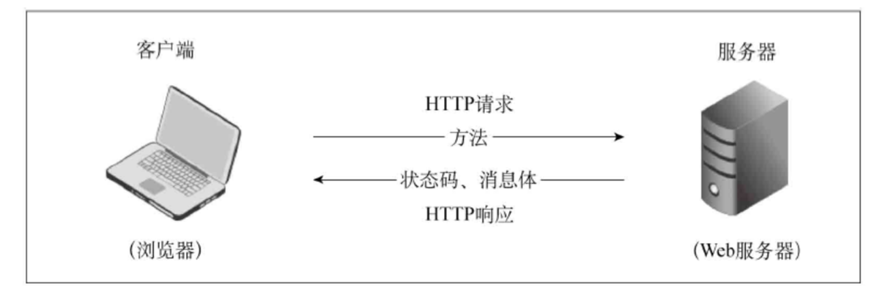

# 字节与字符串

##### 单位换算

1 byte = 8 bits

##### 字符串转字节


```python
b = "abc张三".encode("utf-8")
```

##### 字节转字符串


```python
b.decode("utf-8")
# 'abc张三'
```

# Web通信原理




#### Http请求方法

| **方法**    | **描述**                                                     |
| ----------- | ------------------------------------------------------------ |
| **GET**     | 请求指定的页面信息，并返回实体主体                           |
| **POST**    | 向指定资源提交数据进行处理请求（例如提交表单或者上传文件）。数据被包含在请求体中。POST请求可能会导致新的资源的建立和/或已有资源的修改 |
| **HEAD**    | 类似于GET请求，只不过返回的响应中没有具体的内容，用于获取报头 |
| **PUT**     | 从客户端向服务器传送的数据取代指定的文档的内容               |
| **DELETE**  | 请求服务器删除指定的页面                                     |
| **OPTIONS** | 允许客户端查看服务器的性能                                   |

#### HTTP状态码

| **代码** | **含义**                                     |
| -------- | -------------------------------------------- |
| **1\**** | 信息，请求收到，继续处理                     |
| **2\**** | 成功，行为被成功地接受、理解和采纳           |
| **3\**** | 重定向，为了完成请求，必须进一步执行的动作   |
| **4\**** | 客户端错误，请求包含语法错误或者请求无法实现 |
| **5\**** | 服务器错误，服务器不能实现一种明显无效的请求 |

# urllib官方标准库

| **模块名称**           | **描述**                                                     |
| ---------------------- | ------------------------------------------------------------ |
| **urllib.parse**       | 该模块定义的功能分为两大类：URL解析和URL引用                 |
| **urllib.request**     | 该模块定义了打开URL（主要是HTTP）的方法和类，如身份验证、重定向、cookie等 |
| **urllib.error**       | 该模块中主要包含异常类，基本的异常类是URLError               |
| **urllib.robotparser** | 该模块用于解析robots.txt文件                                 |


### 导入 urllib


```python
import urllib
```

### UrlParse模块


```python
url = "http://localhost:8080/servlet_api/Hello?username=zhangsan#body"
```

#### UrlParse函数

urlparse() 函数可以将 URL 解析成 ParseResult 对象。对象中包含了六个元素，分别为协议（scheme） 、域名（netloc） 、路径（path） 、路径参数（params） 、查询参数（query） 、片段（fragment）


```python
from urllib.parse import urlparse
parsed_result = urlparse(url)
parsed_result
```


    ParseResult(scheme='http', netloc='localhost:8080', path='/servlet_api/Hello', params='', query='username=zhangsan', fragment='body')


#### UrlSplit函数


```python
from urllib.parse import urlsplit
split_result = urlsplit(url)
split_result
```


    SplitResult(scheme='http', netloc='localhost:8080', path='/servlet_api/Hello', query='username=zhangsan', fragment='body')


#### UrlDeFrag函数

urldefrag：如果url包含一个片段标识符，urldefrag()函数可以返回一个没有片段标识符的修改过的url，并且这个片段标识符作为单独的字符串。如果url中没有片段标识符，则返回未修改的url和一个空字符串。


```python
from urllib.parse import urldefrag
defrag_result = urldefrag (url)
defrag_result
```


    DefragResult(url='http://localhost:8080/servlet_api/Hello?username=zhangsan', fragment='body')


#### UrlUnParse函数

urlunparse()接收一个列表的参数，组成一个完整的URL，而且列表的长度是有要求的，是必须六个参数以上，否则抛出异常


```python
from urllib.parse import urlunparse
url_compos = ("http","localhost:8080", "/servlet_api/Hello","","username=zhangsan","head")
urlunparse(url_compos)
```


```http
http://localhost:8080/servlet_api/Hello?username=zhangsan#head
```


#### UrlJoin函数

连接两个参数的url，将第二个参数中缺的部分用第一个参数的补齐;  如果第二个有完整的路径，则以第二个为主


```python
from urllib.parse import urljoin
print(urljoin("https://movie.douban.com/","index"))
print(urljoin("https://movie.douban.com/","https://accounts.douban.com/login"))
```

    https://movie.douban.com/index
    https://accounts.douban.com/login


#### urlencode函数

##### 字典转请求参数


```python
from urllib.parse import urlencode
requestParameters = {"username":"张三","password":"123456"}
requestParametersEncode = urlencode(requestParameters,encoding="gbk")
requestParametersEncode
```


    'username=%D5%C5%C8%FD&password=123456'


##### 请求参数转字典


```python
from urllib.parse import parse_qs
parse_qs(requestParametersEncode,encoding="gbk")
```


    {'username': ['张三'], 'password': ['123456']}


### Request模块

#### Get请求


```python
response = urllib.request.urlopen(f"http://localhost:8080/servlet_api/AboutUs")
print(response.read().decode("utf-8")) #字节序列
```

    <html>
    <head><title>关于我们</title></head>
    <body>
    <h1>关于我们</h1>
    <p>公司网址：www.studybigdata.cn</p>
    </body>
    </html>


​    

#### Post请求


```python
import urllib.parse
import urllib.request

requestParameters = {"username":"张三","password":"123456"}
requestParametersBytesString = urllib.parse.urlencode(requestParameters) # 将请求参数编码成字节字符串
data = bytes(requestParametersBytesString,encoding = "utf-8") # 转成字节
response = urllib.request.urlopen("http://localhost:8080/servlet_api/LogIn", data=data)
response.read().decode('utf-8')#读取服务器的响应的字节，转为字符串
```


    '<html>\r\n<head><title>首页</title></head>\r\n<body>\r\n当前登录用户: 未登录\r\n</body>\r\n</html>\r\n'


# Request

### 安装Requests库


```python
!pip install requests
```


### 导入Requests模块


```python
import requests
```

### 构造Request Header


```python
headers = {"User-Agent": "Mozilla/5.0 (Windows NT 10.0; Win64; x64) AppleWebKit/537.36 (KHTML, like Gecko) Chrome/114.0.0.0 Safari/537.36"}
```

### Head请求


```python
url = "http://localhost:8080/servlet_api/AboutUs"
response = requests.head("http://localhost:8080/servlet_api/Hello")
response.content.decode("utf-8")
for i in response.headers.items():
    print(i)
```

    ('Server', 'Apache-Coyote/1.1')
    ('Content-Length', '107')
    ('Date', 'Sun, 11 Jun 2023 07:16:23 GMT')


### Get请求


```python
HelloURL = "http://localhost:8080/servlet_api/Hello?username=zhangsan"
response = requests.get(HelloURL,headers=headers)
#以字节流形式打印网页源码
print(response.text)
```

    <html>
    <head><title>a servlet</title></head>
    <body>
    Hello! zhangsan
    </body>
    </html>


​    

### Post请求


```python
req_param = {"username":"张三","password":"123456"}
response = requests.post("http://localhost:8080/servlet_api/LogIn",data=req_param)
print(response.text)
```

    <html>
    <head><title>首页</title></head>
    <body>
    当前登录用户: 张三
    </body>
    </html>


​    

### Put请求


```python
HelloURL = "http://localhost:8080/servlet_api/Hello"
response = requests.put(HelloURL)
print(response.text)
```

    <html>
    <head><title>a servlet</title></head>
    <body>
    您发送了一个Put请求! 
    </body>
    </html>


​    

### Delete请求


```python
response = requests.delete(HelloURL)
print(response.text)
```

    <html>
    <head><title>a servlet</title></head>
    <body>
    您发送了一个Put请求! 
    </body>
    </html>


​    

### Options请求


```python
response = requests.options(HelloURL)
print(response.text)
```

    <html>
    <head><title>a servlet</title></head>
    <body>
    您发送了一个Put请求! 
    </body>
    </html>


​    

### Response


```python
response = requests.get("http://localhost:8080/servlet_api/Index")
print(response.url)
print(response.status_code)
print(response.headers)
print(response.encoding)
print(response.content)
print(response.text)
print(response.cookies)
```

    http://localhost:8080/servlet_api/Index
    200
    {'Server': 'Apache-Coyote/1.1', 'Set-Cookie': 'JSESSIONID=44C6D212AE2468EE107B40E3B6109664; Path=/servlet_api/; HttpOnly', 'Content-Type': 'text/html;charset=utf-8', 'Content-Length': '101', 'Date': 'Sun, 11 Jun 2023 07:41:13 GMT'}
    utf-8
    b'<html>\r\n<head><title>\xe9\xa6\x96\xe9\xa1\xb5</title></head>\r\n<body>\r\n\xe5\xbd\x93\xe5\x89\x8d\xe7\x99\xbb\xe5\xbd\x95\xe7\x94\xa8\xe6\x88\xb7: \xe6\x9c\xaa\xe7\x99\xbb\xe5\xbd\x95\r\n</body>\r\n</html>\r\n'
    <html>
    <head><title>首页</title></head>
    <body>
    当前登录用户: 未登录
    </body>
    </html>
    
    <RequestsCookieJar[<Cookie JSESSIONID=44C6D212AE2468EE107B40E3B6109664 for localhost.local/servlet_api/>]>


### Cookie


```python
response = requests.get("http://localhost:8080/servlet_api/CookieTest", headers=headers)

print(response.content.decode("utf-8"))
for cookie in response.cookies.keys():
    print(cookie + ":"+ response.cookies.get(cookie))
```

    给你确定个广告ID：
    username:zhangsan
    advertisementId:999999


#### 自定义Cookie


```python
#自定义cookies
cookies = dict(view="kouhong",advertisementId="888888")
response = requests.post("http://localhost:8080/servlet_api/CookieTest", headers=headers, cookies=cookies)
print(response.content.decode("utf-8"))
```

    小李啊，据我了解你喜欢买化妆品，我给你推荐个面膜！


### Session


```python
# 发送POST请求(禁用重定向)
response = requests.post("http://localhost:8080/servlet_api/LogIn",data=req_param, allow_redirects=False)

# 在header中取出重定向地址
redirect_url = response.headers['Location']
print(redirect_url)

# 登录成功后，服务器为当前会话产生Session，返回给客户端一个cookie：JSESSIONID
for item in response.cookies.items():
    print(item)
```

    http://localhost:8080/servlet_api/Index
    ('JSESSIONID', '7406A09B5D0A3CB79784FE002BA9E905')


```python
# 再次请求服务器，服务器会根据cookie信息识别当前用户。    
response = requests.get(redirect_url,cookies=response.cookies)
print(response.content.decode("utf-8"))
```

    <html>
    <head><title>首页</title></head>
    <body>
    当前登录用户: 张三
    </body>
    </html>


> 实验接口源码：
>
> https://github.com/A-stranger/studybigdata/tree/master/javaee/servlet_api