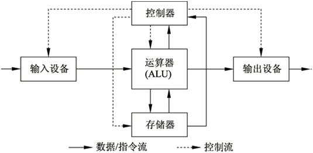
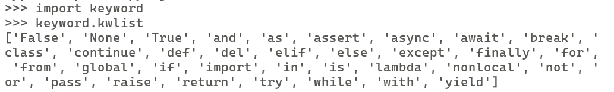
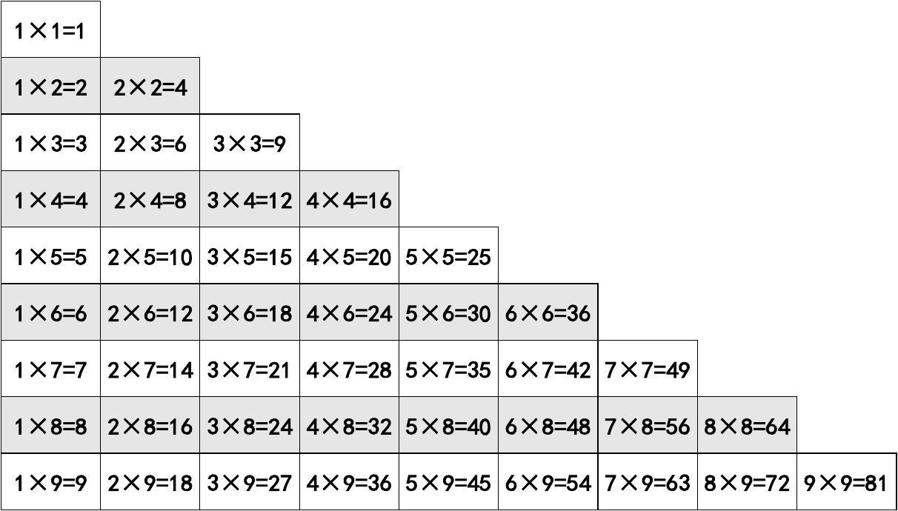
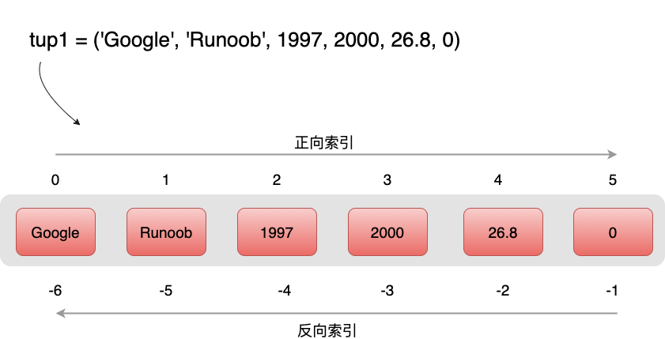
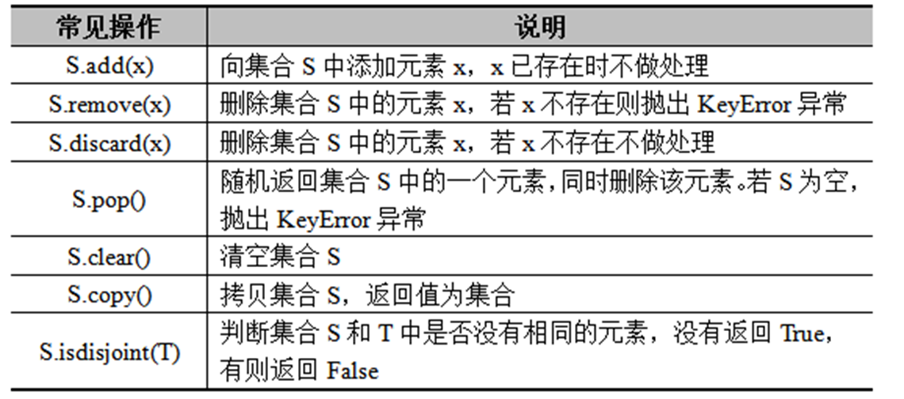
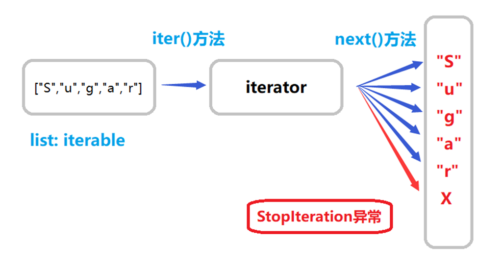
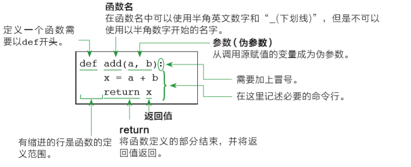
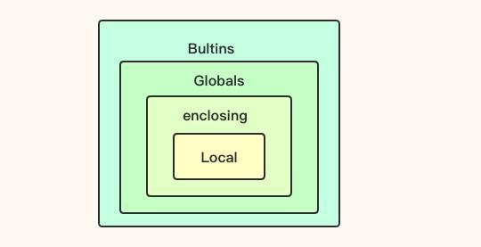
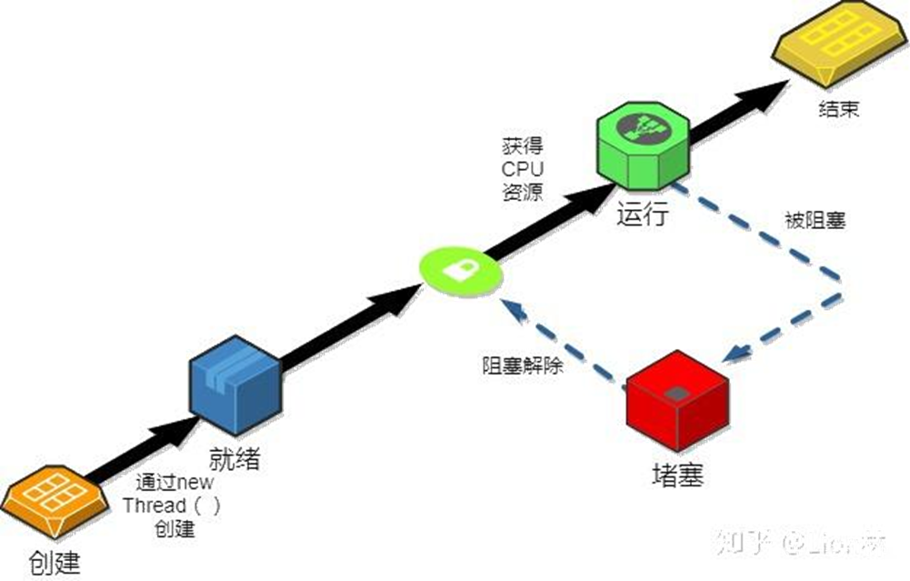

---

# Python

---

## 计算机组成

- 数据：存储器（RAM、Cache）；
- 计算：运算器ALU（算术运算、逻辑运算）



---

## Python概述

### 版本

Python 2 与 Python3

##### 查看Python版本

```powershell
PS C:\Users\Qingyuan_Qu> python -V
Python 3.11.2
```

---

### 开发环境

- 官方Python IDEL
- Anaconda3
- VS Code
- PyCharm
- ...  ...

---

### 编程规范

- 代码缩进：分支、循环、函数、类定义、异常处理、With语句等。注意代码块和函数体的缩进，一般以4个空格为一个缩进单位，或直接一个`Tab`制表符；
- 导入模块顺序：标准库、扩展库、自定义库；避免导入整个库，最好用到啥导啥；
- 不要写过长语句；

---

### 扩展库安装卸载

| 命令                                 | 说明 | 举例 |
| ------------------------------------ | ---- | ---- |
| pip list                             |      |      |
| pip install package[==version]       |      |      |
| pip uninstall packagename[==version] |      |      |

---

##### 安装Jupyter Notebook

```shell
pip install jupyter notebook
```

##### 启动Jupyter Notebook

```shell
jupyter notebook --no-browser --ip=192.168.179.100 --port 9999
```

---

### 帮助信息

内置函数`help()`可以查看属性、方法、类、模块等的帮助信息。

---

## 相关术语

#### 关键字

```python
import keyword
print(keyword.kwlist)
```



---

#### 变量

 编程的本质，就是对内存中数据的访问和修改。程序所用的数据都会保存到内存中，程序员需要一种机制来访问或修改内存中的数据。

这种机制就是变量，每个变量都代表了某一小块内存，而且变量是有名字的，程序对变量赋值，实际上就是把数据装入到该变量所代表的内存区的过程；

程序读取变量的值，实际上就是从该变量所代表的内存区取值的过程。形象地理解：变量相当于一个有名称的容器，该容器用于装各种不同类型的数据。

> 摘录自《疯狂Java讲义·第五版》

---

##### 变量命名规范

- 变量名称区分大小写。

- 变量名称首字母不能是数字

- 变量名称可以由字母、数字和下划线组成

- 变量名称不能使用Python内置的关键字

---

## 数据类型

### 数值类型

| 数值类型    | 描述   | 示例                |
| ----------- | ------ | ------------------- |
| **int**     | 整数   | 8、10、100          |
| **float**   | 浮点数 | 1.0、2.1、1e-3      |
| **complex** | 复数   | 1+2j、1.23j、1.1+1j |
| **bool**    | 布尔型 | True、False         |

---

Python语言中，任何非零的数值、非空的数据类型，非空的字符串和非空列表，都`等价于True`，(`但除1以外都不等于True`)

```python
>>> 2 == True
False

>>> if 2:
...     print("abc")
...
abc
```

0或空类型、""(空字符串)、[]空表都`等价于False`，可以直接用作判断条件，(`但除0以外都不等于False`)。

```python
>>> if []:
...     print("False")
... else:
...     print("True")
...
True
```

---

### 字符串

|            | 使用方式                 | 示例               | 备注                |
| ---------- | ------------------------ | ------------------ | ------------------- |
| 单引号     | ' '                      | hi = 'hello world' | 可使用 [\\]续行输入 |
| 双引号     | " "                      | hi = "hello world" | 可使用 [\\]续行输入 |
| 多行字符串 | 以 [''']   ["""]开头结尾 |                    |                     |

---

### NoneType

无、空。

类型取值： `None`

```python
>>> a = []
>>> a == None
False

>>> b = ""
>>> b == None
False
```

```python
>>> def fun():
...     return None
...
>>> fun() == None
True
```

---

## 运算符

| 运算符分类 |                            | 示例                           |
| ---------- | -------------------------- | ------------------------------ |
| 赋值运算符 | =, +=, -=, *=, /=, %=, //= | a=10                           |
| 算术运算符 | +, -, *, /, %, //, **      | 5/3=1.666,  5//3=1,  5%3=2     |
| 比较运算符 | <, >, <=, >=, ==, !=       | 3<=4                           |
| 逻辑运算符 | and, or, not               | T and F => False , T or F => T |
| 成员运算符 | in, not in                 | "he" in 'hello' =>  True       |
| 身份运算符 | is, is not                 | a = 1 ,b = 1, a is b => True   |
| 位运算符   | &, \|, ^, ~, <<, >>        |                                |

```python
a = 00111000 = 56  =>  ~a = -(00111000+1) = -57
```

---

#### `is` 与 `==`

##### 情况一

```python
>>> a = 3
>>> b = 3

>>> a == b # == 判断两变量的值是否相等
True
>>> a is b # is 比较两个变量是否指向了同一个对象
True

# 可以看到变量a,b指向了同一内存地址中的对象
>>> id(a)
140705600293368
>>> id(b)
140705600293368
```

---

#### `is` 与 `==`

##### 情况二

```python
>>> a = ["a"]
>>> b = ["a"]

>>> a == b
True
>>> a is b
False

# 可以看到变量a,b指向了不同内存地址中的对象
>>> id(a)
2598781634944
>>> id(b)
2598781645888
```

---

>`id()`:  Return the identity of an object.  (CPython uses the object's memory address.)
>
>**CPython** 是用 C 语言实现的 Python 解释器，也是官方的并且是最广泛使用的Python解释器。

---

## 内置函数

函数是组织好的、实现单一功能或相关联功能的代码段。我们可以将函数视为一段有名字的代码，这类代码可以在需要的地方以`函数名()`的形式调用。

##### 内置函数概念

内置函数（built in function）不需要额外导入任何模块即可直接使用，具有非常快的运算速度，推荐优先使用。使用下面的语句可以查看所有的`内置函数`和`内置对象`。

---

```python
dir(__builtins__)
```

Help on built-in module builtins:

NAME
    builtins - Built-in functions, types, exceptions, and other objects.

DESCRIPTION
    This module provides direct access to all 'built-in' identifiers of Python; for example, builtins.len is
the full name for the built-in function len().
    This module is not normally accessed explicitly(显式) by most applications, but can be useful in modules that provide objects with the same name as a built-in value, but in which the built-in of that name is also needed.

---

该模块提供对Python所有“内置”标识符的直接访问；例如，`builtins.len`是内置函数`len()`的全名。
该模块通常不会被大多数应用程序显式访问，但在提供与内置值同名的对象的模块中可能很有用，但在这些模块中也需要该名称的内置值。

```python
>>> import builtins
>>> builtins.len([1,2,3])
3
```

```python
>>> def len():
...     print("hello")
...
>>> len()
hello

>>> builtins.len([1,2,3])
3
```

---

##### 常见的内置函数

| 功能                     | 函数名                             | 示例                                       |
| ------------------------ | ---------------------------------- | ------------------------------------------ |
| 输入                     | input()                            |                                            |
| 输出                     | print()                            |                                            |

---
| 功能     | 函数名       | 示例                |
| -------- | ------------ | ------------------- |
| 绝对值   | abs(x)       | abs(-5) = 5         |
| 四舍五入 | round(a[,b]) | round(5.55,1) = 5.5 |
| 幂运算   | pow(a,b)     | a的b次幂            |
| 商和余数 | divmod(a,b)  | divmod(5,2) = (2,1) |

---
| 功能                     | 函数名                             | 示例                                       |
| ------------------------ | ---------------------------------- | ------------------------------------------ |
| 最大值                   | max()                              | max([1,3,4,5]) = 5                         |
| 最小值                   | min()                              | min([1,3,4,5]) = 1                         |
| 求和                     | sum()                              | sum([1,2,3]) = 6                           |

---

| 功能                     | 函数名                             | 示例                                       |
| ------------------------ | ---------------------------------- | ------------------------------------------ |
| 映射                     | map(func, *iterables)              | map(lambda x:x**2, [1,2,3])                |
| 过滤                     | filter(function or None, iterable) | filter(lambda x:x%2==0, [1,2,3,4])         |

---

| 功能                     | 函数名                             | 示例                                       |
| ------------------------ | ---------------------------------- | ------------------------------------------ |
| 元素个数                 | len(items)                         | len("study bigdata")   =>   13             |
| 类型判断                 | type()                             | a = "hello";  type(a)   =>   <class 'str'> |
| 帮助信息(模块、类、方法) | help()                             |                                            |
| 等差数列                 | range(stop)                        | range(5)  => 0,1,2,3,4                     |
|                          | range(start, stop[, step])         | range(1,10,2) => 1,3,5,7,9                 |

---

##### map

```python
def add(x, y):
    return x + y

a = [1, 2, 3, 4, 5]
b = [6, 7, 8, 9, 10]

result = list(map(add, a, b))

print(result) # 输出 [7, 9, 11, 13, 15]
```

---

## [字符串相关方法](#function_string)

#### 字符串索引查询

###### 单值索引

```python
>>> domain = "studybigdata.cn"

>>> domain[2]
'u'
>>> domain[-1]
'n'
```

###### 范围索引

```python
>>> domain[5:8]
'big'

>>> domain[-2:]
'cn'
```

---

#### 修改

不支持！ 因为是不可变类型，所以不可对元素重新赋值。

```python
>>> domain[1] = "S"
Traceback (most recent call last):
  File "<stdin>", line 1, in <module>
TypeError: 'str' object does not support item assignment
```

---

#### 常用方法

s = " hello World "

s1 = "hello"

s2 = "123456"

|  |                    |
| ---------------------- | ------------------ |
| **大小写** | |
| 大写                   | s.upper()          |
| 小写                   | s.lower()          |
| 首字母大写             | s.capitalize()     |
| 每个单词大写           | s.title()          |
| 大小写互换             | s.swapcase()       |
| **对齐方式** |                    |
| 居中对齐                 | s.center(20,"-")   |
| 左对齐                 | s.ljust(20,"-")    |
| 右对齐                 | s.rjust(20,"-")    |
| **去除字符** |                    |
| 去除头部空格           | s.lstrip()          |
| 去除头部空格           | s.rstrip()          |
| 去除首尾空格           | s.strip()          |
| 去除前缀 | s.removeprefix("he") |
| 去除后缀 | s.removesuffix("ld") |
| **查找替换** | |
| 某字符的索引           | s.index("abc")  查找到，返回索引；查找不到，抛出异常 |
| 某字符的索引 | s.find("abc")   查找到，返回索引；查找不到，返回-1 |
| 字符串替换 | s.replace("hello", "hi")                             |
| **拆分-合并**          |                                                      |
| 字符串拆分为列表       | s.split(" ")                                         |
| 可迭代对象链接成字符串 | "-".join(l)        |
| **字符串与字节** |  |
| 字符串转字节 | b = "abc张三".encode("utf-8")|
| 字节转字符串 | b.decode("utf-8")        |
| **判断开头结尾** |  |
| 判断是否是小写/大写 | s1.islower() => True |
| 判断是否为纯数据 | s2.isdigit()  => => True |
|  | |
| 判断是否以某字符开头 | s.endswith("rld ") |
| 判断是否以某字符结尾 | s.startswith(" hell") |
|  |  |

---

## 分支循环

### 分支

```python
if condition:
 statements
else:
    statements
```

```python
if condition:
 statements    
elif condition:
    statements
else:
 statements
```

---

##### 判断一个数是奇数还是偶数

```python
var = int(input("请输入一个整数"))

if var % 2 == 0:
    print("你输入了一个偶数")
else:
    print("你输入了一个奇数")
```

```python
var = int(input("请输入一个整数"))

if var == 0:
    print("你输入了一个0")
elif var == 1:
    print("你输入了一个1")
else:
    print("你输入了一个不是0和1的数")
```

---

### 循环

#### for

```python
# range(start,end) # 返回可迭代对象，左闭右开
sum = 0

for i in range(1,10):
    sum = sum + i

print(sum)
```

---

#### while

```python
sum = 0
i = 0
while i < 10:
    sum = sum + i
    i = i + 1

print(sum)
```

---

#### continue

- 中断某次循环，继续下一次循环

```python
# 打印1-9中的偶数。
for i in range(1, 10):
    if i % 2 != 0:
        continue # 循环体后的代码不再执行
    print(i)
```

---

#### break

- 终止循环

```python
sum = 0

for i in range(1, 10):
    if i > 5:
        break
    sum = sum + i

print(sum)
```

---

### 案例：九九乘法口诀表



---

#### 方法一

##### 第一步

观察发现：

- 如果把上三角补全的话，是一个 9*9 实对称阵；

- 列（i）的取值是（1~9）
- 行（j）的取值也是（1~9）

```python
11 21 31 41 51 61 71 81 91 
12 22 32 42 52 62 72 82 92 
13 23 33 43 53 63 73 83 93 
14 24 34 44 54 64 74 84 94 
15 25 35 45 55 65 75 85 95 
16 26 36 46 56 66 76 86 96 
17 27 37 47 57 67 77 87 97 
18 28 38 48 58 68 78 88 98 
19 29 39 49 59 69 79 89 99
```

---

##### 结果

```python
1 1 2 1 3 1 4 1 5 1 6 1 7 1 8 1 9 1 
1 2 2 2 3 2 4 2 5 2 6 2 7 2 8 2 9 2 
1 3 2 3 3 3 4 3 5 3 6 3 7 3 8 3 9 3 
1 4 2 4 3 4 4 4 5 4 6 4 7 4 8 4 9 4 
1 5 2 5 3 5 4 5 5 5 6 5 7 5 8 5 9 5 
1 6 2 6 3 6 4 6 5 6 6 6 7 6 8 6 9 6 
1 7 2 7 3 7 4 7 5 7 6 7 7 7 8 7 9 7 
1 8 2 8 3 8 4 8 5 8 6 8 7 8 8 8 9 8 
1 9 2 9 3 9 4 9 5 9 6 9 7 9 8 9 9 9 
```

---

##### 第二步

取其中一半，只有当 j<=i  时输出，并调整格式

```python
for i in range(1,10):
    for j in range(1,10):
        if j<=i:
            print(j,"*",i,"=",i*j, sep="", end="\t")
    print()
```

```python
1*1=1 
1*2=2 2*2=4 
1*3=3 2*3=6 3*3=9 
1*4=4 2*4=8 3*4=12 4*4=16 
1*5=5 2*5=10 3*5=15 4*5=20 5*5=25 
1*6=6 2*6=12 3*6=18 4*6=24 5*6=30 6*6=36 
1*7=7 2*7=14 3*7=21 4*7=28 5*7=35 6*7=42 7*7=49 
1*8=8 2*8=16 3*8=24 4*8=32 5*8=40 6*8=48 7*8=56 8*8=64 
1*9=9 2*9=18 3*9=27 4*9=36 5*9=45 6*9=54 7*9=63 8*9=72 9*9=81
```

---

#### 方法二

```python
for i in range(1,10):
    for j in range(1,i+1):
            print(j,"*",i,"=",i*j, sep="", end="\t")
    print()
```

---

## Collection模块

This module implements specialized container datatypes providing alternatives to Python's general purpose built-in containers, dict, list, set, and tuple.

该模块实现了专门的容器数据类型，为Python的通用内置容器dict、list、set和tuple提供了替代方案。

---

### 序列类型

Python中常用的序列类型有字符串、列表和元组。



Python中的序列支持双向索引：正向递增索引和反向递减索引

正向递增索引从左向右依次递增，第一个元素的索引为0，第二个元素的索引为1，以此类推；

反向递减索引从右向左依次递减，从右数第一个元素的索引为-1，第二个元素的索引为-2，以此类推。

---

### 列表

#### 创建

##### 直接创建

列表可以包含任意类型的数据，包括数字、字符串、元组等。

```python
>>> int_l = [1,2,3]
>>> str_l = ["b","d","c"]
>>> mix_l = [1,"study",[3,4,5]]
```

##### 其他类型转换而来

```python
>>> trans_l = list("study")
>>> trans_l
['s', 't', 'u', 'd', 'y']
```

---

#### 索引查询

支持 `单值索引`和`范围索引切片`。

```python
>>> str_l[1]
'd'
>>> str_l[-2]
['d']

>>> str_l[0:2]
['b', 'd']

>>> str_l[1:3]
['d', 'c']

>>> str_l[1:]
['d', 'c']
```

---

#### 索引修改

```python
>>> int_l[0] = 3
>>> int_l
[3, 2, 3]
```

```python
>>> int_l[1:3] = [4,5]
>>> int_l
[3, 4, 5]
```

---

#### 增加

##### 追加元素

```python
>>> str_l.append("e")
>>> str_l
['b', 'd', 'c', 'e']
```

##### 插入元素

```python
>>> str_l.insert(0,"a")
>>> str_l
['a', 'b', 'd', 'c', 'e']
```

##### 扩展列表

```python
>>> str_l.extend(["g","f"])
>>> str_l
['a', 'b', 'd', 'c', 'e', 'g', 'f']
```

---

##### 升序

```python
>>> str_l = ["a","c","b"]
>>> str_l.sort()
>>> str_l
['a', 'b', 'c']
```

##### 降序

```python
>>> str_l = ["a","c","b"]
>>> str_l.sort(reverse=True)
>>> str_l
['c', 'b', 'a']
```

##### 逆转

```python
>>> str_l = ["a","c","b"]
>>> str_l.reverse()
>>> str_l
['b', 'c', 'a']
```

---

#### 删除

##### 删除最后的元素

```python
>>> str_l = ["a","b","c","d"]
>>> str_l.pop()
'd'
>>> str_l.pop()
'c'
>>> str_l
['a', 'b']
```

---

##### 按值删除元素

```python
>>> str_l.remove("a")
>>> str_l
['b']
```

---

##### 清空列表

```python
>>> str_l = ["a","b","c"]
>>> str_l.clear()
>>> str_l
[]
```

---

##### 回收列表

```python
>>> str_l = ["a","b","c"]
>>> del str_l
>>> str_l
Traceback (most recent call last):
  File "<stdin>", line 1, in <module>
NameError: name 'str_l' is not defined
```

---

#### 列表推导式

##### 需求一

根据已知列表，产生一个新列表，新列表中的每个元素为旧列表元素的平方。

```python
# 输入：
l_old = [1,2,3,4,5,6,7]
# 输出：
l_new = [1, 4, 9, 16, 25, 36, 49]
```

---

###### 方法一

```python
l_new = []
for i in l_old:
    l_new.append(i**2)
```

###### 方法二

```python
l_new = [i**2 for i in l_old]
```

---

##### 需求二

从已知整数列表中筛选出奇数，形成一个新列表。

```python
# 输入：
l_old = [1,2,3,4,5,6,7]
# 输出：
l_odd = [1,3,5,7]
```

---

###### 方法一

```python
l_odd = []

for i in l_old:
    if i%2==1:
        l_odd.append(i)
```

---

###### 方法二

```python
l_odd = [i for i in l_old if i%2==1]
```

---

##### 需求三

计算两个数据集合的笛卡尔积。

```python
# 输入
l_a = [1,2,3]
l_b = [4,5]

# 输出
[(1, 4), (1, 5), (2, 4), (2, 5), (3, 4), (3, 5)]
```

---

###### 方法一

```python
l_a = [1,2,3]
l_b = [4,5]
l_cartesion = []

for i in l_a:
    for j in l_b:
        l_cartesion.append( (i,j) )
```

---

###### 方法二

```python
[(i,j) for i in l_a for j in l_b]
```

---

### 元组

不支持修改。

#### 创建

```python
t = (1)  # 注意：1，int类型
t = (1,) # 一元组
t = (1,2,3) # 二元组
```

---

#### 查询

支持索引和范围索引

```python
t = (1,2,3)
t[1]
t[0:2]
```

---

### 集合

Python集合具备互异性和无序性。

  Ø 互异性：集合中的元素互不相同。

  Ø 无序性：集合中的元素没有顺序。

Python要求放入集合中的元素必须是不可变类型。

  Ø 不可变类型：整型、浮点型、字符串、元组。

  Ø 可变类型：列表、集合、字典。

---



---

##### 构造

```python
s_0 = set()
# 或
s_1 = {1,2,3}
s_2 = {2,3,4}
s_3 = {1,2}
```

---

##### 交|并|差|对称差

```python
s_1 | s_2 # {1, 2, 3, 4}
s_1 & s_2 # {2, 3}
s_1 - s_2 # {1}
s_1^s_2  # {1, 4}
```

##### 合并union

```python
s_1.union(s_2) # {1, 2, 3, 4}
```

---

##### 子集判断issubset

```python
s_3.issubset(s_1) # True
s_3.issubset(s_2) # False
```

##### 超集判断issuperset

```python
s_1.issuperset(s_3) # True
```

---

##### 集合推导式

```python
>>> a = {1,2,3,4,5}
>>> {i**2 for i in a}
{1, 4, 9, 16, 25}
```

---

### 字典

映射类型以键值对的形式存储元素，键值对中的键与值之间存在映射关系。

**字典**（dict）是Python唯一的内置映射类型，字典的键必须遵守以下两个原则：

  Ø 每个键只能对应一个值，不允许同一个键在字典中重复出现。

  Ø 字典中的键是不可变类型。

---

##### 构造

```python
zs = dict()
# 或
zs = {} # 空字典
zs = {"name":"张三", "age":18}
```

##### 查询

```python
zs["name"]  # '张三' 
zs.get("name") # '张三'
```

---

##### 增加、修改

有则修改，无则增加

```python
zs["age"] = 19
zs.update(age=20)
zs.update(age=21, tel=15311113301)
zs.update({"address":"山东省枣庄市", "tel":15322223301})
```

##### 删除

```python
zs.pop("tel")
```

---

##### 键

```python
zs.keys()
# dict_keys(['name', 'age', 'address'])
```

遍历字典的key

````python
for k in zs:
    print(k)
    
```
name
age
address
```
````

---

##### 值

```python
zs.values()
# dict_values(['张三', 21, '山东省枣庄市'])
```

##### 键值对

```python
zs.items()
# dict_items([('name', '张三'), ('age', 21), ('address', '山东省枣庄市')])
```

---

##### 按序删除

```python
zs.popitem() # 栈
```

##### 清空

```python
zs.clear()
```

---

##### 字典推导式

```python
# 借助字典推导式，交换字典的key和value, 产生新的字典
{v:k for k,v in zs.items()}


# 将字典的值转为集合
s = {v for k,v in zs.items()}
```

---

##### 案例：词频统计

```python
poem = '''江南
江南可采莲，
莲叶何田田，
鱼戏莲叶间。
鱼戏莲叶东，
鱼戏莲叶西，
鱼戏莲叶南，
鱼戏莲叶北。
'''
```

统计古诗中每个字符出现的次数。

---

##### 案例：词频统计

```python
word_count = {}

for word in poem:
    if word_count.get(word) == None:
        word_count.update( {word:1} )  # {"江":1, "南":1}
    else:
        v = word_count.get(word) + 1
        word_count.update({word:v})
word_count
```

---

### 其他

`+` 运算符可用于字符串、列表、元组的拼接；

`×` 运算符可用于字符串、列表、元组的复制；

> 集合、字典不支持

---

#### 排列组合

##### 组合

```python
import itertools
list(itertools.combinations({1,2,3},2)) # [(1, 2), (1, 3), (2, 3)]
```

##### 排列

```python
list(itertools.permutations([1,2])) # [(1, 2), (2, 1)]
```

---

#### 可迭代对象Iterable

可迭代对象的显著特征：包含`__iter__`方法。

```python
# abc: Abstract Base Classes (ABCs)
from collections.abc import Iterable

################################# All True #################################
print(isinstance('123',Iterable))
print(isinstance(list(), Iterable))
print(isinstance(tuple(),Iterable))
print(isinstance(set(), Iterable))
print(isinstance(dict(), Iterable))

print(isinstance(range(1,5),Iterable))

print(isinstance(map(lambda x:x**2, [1,2,3]), Iterable))
print(isinstance(filter(lambda x:x%2==0, [1,2,3,4,5]), Iterable))
print(isinstance(reversed([1,2,3,4,5]), Iterable))
print(isinstance(enumerate("abc"), Iterable))
print(isinstance(zip(["name","age"],("张三",18)), Iterable))

print(isinstance((x for x in range(5)),Iterable))
```

---

#### 迭代器Iterator

可迭代对象的显著特征：包含`__next__`方法。



---

```python
from collections.abc import Iterator

################################# False #################################
print(isinstance(list(), Iterator))
print(isinstance(tuple(),Iterator))
print(isinstance(set(), Iterator))
print(isinstance(dict(), Iterator))
print(isinstance(range(1,5),Iterator))

################################# True #################################
print(isinstance(map(lambda x:x**2, [1,2,3]), Iterator))
print(isinstance(filter(lambda x:x%2==0, [1,2,3,4,5]), Iterator))
print(isinstance(reversed([1,2,3,4,5]), Iterator))
print(isinstance(enumerate("abc"), Iterator))
print(isinstance(zip(["name","age"],("张三",18)), Iterator))
print(isinstance((x for x in range(5)),Iterator))
```

---

#### 可迭代对象和迭代器的区别

实现了 `__iter__()` 方法的类， 属于可迭代类；`iter()`：传入可迭代对象返回迭代器。

实现了 `__next__()` 方法的类，属于迭代器类；`next()`：从迭代器返回下一个元素。

可以使用迭代器进行迭代访问的列表、元组和字符串等都是可迭代对象。

```python
l1 = [1,2,3]
it = iter(l1)     # 创建迭代器对象
print(next(it))     # 迭代器调用__next__()方法输出下一个元素
print(next(it))
```

---

#### 生成器Generator

##### 例一

```python
def gen():
    yield 1
    yield 2
    yield 3

g = gen()
```

```python
next(g)
```

---

##### 例二

```python
def yieldtest(x):
    for i in x:
        yield i**2

g = yieldtest(range(3))
```

```python
g.__next__()
```

---

## 函数

### 函数定义



---

### [What is the difference between arguments and parameters?](https://docs.python.org/3/faq/programming.html#id16)

[Parameters](https://docs.python.org/3/glossary.html#term-parameter) are defined by the names that appear in a function definition, whereas [arguments](https://docs.python.org/3/glossary.html#term-argument) are the values actually passed to a function when calling it. Parameters define what [kind of arguments](https://docs.python.org/3/glossary.html#term-parameter) a function can accept. For example, given the function definition:

```
def func(foo, bar=None, **kwargs):
    pass
```

*foo*, *bar* and *kwargs* are parameters of `func`. However, when calling `func`, for example:

```
func(42, bar=314, extra=somevar)
```

the values `42`, `314`, and `somevar` are arguments.

---

### 常规函数

```python
# 空函数
def empty_fun():
    pass
def empty_fun():
    ...
    
# 无返回值函数
def standard_arg(arg):
    print(arg)
   
# 有返回值函数
def standard_args(arg):
    return arg
```

---

#### 为参数指定默认值

```python
def func(a, b=100):
    return a+b

func(1,2) # 3
func(1)  # 101
```

---

##### 默认参数值的计算

参数arg的值，在函数定义时触发计算。

```python
i = 5

def f(arg=i):
    print(arg)

i = 6
f() # 输出5，而不是6
```

---

##### 注意

通常默认参数的值只计算一次，但是当默认参数是可变对象时，会有所不同。下面的函数会在后续调用中累积传递给它的实参。

```python
def f(a, L=[]):
    L.append(a)
    return L

print(f(1)) # [1]
print(f(2)) # [1, 2]
print(f(3)) # [1, 2, 3] 
```

---

### 位置参数

位置参数是函数定义中最基本的参数类型。它们按照声明的顺序从函数调用者那里接受传递的值。在函数调用时，这些值按照函数定义时参数的顺序进行匹配。位置参数是函数定义的一部分，因此调用者必须按照声明时的顺序提供相应的值。

---

下面是一个简单的函数示例，其中包含两个位置参数：

```python
def add_numbers(x, y):
    result = x + y
    return result
```

在这个函数中，`x` 和 `y` 是位置参数。调用这个函数时，必须提供两个值，分别对应于 `x` 和 `y`：

```python
sum_result = add_numbers(3, 5)
print(sum_result)  # 输出 8
```

在这个例子中，`3` 和 `5` 是位置参数，它们分别传递给了 `x` 和 `y`。函数执行后返回它们的和，结果为 `8`。

值得注意的是，位置参数是按照它们在函数定义中的位置进行匹配的。因此，在调用函数时，提供的值的顺序非常重要。

---

### [关键字参数](https://docs.python.org/3.12/tutorial/controlflow.html#keyword-arguments)

关键字参数是一种在函数调用时通过指定参数名来传递值的方法。与位置参数不同，关键字参数的传递方式不依赖于参数的顺序，而是通过参数名明确指定值。这种方式可以提高函数调用的可读性，尤其是当函数有多个参数，而某些参数是可选的时候。

---

以下是关键字参数的基本使用方式：

```python
def greet(name, greeting): # greeting：问候
    message = f"{greeting}, {name}!"
    return message
```

在这个函数中，`name` 和 `greeting` 都是位置参数。调用函数时，我们可以使用`关键字参数`的方式传递值：

```python
result = greet(greeting="Hello"，name="张三")
print(result)
```

在这个例子中，我们通过 `name="Alice"` 和 `greeting="Hello"` 明确指定了每个参数的值。这种方式不仅提高了可读性，而且消除了参数位置的歧义。

---

关键字参数还可以与位置参数混合使用。例如：

```python
def print_person_info(name, age, city="Unknown"):
    print(f"Name: {name}, Age: {age}, City: {city}")

# 使用关键字参数和位置参数
print_person_info("Bob", city="New York", age=25)
```

在这个例子中，`name` 是位置参数，而 `age`、`city` 是关键字参数。如果不提供 `city` 的值，将使用默认值 `"Unknown"`。

总体而言，关键字参数提供了更灵活的调用方式，特别是在函数有很多参数时，可以明确指定每个参数的值，使得代码更加易读。

---

### 可变参数

`*` 在形参中出现时，用于打包参数为元组；

```python
def star_expression(*args):
    print(type(args)) # tuple
    print(args)
    
star_expression(1,2,3)
# (1, 2, 3)
```

`**` 在形参中出现时，用于打包实参中的关键字参数为字典；

```python
def dict_expression(**kvargs):
    print(type(kvargs))
    print(kvargs)
    
dict_expression(name="zhangsan",age=19)
# {'name': 'zhangsan', 'age': 19}
```

---

`*` 在实参中出现时，用于解包可迭代对象（字符串、列表、元组、字典的键）为位置参数；

```python
def star_expression(arg1,arg2):
    print(arg1,arg2)
    
star_expression(*[1,2])
# 1 2
```

`**` 在实参中出现时，用于解包字典为关键字参数；

```python
def dict_expression(name,age):
    print(name,age)

p = {"age":19,"name":"zhangsan"}
dict_expression(**p)
# zhangsan 19
```

---

### 特殊参数

##### 仅位置参数

```python
# 定义
def pos_only_arg(arg1, arg2, /):
    print(arg1, arg2)

# 调用
pos_only_arg(1, 2)  # 正确
pos_only_arg(arg1=1, arg2=2)
# TypeError: pos_only_arg() got some positional-only arguments passed as keyword arguments: 'arg1, arg2'
```

---

##### 仅关键字参数

```python
# 定义
def kwd_only_arg(*, arg1, arg2):
    print(arg1, arg2)

# 调用
kwd_only_arg(arg2=2, arg1=1) # 正确
kwd_only_arg(1, 2)   
# TypeError: kwd_only_arg() takes 0 positional arguments but 2 were given
```

---

##### 位置关键字参数

```python
# 定义
def combined_example(pos_only_1, /, standard_1, *, kwd_only_1):
    print(pos_only_1, standard_1, kwd_only_1)
  
#调用
combined_example(1, standard_1=2, kwd_only_1=3) # 正确
combined_example(1, 2, kwd_only_1=3)   # 正确
```

---

### 递归

递归：函数自身调用自身。

##### 例1：函数简单的调用自己

没有结束条件，会造成死循环。

```python
def func():
    print('from func')
    func()

func()
```

---

##### 例2：不使用for循环打印1-100

```python
def f(x):
    print(x)
    if x==100:
        return
    f(x+1)
    
f(1) # 调用
```

---

##### 例3：阶乘

```python
def factorial(n):
    if n==1:
        return 1
    else:
        return n*factorial(n-1)

factorial(5) #输出120
```

---

##### 例4：斐波那契数

```python
def fibonacci(n):
    if n==1 or n==2:
        return 1
    else:
        return fibonacci(n-1)+fibonacci(n-2)

fibonacci(5) #输出5
```

---

### 作用域

**Python变量的作用域一共有4种，分别是：**

- **L** （**Local**） 局部作用域
- **E** （**Enclosing**） 闭包函数外的函数中
- **G** （**Global**） 全局作用域
- **B** （**Built-in**） 内建作用域

 以 `L->E->G->B` 的规则查找，即：在**局部**找不到，便会去局部外的局部找（例如**闭包**），再找不到就会去**全局**找，再者去**内建**中找。



---

##### 在函数内引用全局变量

```python
x = 10
def func():
    print(x)

func()
```

---

##### 在函数内修改全局变量（失败）

```python
x = 10

def func():
    x = 20 # 局部变量
    print(x)

func()

print(x)
```

---

##### 在函数内引用全局变量并赋值（失败）

```python
x = 1
def func():
    x += 1
    print (x)

func()
```

> **UnboundLocalError**: cannot access local variable 'x' where it is not associated with a value
>
> UnboundLocalError:无法访问未与值关联的局部变量“x”

---

##### 在函数内修改全局变量（成功）

> 在函数内对外部变量赋值时，会在函数内重新创建一个同名局部变量。

```python
x = 10

def func():
    global x
    x = 20
    print(x)

func()
print(x)
```

---

#### 闭包

在函数内部定义函数并返回的方式。

> 当函数在执行中，其内的某变量被其内定义的函数引用后，不会立刻释放该变量，允许新定义的函数持有该变量的引用。这就是在**lambda**演算中引入“闭包”的原因，这种机制产生的持有上层函数环境、新定义的函数，就叫“闭包”。

---

##### 闭包Enclosing-nolocal

```python
def outer(x):
    def inner(y):
        return x + y
    return inner 
```

---

```python
a = 10

def outer():
    a = 20

    def inner(): # 在下行尝试声明 a 为 global a 或 nonlocal a
        a = 30
        print(a)

    inner()
    print(a)

outer()
print(a)
```

> 当inner函数中的局部变量a使用nolocal修饰时，指向的是outer函数中的a=20；
>
> 当inner函数中的局部变量a使用global修饰时，指向的是全局变量a=10

---

### 高阶函数

#### lambda匿名函数

lambda匿名函数中只能使用简单的语法，不能使用`if else while return`等语句。

```python
>>> lambda :None
<function <lambda> at 0x000001E5B861F920>

>>> lambda : "hello"
<function <lambda> at 0x000001E5B861FA60>

>>> hello = lambda : "hello"
>>> hello()
'hello'

# 无返回值
>>> hello = lambda : print("hello")
>>> hello()
hello
```

---

```python

>>> square = lambda x:x**2
>>> square(2)
4


>>> add = lambda x,y:x+y
>>> add(1,2)
3

# 指定默认参数值
>>> f = lambda x,y=2:x+y
>>> f(1)
3
```

---

#### lambda匿名函数应用

##### 测试数据

```python
x = range(10,0,-1)
y = list("abcdefghij")
data = list(zip(x,y))
```

```python
[(10, 'a'),
 (9, 'b'),
 (8, 'c'),
 (7, 'd'),
 (6, 'e'),
 (5, 'f'),
 (4, 'g'),
 (3, 'h'),
 (2, 'i'),
 (1, 'j')]
```

---

##### 打乱

```python
import random
random.shuffle(data)
data
```

```python
[(9, 'b'),
 (4, 'g'),
 (1, 'j'),
 (7, 'd'),
 (6, 'e'),
 (10, 'a'),
 (3, 'h'),
 (2, 'i'),
 (5, 'f'),
 (8, 'c')]
```

---

##### 对指定字段排序

```python
def sort_by_one(x):
    return x[1]

data.sort(key=sort_by_one)
data
```

排序结果

```python
[(10, 'a'),
 (9, 'b'),
 (8, 'c'),
 (7, 'd'),
 (6, 'e'),
 (5, 'f'),
 (4, 'g'),
 (3, 'h'),
 (2, 'i'),
 (1, 'j')]
```

---

##### lambda匿名表达式方式

```python
data.sort(key=lambda x:x[0])
data
```

排序结果

```python
[(1, 'j'),
 (2, 'i'),
 (3, 'h'),
 (4, 'g'),
 (5, 'f'),
 (6, 'e'),
 (7, 'd'),
 (8, 'c'),
 (9, 'b'),
 (10, 'a')]
```

---

##### 再次打乱数据

```python
import random
random.shuffle(data)
data
```

##### 根据第一字段的长度排序(逆序)

```python
data.sort(key=lambda x:len(str(x[0])), reverse=True)
data
```

---

排序结果

```python
[(10, 'a'),
 (1, 'j'),
 (4, 'g'),
 (2, 'i'),
 (7, 'd'),
 (6, 'e'),
 (3, 'h'),
 (5, 'f'),
 (8, 'c'),
 (9, 'b')]
```

---

##### 对字典排序(value)

```python
d = {"a":3,"c":2,"b":1,"e":4}

items = d.items()

sorted(items, key=lambda x:x[1])
```

排序结果

```python
[('b', 1), ('c', 2), ('a', 3), ('e', 4)]
```

---

> 为hello函数增加日志打印功能

#### 函数作为参数

```python
import time

def hello():
    time.sleep(2)
    print("welcome to www.studybigdata.cn")
 
def log(func): # 函数作为参数
    print("log start")
    func()
    print("log end")

log(hello)
```

---

#### 函数作为返回值

```python
def hello():
    time.sleep(2)
    print("welcome to www.studybigdata.cn")

def log(fun):
    def logWrapper():
        print("log start")
        fun()
        print("log end")

    return logWrapper #函数作为返回值

hello = log(hello)
hello()
```

---

#### 装饰器模式

```python
import time

# 1. 定义装饰器
def log(fun):
    def logWrapper():
        print("log start")
        fun()
        print("log end")

    return logWrapper

# 2. 使用装饰器
@log
def hello():
    time.sleep(2)
    print("welcome to www.studybigdata.cn")

hello()
```

```python
print(hello.__name__) #logWrapper
```

---

#### 装饰器调整

```python
import time
import functools

def log(fun): # 入参 fun = hello
    @functools.wraps(fun) # 返回与入参同名的函数
    def logWrapper():
        print("log start")
        fun()
        print("log end")

    return logWrapper

# 2. 使用装饰器
@log
def hello():
    time.sleep(2)
    print("welcome to www.studybigdata.cn")

hello()
print(hello.__name__)
```

---

## 面向对象

面向对象有三个基本特征：封装（Encapsulation）、继承(Inheritance)、多态(Ploymorphism);

**封装**指的是将对象的实现细节隐藏起来，然后通过一些`公用方法`来暴露该对象的功能；

**继承**是面向对象实现软件复用的重要手段，当子类继承父类后，子类作为一种特殊的父类，将直接获得父类的属性和方法；

**多态**指的是子类对象可以直接赋值给父类变量，但运行时依然表现出子类的行为特征，这意味着同一个类型的对象在执行同一方法时，可能表现出多种行为特征。

> 《疯狂Java讲义·第五版》

---

### 类的定义

```python
class Person:

    def __init__(self, n, a):  # 构造方法(初始化方法)
        self.name = n    # 属性 name
        self.age = a    # 属性 age
        
    def say(self):     # 公有成员方法                
        print(f"大家好，我的名字是{self.name}, 我{self.age}岁。")
```

构造方法，也称为初始化方法，创建对象时，自动调用该方法。`self`参数，表示调用该方法的对象。

---

### 对象的创建

```python
zs = Person("张三", 18)
zs.say()
ls = Person("李四", 19)
ls.say()
```

> 对象的`数据成员`和`行为`都可以称为对象的属性；如：张三的`姓名、体重特征`和张三的`讲话行为`都是张三的`属性`。通常情况下，将对象的数据成员称为属性；将对象的行为称为方法。
>
> 属性：<https://docs.python.org/3.12/glossary.html#term-attribute>

---

### 类变量

```python
class Person:
    
    count = 0      # 类变量（多个对象共享该变量）
    
    def __init__(self, n, a):  # 构造方法(初始化方法)
        self.name = n    # 属性 name
        self.age = a    # 属性 age
        Person.count +=1      
        
    def say(self):    # 公有成员方法                
        print(f"大家好，我的名字是{self.name}, 我{self.age}岁。")
```

类变量，多个对象共享该变量<https://docs.python.org/3.12/glossary.html#term-class-variable>

---

### 属性的类型

```python
class Person:
    
    count = 0      # 类变量（多个对象共享该变量）
    
    def __init__(self, n, a, w): # 构造方法(初始化方法)
        self.name = n    # public属性
        self.age = a    # public属性
        self.__weight = w   # private属性
        Person.count += 1      
        
    def say(self):    # 公有成员方法                
        print(f"大家好，我的名字是{self.name}, 我{self.age}岁。")
```

> 注意：类变量名和对象属性名可相同。

---

#### 查看对象的属性

```python
zs.__dict__
A dictionary or other mapping object used to store an object’s (writable) attributes.
```

> 类实例化：<https://docs.python.org/3.12/tutorial/classes.html#class-objects>
>
> 属性字典：<https://docs.python.org/3.12/library/stdtypes.html?highlight=__dict__#object.__dict>__

---

#### 公有属性

```python
zs = Person("张三",60)
zs.name = "张四"
zs.name # 张四
```

#### 私有属性

```python
# zs.__weight # AttributeError
```

私有属性类外不可见，可通过如下方式为私有属性增加查询、修改、删除方法。

---

##### 私有属性访问方式1

```python
class Person:
    
    count = 0         # 类变量

    def __init__(self, n, w) -> None:
        self.name = n                         # 公有属性
        self.__weight = w                      # 私有属性
        Person.count +=1            
    
    def get_weight(self):      
        return self.__weight
    
    def set_weight(self, w):     
        self.__weight = w
```

```python
zs.set_weight(70) # 通过set方法修改为70
zs.get_weight()  # 70
```

---

##### 私有属性访问方式2

```python
class Person:
    count = 0         # 类变量
    def __init__(self, n, w) -> None:
        self.name = n                         # 公有属性
        self.__weight = w                      # 私有属性
        Person.count +=1            
    
    @property
    def weight(self):      
        return self.__weight

    @weight.setter
    def weight(self, w):     
        self.__weight = w

    @weight.deleter
    def weight(self):      
        del self.__weight
```

---

```python
zs = Person("张三",60)
zs.weight = 70
print(zs.weight) # 70

del zs.weight
print(zs.__dict__) # {'name': '张三'}
```

---

##### 私有属性访问方式3

```python
class Person:
    
    count = 0         # 类变量
    def __init__(self, n, w) -> None:
        self.name = n                         # 公有属性
        self.__weight = w                      # 私有属性
        Person.count +=1            

    def __setWeight(self, w):     # 私有成员方法
        self.__weight = w
    
    def __getWeight(self):      
        return self.__weight

    def __delWeight(self):      
        del self.__weight
    
    weight = property(__getWeight,__setWeight, __delWeight) #注意参数的顺序
```

---

```python
zs = Person("张三",60)
print(zs.weight)    # 60
zs.weight = 70
print(zs.weight)    # 70
del zs.weight
print(zs.__dict__)  # {'name': '张三'}
```

---

### 方法

#### 成员方法

```python
class Person:
    
    count = 0         # 类变量
    def __init__(self, n, w) -> None:
        self.name = n                         # 公有属性
        self.__weight = w                      # 私有属性
        Person.count +=1            

    def __setWeight(self, w):     # 私有成员方法
        self.__weight = w
    
    def __getWeight(self):      
        return self.__weight

    def __delWeight(self):      
        del self.__weight
    
    weight = property(__getWeight,__setWeight, __delWeight) #注意参数的顺序
 
    def __digest(self, food_weight):   # 私有成员方法
        self.__weight += 0.01 * food_weight
   
```

---

#### 类方法

类方法传递一个`cls`参数，表示当前类；

```python
class Person:
    
    __count = 0         # 类变量
    def __init__(self, n, w) -> None:
        self.name = n                         # 公有属性
        self.__weight = w                      # 私有属性
        Person.__count +=1            

    def __setWeight(self, w):         # 私有成员方法
        self.__weight = w
    
    def __getWeight(self):      
        return self.__weight

    def __delWeight(self):      
        del self.__weight
    
    weight = property(__getWeight,__setWeight, __delWeight) #注意参数的顺序
   
    def __digest(self, food_weight):      # 私有成员方法
        self.__weight += 0.01 * food_weight
    
    def eat(self, food_weight):                 # 公有成员方法                
        self.__digest(food_weight)

    @classmethod
    def showCount(cls):
        print(cls.__count)
    
    @classmethod
    def resetCount(cls):
        cls.__count = 0
```

---

#### 注意
>
> 通常情况下：
>
>  对象调用成员方法；类调用类方法。
>
> 另外：
>
>  对象也可调用类方法；
>
>  类也可调用成员方法（类调用成员方法时，需要显式传递对象名到self参数）

---

#### 静态方法

```python
class Person:
    
    __count = 0         # 类变量
    def __init__(self, n, w) -> None:
        self.name = n                         # 公有属性
        self.__weight = w                      # 私有属性
        Person.__count +=1            

    def __setWeight(self, w):     # 私有成员方法
        self.__weight = w
    
    def __getWeight(self):      
        return self.__weight

    def __delWeight(self):      
        del self.__weight
    
    weight = property(__getWeight,__setWeight, __delWeight) #注意参数的顺序
   
    def __digest(self, food_weight):   # 私有成员方法
        self.__weight += 0.01 * food_weight
    
    def eat(self, food_weight):                 # 公有成员方法                
        self.__digest(food_weight)

    @classmethod
    def showCount(cls):
        print(cls.__count)
    
    @classmethod
    def resetCount(cls):
        cls.__count = 0

    @staticmethod
    def createPersons():
        zs = Person("张三",62)
        ls = Person("李四",72)
        print(Person.__count)
```

如果一个方法没有使用到类本身任何变量，可以直接使用静态方法。静态方法放到类外边也不影响，主要是放在类里面给它一个作用域，方便管理 。

---

### 添加与查询属性

##### 添加属性

```python
setattr(zs,"age",18)
zs.__dict__ 
# {'name': '张三', '_Person__weight': 61.0, 'age': 18}
```

##### 查询属性值

```python
getattr(zs,"age") 
# 18
```

---

### 面向对象编程练习题

编写一个`矩形`类，用于表示矩形。该类应包含以下特性和功能：

1. **属性**：
   - 私有属性：宽度和高度。
   - 公有属性：面积（用于存储矩形的面积，但在外部不可直接访问）。
   - 类属性：总矩形数，用于跟踪创建的矩形实例的数量。
2. **方法**：
   - 私有方法：
     - 验证设置的宽度和高度是否有效（大于0）。
   - 公有方法：
       - 计算矩形的面积，并存储在公有属性`面积`中。
       - 返回矩形的面积。如果公有属性`面积`未被计算，则先调用`计算矩形的面积`方法。
       - 设置矩形的宽度。调用私有方法验证宽度是否有效，如果有效，则更新宽度，并重置面积（因为面积可能受到影响）。
       - 设置矩形的高度。调用私有方法验证高度是否有效，如果有效，则更新高度，并重置面积（因为面积可能受到影响）。
       - 查询矩形的宽度和高度。
   - 类方法：
     - 返回已创建的矩形实例的总数。
   - 静态方法：
     - 在静态方法中创建两个矩形对象，并在对象初始化时，指定宽度和高度；
     - 通过公有方法修改第一个矩形对象的宽度和高度；
     - 查询矩形的宽度和高度；
     - 打印矩形的面积
     - 打印矩形实例的总数。

**二、要求**

1. 实现上述`矩形`类，并确保它符合面向对象编程的规范。
2. 在类的实现中，应体现公有属性、私有属性、类属性的概念。
3. 编写公有方法、私有方法、类方法和静态方法，并确保它们能正确执行其预期的功能。
4. 在类的使用过程中，演示如何创建`矩形`对象、如何访问和修改其属性、如何调用其方法。
5. 编写代码示例，展示如何使用`矩形`类，并验证其功能的正确性。

---

```python
class Rectangle:

    count = 0
    
    def __init__(self, w,h):
        self.__width = w
        self.__height = h
        self.area = None
        Rectangle.count +=1

    # 验证给定的数值是不是有效
    def __validating(self, edge_length):
        if edge_length>0:
            return True
        else:
            return False
    
    def calculate_area(self):
        self.area = self.__width * self.__height

    # 返回矩形面积
    def show_area(self):
        return self.area

    # 设置矩形宽度
    def set_width(self, w):
        if self.__validating(w):
            self.__width=w
            self.calculate_area()
        else:
            print("您设置的宽度不合法")
        
            

    # 设置矩形高度
    def set_height(self,h1):
        if self.__validating(h1):
            self.__height = h1
            self.calculate_area()
        else:
            print("设置的高度不合法")

    # 查询矩形的宽度
    def show_width(self):
        return self.__width

    # 查询矩形的高度
    def show_height(self):
        return self.__height

    @classmethod
    def show_num_of_rectangle(cls):
        return cls.count

    @staticmethod
    def the_static_method():
        rec1 = Rectangle(2,3)
        rec2 = Rectangle(3,4)
        rec1.set_width(-1)
        rec1.set_height(6)
        
        print(rec1.show_width())
        print(rec1.show_height())

        print(rec1.show_area())
        print(Rectangle.show_num_of_rectangle())
```

---

### 继承

**继承**是[面向对象](https://baike.baidu.com/item/面向对象/2262089?fromModule=lemma_inlink)软件技术当中的一个概念，与[多态](https://baike.baidu.com/item/多态/2282489?fromModule=lemma_inlink)、[封装](https://baike.baidu.com/item/封装/2796965?fromModule=lemma_inlink)共为[面向对象](https://baike.baidu.com/item/面向对象/2262089?fromModule=lemma_inlink)的三个基本特征。继承可以使得子类具有父类的[属性](https://baike.baidu.com/item/属性/20192958?fromModule=lemma_inlink)和[方法](https://baike.baidu.com/item/方法/2444?fromModule=lemma_inlink)或者重新定义、追加属性和方法等。

> 百度百科

通过继承创建的新类称为“子类”或“派生类”；

被继承的类称为“父类”或“基类”

---

#### 子类继承父类的公用方法

在`Person`类基础上，派生出`Student`类。

```python
class Person:
    def basic_info(self):
        print("This a Person.")
    
class Student(Person):
    def detail_info(self):
        print("I am a Student.")
```

---

子类调用父类的构造函数

```python
class Person:
    def __init__(self, n, w):
        self.name = n
        self.__weight = w

    def basic_info(self):
        print("This a Person.")

class Student(Person):
    def __init__(self, n, w, a):
        super().__init__(n, w)
        self.age = a

    def detail_info(self):
        print("I am a Student.")

    def say(self):
        print(f"i am {self.name}, {self.age}岁， {self.__weight} 公斤")
```

---

```python
zs = Student("张三",70,18)
zs.basic_info()
zs.detail_info()
zs.say()
```

会出现错误

```python
AttributeError: 'Student' object has no attribute '_Student__weight'
```

子类对象可以继承父类的公有属性和方法，如上述从父类继承过来的`name`属性；

不能继承父类的私有属性和私有方法，如上述父类的`__weight`属性。但可以间接访问父类的私有属性。

---

在父类中为私有属性weight设置公有get方法。

```python
class Person:
    def __init__(self, n, w):
        self.name = n
        self.__weight = w
        
    def basic_info(self):
        print("This a Person.")

    @property
    def weight(self):
        return self.__weight

class Student(Person):
    def __init__(self, n, w, a):
        super().__init__(n, w)
        self.age = a

    def detail_info(self):
        print("I am a Student.")

    def say(self):
        print(f"i am {self.name}, {self.age}岁， {self.weight} 公斤")
```

---

```python
zs = Student("张三",70,18)
zs.basic_info()
zs.detail_info()
zs.say()
```

```bash
This a Person.
I am a Student.
i am 张三, 18岁， 70 公斤
```

---

#### 重写 Override

重写一个继承自父类的同名方法。

```python
def basic_info(self):
    print("This is a student.")    
```

---

### 多态

```python
class Person:
    def __init__(self, n):
        self.name = n
        
    def who_am_i(self):
        print(self.name)

class Student(Person):
    def __init__(self, n):
        super().__init__(n)

class Teacher(Person):
    def __init__(self, n):
        super().__init__(n)
```

```python
def whoAmI(x):
    x.who_am_i()

p = Person("Person")
zs = Student("张三")
ls = Teacher("教师A")

whoAmI(p)
whoAmI(zs)
whoAmI(ls)
```

---

### 如何查找对象的方法或属性

### [How can I find the methods or attributes of an object?](https://docs.python.org/3/faq/programming.html#id21)[¶](https://docs.python.org/3/faq/programming.html#how-can-i-find-the-methods-or-attributes-of-an-object)

For an instance `x` of a user-defined class, [`dir(x)`](https://docs.python.org/3/library/functions.html#dir) returns an alphabetized (按字母顺序排列)list of the names containing `the instance attributes and methods` and `attributes defined by its class`.

对于用户定义类的实例`x`，[`dir（x）`]返回一个按字母顺序排列的名称列表，其中包含`实例属性和方法`以及`由其类定义的属性`。

---

### 继承练习1

编写一个名为`Animal`的父类，该类包含以下属性和方法：

- 属性：`name`（动物的名称）
- 方法：`speak()`
- 方法：`eat()`（打印动物正在进食的消息）

然后，创建两个子类`Dog`和`Cat`，它们分别继承自`Animal`类。

- `Dog`类应该具有额外的属性`breed`（狗的品种），并实现`speak()`方法以打印狗叫的声音。
- `Cat`类应该只实现`speak()`方法以打印猫叫的声音。

最后，创建`Animal`、`Dog`和`Cat`的实例，并测试它们的方法，确保`Dog`和`Cat`能够正确地调用继承自`Animal`的`eat()`方法，以及它们各自的`speak()`方法。

---

### 继承练习2

- 为矩形类派生子类 正方形；
- 为正方形类增加属性edge；
- 修改从父类继承的`calculate_area`方法，根据边长的平方计算面积；
- 创建正方形对象；
- 计算面积；
- 显示面积

---

## 命名空间、包、模块

#### namespace

- [**namespace**](https://docs.python.org/3/glossary.html#term-namespace)

The place where a variable is stored. Namespaces are implemented as dictionaries. There are the local, global and built-in namespaces as well as nested namespaces in objects (in methods). Namespaces support modularity by preventing naming conflicts. For instance, the functions [`builtins.open`](https://docs.python.org/3/library/functions.html#open) and [`os.open()`](https://docs.python.org/3/library/os.html#os.open) are distinguished by their namespaces. Namespaces also aid readability and maintainability by making it clear which module implements a function. For instance, writing [`random.seed()`](https://docs.python.org/3/library/random.html#random.seed) or [`itertools.islice()`](https://docs.python.org/3/library/itertools.html#itertools.islice) makes it clear that those functions are implemented by the [`random`](https://docs.python.org/3/library/random.html#module-random) and [`itertools`](https://docs.python.org/3/library/itertools.html#module-itertools) modules, respectively.

存储变量的位置。名称空间被实现为字典。对象（方法）中有本地、全局和内置的名称空间以及嵌套的名称空间。名称空间通过防止名称冲突来支持模块化。

例如，函数[`builtins.open`()]和[`os.open()`]通过名称空间进行区分。

名称空间还通过明确哪个模块实现了一个函数来帮助可读性和可维护性。例如，编写[`random.seed()`]或[`itertools.islice()`]可以清楚地表明，这些函数分别由[`random`]和[`itertools`]模块实现。

---

#### module

- [**module**](https://docs.python.org/3/glossary.html#term-module)

An object that serves as an organizational unit of Python code. Modules have a namespace containing arbitrary(任意的) Python objects. Modules are loaded into Python by the process of [importing](https://docs.python.org/3/glossary.html#term-importing).

模块作为Python代码的组织单元的对象。模块的名称空间包含任意(任意的) Python对象。模块通过[导入]的过程加载到Python中。

---

#### regular package

- [**regular package**](https://docs.python.org/3/glossary.html#term-regular-package)

A traditional [package](https://docs.python.org/3/glossary.html#term-package), such as a directory containing an `__init__.py` file.

传统的[包]，例如包含`__init__.py`文件的目录。

---

#### namespace package

- [**namespace package**](https://docs.python.org/3/glossary.html#term-namespace-package)

A [**PEP 420**](https://peps.python.org/pep-0420/) [package](https://docs.python.org/3/glossary.html#term-package) which serves only as a container for subpackages. Namespace packages may have no physical representation, and specifically are not like a [regular package](https://docs.python.org/3/glossary.html#term-regular-package) because they have no `__init__.py` file.

一个[**PEP 420**][package]，仅用作子包的容器。命名空间包可能没有物理表示，特别是与[常规包]不同，因为它们没有`__init__.py`文件。

*PEP*是*Python* Enhancement Proposals的缩写。一个*PEP*是一份为*Python*社区提供各种增强功能的技术规格，也是提交新特性，以便让社区指出问题，精确化技术文档的提案。

---

```python
################################### module ###################################
>>> import numpy
>>> type(numpy)
<class 'module'>
>>> numpy.__path__
['D:\\Program Files\\Python312\\Lib\\site-packages\\numpy']

>>> import matplotlib
>>> type(matplotlib)
<class 'module'>
>>> matplotlib.__path__
['D:\\Program Files\\Python312\\Lib\\site-packages\\matplotlib']

################################### module ###################################
# 单个py文件  pyplot.py
>>> import matplotlib.pyplot as plt
>>> type(plt)
<class 'module'>
```

---

### Module(PY文件)

#### `__name__`属性

类、模块、包 都有`__name__`属性

1. 当Python文件被当做程序执行时： `__name__==__main__`
2. 当Python文件被当做模块导入时：`__name__==文件名`

---

#### 定义模块

##### Addtion.py

```python
a = 1
b = 2

_c = 3
__d = 4

def add(a,b):
 c = a+b
 return c

class Person():
    def __init__(self, n, a):
        self.__name = n
        self.__age = a
       
    def hello(self):
        print(f"My Name is {self.__name}, My Age is {self.__age}")

if __name__=="__main__":
    print("本文件被当做程序执行")  #
    
elif __name__ =="Addition":
    print("本文件被当做模块导入")  # 注意：文件名需要命名为Addition 
```

---

#### 使用模块

##### 导入模块

```python
import Addition
Addition.add(1,2)# 使用模块中的方法
```

---

##### 从模块导入某个对象

```python
from Addition import add
add(1, 2)# 使用模块中的方法
```

##### 从模块导入所有对象

```python
from Addition import *
add()# 使用模块中的方法
```

---

##### 特殊情况

使用`from Addition import *`导入时，无法导入下划线开头的成员；

```python
from Addition import *
a
b
_c # NameError: name '_c' is not defined
__d # NameError: name '__d' is not defined
```

值得注意的是，如果使用`import Addition`这样导入模块，仍然可以用`Addition._c`或`Addition.__d`这样的形式访问到这样的对象。

---

##### `__all__`变量

除非该成员在模块中的`__all__`变量中。

```python
__all__ = ["a", "_c", "__d", "add"]

a = 1
b = 2

_c = 3 # protected
__d = 4 # private

def add(a, b):
    c = a+b
    return c

if __name__ == "__main__":
    print("本文件被当做程序执行")
elif __name__ == "Addtion":
    print("本文件被当做模块导入")
```

> Jupyter中会保留已定义的变量，测试时记得重启kernel。

---

### Regular Package

Regular Package：带 `__init__.py`文件的文件夹。导入包时，会自动执行`__init__.py`中的代码。

---

#### 创建包

```powershell
PS C:\Users\Qingyuan_Qu\Desktop\python> tree /f /a
卷 Windows 的文件夹 PATH 列表
卷序列号为 8631-0A59
C:.
|   Test.py
|
\---package
    \---arithmetic
            Addition.py
            Substraction.py
            __init__.py
```

##### `Addition.py`

内容不变。

##### `__init__.py`

```
print(__name__)
```

---

#### 使用包

```python
import package.Arithmetic #导入包，只能使用包中的对象（属性、函数等）
import package.Arithmetic.Addition # print(Arithmetic.Addition.__name__)

from package.Arithmetic import Addition
from package.Arithmetic.Addition import add
```

---

### 模块练习

**题目描述：**

假设你是一位软件开发者，你需要创建一个名为`math_utilities`的Python模块，该模块包含一些基本的数学函数。然后，在另一个Python脚本中，你需要导入这个模块，并使用其中的函数来进行一些计算。

**具体要求：**

1. 创建一个名为`math_utilities.py`的Python模块，并在其中定义以下函数：
   - `add(x, y)`：返回两个数字的和。
   - `subtract(x, y)`：返回两个数字的差。
   - `multiply(x, y)`：返回两个数字的乘积。
   - `divide(x, y)`：返回两个数字的商。如果除数为0，则抛出一个`ValueError`异常。

2. 创建一个名为`main.py`的Python脚本，在该脚本中：
   - 导入`math_utilities`模块。
   - 使用`math_utilities`模块中的函数来计算并打印以下结果：
     - 5和3的和
     - 5和3的差
     - 5和3的乘积
     - 尝试计算5除以0（应该捕获并打印异常信息）

3. 运行`main.py`脚本，并验证结果是否正确。

**提示：**

- 确保`math_utilities.py`和`main.py`两个文件位于同一个目录下。
- 在`main.py`中，你可以使用`import math_utilities`来导入模块。
- 使用`try-except`块来捕获和处理`divide`函数可能抛出的异常。

**练习目标：**

- 熟悉Python模块的概念和用法。
- 学会在模块中定义函数，并在其他脚本中导入和使用这些函数。
- 掌握异常处理的基本方法。

---

### 包练习

**题目描述：**

在本练习中，你将学习如何创建一个简单的Python包，并在另一个Python脚本中导入和使用该包中的模块。假设你要创建一个名为`my_math_package`的包，它包含两个模块：`basic_operations`和`advanced_operations`。

**具体要求：**

1. **创建包目录结构**：
   - 创建一个名为`my_math_package`的目录。
   - 在`my_math_package`目录下，创建两个子目录`basic_operations`和`advanced_operations`（它们将作为包内的模块）。
   - 在每个子目录中，创建一个名为`__init__.py`的空文件（这是将目录变为Python包所必需的）。

2. **编写模块代码**：
   - 在`basic_operations`模块的`__init__.py`文件中，定义函数`add`和`subtract`。
   - 在`advanced_operations`模块的`__init__.py`文件中，定义函数`multiply`和`divide`（确保处理除以零的情况）。

3. **创建使用包的脚本**：
   - 创建一个名为`use_math_package.py`的Python脚本。
   - 在这个脚本中，导入`my_math_package`包，并使用其中的函数进行一些计算。

4. **运行脚本并验证结果**：
   - 运行`use_math_package.py`脚本，并验证结果是否正确。

**示例代码：**

**basic_operations/`__init__`.py**

```python
def add(x, y):
    return x + y

def subtract(x, y):
    return x - y
```

**advanced_operations/`__init__`.py**

```python
def multiply(x, y):
    return x * y

def divide(x, y):
    if y == 0:
        raise ValueError("除数不能为0")
    return x / y
```

**use_math_package.py**

```python
from my_math_package.basic_operations import add, subtract
from my_math_package.advanced_operations import multiply, divide

try:
    print(f"5 + 3 = {add(5, 3)}")
    print(f"5 - 3 = {subtract(5, 3)}")
    print(f"5 * 3 = {multiply(5, 3)}")
    print(f"5 / 3 = {divide(5, 3)}")
    print(f"5 除以 0 会引发异常...")
    print(divide(5, 0))  # 这将引发异常
except ValueError as e:
    print(e)
```

**练习目标：**

- 理解Python包和模块的概念。
- 学会如何创建和组织包结构。
- 学会如何在其他脚本中导入和使用包中的模块。
- 巩固异常处理的知识。

---


## 文件处理入门

### 文件读写

在Python中可以通过`open`函数打开文件进行读写；

语法格式：

`open(file, mode="r")`

---

### with关键字

代码中有异常情况

##### 不使用with

```python
f = open("studybigdata.txt","w")
f.write("学习大数据 \nwww.studybigdata.cn")
1/0
# 在IDLE中写入失败，在VS Code中写入成功。
```

出现异常时，文件没有正常关闭，文件内容为空。

我们写的字符串在内存中，没有正常刷写到磁盘上。

---

##### 使用with

```python
with open("studybigdata.txt","w") as f:
    f.write("学习大数据 \nwww.studybigdata.cn")
    1/0
```

虽然产生了异常，但是可以把字符串写入文件中。

---

## 异常处理

```python
>>> 1/0

Traceback (most recent call last):
  File "C:/Users/Qingyuan_Qu/Desktop/exception.py", line 1, in <module>
    1/0
ZeroDivisionError: division by zero
```

---

### 异常处理

```python
f = open("studybigdata.txt","w")

try:
    f.write("学习大数据 \nwww.studybigdata.cn")
    1/0
except:
    print("除数为零。")
    f.close() # 如果缺少这句代码，文件无法写成功。
```

---

### 打印具体异常信息

```python
try:
    1/0
except ZeroDivisionError as e:
    print("除数为零。")
    print(e)
```

---

### 多异常处理

```python
try:
    1/0 # 此处有异常，直接进入异常处理代码段； 不再进入下行代码。
    100+"studybigdata"
except ZeroDivisionError as e:
    print("除数为零。")
    print(e)
except TypeError as e:
    print(e)
```

---

### 无异常处理

当程序有异常时，执行except语句块；

当程序无异常时，执行else语句块。

```python
try:
    1/1
except ZeroDivisionError as e:
    print(e)
else:
    print("无异常")
```

---

### 收尾

```python
try:
    1/0
except ZeroDivisionError as e:
    print(e)
else:
    print("无异常")
finally:
    print("我总是会被执行")
```

---

### 异常不处理

抛出异常

```python
raise ZeroDivisionError("主动抛出异常")
```

---

### 异常处理练习

编写一个程序，该程序从用户输入中读取一系列数字，并计算这些数字的平均值。如果用户输入的不是数字（即输入无法转换为浮点数），则应该捕获异常并提示用户重新输入。当用户输入"q"时，程序应结束并输出已输入数字的平均值（如果至少输入了一个数字）。

>   多次让用户输入数据；
>
>   数据类型转换；

---


## OS模块

|                 |                                |                               |
| --------------- | ------------------------------ | ----------------------------- |
| os.name         | 查看操作系统内核名             |                               |
|                 |                                |                               |
| **环境变量**    |                                |                               |
| os.environ[]    | 设置环境变量                   | os.environ["name"]="zhangsan" |
| os.getenv()     | 查询环境变量                   | os.getenv("PATH")             |
| **目录与文件**  |                                |                               |
| os.getcwd()     | 查询当前工作目录               |                               |
| os.chdir()      | 切换目录                       |                               |
| os.listdir()    | 查看指定目录下的所有文件和目录 | os.listdir("C:\\")            |
| os.mkdir()      | 创建目录                       |                               |
| os.rmdir()      | 删除目录                       |                               |
| os.removedirs() | 删除多个目录                   |                               |
| os.rename()     | 重命名文件                     |                               |


---

## 多线程

### 进程(线程)的状态

在操作系统中，进程（或线程）可以处于几种不同的状态。这些状态用于描述进程的当前活动或等待状态。以下是常见的进程状态及其介绍：



---


#### 1. 新建（New）

- **描述**：进程正在被创建。
- **详细信息**：当一个新进程被创建时，它处于新建状态。操作系统分配必要的资源（如内存）并进行初始化。

#### 2. 就绪（Ready）

- **描述**：进程已经准备好执行，但尚未分配到CPU。
- **详细信息**：在这个状态下，进程已加载到内存中并等待被调度到CPU上执行。多个就绪进程通常存储在一个就绪队列中，由调度程序根据一定的调度算法选择下一个要执行的进程。

---


#### 3. 运行（Running）

- **描述**：进程正在CPU上执行。
- **详细信息**：当进程被调度到CPU上，它从就绪状态变为运行状态。在这个状态下，进程的指令正在被处理器执行。

#### 4. 阻塞/等待（Blocked/Waiting）

- **描述**：进程正在等待某个事件（如I/O操作完成或资源可用）。
- **详细信息**：如果进程需要等待某个条件满足（例如，等待I/O操作完成、等待某个锁或信号），它会进入阻塞状态。进程在阻塞状态下不会占用CPU资源，直到所等待的事件发生后才会转为就绪状态。

---


#### 5. 终止（Terminated）

- **描述**：进程已经完成执行或因某种原因被终止。
- **详细信息**：当进程执行完所有指令或被操作系统终止时，它进入终止状态。操作系统会清理进程所占用的资源，并将其从进程表中移除。

#### 6. 挂起（Suspended）

- **描述**：进程被暂时停止执行，并被移出内存。
- **详细信息**：操作系统可能会将某些进程从内存中移到磁盘上，以释放内存资源给其他进程使用。挂起状态可以分为两种：
    - **就绪挂起（Ready Suspended）**：进程在磁盘上，但已经准备好执行，一旦被重新加载到内存中即可执行。
    - **阻塞挂起（Blocked Suspended）**：进程在磁盘上，并且在等待某个事件。

---


### Python线程

---


#### threading.Thread

`threading.Thread` 类的构造方法用于创建线程对象。

```python
thread = threading.Thread(target=target_function, args=(arg1, arg2), kwargs={'key1': value1, 'key2': value2}, daemon=False, name='ThreadName')
```

这个构造方法可以接受多个参数，主要包括：

1. **target**：指定线程将要执行的目标函数或方法。这个参数是一个可调用的对象（函数、方法等），在线程启动后将被调用执行。如果没有指定此参数，线程将不会执行任何操作。

2. **args**：一个元组，用于传递给目标函数或方法的参数。如果目标函数需要接收参数，可以通过这个参数传递。如果目标函数不需要参数，可以省略此参数。

3. **kwargs**：一个字典，用于传递给目标函数或方法的关键字参数。与 `args` 参数类似，用于传递额外的参数给目标函数或方法。

4. **daemon**：一个布尔值，表示线程是否为守护线程。如果将守护线程标志设置为 `True`，则该线程在主线程退出时会被自动终止。默认值为 `False`。

5. **name**：线程的名称。可以给线程指定一个名称，方便识别和调试。如果不指定名称，系统会自动分配一个名称。

---

#### 线程示例

```python
import threading

# 目标函数
def print_numbers(start, end):
    for i in range(start, end):
        print(i)

# 创建线程对象
thread = threading.Thread(target=print_numbers, args=(1, 6), name='NumberPrinter')

# 启动线程
thread.start()

# 等待线程结束
thread.join()

print("Main thread finished")
```

在这个示例中，我们创建了一个名为 `NumberPrinter` 的线程，它执行的目标函数是 `print_numbers`。这个函数接受两个参数 `start` 和 `end`，并打印出指定范围内的数字。然后，我们启动线程，并在主线程中等待线程执行完毕。

---


1. **`thread.start()`：**
    - `thread.start()` 是 `threading.Thread` 对象的方法，用于启动线程。一旦线程启动，它将执行其目标函数或方法。
    - 在调用 `start()` 方法之后，线程将进入可运行状态，并在系统资源允许的情况下被调度执行。

2. **`thread.join()`：**
    - `thread.join()` 是 `threading.Thread` 对象的方法，用于在主线程中等待线程执行完成。
    - 在调用 `join()` 方法之后，主线程将会阻塞，直到 `thread` 线程执行完成。这样做的目的是为了确保在主线程继续执行之前，`thread` 线程已经完成了它的任务。


---

#### 练习

1.   修改上述代码，打印 1，3，5，7，9

---


### Python多线程

简单的Python多线程案例，模拟一个简单的任务，比如计算一组数字的平方和立方。

```python
import threading
import time

# 定义一个函数，计算一组数字的平方
def calculate_squares(numbers):
    print("Calculating squares...")
    for n in numbers:
        time.sleep(0.2)
        print(f'Square of {n}: {n * n}')

# 定义另一个函数，计算一组数字的立方
def calculate_cubes(numbers):
    print("Calculating cubes...")
    for n in numbers:
        time.sleep(0.2)
        print(f'Cube of {n}: {n * n * n}')

# 主函数
def main():
    numbers = [2, 3, 4, 5]
    
    # 创建线程
    thread1 = threading.Thread(target=calculate_squares, args=(numbers,))
    thread2 = threading.Thread(target=calculate_cubes, args=(numbers,))
    
    # 启动线程
    thread1.start()
    thread2.start()
    
    # 等待线程完成
    thread1.join()
    thread2.join()
    
    print("Done!")

if __name__ == "__main__":
    main()
```

---


1. **导入模块**：导入`threading`和`time`模块。`threading`用于多线程操作，`time`用于在计算过程中引入延迟，以便更好地展示多线程的效果。

2. **定义任务函数**：
    - `calculate_squares(numbers)`：计算输入列表中每个数字的平方，并打印结果。
    - `calculate_cubes(numbers)`：计算输入列表中每个数字的立方，并打印结果。

3. **主函数**：
    - 创建一个包含数字的列表`numbers`。
    - 创建两个线程`thread1`和`thread2`，分别执行计算平方和计算立方的任务。
    - 使用`start()`方法启动线程。
    - 使用`join()`方法等待线程完成。

4. **执行主函数**：检查是否是主模块并调用`main()`函数。

#### 运行结果

程序运行时，会同时执行计算平方和立方的任务，输出结果会交错显示，表明两个线程在并发工作。


---

#### 练习

修改上述代码，添加一个线程，实现输出`numbers`中所有偶数。


---

### 线程锁

**`threading.Lock()`：**

- `threading.Lock()` 是 Python 中的一个锁对象，用于在多线程编程中控制对共享资源的访问。锁在多线程环境中用于防止多个线程同时访问共享资源，从而避免出现数据竞争和不一致的情况。
- 你需要在需要保护的代码段前后分别使用 `lock.acquire()` 和 `lock.release()` 方法来获取和释放锁，以确保同一时间只有一个线程可以访问共享资源。

---


下面是一个结合了这些概念的示例代码：

```python
import threading
import time

# 定义一个共享资源
shared_resource = 0

# 定义一个锁对象
lock = threading.Lock()

# 目标函数：修改共享资源
def modify_shared_resource():
    global shared_resource
    # 获取锁
    lock.acquire()
    try:
        # 修改共享资源
        shared_resource += 1
        print("Shared resource modified by thread")
        time.sleep(2)
    finally:
        # 释放锁
        lock.release()

# 创建线程对象
thread = threading.Thread(target=modify_shared_resource)
thread2 = threading.Thread(target=modify_shared_resource)

# 启动线程
thread.start()
thread2.start()

# 等待线程执行完成
thread.join()
thread2.join()

print("Main thread finished")
print("Final value of shared resource:", shared_resource)
```

在这个示例中，我们创建了两个线程 `thread` 和 `thread2`，它们都执行 `modify_shared_resource` 目标函数。这个函数用于修改一个共享资源 `shared_resource`。为了确保多个线程不会同时修改 `shared_resource`，我们使用了一个锁对象 `lock` 来保护共享资源的访问。每个线程在修改共享资源之前都会先获取锁，然后在修改完成后释放锁。通过这种方式，我们确保了共享资源的安全访问。

---

#### 练习


将上述程序修改为售票程序；

如，将`shared_resource`变量视为票数，设置起始值为  10；

再添加一个售票线程。

##### 正确答案

```python
def modify_shared_resource():
    global shared_resource

    for i in range(8):
        lock.acquire() # 加锁

        if shared_resource>0:
            shared_resource -= 1
            print(threading.current_thread().name, shared_resource)
            lock.release() # 解锁
            time.sleep(2)
        else:
            lock.release() # 解锁
            break
```

##### 错误答案

```python
def modify_shared_resource():
    global shared_resource

    lock.acquire() # 加锁

    for i in range(6):

        if shared_resource>0:
            shared_resource -= 1
            print(threading.current_thread().name, shared_resource)
            time.sleep(2)
        else:
            break
    lock.release() # 解锁
```


---


#### 线程锁案例-售票系统

---

下面是一个更贴近实际应用的多线程案例，演示如何使用Python的`threading`模块实现一个简单的售票系统。这个系统有多个线程，模拟多个售票窗口同时卖票。

前面我们通过`lock.acquire()`与`lock.release()`实现了锁的获取与释放，但其实我们Python还给我们提供了一个更简单的语法，通过with lock来获取与释放锁。

```python
import threading
import time

# 定义一个类来模拟售票系统
class TicketSeller:
    def __init__(self, tickets):
        self.tickets = tickets
        self.lock = threading.Lock()

    # 卖票方法
    def sell_ticket(self, window_name):
        while True:
            # 获取锁，确保线程安全
            with self.lock:
                if self.tickets > 0:
                    self.tickets -= 1
                    print(f'{window_name} sold 1 ticket, {self.tickets} tickets left.')
                else:
                    print(f'{window_name} found no tickets left.')
                    break
            time.sleep(0.1)  # 模拟售票过程中的延迟

# 定义售票窗口的线程函数
def ticket_window(seller, window_name):
    seller.sell_ticket(window_name)

def main():
    # 初始化售票系统，设置初始票数
    total_tickets = 10
    # 一个售票员对象
    seller = TicketSeller(total_tickets)
    
    # 创建多个线程模拟多个售票窗口
    windows = ['Window 1', 'Window 2', 'Window 3']
    threads = []
    for window in windows:
        thread = threading.Thread(target=ticket_window, args=(seller, window))
        threads.append(thread)
        thread.start()
    
    # 等待所有线程完成
    for thread in threads:
        thread.join()

    print("All tickets sold!")

if __name__ == "__main__":
    main()
```

---


1. **导入模块**：
    - `threading`：用于多线程操作。
    - `time`：用于引入延迟。

2. **定义`TicketSeller`类**：
    - `__init__`方法：初始化票数和锁。
    - `sell_ticket`方法：卖票逻辑，使用锁确保线程安全。

3. **定义售票窗口线程函数**：
    - `ticket_window`函数：调用`TicketSeller`类的`sell_ticket`方法。

4. **主函数**：
    - 初始化售票系统，设置总票数。
    - 创建多个线程，模拟多个售票窗口。
    - 启动线程并等待所有线程完成。

5. **执行主函数**：检查是否是主模块并调用`main()`函数。

---


#### 运行结果

程序运行时，会有多个线程同时执行卖票任务，输出结果类似于：

```
Window 1 sold 1 ticket, 9 tickets left.
Window 2 sold 1 ticket, 8 tickets left.
Window 3 sold 1 ticket, 7 tickets left.
Window 1 sold 1 ticket, 6 tickets left.
Window 2 sold 1 ticket, 5 tickets left.
Window 3 sold 1 ticket, 4 tickets left.
Window 1 sold 1 ticket, 3 tickets left.
Window 2 sold 1 ticket, 2 tickets left.
Window 3 sold 1 ticket, 1 tickets left.
Window 1 sold 1 ticket, 0 tickets left.
Window 2 found no tickets left.
Window 3 found no tickets left.
All tickets sold!
```

这个案例展示了如何使用多线程来模拟一个简单的售票系统，其中使用了锁机制来保证多个线程在访问和修改共享资源（即票数）时的线程安全。


---

The  End

---

## 文件读写module _io

### mode

```shell
    ========= ===============================================================
    Character Meaning
    --------- ---------------------------------------------------------------
    'r'       open for reading (default)
    'w'       open for writing, truncating the file first
    'x'       create a new file and open it for writing
    'a'       open for writing, appending to the end of the file if it exists
    'b'       binary mode
    't'       text mode (default)
    '+'       open a disk file for updating (reading and writing)
    ========= ===============================================================
```

---


| 文件操作   | 方法          | 示例                               |
| ---------- | ------------- | ---------------------------------- |
| 打开       | `open()`      | `file = open('filename.txt', 'r')` |
| 关闭       | `close()`     | `file.close()`                     |
| **读文件** |               |                                    |
| 读n个字符  | `read(n)`     | `content = file.read(10)`          |
| 读一行     | `readline()`  | `line = file.readline()`           |
| 读所有行   | `readlines()` | `lines = file.readlines()`         |
| **写文件** |               |                                    |
| 写入字符串 | `write()`     | `file.write('hello\n')`            |

下面是这些方法的使用案例：


### open

#### 1. 'r' 

-   打开文件进行读取（默认）


```python
with open('example.txt', 'r') as file:
    content = file.read()
    print(content)
```
如果`example.txt`存在，它会读取并打印文件的内容。如果不存在，则会引发`FileNotFoundError`。

#### 2. 'w'

-   打开文件进行写入，先清空文件内容


```python
with open('example.txt', 'w') as file:
    file.write('Hello, World!')
```
如果`example.txt`存在，它的内容会被清空，并写入`'Hello, World!'`。如果文件不存在，它会被创建。

#### 3. 'x' 

- 创建一个新文件并打开进行写入


```python
try:
    with open('example.txt', 'x') as file:
        file.write('This is a new file.')
except FileExistsError:
    print("File already exists.")
```
如果`example.txt`存在，则会引发`FileExistsError`。否则，文件会被创建并写入`'This is a new file.'`。

#### 4. 'a' 

-   打开文件进行写入，如果文件存在则追加到末尾


```python
with open('example.txt', 'a') as file:
    file.write('\nAnother line of text.')
```
无论`example.txt`是否存在，都会在其末尾追加`'\nAnother line of text.'`。

#### 5. 'b' 和 't' 

-   二进制和文本模式（通常与其他模式一起使用）

    * 文本模式（'t'）是默认的，用于处理文本文件。

    * 二进制模式（'b'）用于处理二进制文件，如图像或音频文件。


```python
# 文本模式（默认）
with open('example.txt', 'wt') as file:  # 注意't'是默认的，所以这里可以省略
    file.write('Text in text mode.\n')

# 二进制模式（用于二进制文件）
import requests

video = requests.get("https://www.studybigdata.cn/file/machine-learning/video_face.mp4")
with open("./video.mp4", 'wb') as f:
    f.write(video.content)
```
#### 6. '+' 

-   打开磁盘文件进行更新（读取和写入）


```python
with open('example.txt', 'r+') as file:
    content = file.read()
    print(content)
    file.seek(3)  # 将文件指针移动到文件的开始 , 如指定3， 则会从文件的第3个字符开始操作。（英文）
    file.write('New content added to the beginning.\n') # 会将后面的内容给覆盖掉
    file.write(content)  # 这将把原始内容追加到新的内容之后
```
注意：在使用'r+'模式时，如果试图在读取整个文件后写入，你需要先将文件指针移回文件的开始（使用`file.seek(0)`），否则的写入操作会覆盖文件的剩余部分。

-   中文

```python
try:
    with open('example.txt', 'x') as file:
        file.write('我们一块学习Python。')
except FileExistsError:
    print("File already exists.")
```

```python
with open('example.txt', 'r+') as file:
    content = file.read()
    print(content)
    file.seek(4)  # 将文件指针移动到文件的开始
    file.write('New content added to the beginning.\n')
```

---


### read

当我们在Python中使用`open()`函数打开一个文件后，通常会使用文件对象提供的一些方法来读取文件的内容。以下是`read()`, `readline()`, 和 `readlines()` 这三个常用方法的介绍：

#### 1. `read()`

`read()`方法用于从文件中读取指定数量的字节或整个文件，并将其作为字符串返回。如果未指定参数，则默认读取整个文件。

**示例**：

```python
with open('example.txt', 'r') as file:
    content = file.read()  # 读取整个文件
    print(content)

# 如果只想读取前10个字节
with open('example.txt', 'r') as file:
    content = file.read(10)  # 读取前10个字符，这里是指字符数！
    print(content)
```

#### 2. `readline()`

`readline()`方法用于从文件中读取一行内容，并将其作为字符串返回。每次调用`readline()`时，它都会读取文件中的下一行。

**示例**：

```python
with open('example.txt', 'r') as file:
    line = file.readline()  # 读取第一行
    print(line)

    line = file.readline()  # 读取第二行
    print(line)

# 如果要读取所有行，可以使用循环
with open('example.txt', 'r') as file:
    while True:
        line = file.readline()
        if not line:  # 如果读到空字符串（EOF），则跳出循环
            break
        print(line, end='')  # end='' 用于避免在每行末尾打印额外的换行符
```

#### 3. `readlines()`

`readlines()`方法用于读取文件中的所有行，并将它们作为列表返回，其中列表的每个元素都是文件中的一行。

**示例**：

```python
with open('example.txt', 'r') as file:
    lines = file.readlines()  # 读取所有行并存储到列表中
    for line in lines:
        print(line, end='')  # 打印每一行，同样使用end=''避免额外的换行符

# 也可以直接使用for循环遍历文件对象，这通常比readlines()更高效
with open('example.txt', 'r') as file:
    for line in file:
        print(line, end='')
```

注意：在使用`read()`, `readline()`, 和 `readlines()` 方法时，如果文件很大，一次性读取整个文件可能会导致内存不足。在这种情况下，最好使用循环逐行读取或使用更高效的读取策略，如文件对象的迭代（如上例中直接遍历文件对象）。


---

### 文件读写练习

1. 通过Python新建一个文件`gushi.txt`，选择一首古诗写入文件中。
2. 编写一个函数，读取指定的文件`gushi.txt`，将内容复制到`copy.txt`中，并在控制台输出“复制完毕”。


#### 1. 新建文件并写入古诗

```python
# 定义函数写入古诗
def write_gushi(filename, content):
  

# 选择一首古诗
gushi_content = """


"""

# 调用函数写入古诗
write_gushi("gushi.txt", gushi_content)
```

#### 2. 读取文件并复制到另一个文件

```python
# 定义函数读取并复制文件内容
def copy_file(source_filename, target_filename):
    try:
        with open(source_filename, "r", encoding="utf-8") as source_file, open(target_filename, "w", encoding="utf-8") as target_file:
           
        # code
        
    except Exception as e:
        print(f"复制文件时发生错误: {e}")

# 调用函数复制文件
copy_file("gushi.txt", "copy.txt")
```


---

## Time模块

---

| 时间分类         | 函数名                                               |                               |
| ---------------- | ---------------------------------------------------- | ----------------------------- |
| 格林威治时间     | time.gmtime()                                        | 九元组                        |
| 本地时间         | time.localtime()                                     | 九元组                        |
| **格式化字符串** | time.asctime()                                       | 'Sun Apr 23 10:31:48 2023'    |
| 字符串转时间对象 | time.strptime(time_1, '%Y-%m-%d %H:%M:%S')           | time1 = "2000-01-01 14:30:30" |
| 时间对象转字符串 | time.strftime("%Y-%m-%d %H:%M:%S", time.localtime()) |                               |

> localtime北京时间 = gmtime格林威治时间 + 8小时

---


## CSV模块

---

Python的`csv`模块提供了用于读写CSV（Comma Separated Values，逗号分隔值）文件的功能。CSV是一种常见的数据交换格式，它以纯文本形式存储表格数据（如电子表格或数据库中的数据）。CSV文件中的每一行代表一条记录，每个字段之间由逗号（或其他指定的分隔符）分隔。

`csv`模块使得处理CSV文件变得简单而直观，它提供了几个关键的功能：

1. **csv.reader()**: 用于读取CSV文件中的数据。它返回一个迭代器，其中每一行都表示为一个列表，列表中的每个元素都是这一行中的一个字段。

2. **csv.writer()**: 用于将数据写入CSV文件。你可以使用这个writer对象将行数据（表示为列表或元组）写入CSV文件。

3. **csv.DictReader()** 和 **csv.DictWriter()**: 这两个函数类似于`reader`和`writer`，但它们是处理字典而不是列表。字段名通常位于CSV文件的第一行（标题行），每一行数据都被解析为一个字典，其中键是字段名，值是对应的数据。

下面是一个简单的示例，展示了如何使用`csv`模块读取和写入CSV文件：

---

### 读取CSV文件

```python
import csv

with open('example.csv', 'r') as csvfile:
    reader = csv.reader(csvfile)
    for row in reader:
        print(row)  # 打印每一行数据，每行数据是一个列表
```

---

### 写入CSV文件

```python
import csv

data = [['Name', 'Age', 'Occupation'], ['Alice', '30', 'Engineer'], ['Bob', '28', 'Designer']]

with open('example.csv', 'w', newline='') as csvfile:
    writer = csv.writer(csvfile)
    for row in data:
        writer.writerow(row)  # 写入一行数据
```

---

### 使用DictReader和DictWriter

```python
# 写入CSV文件（使用字典形式）
import csv

fieldnames = ['Name', 'Age', 'Occupation']
data = [{'Name': 'Alice', 'Age': '30', 'Occupation': 'Engineer'},
        {'Name': 'Bob', 'Age': '28', 'Occupation': 'Designer'}]

with open('output_dict.csv', 'w', newline='') as csvfile:
    writer = csv.DictWriter(csvfile, fieldnames=fieldnames)
    writer.writeheader()  # 写入标题行
    for row in data:
        writer.writerow(row)  # 写入一行数据（字典形式）

# 读取CSV文件（使用字典形式）
with open('output_dict.csv', 'r') as csvfile:
    reader = csv.DictReader(csvfile)
    for row in reader:
        print(row)  # 打印每一行数据，每行数据是一个字典
```

`csv`模块还提供了许多其他功能和选项，例如自定义分隔符、引号符号、行终止符等，以满足不同CSV文件格式的需求。这些功能使得`csv`模块成为处理CSV数据的强大工具。


---


## JSON

Python 的 `json` 模块用于在 Python 和 JSON（JavaScript Object Notation）之间进行数据交换。JSON 是一种轻量级的数据交换格式，易于人类阅读和编写，也易于机器解析和生成。`json` 模块提供了简单的接口来编码（序列化）和解码（反序列化）JSON 数据。下面通过几个案例介绍如何使用 `json` 模块。

### 常用函数

在 Python 中，`json` 模块提供了一些主要函数用于 JSON 数据的编码和解码，具体包括 `dump`、`dumps`、`load` 和 `loads`。这些函数的主要区别在于它们处理 JSON 数据的方式和应用场景。下面详细介绍它们的功能和区别。

#### 总结与区别

- **`dump` vs `dumps`**：
  - `dump`：将 Python 对象序列化为 JSON 格式，并写入文件。用于处理文件 I/O。
  - `dumps`：将 Python 对象序列化为 JSON 字符串。用于在代码中传递或处理 JSON 数据。

- **`load` vs `loads`**：
  - `load`：从文件中读取 JSON 数据，并反序列化为 Python 对象。用于处理文件 I/O。
  - `loads`：将 JSON 字符串反序列化为 Python 对象。用于在代码中解析 JSON 数据。

#### 使用场景

- **`dump` 和 `load`**：适用于将 JSON 数据保存到文件或从文件中读取 JSON 数据的场景。
- **`dumps` 和 `loads`**：适用于在内存中操作 JSON 数据，例如在网络传输、日志记录或测试时使用。

通过以上介绍和示例，可以更清楚地了解 `json.dump`、`json.dumps`、`json.load` 和 `json.loads` 的用法和区别。


### JSON序列化与反序列化

#### JSON 编码（序列化）

将 Python 对象转换为 JSON 字符串的过程称为编码或序列化。

##### 示例：将字典转换为 JSON 字符串

```python
import json

# Python 字典
data = {
    "name": "Alice",
    "age": 25,
    "is_student": False,
    "courses": ["Math", "Science"],
    "address": {
        "city": "Wonderland",
        "zipcode": "123456"
    }
}

# 将 Python 字典编码为 JSON 字符串
json_str = json.dumps(data)
print(json_str)
```

输出结果：

```json
{"name": "Alice", "age": 25, "is_student": false, "courses": ["Math", "Science"], "address": {"city": "Wonderland", "zipcode": "123456"}}
```

#### JSON 解码（反序列化）

将 JSON 字符串转换为 Python 对象的过程称为解码或反序列化。

##### 示例：将 JSON 字符串转换为字典

```python
import json

# JSON 字符串
json_str = '{"name": "Alice", "age": 25, "is_student": false, "courses": ["Math", "Science"], "address": {"city": "Wonderland", "zipcode": "123456"}}'

# 将 JSON 字符串解码为 Python 字典
data = json.loads(json_str)
print(data)
```

输出结果：

```python
{'name': 'Alice', 'age': 25, 'is_student': False, 'courses': ['Math', 'Science'], 'address': {'city': 'Wonderland', 'zipcode': '123456'}}
```

#### 读写 JSON 文件

`json` 模块还提供了方便的方法来读写 JSON 文件。

##### 示例：将字典写入 JSON 文件

```python
import json

# Python 字典
data = {
    "name": "Alice",
    "age": 25,
    "is_student": False,
    "courses": ["Math", "Science"],
    "address": {
        "city": "Wonderland",
        "zipcode": "123456"
    }
}

# 将 Python 字典写入 JSON 文件
with open('data.json', 'w') as json_file:
    json.dump(data, json_file)
```

##### 示例：从 JSON 文件读取数据

```python
import json

# 从 JSON 文件读取数据
with open('data.json', 'r') as json_file:
    data = json.load(json_file)
    print(data)
```

#### 控制 JSON 编码的格式

可以通过 `json.dumps()` 和 `json.dump()` 的一些参数来控制 JSON 编码的格式，如缩进和排序键。

##### 示例：格式化 JSON 字符串

```python
import json

# Python 字典
data = {
    "name": "Alice",
    "age": 25,
    "is_student": False,
    "courses": ["Math", "Science"],
    "address": {
        "city": "Wonderland",
        "zipcode": "123456"
    }
}

# 使用缩进格式化 JSON 字符串
json_str = json.dumps(data, indent=4)
print(json_str)
```

输出结果：

```json
{
    "name": "Alice",
    "age": 25,
    "is_student": false,
    "courses": [
        "Math",
        "Science"
    ],
    "address": {
        "city": "Wonderland",
        "zipcode": "123456"
    }
}
```

##### 示例：按键排序 JSON 字符串

```python
import json

# Python 字典
data = {
    "name": "Alice",
    "age": 25,
    "is_student": False,
    "courses": ["Math", "Science"],
    "address": {
        "city": "Wonderland",
        "zipcode": "123456"
    }
}

# 按键排序 JSON 字符串
json_str = json.dumps(data, indent=4, sort_keys=True)
print(json_str)
```

输出结果：

```json
{
    "address": {
        "city": "Wonderland",
        "zipcode": "123456"
    },
    "age": 25,
    "courses": [
        "Math",
        "Science"
    ],
    "is_student": false,
    "name": "Alice"
}
```

通过上述几个案例，可以看到如何使用 Python 的 `json` 模块来进行 JSON 数据的编码和解码，以及如何读写 JSON 文件和控制 JSON 编码格式。

---


### 自定义类对象的序列化

在 Python 中，`json` 模块也可以用来处理自定义对象的编码和解码。为了将自定义对象转换为 JSON 字符串，我们需要编写自定义的编码和解码函数。下面通过一个具体的案例来展示如何处理自定义对象。

#### 自定义对象编码（序列化）

首先，我们定义一个简单的类 `Person`，然后编写一个自定义的编码器将其转换为 JSON 字符串。

##### 示例：自定义对象编码

```python
import json

# 定义一个简单的类
class Person:
    def __init__(self, name, age, city):
        self.name = name
        self.age = age
        self.city = city

# 自定义的编码器
def person_encoder(obj):
    if isinstance(obj, Person):
        return {"name": obj.name, "age": obj.age, "city": obj.city}
    raise TypeError(f"Object of type {obj.__class__.__name__} is not JSON serializable")

# 创建一个 Person 对象
person = Person("Alice", 25, "Wonderland")

# 将 Person 对象编码为 JSON 字符串
json_str = json.dumps(person, default=person_encoder, indent=4)
print(json_str)
```

输出结果：

```json
{
    "name": "Alice",
    "age": 25,
    "city": "Wonderland"
}
```

#### 自定义对象解码（反序列化）

对于解码，需要将 JSON 字符串转换回自定义对象。我们可以编写一个自定义的解码器来实现这一点。

##### 示例：自定义对象解码

```python
import json

# 定义一个简单的类
class Person:
    def __init__(self, name, age, city):
        self.name = name
        self.age = age
        self.city = city

# 自定义的编码器
def person_encoder(obj):
    if isinstance(obj, Person):
        return {"name": obj.name, "age": obj.age, "city": obj.city}
    raise TypeError(f"Object of type {obj.__class__.__name__} is not JSON serializable")

# 自定义的解码器
def person_decoder(dct):
    if "name" in dct and "age" in dct and "city" in dct:
        return Person(dct["name"], dct["age"], dct["city"])


# 创建一个 Person 对象
person = Person("Alice", 25, "Wonderland")

# 将 Person 对象编码为 JSON 字符串
json_str = json.dumps(person, default=person_encoder, indent=4)
print("Encoded JSON:")
print(json_str)

# 将 JSON 字符串解码为 Person 对象
person_obj = json.loads(json_str, object_hook=person_decoder)
print("\nDecoded Object:")
print(f"Name: {person_obj.name}, Age: {person_obj.age}, City: {person_obj.city}")
```

输出结果：

```json
Encoded JSON:
{
    "name": "Alice",
    "age": 25,
    "city": "Wonderland"
}
```

```python
Decoded Object:
Name: Alice, Age: 25, City: Wonderland
```

---


#### 使用 `JSONEncoder` 和 `JSONDecoder`

我们还可以通过继承 `json.JSONEncoder` 和 `json.JSONDecoder` 来实现自定义对象的编码和解码。

##### 示例：使用 `JSONEncoder` 和 `JSONDecoder`

```python
import json

# 定义一个简单的类
class Person:
    def __init__(self, name, age, city):
        self.name = name
        self.age = age
        self.city = city

# 自定义 JSONEncoder
class PersonEncoder(json.JSONEncoder):
    def default(self, obj):
        if isinstance(obj, Person):
            return {"name": obj.name, "age": obj.age, "city": obj.city}
        return super().default(obj)

# 自定义 JSONDecoder
class PersonDecoder(json.JSONDecoder):
    def __init__(self, *args, **kwargs):
        super().__init__(object_hook=self.object_hook, *args, **kwargs)

    def object_hook(self, dct):
        if "name" in dct and "age" in dct and "city" in dct:
            return Person(dct["name"], dct["age"], dct["city"])
        return dct

# 创建一个 Person 对象
person = Person("Alice", 25, "Wonderland")

# 使用自定义 JSONEncoder 将 Person 对象编码为 JSON 字符串
json_str = json.dumps(person, cls=PersonEncoder, indent=4)
print("Encoded JSON:")
print(json_str)

# 使用自定义 JSONDecoder 将 JSON 字符串解码为 Person 对象
person_obj = json.loads(json_str, cls=PersonDecoder)
print("\nDecoded Object:")
print(f"Name: {person_obj.name}, Age: {person_obj.age}, City: {person_obj.city}")
```

输出结果与之前相同：

```json
Encoded JSON:
{
    "name": "Alice",
    "age": 25,
    "city": "Wonderland"
}
```

```python
Decoded Object:
Name: Alice, Age: 25, City: Wonderland
```

通过这些案例，可以看到如何使用 `json` 模块来处理自定义对象的编码和解码。可以通过编写自定义的编码和解码函数或继承 `JSONEncoder` 和 `JSONDecoder` 来实现这一点。


---


## Pickle模块

Python对象序列化工具。

##### 序列化

```python
import pickle

s = "www.studybigdata.cn"
l = ["www","studybigdata","cn"]
d = {"domain":"www.studybigdata.cn","owner":"qingyuan"}

with open("data.pkl","wb") as f:
    pickle.dump(s,f)
    pickle.dump(l,f)
    pickle.dump(d,f)
```

---

##### 反序列化

```python
import pickle

with open("data.pkl","rb") as f:
    s = pickle.load(f)
    l = pickle.load(f)
    d = pickle.load(f)
    print(s,l,d,sep="\n")
```

---

#### 调整

##### 序列化

```python
import pickle

s = "www.studybigdata.cn"
l = ["www","studybigdata","cn"]
d = {"domain":"www.studybigdata.cn","owner":"qingyuan"}

with open("data.pkl","wb") as f:
    pickle.dump((s,l,d),f) # 把待序列化的对象打包为元组   
```

---

##### 反序列化

```python
import pickle

with open("data.pkl","rb") as f:
    s,l,d = pickle.load(f) # 元组解包
    print(s,l,d,sep="\n")
```

> 注意：
>
> 第一种是将三个对象分别序列化，反序列化的时候load了三次；
>
> 第二种是将三个对象组合成一个元组对象再序列化，所以反序列化时只需要load一次。

---
