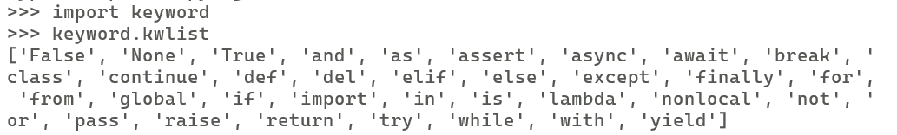
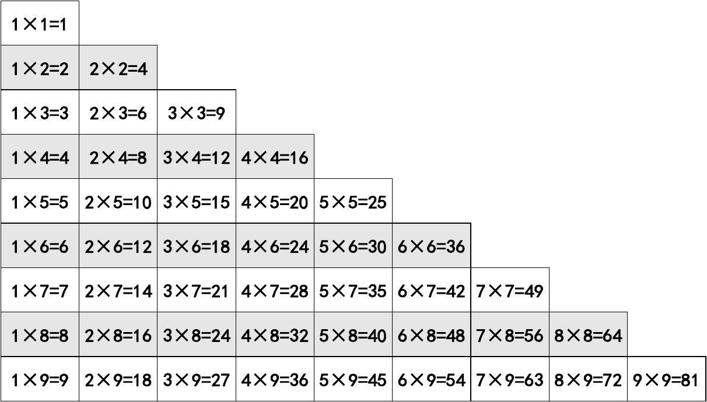
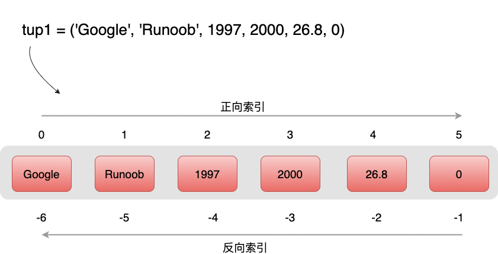
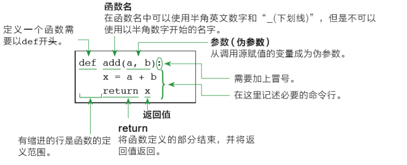

---

# Python

---

## Python概述

### 版本

Python 2 与 Python3

##### 查看Python版本

```powershell
PS C:\Users\Qingyuan_Qu> python -V
Python 3.11.2
```

---

### 开发环境

- 官方Python IDEL
- Anaconda3
- VS Code
- PyCharm
- ...  ...

---

### 编程规范

- 代码缩进：分支、循环、函数、类定义、异常处理、With语句等。注意代码块和函数体的缩进，一般以4个空格为一个缩进单位，或直接一个`Tab`制表符；
- 导入模块顺序：标准库、扩展库、自定义库；避免导入整个库，最好用到啥导啥；
- 不要写过长语句；

---

### 扩展库安装卸载

| 命令                                 | 说明 | 举例 |
| ------------------------------------ | ---- | ---- |
| pip list                             |      |      |
| pip install package[==version]       |      |      |
| pip uninstall packagename[==version] |      |      |

---

##### 安装Jupyter Notebook

```shell
pip install jupyter notebook
```

##### 启动Jupyter Notebook

```shell
jupyter notebook --no-browser --ip=192.168.179.100 --port 9999
```

---

### 帮助信息

内置函数`help()`可以查看属性、方法、类、模块等的帮助信息。

---

## 相关术语

#### 关键字

```python
import keyword
print(keyword.kwlist)
```



---

#### 变量

 编程的本质，就是对内存中数据的访问和修改。程序所用的数据都会保存到内存中，程序员需要一种机制来访问或修改内存中的数据。

这种机制就是变量，每个变量都代表了某一小块内存，而且变量是有名字的，程序对变量赋值，实际上就是把数据装入到该变量所代表的内存区的过程；

程序读取变量的值，实际上就是从该变量所代表的内存区取值的过程。形象地理解：变量相当于一个有名称的容器，该容器用于装各种不同类型的数据。

> 摘录自《疯狂Java讲义·第五版》

---

##### 变量命名规范

- 变量名称区分大小写。

- 变量名称首字母不能是数字

- 变量名称可以由字母、数字和下划线组成

- 变量名称不能使用Python内置的关键字

---

## 数据类型

### 数值类型

| 数值类型  | 描述   | 示例           |
| --------- | ------ | -------------- |
| **int**   | 整数   | 8、10、100     |
| **float** | 浮点数 | 1.0、2.1、1e-3 |
| **bool**  | 布尔型 | True、False    |

---

Python语言中，任何非零的数值、非空的数据类型，非空的字符串和非空列表，都`等价于True`，(`但除1以外都不等于True`)

```python
>>> 2 == True
False

>>> if 2:
...     print("abc")
...
abc
```

0或空类型、""(空字符串)、[]空表都`等价于False`，可以直接用作判断条件，(`但除0以外都不等于False`)。

```python
>>> if []:
...     print("False")
... else:
...     print("True")
...
True
```

---

### 字符串

|            | 使用方式                 | 示例               | 备注                |
| ---------- | ------------------------ | ------------------ | ------------------- |
| 单引号     | ' '                      | hi = 'hello world' | 可使用 [\\]续行输入 |
| 双引号     | " "                      | hi = "hello world" | 可使用 [\\]续行输入 |
| 多行字符串 | 以 [''']   ["""]开头结尾 |                    |                     |

---

### NoneType

无、空。

类型取值： `None`

```python
>>> a = []
>>> a == None
False

>>> b = ""
>>> b == None
False
```

```python
>>> def fun():
...     return None
...
>>> fun() == None
True
```

---

#### `is` 与 `==`

##### 情况一

```python
>>> a = 3
>>> b = 3

>>> a == b # == 判断两变量的值是否相等
True
>>> a is b # is 比较两个变量是否指向了同一个对象
True

# 可以看到变量a,b指向了同一内存地址中的对象
>>> id(a)
140705600293368
>>> id(b)
140705600293368
```

---

#### `is` 与 `==`

##### 情况二

```python
>>> a = ["a"]
>>> b = ["a"]

>>> a == b
True
>>> a is b
False

# 可以看到变量a,b指向了不同内存地址中的对象
>>> id(a)
2598781634944
>>> id(b)
2598781645888
```

---

>`id()`:  Return the identity of an object.  (CPython uses the object's memory address.)
>
>**CPython** 是用 C 语言实现的 Python 解释器，也是官方的并且是最广泛使用的Python解释器。

## 运算符

| 运算符分类 |                            | 示例                           |
| ---------- | -------------------------- | ------------------------------ |
| 赋值运算符 | =, +=, -=, *=, /=, %=, //= | a=10                           |
| 算术运算符 | +, -, *, /, %, //, **      | 5/3=1.666,  5//3=1,  5%3=2     |
| 比较运算符 | <, >, <=, >=, ==, !=       | 3<=4                           |
| 逻辑运算符 | and, or, not               | T and F => False , T or F => T |
| 成员运算符 | in                         | "he" in 'hello' =>  True       |

---

## 内置函数

函数是组织好的、实现单一功能或相关联功能的代码段。我们可以将函数视为一段有名字的代码，这类代码可以在需要的地方以`函数名()`的形式调用。

##### 内置函数概念

内置函数（built in function）不需要额外导入任何模块即可直接使用，具有非常快的运算速度，推荐优先使用。使用下面的语句可以查看所有的`内置函数`和`内置对象`。

---

```python
dir(__builtins__)
```

Help on built-in module builtins:

NAME
    builtins - Built-in functions, types, exceptions, and other objects.

DESCRIPTION
    This module provides direct access to all 'built-in' identifiers of Python; for example, builtins.len is the full name for the built-in function len().
    This module is not normally accessed explicitly(显式) by most applications, but can be useful in modules that provide objects with the same name as a built-in value, but in which the built-in of that name is also needed.

---

该模块提供对Python所有“内置”标识符的直接访问；例如，`builtins.len`是内置函数`len()`的全名。
该模块通常不会被大多数应用程序显式访问，但在提供与内置值同名的对象的模块中可能很有用，但在这些模块中也需要该名称的内置值。

```python
>>> import builtins
>>> builtins.len([1,2,3])
3
```

```python
>>> def len():
...     print("hello")
...
>>> len()
hello

>>> builtins.len([1,2,3])
3
```

---

##### 常见的内置函数

| 功能                     | 函数名                             | 示例                                       |
| ------------------------ | ---------------------------------- | ------------------------------------------ |
| 输入                     | input()                            |                                            |
| 输出                     | print()                            |                                            |
| 元素个数 | len(items)                 | len("study bigdata")   =>   13             |
| 类型判断 | type()                     | a = "hello";  type(a)   =>   <class 'str'> |
| 等差数列 | range(stop)                | range(5)  => 0,1,2,3,4                     |
|          | range(start, stop[, step]) | range(1,10,2) => 1,3,5,7,9                 |

---

## 字符串相关方法

#### 字符串索引查询

###### 单值索引

```python
>>> domain = "studybigdata.com"

>>> domain[2]
'u'
>>> domain[-1]
'm'
```

###### 范围索引

```python
>>> domain[5:8]
'big'

>>> domain[-3:]
'com'
```

---

#### 修改

不支持！ 因为是不可变类型，所以不可对元素重新赋值。

```python
>>> domain[1] = "S"
Traceback (most recent call last):
  File "<stdin>", line 1, in <module>
TypeError: 'str' object does not support item assignment
```

---

#### 常用方法

s = " hello World "

s1 = "hello"

s2 = "123456"

## 分支循环

### 分支

##### 判断一个数是奇数还是偶数

```python
var = int(input("请输入一个整数"))

if var % 2 == 0:
    print("你输入了一个偶数")
else:
    print("你输入了一个奇数")
```

```python
var = int(input("请输入一个整数"))

if var == 0:
    print("你输入了一个0")
elif var == 1:
    print("你输入了一个1")
else:
    print("你输入了一个不是0和1的数")
```

---

### 循环

#### for

```python
# range(start,end) # 返回可迭代对象，左闭右开
sum = 0

for i in range(1,10):
    sum = sum + i

print(sum)
```

---

#### while

```python
sum = 0
i = 0
while i < 10:
    sum = sum + i
    i = i + 1

print(sum)
```

---

#### continue

- 中断某次循环，继续下一次循环

```python
# 打印1-9中的偶数。
for i in range(1, 10):
    if i % 2 != 0:
        continue # 循环体后的代码不再执行
    print(i)
```

---

#### break

- 终止循环

```python
sum = 0

for i in range(1, 10):
    if i > 5:
        break
    sum = sum + i

print(sum)
```

---

### 案例：九九乘法口诀表



---

#### 方法一

##### 第一步

观察发现：

- 如果把上三角补全的话，是一个 9*9 实对称阵；

- 列（i）的取值是（1~9）
- 行（j）的取值也是（1~9）

```python
11 21 31 41 51 61 71 81 91 
12 22 32 42 52 62 72 82 92 
13 23 33 43 53 63 73 83 93 
14 24 34 44 54 64 74 84 94 
15 25 35 45 55 65 75 85 95 
16 26 36 46 56 66 76 86 96 
17 27 37 47 57 67 77 87 97 
18 28 38 48 58 68 78 88 98 
19 29 39 49 59 69 79 89 99
```

---

##### 结果

```python
1 1 2 1 3 1 4 1 5 1 6 1 7 1 8 1 9 1 
1 2 2 2 3 2 4 2 5 2 6 2 7 2 8 2 9 2 
1 3 2 3 3 3 4 3 5 3 6 3 7 3 8 3 9 3 
1 4 2 4 3 4 4 4 5 4 6 4 7 4 8 4 9 4 
1 5 2 5 3 5 4 5 5 5 6 5 7 5 8 5 9 5 
1 6 2 6 3 6 4 6 5 6 6 6 7 6 8 6 9 6 
1 7 2 7 3 7 4 7 5 7 6 7 7 7 8 7 9 7 
1 8 2 8 3 8 4 8 5 8 6 8 7 8 8 8 9 8 
1 9 2 9 3 9 4 9 5 9 6 9 7 9 8 9 9 9 
```

---

##### 第二步

取其中一半，只有当 j<=i  时输出，并调整格式

```python
for i in range(1,10):
    for j in range(1,10):
        if j<=i:
            print(j,"*",i,"=",i*j, sep="", end="\t")
    print()
```

```python
1*1=1 
1*2=2 2*2=4 
1*3=3 2*3=6 3*3=9 
1*4=4 2*4=8 3*4=12 4*4=16 
1*5=5 2*5=10 3*5=15 4*5=20 5*5=25 
1*6=6 2*6=12 3*6=18 4*6=24 5*6=30 6*6=36 
1*7=7 2*7=14 3*7=21 4*7=28 5*7=35 6*7=42 7*7=49 
1*8=8 2*8=16 3*8=24 4*8=32 5*8=40 6*8=48 7*8=56 8*8=64 
1*9=9 2*9=18 3*9=27 4*9=36 5*9=45 6*9=54 7*9=63 8*9=72 9*9=81
```

---

#### 方法二

```python
for i in range(1,10):
    for j in range(1,i+1):
            print(j,"*",i,"=",i*j, sep="", end="\t")
    print()
```

---


## Collection模块

This module implements specialized container datatypes providing alternatives to Python's general purpose built-in containers, dict, list, set, and tuple.

该模块实现了专门的容器数据类型，为Python的通用内置容器dict、list、set和tuple提供了替代方案。

---

### 序列类型

Python中常用的序列类型有字符串、列表和元组。



Python中的序列支持双向索引：正向递增索引和反向递减索引

正向递增索引从左向右依次递增，第一个元素的索引为0，第二个元素的索引为1，以此类推；

反向递减索引从右向左依次递减，从右数第一个元素的索引为-1，第二个元素的索引为-2，以此类推。

---

### 列表

#### 创建

##### 直接创建

列表可以包含任意类型的数据，包括数字、字符串、元组等。

```python
>>> int_l = [1,2,3]
>>> str_l = ["b","d","c"]
>>> mix_l = [1,"study",[3,4,5]]
```

##### 其他类型转换而来

```python
>>> trans_l = list("study")
>>> trans_l
['s', 't', 'u', 'd', 'y']
```

---

#### 索引查询

支持 `单值索引`和`范围索引切片`。

```python
>>> str_l[1]
'd'
>>> str_l[-2]
['d']

>>> str_l[0:2]
['b', 'd']

>>> str_l[1:3]
['d', 'c']

>>> str_l[1:]
['d', 'c']
```

---

#### 索引修改

```python
>>> int_l[0] = 3
>>> int_l
[3, 2, 3]
```

```python
>>> int_l[1:3] = [4,5]
>>> int_l
[3, 4, 5]
```


##### 回收列表

```python
>>> str_l = ["a","b","c"]
>>> del str_l
>>> str_l
Traceback (most recent call last):
  File "<stdin>", line 1, in <module>
NameError: name 'str_l' is not defined
```

---

#### 列表推导式

##### 需求一

根据已知列表，产生一个新列表，新列表中的每个元素为旧列表元素的平方。

```python
# 输入：
l_old = [1,2,3,4,5,6,7]
# 输出：
l_new = [1, 4, 9, 16, 25, 36, 49]
```

---

###### 方法一

```python
l_new = []
for i in l_old:
    l_new.append(i**2)
```

###### 方法二

```python
l_new = [i**2 for i in l_old]
```

---

##### 需求二

从已知整数列表中筛选出奇数，形成一个新列表。

```python
# 输入：
l_old = [1,2,3,4,5,6,7]
# 输出：
l_odd = [1,3,5,7]
```

---

###### 方法一

```python
l_odd = []

for i in l_old:
    if i%2==1:
        l_odd.append(i)
```

---

###### 方法二

```python
l_odd = [i for i in l_old if i%2==1]
```

---

##### 需求三

计算两个数据集合的笛卡尔积。

```python
# 输入
l_a = [1,2,3]
l_b = [4,5]

# 输出
[(1, 4), (1, 5), (2, 4), (2, 5), (3, 4), (3, 5)]
```

---

###### 方法一

```python
l_a = [1,2,3]
l_b = [4,5]
l_cartesion = []

for i in l_a:
    for j in l_b:
        l_cartesion.append( (i,j) )
```

---

###### 方法二

```python
[(i,j) for i in l_a for j in l_b]
```

---

### 元组

不支持修改。

#### 创建

```python
t = (1)  # 注意：1，int类型
t = (1,) # 一元组
t = (1,2,3) # 二元组
```

---

#### 查询

支持索引和范围索引

```python
t = (1,2,3)
t[1]
t[0:2]
```

---

### 集合

Python集合具备互异性和无序性。

  Ø 互异性：集合中的元素互不相同。

  Ø 无序性：集合中的元素没有顺序。

Python要求放入集合中的元素必须是不可变类型。

  Ø 不可变类型：整型、浮点型、字符串、元组。

  Ø 可变类型：列表、集合、字典。

---

##### 构造

```python
s_0 = set()
# 或
s_1 = {1,2,3}
s_2 = {2,3,4}
s_3 = {1,2}
```

---

##### 集合推导式

```python
>>> a = {1,2,3,4,5}
>>> {i**2 for i in a}
{1, 4, 9, 16, 25}
```

---

### 字典

映射类型以键值对的形式存储元素，键值对中的键与值之间存在映射关系。

**字典**（dict）是Python唯一的内置映射类型，字典的键必须遵守以下两个原则：

  Ø 每个键只能对应一个值，不允许同一个键在字典中重复出现。

  Ø 字典中的键是不可变类型。

---

##### 构造

```python
zs = dict()
# 或
zs = {} # 空字典
zs = {"name":"张三", "age":18}
```

##### 查询

```python
zs["name"]  # '张三' 
```

---

##### 增加、修改

有则修改，无则增加

```python
zs["age"] = 19
```

##### 删除

```python
zs.pop("tel")
```

---

##### 键

```python
zs.keys()
# dict_keys(['name', 'age', 'address'])
```

遍历字典的key

````python
for k in zs:
    print(k)
````

```
name
age
address
```

---

##### 值

```python
zs.values()
# dict_values(['张三', 21, '山东省枣庄市'])
```

##### 键值对

```python
zs.items()
# dict_items([('name', '张三'), ('age', 21), ('address', '山东省枣庄市')])
```

##### 清空

```python
zs.clear()
```

---

##### 字典推导式

借助字典推导式，交换字典的key和value, 产生新的字典

```python
{v:k for k,v in zs.items()}
```

将字典的值转为集合

```python
s = {v for k,v in zs.items()}
```

---

##### 案例：词频统计

```python
poem = '''江南
江南可采莲，
莲叶何田田，
鱼戏莲叶间。
鱼戏莲叶东，
鱼戏莲叶西，
鱼戏莲叶南，
鱼戏莲叶北。
'''
```

统计古诗中每个字符出现的次数。

---

##### 案例：词频统计

```python
word_count = {}

for word in poem:
    if word_count.get(word) == None:
        word_count.update( {word:1} )  # {"江":1, "南":1}
    else:
        v = word_count.get(word) + 1
        word_count.update({word:v})
word_count
```

---

### 其他

`+` 运算符可用于字符串、列表、元组的拼接；

`×` 运算符可用于字符串、列表、元组的复制；

> 集合、字典不支持

---

## 函数

### 函数定义



---

### [What is the difference between arguments and parameters?](https://docs.python.org/3/faq/programming.html#id16)

[Parameters](https://docs.python.org/3/glossary.html#term-parameter) are defined by the names that appear in a function definition, whereas [arguments](https://docs.python.org/3/glossary.html#term-argument) are the values actually passed to a function when calling it. Parameters define what [kind of arguments](https://docs.python.org/3/glossary.html#term-parameter) a function can accept. For example, given the function definition:

```
def func(foo, bar=None, **kwargs):
    pass
```

*foo*, *bar* and *kwargs* are parameters of `func`. However, when calling `func`, for example:

```
func(42, bar=314, extra=somevar)
```

the values `42`, `314`, and `somevar` are arguments.

---

### 常规函数

```python
# 空函数
def empty_fun():
    pass
def empty_fun():
    ...
    
# 无返回值函数
def standard_arg(arg):
    print(arg)
   
# 有返回值函数
def standard_args(arg):
    return arg
```

---

#### 为参数指定默认值

```python
def func(a, b=100):
    return a+b

func(1,2) # 3
func(1)  # 101
```

---

### 位置参数

位置参数是函数定义中最基本的参数类型。它们按照声明的顺序从函数调用者那里接受传递的值。在函数调用时，这些值按照函数定义时参数的顺序进行匹配。位置参数是函数定义的一部分，因此调用者必须按照声明时的顺序提供相应的值。

---

下面是一个简单的函数示例，其中包含两个位置参数：

```python
def add_numbers(x, y):
    result = x + y
    return result
```

在这个函数中，`x` 和 `y` 是位置参数。调用这个函数时，必须提供两个值，分别对应于 `x` 和 `y`：

```python
sum_result = add_numbers(3, 5)
print(sum_result)  # 输出 8
```

在这个例子中，`3` 和 `5` 是位置参数，它们分别传递给了 `x` 和 `y`。函数执行后返回它们的和，结果为 `8`。

---

### 关键字参数

关键字参数是一种在函数调用时通过指定参数名来传递值的方法。与位置参数不同，关键字参数的传递方式不依赖于参数的顺序，而是通过参数名明确指定值。这种方式可以提高函数调用的可读性，尤其是当函数有多个参数，而某些参数是可选的时候。

---

以下是关键字参数的基本使用方式：

```python
def greet(name, greeting): # greeting：问候
    message = f"{greeting}, {name}!"
    return message
```

在这个函数中，`name` 和 `greeting` 都是位置参数。调用函数时，我们可以使用`关键字参数`的方式传递值：

```python
result = greet(greeting="Hello"，name="张三")
print(result)
```

在这个例子中，我们通过 `name="Alice"` 和 `greeting="Hello"` 明确指定了每个参数的值。这种方式不仅提高了可读性，而且消除了参数位置的歧义。

---

关键字参数还可以与位置参数混合使用。例如：

```python
def print_person_info(name, age, city="Unknown"):
    print(f"Name: {name}, Age: {age}, City: {city}")

# 使用关键字参数和位置参数
print_person_info("Bob", city="New York", age=25)
```

在这个例子中，`name` 是位置参数，而 `age`、`city` 是关键字参数。如果不提供 `city` 的值，将使用默认值 `"Unknown"`。

总体而言，关键字参数提供了更灵活的调用方式，特别是在函数有很多参数时，可以明确指定每个参数的值，使得代码更加易读。

---

### 可变参数

`*` 在形参中出现时，用于打包参数为元组；

```python
def star_expression(*args):
    print(type(args)) # tuple
    print(args)
    
star_expression(1,2,3)
# (1, 2, 3)
```

`**` 在形参中出现时，用于打包实参中的关键字参数为字典；

```python
def dict_expression(**kvargs):
    print(type(kvargs))
    print(kvargs)
    
dict_expression(name="zhangsan",age=19)
# {'name': 'zhangsan', 'age': 19}
```

---

### 特殊参数

##### 仅位置参数

```python
# 定义
def pos_only_arg(arg1, arg2, /):
    print(arg1, arg2)

# 调用
pos_only_arg(1, 2)  # 正确
pos_only_arg(arg1=1, arg2=2)
# TypeError: pos_only_arg() got some positional-only arguments passed as keyword arguments: 'arg1, arg2'
```

---

##### 仅关键字参数

```python
# 定义
def kwd_only_arg(*, arg1, arg2):
    print(arg1, arg2)

# 调用
kwd_only_arg(arg2=2, arg1=1) # 正确
kwd_only_arg(1, 2)   
# TypeError: kwd_only_arg() takes 0 positional arguments but 2 were given
```

---

##### 位置关键字参数

```python
# 定义
def combined_example(pos_only_1, /, standard_1, *, kwd_only_1):
    print(pos_only_1, standard_1, kwd_only_1)
  
#调用
combined_example(1, standard_1=2, kwd_only_1=3) # 正确
combined_example(1, 2, kwd_only_1=3)   # 正确
```


---

### 高阶函数

#### lambda匿名函数

lambda匿名函数中只能使用简单的语法，不能使用`if else while return`等语句。

```python
>>> lambda :None
<function <lambda> at 0x000001E5B861F920>

>>> lambda : "hello"
<function <lambda> at 0x000001E5B861FA60>

>>> hello = lambda : "hello"
>>> hello()
'hello'

# 无返回值
>>> hello = lambda : print("hello")
>>> hello()
hello
```

---

```python

>>> square = lambda x:x**2
>>> square(2)
4

>>> add = lambda x,y:x+y
>>> add(1,2)
3

# 指定默认参数值
>>> f = lambda x,y=2:x+y
>>> f(1)
3
```

---

#### lambda匿名函数应用

##### 测试数据

```python
x = range(10,0,-1)
y = list("abcdefghij")
data = list(zip(x,y))
```

```python
[(10, 'a'),
 (9, 'b'),
 (8, 'c'),
 (7, 'd'),
 (6, 'e'),
 (5, 'f'),
 (4, 'g'),
 (3, 'h'),
 (2, 'i'),
 (1, 'j')]
```
