#### 一、Pandas是什么

 pandas 是一个开源的第三方 Python 库，从 Numpy 和 Matplotlib 的基础上构建而来，享有数据分析“三剑客之一”的盛名（NumPy、Matplotlib、Pandas）。Pandas 已经成为 Python 数据分析的必备高级工具，它的目标是成为强大、灵活、可以支持任何编程语言的数据分析工具。 


Pandas 这个名字来源于面板数据（Panel Data）与数据分析（data analysis）这两个名词的组合。在经济学中，Panel Data 是一个关于多维数据集的术语。Pandas 最初被应用于金融量化交易领域，现在它的应用领域更加广泛，涵盖了农业、工业、交通等许多行业。
Pandas 最初由 Wes McKinney（韦斯·麦金尼）于 2008 年开发，并于 2009 年实现开源。目前，Pandas 由 PyData 团队进行日常的开发和维护工作。在 2020 年 12 月，PyData 团队公布了最新的 Pandas 1.20 版本 。

- 加载数据
- 整理数据
- 操作数据
- 构建数据模型
- 分析数据

##### 1、Pandas主要特点

Pandas 主要包括以下几个特点：

- 它提供了一个简单、高效、带有默认标签（也可以自定义标签）的 DataFrame 对象。
- 能够快速得从不同格式的文件中加载数据（比如 Excel、CSV 、SQL文件），然后将其转换为可处理的对象；
- 能够按数据的行、列标签进行分组，并对分组后的对象执行聚合和转换操作；
- 能够很方便地实现数据归一化操作和缺失值处理；
- 能够很方便地对 DataFrame 的数据列进行增加、修改或者删除的操作；
- 能够处理不同格式的数据集，比如矩阵数据、异构数据表、时间序列等；
- 提供了多种处理数据集的方式，比如构建子集、切片、过滤、分组以及重新排序等。

```
上述知识点将在后续学习中为大家一一讲解。
```

##### 2、Pandas主要优势

与其它语言的数据分析包相比，Pandas 具有以下优势：

- Pandas 的 DataFrame 和 Series 构建了适用于数据分析的存储结构；
- Pandas 简洁的 API 能够让你专注于代码的核心层面；
- Pandas 实现了与其他库的集成，比如 Scipy、scikit-learn 和 Matplotlib；
- Pandas 官方网站（[点击访问](https://pandas.pydata.org/)）提供了完善资料支持，及其良好的社区环境。

##### 3、Pandas内置数据结构

我们知道，构建和处理二维、多维数组是一项繁琐的任务。Pandas 为解决这一问题， 在 ndarray 数组（NumPy 中的数组）的基础上构建出了两种不同的数据结构，分别是 Series（一维数据结构）DataFrame（二维数据结构）：

- Series 是带标签的一维数组，这里的标签可以理解为索引，但这个索引并不局限于整数，它也可以是字符类型，比如 a、b、c 等；
- DataFrame 是一种表格型数据结构，它既有行标签，又有列标签。


下面对上述数据结构做简单地的说明：

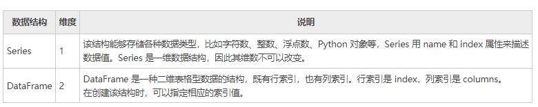

 由于上述数据结构的存在，使得处理多维数组数任务变的简单。在《[Pandas Series入门教程](http://c.biancheng.net/pandas/series.html)》和《[Pandas DataFrame入门教程（图解）](http://c.biancheng.net/pandas/dataframe.html)》两节中，我们会对上述数据结构做详细讲解。

#### 二、Pandas库下载和安装

Python 官方标准发行版并没有自带 Pandas 库，因此需要另行安装。除了标准发行版外，还有一些第三方机构发布的 Python 免费发行版， 它们在官方版本的基础上开发而来，并有针对性的提前安装了一些 Python 模块，从而满足某些特定领域的需求，比如专门适应于科学计算领域的 Anaconda，它就提前安装了多款适用于科学计算的软件包。

对于第三方发行版而言，它们已经自带 Pandas 库，所以无须另行安装。下面介绍了常用的免费发行版：

1) Anaconda（官网下载：https://www.anaconda.com/）是一个开源的 Python 发行版，包含了 180 多个科学包及其依赖项。除了支持 Windows 系统外，也支持 Linux 和 Mac 系统。

2) Python(x,y)（下载地址：https://python-xy.github.io/）是一款基于 Python、Qt （图形用户界面）和 Spyder （交互式开发环境）开发的软件，主要用于数值计算、数据分析和数据可视化等工程项目，目前只支持 Python 2 版本。

3) WinPython（下载地址：https://sourceforge.net/projects/winpython/files/）一个免费的 Python 发行版，包含了常用的科学计算包与 Spyder IDE，但仅支持 Windows 系统。

下面介绍在不同操作系统环境下，标准发行版安装 Pandas 的方法。 

##### 1、Windows系统安装

使用 pip 包管理器安装 Pandas，是最简单的一种安装方式。在 CMD 命令提示符界面行执行以下命令：

```
pip install pandas
```

##### 2、Linux系统安装

对于不同的版本的 Linux 系统，您可以采用它们各自的包管理器来安装 Pandas。

1) Ubuntu用户

Pandas 通常需要与其他软件包一起使用，因此可采用以下命令，一次性安装所有包： 

```
sudo apt-get install numpy scipy matplotlib pandas
```

2) Fedora用户

对于 Fedora 用户而言，可采用以下命令安装：

```
sudo yum install numpy scipy matplotlib pandas
```

##### 3、MacOSX系统安装

对于 Mac 用户而言，同样可以直接使用 pip 包管理器来安装，命令如下：

```python
pip install pandas
```

#### 三、Pandas Series入门教程

Series 结构，也称 Series 序列，是 Pandas 常用的数据结构之一，它是一种类似于一维数组的结构，由一组数据值（value）和一组标签组成，其中标签与数据值之间是一一对应的关系。

Series 可以保存任何数据类型，比如整数、字符串、浮点数、Python 对象等，它的标签默认为整数，从 0 开始依次递增。Series 的结构图，如下所示： 

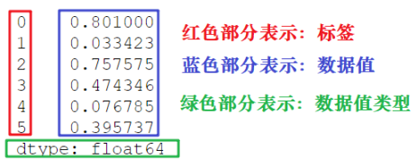

通过标签我们可以更加直观地查看数据所在的索引位置。

##### 1、创建Series对象

Pandas 使用 Series() 函数来创建 Series 对象，通过这个对象可以调用相应的方法和属性，从而达到处理数据的目的：

```python
import pandas as pd
s=pd.Series(data, index, dtype, copy)
```

 参数说明如下所示：

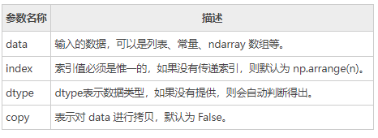

我们也可以使用数组、字典、标量值或者 Python 对象来创建 Series 对象。下面展示了创建 Series 对象的不同方法：

1) 创建一个空Series对象

使用以下方法可以创建一个空的 Series 对象，如下所示：

```python
import pandas as pd
#输出数据为空
s = pd.Series()
print(s)
```

输出结果如下：

```
Series([], dtype: float64)
```

2) ndarray创建Series对象

ndarray 是 NumPy 中的数组类型，当 data 是 ndarry 时，传递的索引必须具有与数组相同的长度。假如没有给 index 参数传参，在默认情况下，索引值将使用是 range(n) 生成，其中 n 代表数组长度，如下所示：

```
[0,1,2,3…. range(len(array))-1]
```

使用默认索引，创建 Series 序列对象：

```python
import pandas as pd
import numpy as np
data = np.array(['a','b','c','d'])
s = pd.Series(data)
print(s)
```

输出结果如下：

```
0   a
1   b
2   c
3   d
dtype: object
```

上述示例中没有传递任何索引，所以索引默认从 0 开始分配 ，其索引范围为 0 到`len(data)-1`，即 0 到 3。这种设置方式被称为“隐式索引”。

除了上述方法外，你也可以使用“显式索引”的方法定义索引标签，示例如下： 

```python
import pandas as pd
import numpy as np
data = np.array(['a','b','c','d'])
#自定义索引标签（即显示索引）
s = pd.Series(data,index=[100,101,102,103])
print(s)
```

输出结果：

```
100  a
101  b
102  c
103  d
dtype: object
```

3) dict创建Series对象

您可以把 dict 作为输入数据。如果没有传入索引时会按照字典的键来构造索引；反之，当传递了索引时需要将索引标签与字典中的值一一对应。
下面两组示例分别对上述两种情况做了演示。

 示例1，没有传递索引时： 

```python
import pandas as pd
import numpy as np
data = {'a' : 0., 'b' : 1., 'c' : 2.}
s = pd.Series(data)
print(s)
```

输出结果：

```
a 0.0
b 1.0
c 2.0
dtype: float64
```

示例 2， 为`index`参数传递索引时： 

```python
import pandas as pd
import numpy as np
data = {'a' : 0., 'b' : 1., 'c' : 2.}
s = pd.Series(data,index=['b','c','d','a'])
print(s)
```

输出结果：

```
b 1.0
c 2.0
d NaN
a 0.0
dtype: float64
```

当传递的索引值无法找到与其对应的值时，使用 NaN（非数字）填充。

4) 标量创建Series对象

示例如下：

```python
import pandas as pd
import numpy as np
s = pd.Series(5, index=[0, 1, 2, 3])
print(s)
```

输出如下：

```
0  5
1  5
2  5
3  5
dtype: int64
```

 标量值按照 index 的数量进行重复，并与其一一对应。

##### 2、访问Series数据

上述讲解了创建 Series 对象的多种方式，那么我们应该如何访问 Series 序列中元素呢？分为两种方式，一种是位置索引访问；另一种是索引标签访问。

1) 位置索引访问

这种访问方式与 ndarray 和 list 相同，使用元素自身的下标进行访问。我们知道数组的索引计数从 0 开始，这表示第一个元素存储在第 0 个索引位置上，以此类推，就可以获得 Series 序列中的每个元素。下面看一组简单的示例：

```python
import pandas as pd
s = pd.Series([1,2,3,4,5],index = ['a','b','c','d','e'])
print(s[0])  #位置下标
print(s['a']) #标签下标
```

输出结果：

```
1
1
```

通过切片的方式访问 Series 序列中的数据，示例如下：

```python
import pandas as pd
s = pd.Series([1,2,3,4,5],index = ['a','b','c','d','e'])
print(s[:3])
```

输出结果：

```
a  1
b  2
c  3
dtype: int64
```

如果想要获取最后三个元素，也可以使用下面的方式：

```python
import pandas as pd
s = pd.Series([1,2,3,4,5],index = ['a','b','c','d','e'])
print(s[-3:])
```

输出结果：

```
c  3
d  4
e  5
dtype: int64
```

2) 索引标签访问

Series 类似于固定大小的 dict，把 index 中的索引标签当做 key，而把 Series 序列中的元素值当做 value，然后通过 index 索引标签来访问或者修改元素值。
示例1，使用索标签访问单个元素值：

```python
import pandas as pd
s = pd.Series([6,7,8,9,10],index = ['a','b','c','d','e'])
print(s['a']）
```

输出结果：

```
6
```

示例 2，使用索引标签访问多个元素值

```python
import pandas as pd
s = pd.Series([6,7,8,9,10],index = ['a','b','c','d','e'])
print(s[['a','c','d']])
```

输出结果：

```
a    6
c    8
d    9
dtype: int64
```

示例3，如果使用了 index 中不包含的标签，则会触发异常：

```python
import pandas as pd
s = pd.Series([6,7,8,9,10],index = ['a','b','c','d','e'])
#不包含f值
print(s['f'])
```

 输出结果：

```
KeyError: 'f'
```

##### 3、Series常用属性

下面我们介绍 Series 的常用属性和方法。在下表列出了 Series 对象的常用属性。

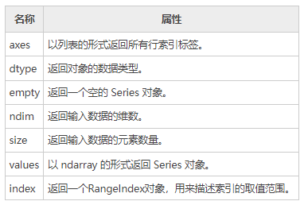

现在创建一个 Series 对象，并演示如何使用上述表格中的属性。如下所示：

```python
import pandas as pd
import numpy as np
s = pd.Series(np.random.randn(5))
print(s)
```

输出结果：

```
0    0.898097
1    0.730210
2    2.307401
3   -1.723065
4    0.346728
dtype: float64
```

上述示例的行索引标签是 [0,1,2,3,4]。

1) axes

```python
import pandas as pd
import numpy as np
s = pd.Series(np.random.randn(5))
print("The axes are:")
print(s.axes)
```

输出结果

```
The axes are:
[RangeIndex(start=0, stop=5, step=1)]
```

2) dtype

```python
import pandas as pd
import numpy as np
s = pd.Series(np.random.randn(5))
print("The dtype is:")
print(s.dtype)
```

输出结果：

```
The dtype is:
float64
```

3) empty

返回一个布尔值，用于判断数据对象是否为空。示例如下：

```python
import pandas as pd
import numpy as np
s = pd.Series(np.random.randn(5))
print("是否为空对象?")
print(s.empty)
```

输出结果：

```
是否为空对象?
False
```

4) ndim

查看序列的维数。根据定义，Series 是一维数据结构，因此它始终返回 1。

```python
import pandas as pd
import numpy as np
s = pd.Series(np.random.randn(5))
print(s)
print(s.ndim)
```

输出结果：

```
0    0.311485
1    1.748860
2   -0.022721
3   -0.129223
4   -0.489824
dtype: float64
1
```

5) size

返回 Series 对象的大小(长度)。

```python
import pandas as pd
import numpy as np
s = pd.Series(np.random.randn(3))
print(s)
#series的长度大小
print(s.size)
```

输出结果：

```
0   -1.866261
1   -0.636726
2    0.586037
dtype: float64
3
```

6) values

以数组的形式返回 Series 对象中的数据。

```python
import pandas as pd
import numpy as np
s = pd.Series(np.random.randn(6))
print(s)
print("输出series中数据")
print(s.values)
```

输出结果：

```
0   -0.502100
1    0.696194
2   -0.982063
3    0.416430
4   -1.384514
5    0.444303
dtype: float64
输出series中数据
[-0.50210028  0.69619407 -0.98206327  0.41642976 -1.38451433  0.44430257]
```

7) index

该属性用来查看 Series 中索引的取值范围。示例如下：

```python
#显示索引
import pandas as pd
s=pd.Series([1,2,5,8],index=['a','b','c','d'])
print(s.index)
#隐式索引
s1=pd.Series([1,2,5,8])
print(s1.index)
```

输出结果：

```
显示索引：
Index(['a', 'b', 'c', 'd'], dtype='object')
隐式索引：
RangeIndex(start=0, stop=4, step=1)
```

##### 4、Series常用方法

1) head()&tail()查看数据

如果想要查看 Series 的某一部分数据，可以使用 head() 或者 tail() 方法。其中 head() 返回前 n 行数据，默认显示前 5 行数据。示例如下：

```python
import pandas as pd
import numpy as np
s = pd.Series(np.random.randn(5))
print("The original series is:")
print(s)
#返回前三行数据
print(s.head(3))
```

输出结果：

```
原系列输出结果:
0    1.249679
1    0.636487
2   -0.987621
3    0.999613
4    1.607751
head(3)输出：
dtype: float64
0    1.249679
1    0.636487
2   -0.987621
dtype: float64
```

tail() 返回的是后 n 行数据，默认为后 5 行。示例如下：

```python
import pandas as pd
import numpy as np
s = pd.Series(np.random.randn(4))
#原series
print(s)
#输出后两行数据
print(s.tail(2))
```

输出结果：

```
原Series输出：
0    0.053340
1    2.165836
2   -0.719175
3   -0.035178
输出后两行数据：
dtype: float64
2   -0.719175
3   -0.035178
dtype: float64
```

2) isnull()&notnull()检测缺失值

isnull() 和 notnull() 用于检测 Series 中的缺失值。所谓缺失值，顾名思义就是值不存在、丢失、缺少。

- isnull()：如果值不存在或者缺失，则返回 True。
- notnull()：如果值不存在或者缺失，则返回 False。


其实不难理解，在实际的数据分析任物中，数据的收集往往要经历一个繁琐的过程。在这个过程中难免会因为一些不可抗力，或者人为因素导致数据丢失的现象。这时，我们可以使用相应的方法对缺失值进行处理，比如均值插值、数据补齐等方法。上述两个方法就是帮助我们检测是否存在缺失值。示例如下：

```python
import pandas as pd
#None代表缺失数据
s=pd.Series([1,2,5,None])
print(pd.isnull(s))  #是空值返回True
print(pd.notnull(s)) #空值返回False
```

输出结果：

```
0    False
1    False
2    False
3     True
dtype: bool

notnull():
0     True
1     True
2     True
3    False
dtype: bool
```

#### 四、Pandas DataFrame入门教程

DataFrame 是 Pandas 的重要数据结构之一，也是在使用 Pandas 进行数据分析过程中最常用的结构之一，可以这么说，掌握了 DataFrame 的用法，你就拥有了学习数据分析的基本能力。

##### 1、认识DataFrame结构

DataFrame 一个表格型的数据结构，既有行标签（index），又有列标签（columns），它也被称异构数据表，所谓异构，指的是表格中每列的数据类型可以不同，比如可以是字符串、整型或者浮点型等。其结构图示意图，如下所示：

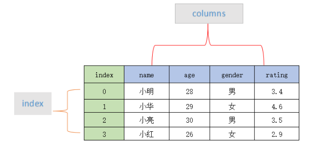

表格中展示了某个销售团队个人信息和绩效评级（rating）的相关数据。数据以行和列形式来表示，其中每一列表示一个属性，而每一行表示一个条目的信息。

下表展示了上述表格中每一列标签所描述数据的数据类型，如下所示： 

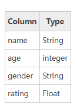

DataFrame 的每一列数据都可以看成一个 Series 结构，只不过，DataFrame 为这些行中每个数据值增加了一个列标签。因此 DataFrame 其实是从 Series 的基础上演变而来。在数据分析任务中 DataFrame 的应用非常广泛，因为它描述数据的更为清晰、直观。

通过示例对 DataFrame 结构做进一步讲解。 下面展示了一张学生成绩表，如下所示： 

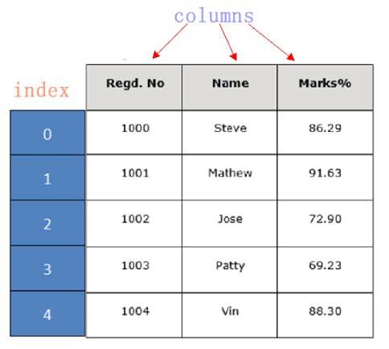

DataFrame 结构类似于 Execl 的表格型，表格中列标签的含义如下所示：

- Regd.No：表示登记的序列号
- Name：学生姓名
- Marks：学生分数


同 Series 一样，DataFrame 自带行标签索引，默认为“隐式索引”即从 0 开始依次递增，行标签与 DataFrame 中的数据项一一对应。上述表格的行标签从 0 到 5，共记录了 5 条数据（图中将行标签省略）。当然你也可以用“显式索引”的方式来设置行标签。

下面对 DataFrame 数据结构的特点做简单地总结，如下所示：

- DataFrame 每一列的标签值允许使用不同的数据类型；
- DataFrame 是表格型的数据结构，具有行和列；
- DataFrame 中的每个数据值都可以被修改。
- DataFrame 结构的行数、列数允许增加或者删除；
- DataFrame 有两个方向的标签轴，分别是行标签和列标签；
- DataFrame 可以对行和列执行算术运算。

##### 2、创建DataFrame对象

创建 DataFrame 对象的语法格式如下：

```python
import pandas as pd
pd.DataFrame(data, index, columns, dtype, copy)
```

 参数说明：

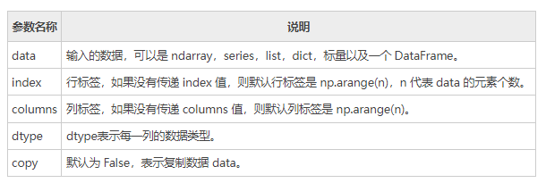

Pandas 提供了多种创建 DataFrame 对象的方式，主要包含以下五种，分别进行介绍。

1) 创建空的DataFrame对象

使用下列方式创建一个空的 DataFrame，这是 DataFrame 最基本的创建方法。

```python
import pandas as pd
df = pd.DataFrame()
print(df)
```

输出结果如下：

```
Empty DataFrame
Columns: []
Index: []
```

2) 列表创建DataFame对象

可以使用单一列表或嵌套列表来创建一个 DataFrame。
示例 1，单一列表创建 DataFrame：

```python
import pandas as pd
data = [1,2,3,4,5]
df = pd.DataFrame(data)
print(df)
```

输出如下：

```
     0
0    1
1    2
2    3
3    4
4    5
```

示例 2，使用嵌套列表创建 DataFrame 对象：

```python
import pandas as pd
data = [['Alex',10],['Bob',12],['Clarke',13]]
df = pd.DataFrame(data,columns=['Name','Age'])
print(df)
```

输出结果：

```
      Name      Age
0     Alex      10
1     Bob       12
2     Clarke    13
```

示例 3，指定数值元素的数据类型为 float：

```python
import pandas as pd
data = [['Alex',10],['Bob',12],['Clarke',13]]
df = pd.DataFrame(data,columns=['Name','Age'],dtype=float)
print(df)
```

输出结果：

```
      Name     Age
0     Alex     10.0
1     Bob      12.0
2     Clarke   13.0
```

3) 字典嵌套列表创建

data 字典中，键对应的值的元素长度必须相同（也就是列表长度相同）。如果传递了索引，那么索引的长度应该等于数组的长度；如果没有传递索引，那么默认情况下，索引将是 range(n)，其中 n 代表数组长度。
示例 4：

```python
import pandas as pd
data = {'Name':['Tom', 'Jack', 'Steve', 'Ricky'],'Age':[28,34,29,42]}
df = pd.DataFrame(data)
print(df)
```

输出结果：

```
      Age      Name
0     28        Tom
1     34       Jack
2     29      Steve
3     42      Ricky
```

 注意：这里使用了默认行标签，也就是 range(n)。它生成了 0,1,2,3，并分别对应了列表中的每个元素值。

示例 5，现在给上述示例 4 添加自定义的行标签： 

```python
import pandas as pd
data = {'Name':['Tom', 'Jack', 'Steve', 'Ricky'],'Age':[28,34,29,42]}
df = pd.DataFrame(data, index=['rank1','rank2','rank3','rank4'])
print(df)
```

输出结果如下：

```
         Age    Name
rank1    28      Tom
rank2    34     Jack
rank3    29    Steve
rank4    42    Ricky
```

注意：index 参数为每行分配了一个索引。

4) 列表嵌套字典创建DataFrame对象

列表嵌套字典可以作为输入数据传递给 DataFrame 构造函数。默认情况下，字典的键被用作列名。
示例 6 如下

```python
import pandas as pd
data = [{'a': 1, 'b': 2},{'a': 5, 'b': 10, 'c': 20}]
df = pd.DataFrame(data)
print(df)
```

输出结果：

```
    a    b      c
0   1   2     NaN
1   5   10   20.0
```

 注意：如果其中某个元素值缺失，也就是字典的 key 无法找到对应的 value，将使用 NaN 代替。

示例 7，给上述示例 6 添加行标签索引： 

```python
import pandas as pd
data = [{'a': 1, 'b': 2},{'a': 5, 'b': 10, 'c': 20}]
df = pd.DataFrame(data, index=['first', 'second'])
print(df)
```

输出结果：

```
        a   b       c
first   1   2     NaN
second  5   10   20.0
```

示例 8，如何使用列表嵌套字典以及行、列索引表创建一个 DataFrame 对象。

```python
import pandas as pd
data = [{'a': 1, 'b': 2},{'a': 5, 'b': 10, 'c': 20}]
df1 = pd.DataFrame(data, index=['first', 'second'], columns=['a', 'b'])
df2 = pd.DataFrame(data, index=['first', 'second'], columns=['a', 'b1'])
print(df1)
print(df2)
```

输出结果：

```
#df1输出
         a  b
first    1  2
second   5  10

#df2输出
         a  b1
first    1  NaN
second   5  NaN
```

注意：因为 b1 在字典键中不存在，所以对应值为 NaN。

5) Series创建DataFrame对象

您也可以传递一个字典形式的 Series，从而创建一个 DataFrame 对象，其输出结果的行索引是所有 index 的合集。 示例如下：

```python
import pandas as pd
d = {'one' : pd.Series([1, 2, 3], index=['a', 'b', 'c']),
   'two' : pd.Series([1, 2, 3, 4], index=['a', 'b', 'c', 'd'])}
df = pd.DataFrame(d)
print(df)
```

输出结果如下：

```
      one    two
a     1.0    1
b     2.0    2
c     3.0    3
d     NaN    4
```

 注意：对于 one 列而言，此处虽然显示了行索引 'd'，但由于没有与其对应的值，所以它的值为 NaN。

##### 3、列索引操作DataFrame

DataFrame 可以使用列索（columns index）引来完成数据的选取、添加和删除操作。下面依次对这些操作进行介绍。

1) 列索引选取数据列

您可以使用列索引，轻松实现数据选取，示例如下：

```python
import pandas as pd
d = {'one' : pd.Series([1, 2, 3], index=['a', 'b', 'c']),
   'two' : pd.Series([1, 2, 3, 4], index=['a', 'b', 'c', 'd'])}
df = pd.DataFrame(d)
print(df['one'])
```

输出结果：

```
a     1.0
b     2.0
c     3.0
d     NaN
Name: one, dtype: float64
```

2) 列索引添加数据列

使用 columns 列索引表标签可以实现添加新的数据列，示例如下：

```python
import pandas as pd
d = {'one' : pd.Series([1, 2, 3], index=['a', 'b', 'c']),
   'two' : pd.Series([1, 2, 3, 4], index=['a', 'b', 'c', 'd'])}
df = pd.DataFrame(d)
#使用df['列']=值，插入新的数据列
df['three']=pd.Series([10,20,30],index=['a','b','c'])
print(df)
#将已经存在的数据列做相加运算
df['four']=df['one']+df['three']
print(df)
```

输出结果：

```
使用列索引创建新数据列:
     one   two   three
a    1.0    1    10.0
b    2.0    2    20.0
c    3.0    3    30.0
d    NaN    4    NaN

已存在的数据列做算术运算：
      one   two   three    four
a     1.0    1    10.0     11.0
b     2.0    2    20.0     22.0
c     3.0    3    30.0     33.0
d     NaN    4     NaN     NaN
```

上述示例，我们初次使用了 DataFrame 的算术运算，这和 NumPy 非常相似。除了使用`df[]=value` 的方式外，您还可以使用 insert() 方法插入新的列，示例如下： 

```python
import pandas as pd
info=[['Jack',18],['Helen',19],['John',17]]
df=pd.DataFrame(info,columns=['name','age'])
print(df)
#注意是column参数
#数值1代表插入到columns列表的索引位置
df.insert(1,column='score',value=[91,90,75])
print(df)
```

输出结果：

```
添加前：
    name  age
0   Jack   18
1  Helen   19
2   John   17

添加后：
    name  score  age
0   Jack     91   18
1  Helen     90   19
2   John     75   17
```

3) 列索引删除数据列

通过 del 和 pop() 都能够删除 DataFrame 中的数据列。示例如下：

```python
import pandas as pd
d = {'one' : pd.Series([1, 2, 3], index=['a', 'b', 'c']),
   'two' : pd.Series([1, 2, 3, 4], index=['a', 'b', 'c', 'd']),
   'three' : pd.Series([10,20,30], index=['a','b','c'])}
df = pd.DataFrame(d)
print("Our dataframe is:")
print(df)
#使用del删除
del df['one']
print(df)
#使用pop方法删除
df.pop('two')
print(df)
```

输出结果：

```
原DataFrame:
      one   three  two
a     1.0    10.0   1
b     2.0    20.0   2
c     3.0    30.0   3
d     NaN     NaN   4

使用del删除 first:
      three    two
a     10.0     1
b     20.0     2
c     30.0     3
d     NaN      4

使用 pop()删除:
   three
a  10.0
b  20.0
c  30.0
d  NaN
```

##### 4、行索引操作DataFrame

理解了上述的列索引操作后，行索引操作就变的简单。下面看一下，如何使用行索引来选取 DataFrame 中的数据。

1) 标签索引选取

可以将行标签传递给 loc 函数，来选取数据。示例如下：

```python
import pandas as pd
d = {'one' : pd.Series([1, 2, 3], index=['a', 'b', 'c']),
   'two' : pd.Series([1, 2, 3, 4], index=['a', 'b', 'c', 'd'])}
df = pd.DataFrame(d)
print(df.loc['b'])
```

输出结果：

```
one 2.0
two 2.0
Name: b, dtype: float64
```

注意：loc 允许接两个参数分别是行和列，参数之间需要使用“逗号”隔开，但该函数只能接收标签索引。

2) 整数索引选取

通过将数据行所在的索引位置传递给 iloc 函数，也可以实现数据行选取。示例如下：

```python
import pandas as pd
d = {'one' : pd.Series([1, 2, 3], index=['a', 'b', 'c']),
   'two' : pd.Series([1, 2, 3, 4], index=['a', 'b', 'c', 'd'])}
df = pd.DataFrame(d)
print (df.iloc[2]）
```

输出结果：

```
one   3.0
two   3.0
Name: c, dtype: float64
```

注意：iloc 允许接受两个参数分别是行和列，参数之间使用“逗号” 隔开，但该函数只能接收整数索引。 

3) 切片操作多行选取

您也可以使用切片的方式同时选取多行。示例如下：

```python
import pandas as pd
d = {'one' : pd.Series([1, 2, 3], index=['a', 'b', 'c']),
   'two' : pd.Series([1, 2, 3, 4], index=['a', 'b', 'c', 'd'])}
df = pd.DataFrame(d)
#左闭右开
print(df[2:4])
```

输出结果：

```
   one  two
c  3.0    3
d  NaN    4
```

4) 添加数据行

使用 append() 函数，可以将新的数据行添加到 DataFrame 中，该函数会在行末追加数据行。示例如下：

```python
import pandas as pd
df = pd.DataFrame([[1, 2], [3, 4]], columns = ['a','b'])
df2 = pd.DataFrame([[5, 6], [7, 8]], columns = ['a','b'])
#在行末追加新数据行
df = df.append(df2)
print(df)
```

输出结果：

```
   a  b
0  1  2
1  3  4
0  5  6
1  7  8
```

5) 删除数据行

您可以使用行索引标签，从 DataFrame 中删除某一行数据。如果索引标签存在重复，那么它们将被一起删除。示例如下：

```python
import pandas as pd
df = pd.DataFrame([[1, 2], [3, 4]], columns = ['a','b'])
df2 = pd.DataFrame([[5, 6], [7, 8]], columns = ['a','b'])
df = df.append(df2)
print(df)
#注意此处调用了drop()方法
df = df.drop(0)
print(df)
```

输出结果：

```
执行drop(0)前：
   a  b
0  1  2
1  3  4
0  5  6
1  7  8

执行drop(0)后：
  a b
1 3 4
1 7 8
```

 在上述的示例中，默认使用 range(2) 生成了行索引，并通过 drop(0) 同时删除了两行数据。

##### 5、常用属性和方法汇总

DataFrame 的属性和方法，与 Series 相差无几，如下所示：

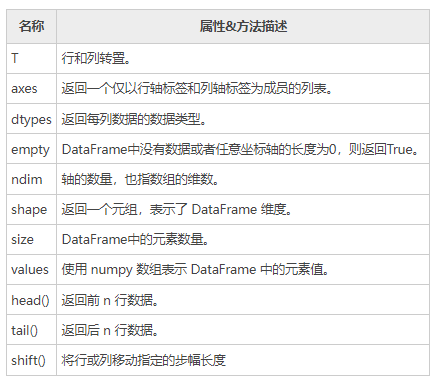

下面对 DataFrame 常用属性进行演示，首先我们创建一个 DataFrame 对象，示例如下：

```python
import pandas as pd
import numpy as np
d = {'Name':pd.Series(['c语言中文网','编程帮',"百度",'360搜索','谷歌','微学苑','Bing搜索']),
   'years':pd.Series([5,6,15,28,3,19,23]),
   'Rating':pd.Series([4.23,3.24,3.98,2.56,3.20,4.6,3.8])}
#构建DataFrame
df = pd.DataFrame(d)
#输出series
print(df)
```

输出结果：

```
输出 series 数据:
     Name  years  Rating
0  c语言中文网    5    4.23
1     编程帮     6    3.24
2      百度     15    3.98
3   360搜索     28    2.56
4      谷歌     3     3.20
5     微学苑    19    4.60
6  Bing搜索     23    3.80
```

1) T（Transpose）转置

返回 DataFrame 的转置，也就是把行和列进行交换。

```python
import pandas as pd
import numpy as np
d = {'Name':pd.Series(['c语言中文网','编程帮',"百度",'360搜索','谷歌','微学苑','Bing搜索']),
   'years':pd.Series([5,6,15,28,3,19,23]),
   'Rating':pd.Series([4.23,3.24,3.98,2.56,3.20,4.6,3.8])}
#构建DataFrame
df = pd.DataFrame(d)
#输出DataFrame的转置
print(df.T)
```

输出结果：

```
Our data series is:
             0         1      2      3       4    5       6
Name    c语言中文网   编程帮    百度  360搜索   谷歌  微学苑  Bing搜索
years        5        6      15      28      3     19      23
Rating    4.23       3.24    3.98    2.56    3.2   4.6     3.8
```

2) axes

返回一个行标签、列标签组成的列表。

```python
import pandas as pd
import numpy as np
d = {'Name':pd.Series(['c语言中文网','编程帮',"百度",'360搜索','谷歌','微学苑','Bing搜索']),
   'years':pd.Series([5,6,15,28,3,19,23]),
   'Rating':pd.Series([4.23,3.24,3.98,2.56,3.20,4.6,3.8])}
#构建DataFrame
df = pd.DataFrame(d)
#输出行、列标签
print(df.axes)
```

输出结果：

```
[RangeIndex(start=0, stop=7, step=1), Index(['Name', 'years', 'Rating'], dtype='object')]
```

3) dtypes

返回每一列的数据类型。示例如下：

```python
import pandas as pd
import numpy as np
d = {'Name':pd.Series(['c语言中文网','编程帮',"百度",'360搜索','谷歌','微学苑','Bing搜索']),
   'years':pd.Series([5,6,15,28,3,19,23]),
   'Rating':pd.Series([4.23,3.24,3.98,2.56,3.20,4.6,3.8])}
#构建DataFrame
df = pd.DataFrame(d)
#输出行、列标签
print(df.dtypes)
```

输出结果：

```
Name       object
years       int64
Rating     float64
dtype:     object
```

4) empty

返回一个布尔值，判断输出的数据对象是否为空，若为 True 表示对象为空。

```python
import pandas as pd
import numpy as np
d = {'Name':pd.Series(['c语言中文网','编程帮',"百度",'360搜索','谷歌','微学苑','Bing搜索']),
   'years':pd.Series([5,6,15,28,3,19,23]),
   'Rating':pd.Series([4.23,3.24,3.98,2.56,3.20,4.6,3.8])}
#构建DataFrame
df = pd.DataFrame(d)
#判断输入数据是否为空
print(df.empty)
```

输出结果：

```
判断输入对象是否为空：
False
```

5) ndim

返回数据对象的维数。DataFrame 是一个二维数据结构。

```python
import pandas as pd
import numpy as np
d = {'Name':pd.Series(['c语言中文网','编程帮',"百度",'360搜索','谷歌','微学苑','Bing搜索']),
   'years':pd.Series([5,6,15,28,3,19,23]),
   'Rating':pd.Series([4.23,3.24,3.98,2.56,3.20,4.6,3.8])}
#构建DataFrame
df = pd.DataFrame(d)
#DataFrame的维度
print(df.ndim)
```

输出结果：

```
2
```

6) shape

返回一个代表 DataFrame 维度的元组。返回值元组 (a,b)，其中 a 表示行数，b 表示列数。

```python
import pandas as pd
import numpy as np
d = {'Name':pd.Series(['c语言中文网','编程帮',"百度",'360搜索','谷歌','微学苑','Bing搜索']),
   'years':pd.Series([5,6,15,28,3,19,23]),
   'Rating':pd.Series([4.23,3.24,3.98,2.56,3.20,4.6,3.8])}
#构建DataFrame
df = pd.DataFrame(d)
#DataFrame的形状
print(df.shape)
```

输出结果：

```
(7, 3)
```

7) size

返回 DataFrame 中的元素数量。示例如下：

```python
import pandas as pd
import numpy as np
d = {'Name':pd.Series(['c语言中文网','编程帮',"百度",'360搜索','谷歌','微学苑','Bing搜索']),
   'years':pd.Series([5,6,15,28,3,19,23]),
   'Rating':pd.Series([4.23,3.24,3.98,2.56,3.20,4.6,3.8])}
#构建DataFrame
df = pd.DataFrame(d)
#DataFrame的中元素个数
print(df.size)
```

输出结果：

```
21
```

8) values

以 ndarray 数组的形式返回 DataFrame 中的数据。

```python
import pandas as pd
import numpy as np
d = {'Name':pd.Series(['c语言中文网','编程帮',"百度",'360搜索','谷歌','微学苑','Bing搜索']),
   'years':pd.Series([5,6,15,28,3,19,23]),
   'Rating':pd.Series([4.23,3.24,3.98,2.56,3.20,4.6,3.8])}
#构建DataFrame
df = pd.DataFrame(d)
#DataFrame的数据
print(df.values)
```

输出结果：

```
[['c语言中文网' 5 4.23]
['编程帮' 6 3.24]
['百度' 15 3.98]
['360搜索' 28 2.56]
['谷歌' 3 3.2]
['微学苑' 19 4.6]
['Bing搜索' 23 3.8]]
```

9) head()&tail()查看数据

如果想要查看 DataFrame 的一部分数据，可以使用 head() 或者 tail() 方法。其中 head() 返回前 n 行数据，默认显示前 5 行数据。示例如下：

```python
import pandas as pd
import numpy as np
d = {'Name':pd.Series(['c语言中文网','编程帮',"百度",'360搜索','谷歌','微学苑','Bing搜索']),
   'years':pd.Series([5,6,15,28,3,19,23]),
   'Rating':pd.Series([4.23,3.24,3.98,2.56,3.20,4.6,3.8])}
#构建DataFrame
df = pd.DataFrame(d)
#获取前3行数据
print(df.head(3))
```

输出结果：

```
     Name       years   Rating
0   c语言中文网      5     4.23
1    编程帮         6     3.24
2    百度          15     3.98
```

tail() 返回后 n 行数据，示例如下：

```python
import pandas as pd
import numpy as np
d = {'Name':pd.Series(['c语言中文网','编程帮',"百度",'360搜索','谷歌','微学苑','Bing搜索']),
   'years':pd.Series([5,6,15,28,3,19,23]),
   'Rating':pd.Series([4.23,3.24,3.98,2.56,3.20,4.6,3.8])}
#构建DataFrame
df = pd.DataFrame(d)
#获取后2行数据
print(df.tail(2))
```

输出结果：

```
      Name     years   Rating
5     微学苑      19     4.6
6    Bing搜索     23     3.8
```

10) shift()移动行或列（略）

如果您想要移动 DataFrame 中的某一行/列，可以使用 shift() 函数实现。它提供了一个`periods` 参数，该参数表示在特定的轴上移动指定的步幅。 
shif() 函数的语法格式如下：

```
DataFrame.shift(periods=1, freq=None, axis=0)  
```

 参数说明如下：

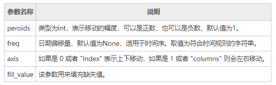

该函数的返回值是移动后的 DataFrame 副本。下面看一组简单的实例：

```python
import pandas as pd 
info= pd.DataFrame({'a_data': [40, 28, 39, 32, 18], 
'b_data': [20, 37, 41, 35, 45], 
'c_data': [22, 17, 11, 25, 15]}) 
#移动幅度为3
info.shift(periods=3)  
```

输出结果：

```
   a_data  b_data  c_data
0     NaN     NaN     NaN
1     NaN     NaN     NaN
2     NaN     NaN     NaN
3    40.0    20.0    22.0
4    28.0    37.0    17.0
```

下面使用 fill_value 参数填充 DataFrame 中的缺失值，如下所示：

```python
import pandas as pd 
info= pd.DataFrame({'a_data': [40, 28, 39, 32, 18], 
'b_data': [20, 37, 41, 35, 45], 
'c_data': [22, 17, 11, 25, 15]}) 
#移动幅度为3
print(info.shift(periods=3))
#将缺失值和原数值替换为52
info.shift(periods=3,axis=1,fill_value= 52)  
```

输出结果：

```
原输出结果：
   a_data  b_data  c_data
0     NaN     NaN     NaN
1     NaN     NaN     NaN
2     NaN     NaN     NaN
3    40.0    20.0    22.0
4    28.0    37.0    17.0

替换后输出：
   a_data  b_data  c_data
0      52      52      52
1      52      52      52
2      52      52      52
3      52      52      52
4      52      52      52
```

注意：fill_value 参数不仅可以填充缺失值，还也可以对原数据进行替换。

#### 五、Pandas Panel三维数据结构(略)

 Panel 结构也称“面板结构”，它源自于 Panel Data 一词，翻译为“面板数据”。如果您使用的是 Pandas 0.25 以前的版本，那么您需要掌握本节内容，否则，作为了解内容即可。

```
自 Pandas 0.25 版本后， Panel 结构已经被废弃。
```

Panel 是一个用来承载数据的三维数据结构，它有三个轴，分别是 items（0 轴），major_axis（1 轴），而 minor_axis（2 轴）。这三个轴为描述、操作 Panel 提供了支持，其作用介绍如下：

- items：axis =0，Panel 中的每个 items 都对应一个 DataFrame。
- major_axis：axis=1，用来描述每个 DataFrame 的行索引。
- minor_axis：axis=2，用来描述每个 DataFrame 的列索引。

##### 1、pandas.Panel()

 您可以使用下列构造函数创建一个 Panel，如下所示：

```
pandas.Panel(data, items, major_axis, minor_axis, dtype, copy)
```

 参数说明如下：

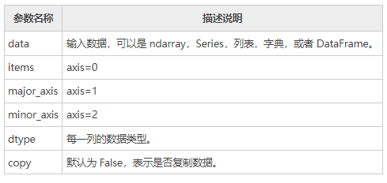

##### 2、创建Panel 对象

下面介绍创建 Panel 对象的两种方式：一种是使用 nadarry 数组创建，另一种使用 DataFrame 对象创建。首先，我们学习如何创建一个空的 Panel 对象。

1) 创建一个空Panel

使用 Panel 的构造函数创建，如下所示：

```python
import pandas as pd
p = pd.Panel()
print(p)
```

输出结果：

```
<class 'pandas.core.panel.Panel'>
Dimensions: 0 (items) x 0 (major_axis) x 0 (minor_axis)
Items axis: None
Major_axis axis: None
Minor_axis axis: None
```

2) ndarray三维数组创建

```python
import pandas as pd
import numpy as np
#返回均匀分布的随机样本值位于[0,1）之间
data = np.random.rand(2,4,5)
p = pd.Panel(data)
print (p)
```

输出结果：

```
<class 'pandas.core.panel.Panel'>
Dimensions: 2 (items) x 4 (major_axis) x 5 (minor_axis)
Items axis: 0 to 1
Major_axis axis: 0 to 3
Minor_axis axis: 0 to 4
```

 请注意与上述示例的空 Panel 进行对比。

3) DataFrame创建

下面使用 DataFrame 创建一个 Panel，示例如下：

```python
import pandas as pd
import numpy as np
data = {'Item1' : pd.DataFrame(np.random.randn(4, 3)),
   'Item2' : pd.DataFrame(np.random.randn(4, 2))}
p = pd.Panel(data)
print(p)
```

输出结果：

```
Dimensions: 2 (items) x 4 (major_axis) x 3 (minor_axis)
Items axis: Item1 to Item2
Major_axis axis: 0 to 3
Minor_axis axis: 0 to 2
```

##### 3、Panel中选取数据

如果想要从 Panel 对象中选取数据，可以使用 Panel 的三个轴来实现，也就是`items``major_axis``minor_axis` 。下面介绍其中一种，大家体验一下即可。

1) 使用 items选取数据 

示例如下：

```python
import pandas as pd
import numpy as np
data = {'Item1':pd.DataFrame(np.random.randn(4, 3)),
   'Item2':pd.DataFrame(np.random.randn(4, 2))}
p = pd.Panel(data)
print(p['Item1'])
```

输出结果：

```
            0          1          2
0    0.488224  -0.128637   0.930817
1    0.417497   0.896681   0.576657
2   -2.775266   0.571668   0.290082
3   -0.400538  -0.144234   1.110535
```

上述示例中 data，包含了两个数据项，我们选择了 item1，输出结果是 4 行 3 列的 DataFrame，其行、列索引分别对应 major_axis 和 minor_axis。

#### 六、Python Pandas描述性统计

描述统计学（descriptive statistics）是一门统计学领域的学科，主要研究如何取得反映客观现象的数据，并以图表形式对所搜集的数据进行处理和显示，最终对数据的规律、特征做出综合性的描述分析。Pandas 库正是对描述统计学知识完美应用的体现，可以说如果没有“描述统计学”作为理论基奠，那么 Pandas 是否存在犹未可知。下列表格对 Pandas 常用的统计学函数做了简单的总结： 

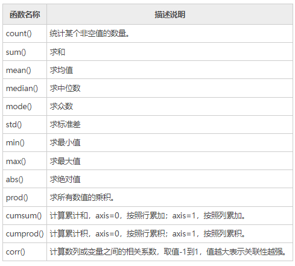

从描述统计学角度出发，我们可以对 DataFrame 结构执行聚合计算等其他操作，比如 sum() 求和、mean()求均值等方法。
在 DataFrame 中，使用聚合类方法时需要指定轴(axis)参数。下面介绍两种传参方式：

- 对行操作，默认使用 axis=0 或者使用 "index"；
- 对列操作，默认使用 axis=1 或者使用 "columns"。

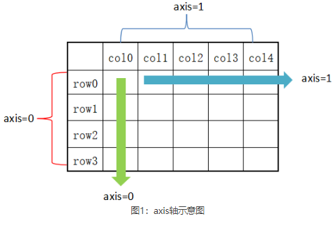

从图 1 可以看出，axis=0 表示按垂直方向进行计算，而 axis=1 则表示按水平方向。下面让我们创建一个 DataFrame，使用它对本节的内容进行演示。

创建一个 DataFrame 结构，如下所示：

```python
import pandas as pd
import numpy as np
#创建字典型series结构
d = {'Name':pd.Series(['小明','小亮','小红','小华','老赵','小曹','小陈',
   '老李','老王','小冯','小何','老张']),
   'Age':pd.Series([25,26,25,23,30,29,23,34,40,30,51,46]),
   'Rating':pd.Series([4.23,3.24,3.98,2.56,3.20,4.6,3.8,3.78,2.98,4.80,4.10,3.65])
}
df = pd.DataFrame(d)
print(df)
```

输出结果：

```
   Name  Age  Rating
0    小明   25    4.23
1    小亮   26    3.24
2    小红   25    3.98
3    小华   23    2.56
4    老赵   30    3.20
5    小曹   29    4.60
6    小陈   23    3.80
7    老李   34    3.78
8    老王   40    2.98
9    小冯   30    4.80
10   小何   51    4.10
11   老张   46    3.65
```

##### 1、sum()求和

在默认情况下，返回 axis=0 的所有值的和。示例如下：

```python
import pandas as pd
import numpy as np
#创建字典型series结构
d = {'Name':pd.Series(['小明','小亮','小红','小华','老赵','小曹','小陈',
   '老李','老王','小冯','小何','老张']),
   'Age':pd.Series([25,26,25,23,30,29,23,34,40,30,51,46]),
   'Rating':pd.Series([4.23,3.24,3.98,2.56,3.20,4.6,3.8,3.78,2.98,4.80,4.10,3.65])
}
df = pd.DataFrame(d)
#默认axis=0或者使用sum("index")
print(df.sum())
```

输出结果：

```
Name      小明小亮小红小华老赵小曹小陈老李老王小冯小何老张
Age                            382
Rating                       44.92
dtype: object
```

 **注意**：sum() 和 cumsum() 函数可以同时处理数字和字符串数据。虽然字符聚合通常不被使用，但使用这两个函数并不会抛出异常；而对于 abs()、cumprod() 函数则会抛出异常，因为它们无法操作字符串数据。

下面再看一下 axis=1 的情况，如下所示： 

```python
import pandas as pd
import numpy as np
d = {'Name':pd.Series(['小明','小亮','小红','小华','老赵','小曹','小陈',
   '老李','老王','小冯','小何','老张']),
   'Age':pd.Series([25,26,25,23,30,29,23,34,40,30,51,46]),
   'Rating':pd.Series([4.23,3.24,3.98,2.56,3.20,4.6,3.8,3.78,2.98,4.80,4.10,3.65])
}
df = pd.DataFrame(d)
#也可使用sum("columns")或sum(1)
print(df.sum(axis=1))
```

 输出结果：

```
0     29.23
1     29.24
2     28.98
3     25.56
4     33.20
5     33.60
6     26.80
7     37.78
8     42.98
9     34.80
10    55.10
11    49.65
dtype: float64
```

##### 2、mean()求均值

示例如下：

```python
import pandas as pd
import numpy as np
d = {'Name':pd.Series(['小明','小亮','小红','小华','老赵','小曹','小陈',
   '老李','老王','小冯','小何','老张']),
   'Age':pd.Series([25,26,25,23,30,29,23,34,40,30,51,46]),
   'Rating':pd.Series([4.23,3.24,3.98,2.56,3.20,4.6,3.8,3.78,2.98,4.80,4.10,3.65])
}
df = pd.DataFrame(d)
print(df.mean())
```

输出结果：

```
Age       31.833333
Rating     3.743333
dtype: float64
```

##### 3、std()求标准差

返回数值列的标准差，示例如下：

```python
import pandas as pd
import numpy as np
d = {'Name':pd.Series(['小明','小亮','小红','小华','老赵','小曹','小陈',
   '老李','老王','小冯','小何','老张']),
   'Age':pd.Series([25,26,25,23,59,19,23,44,40,30,51,54]),
   'Rating':pd.Series([4.23,3.24,3.98,2.56,3.20,4.6,3.8,3.78,2.98,4.80,4.10,3.65])
}
df = pd.DataFrame(d)
print(df.std())
```

输出结果：

```
Age       13.976983
Rating     0.661628
dtype: float64
```

 标准差是方差的算术平方根，它能反映一个数据集的离散程度。注意，平均数相同的两组数据，标准差未必相同。

##### 4、数据汇总描述

describe() 函数显示与 DataFrame 数据列相关的统计信息摘要。示例如下：

```python
import pandas as pd
import numpy as np
d = {'Name':pd.Series(['小明','小亮','小红','小华','老赵','小曹','小陈',
   '老李','老王','小冯','小何','老张']),
   'Age':pd.Series([25,26,25,23,30,29,23,34,40,30,51,46]),
   'Rating':pd.Series([4.23,3.24,3.98,2.56,3.20,4.6,3.8,3.78,2.98,4.80,4.10,3.65])
}
#创建DataFrame对象
df = pd.DataFrame(d)
#求出数据的所有描述信息
print(df.describe())
```

输出结果：

```
             Age     Rating
count  12.000000  12.000000
mean   34.916667   3.743333
std    13.976983   0.661628
min    19.000000   2.560000
25%    24.500000   3.230000
50%    28.000000   3.790000
75%    45.750000   4.132500
max    59.000000   4.800000
```

describe() 函数输出了平均值、std 和 IQR 值(四分位距)等一系列统计信息。通过 describe() 提供的`include`
include 相关参数值说明如下：

- object： 表示对字符列进行统计信息描述；
- number：表示对数字列进行统计信息描述；
- all：汇总所有列的统计信息。


下面看一组示例，如下所示：

```python
import pandas as pd
import numpy as np
d = {'Name':pd.Series(['小明','小亮','小红','小华','老赵','小曹','小陈',
   '老李','老王','小冯','小何','老张']),
   'Age':pd.Series([25,26,25,23,59,19,23,44,40,30,51,54]),
   'Rating':pd.Series([4.23,3.24,3.98,2.56,3.20,4.6,3.8,3.78,2.98,4.80,4.10,3.65])
}
df = pd.DataFrame(d)
print(df.describe(include=["object"]))
```

输出结果：

```
       Name
count    12
unique   12
top      小红
freq      1
```

最后使用`all` 参数，看一下输出结果，如下所示： 

```python
import pandas as pd
import numpy as np
d = {'Name':pd.Series(['小明','小亮','小红','小华','老赵','小曹','小陈',
   '老李','老王','小冯','小何','老张']),
   'Age':pd.Series([25,26,25,23,59,19,23,44,40,30,51,54]),
   'Rating':pd.Series([4.23,3.24,3.98,2.56,3.20,4.6,3.8,3.78,2.98,4.80,4.10,3.65])
}
df = pd.DataFrame(d)
print(df.describe(include="all"))
```

输出结果：

```
       Name        Age     Rating
count    12  12.000000  12.000000
unique   12        NaN        NaN
top      小红       NaN       NaN
freq      1        NaN        NaN
mean    NaN  34.916667   3.743333
std     NaN  13.976983   0.661628
min     NaN  19.000000   2.560000
25%     NaN  24.500000   3.230000
50%     NaN  28.000000   3.790000
75%     NaN  45.750000   4.132500
max     NaN  59.000000   4.800000
```

#### 七、Pandas使用自定义函数（略）

如果想要应用自定义的函数，或者把其他库中的函数应用到 Pandas 对象中，有以下三种方法：

- **1)** 操作整个 DataFrame 的函数：pipe()
- **2)** 操作行或者列的函数：apply()
- **3)** 操作单一元素的函数：applymap()

 如何从上述函数中选择适合的函数，这取决于函数的操作对象。下面介绍了三种方法的使用。

##### 1、操作整个数据表

通过给 pipe() 函数传递一个自定义函数和适当数量的参数值，从而操作 DataFrme 中的所有元素。下面示例，实现了数据表中的元素值依次加 3。
首先自定义一个函数，计算两个元素的加和，如下所示：

```python
def adder(ele1,ele2):
    return ele1+ele2
```

然后使用自定义的函数对 DataFrame 进行操作：

```python
df = pd.DataFrame(np.random.randn(4,3),columns=['c1','c2','c3'])
#传入自定义函数以及要相加的数值3
df.pipe(adder,3)
```

完整的程序，如下所示：

```python
import pandas as pd
import numpy as np
#自定义函数
def adder(ele1,ele2):
   return ele1+ele2
#操作DataFrame
df = pd.DataFrame(np.random.randn(4,3),columns=['c1','c2','c3'])
#相加前
print(df)
#相加后
print(df.pipe(adder,3))
```

输出结果：

```
         c1        c2        c3
0  1.989075  0.932426 -0.523568
1 -1.736317  0.703575 -0.819940
2  0.657279 -0.872929  0.040841
3  0.441424  1.170723 -0.629618
         c1        c2        c3
0  4.989075  3.932426  2.476432
1  1.263683  3.703575  2.180060
2  3.657279  2.127071  3.040841
3  3.441424  4.170723  2.370382
```

##### 2、操作行或列

如果要操作 DataFrame 的某一行或者某一列，可以使用 apply() 方法，该方法与描述性统计方法类似，都有可选参数 axis，并且默认按列操作。示例如下：

```python
import pandas as pd
import numpy as np
df = pd.DataFrame(np.random.randn(5,3),columns=['col1','col2','col3'])
df.apply(np.mean)
#默认按列操作，计算每一列均值
print(df.apply(np.mean))
```

输出结果：

```
col1    0.277214
col2    0.716651
col3   -0.250487
dtype: float64
```

传递轴参 axis=1， 表示逐行进行操作，示例如下：

```python
import pandas as pd
import numpy as np
df = pd.DataFrame(np.random.randn(5,3),columns=['col1','col2','col3'])
print(df)
print (df.apply(np.mean,axis=1))
```

输出结果：

```
       col1      col2      col3
0  0.210370 -0.662840 -0.281454
1 -0.875735  0.531935 -0.283924
2  1.036009 -0.958771 -1.048961
3 -1.266042 -0.257666  0.403416
4  0.496041 -1.071545  1.432817

0   -0.244641
1   -0.209242
2   -0.323908
3   -0.373431
4    0.285771
dtype: float64
```

求每一列中，最大值与最小值之差。示例如下：

```python
import pandas as pd
import numpy as np
df = pd.DataFrame(np.random.randn(5,3),columns=['col1','col2','col3'])
print(df.apply(lambda x: x.max() - x.min()))
```

输出结果:

```
col1    3.538252
col2    2.904771
col3    2.650892
dtype: float64
```

##### 3、操作单一元素

DataFrame 数据表结构的 applymap() 和 Series 系列结构的 map() 类似，它们都可以接受一个 Python 函数，并返回相应的值。
示例如下：

```python
import pandas as pd
import numpy as np
df = pd.DataFrame(np.random.randn(5,3),columns=['col1','col2','col3'])
#自定义函数lambda函数
print(df['col1'].map(lambda x:x*100))
```

输出结果：

```
0    -18.171706
1      1.582861
2     22.398156
3     32.395690
4   -133.143543
Name: col1, dtype: float64
```

下面示例使用了 applymap() 函数，如下所示：

```python
import pandas as pd
import numpy as np
#自定义函数
df = pd.DataFrame(np.random.randn(5,3),columns=['col1','col2','col3'])
print(df.applymap(lambda x:x*10))
print(df.apply(np.mean))
```

输出结果：

```
        col1       col2       col3
0  -1.055926   7.952690  15.225932
1   9.362457 -12.230732   7.663450
2   2.910049  -2.782934   2.073905
3 -12.008132  -1.444989   5.988144
4   2.877850   6.563894   8.192513
#求均值：
col1    0.041726
col2   -0.038841
col3    0.782879
dtype: float64
```

#### 八、Pandas reindex重置索引

重置索引（reindex）可以更改原 DataFrame 的行标签或列标签，并使更改后的行、列标签与 DataFrame 中的数据逐一匹配。通过重置索引操作，您可以完成对现有数据的重新排序。如果重置的索引标签在原 DataFrame 中不存在，那么该标签对应的元素值将全部填充为 NaN。

##### 1、重置行列标签

看一组简单示例：

```python
import pandas as pd
import numpy as np
N=20
df = pd.DataFrame({
   'A': pd.date_range(start='2016-01-01',periods=N,freq='D'),
   'x': np.linspace(0,stop=N-1,num=N),
   'y': np.random.rand(N),
   'C': np.random.choice(['Low','Medium','High'],N).tolist(),
   'D': np.random.normal(100, 10, size=(N)).tolist()
})
#重置行、列索引标签
df_reindexed = df.reindex(index=[0,2,5], columns=['A', 'C', 'B'])
print(df_reindexed)
```

输出结果：

```
           A       C   B
0 2020-12-07  Medium NaN
2 2020-12-09     Low NaN
5 2020-12-12    High NaN
```

现有 a、b 两个 DataFrame 对象，如果想让 a 的行索引与 b 相同，您可以使用 reindex_like() 方法。示例如下：

```python
import pandas as pd
import numpy as np
a = pd.DataFrame(np.random.randn(10,3),columns=['col1','col2','col3'])
b = pd.DataFrame(np.random.randn(7,3),columns=['col1','col2','col3'])
a= a.reindex_like(b)
print(a)
```

输出结果：

```
       col1      col2      col3
0  1.776556 -0.821724 -1.220195
1 -1.401443  0.317407 -0.663848
2  0.300353 -1.010991  0.939143
3  0.444041 -1.875384  0.846112
4  0.967159  0.369450 -0.414128
5  0.320863 -1.223477 -0.337110
6 -0.933665  0.909382  1.129481
```

 上述示例，a 会按照 b 的形式重建行索引。需要特别注意的是，a 与 b 的列索引标签必须相同。

##### 2、填充元素值

reindex_like() 提供了一个可选的参数`method` ，使用它来填充相应的元素值，参数值介绍如下： 

- pad/ffill：向前填充值；
- bfill/backfill：向后填充值；
- nearest：从距离最近的索引值开始填充。


示例如下：

```python
import pandas as pd
import numpy as np
df1 = pd.DataFrame(np.random.randn(6,3),columns=['col1','col2','col3'])
df2 = pd.DataFrame(np.random.randn(2,3),columns=['col1','col2','col3'])
#使df2和df1行标签相同
print(df2.reindex_like(df1))
#向前填充
print(df2.reindex_like(df1,method='ffill'))
```

输出结果：

```
#填充前
       col1      col2      col3
0  0.129055  0.835440  0.383065
1 -0.357231  0.379293  1.211549
2       NaN       NaN       NaN
3       NaN       NaN       NaN
4       NaN       NaN       NaN
5       NaN       NaN       NaN
#填充后
       col1      col2      col3
0  0.129055  0.835440  0.383065
1 -0.357231  0.379293  1.211549
2 -0.357231  0.379293  1.211549
3 -0.357231  0.379293  1.211549
4 -0.357231  0.379293  1.211549
5 -0.357231  0.379293  1.211549
```

##### 3、限制填充行数

reindex_like() 还提供了一个额外参数 limit，该参数用来控制填充的最大行数。示例如下：

```python
import pandas as pd
import numpy as np
df1 = pd.DataFrame(np.random.randn(6,3),columns=['col1','col2','col3'])
df2 = pd.DataFrame(np.random.randn(2,3),columns=['col1','col2','col3'])
print (df2.reindex_like(df1))
#最多填充2行
print (df2.reindex_like(df1,method='ffill',limit=2))
```

输出结果：

```
       col1      col2      col3
0 -1.829469  0.310332 -2.008861
1 -1.038512  0.749333 -0.094335
2       NaN       NaN       NaN
3       NaN       NaN       NaN
4       NaN       NaN       NaN
5       NaN       NaN       NaN

       col1      col2      col3
0 -1.829469  0.310332 -2.008861
1 -1.038512  0.749333 -0.094335
2 -1.038512  0.749333 -0.094335
3 -1.038512  0.749333 -0.094335
4       NaN       NaN       NaN
5       NaN       NaN       NaN
```

 由上述示例可以看出，填充了 2、3 行 缺失值，也就是只填充了 2 行数据。

##### 4、重命名标签

rename() 方法允许您使用某些映射(dict或Series)或任意函数来对行、列标签重新命名，示例如下：

```python
import pandas as pd
import numpy as np
df1 = pd.DataFrame(np.random.randn(6,3),columns=['col1','col2','col3'])
print (df1)
#对行和列重新命名
print (df1.rename(columns={'col1' : 'c1', 'col2' : 'c2'},index = {0 : 'apple', 1 : 'banana', 2 : 'durian'}))
```

输出结果：

```
       col1      col2      col3
0 -1.762133 -0.636819 -0.309572
1 -0.093965 -0.924387 -2.031457
2 -1.231485 -0.738667  1.415724
3 -0.826322  0.206574 -0.731701
4  1.863816 -0.175705  0.491907
5  0.677361  0.870041 -0.636518

              c1        c2      col3
apple  -1.762133 -0.636819 -0.309572
banana -0.093965 -0.924387 -2.031457
durian -1.231485 -0.738667  1.415724
3      -0.826322  0.206574 -0.731701
4       1.863816 -0.175705  0.491907
5       0.677361  0.870041 -0.636518
```

rename() 方法提供了一个 inplace 参数，默认值为 False，表示拷贝一份原数据，并在复制后的数据上做重命名操作。若 inplace=True 则表示在原数据的基础上重命名。

#### 九、Pandas iteration遍历

遍历是众多编程语言中必备的一种操作，比如 Python 语言通过 for 循环来遍历列表结构。那么 Pandas 是如何遍历 Series 和 DataFrame 结构呢？我们应该明确，它们的数据结构类型不同的，遍历的方法必然会存在差异。对于 Series 而言，您可以把它当做一维数组进行遍历操作；而像 DataFrame 这种二维数据表结构，则类似于遍历 Python 字典。

在 Pandas 中同样也是使用 for 循环进行遍历。通过`for`遍历后，Series 可直接获取相应的 value，而 DataFrame 则会获取列标签。示例如下： 

```python
import pandas as pd
import numpy as np
N=20
df = pd.DataFrame({
   'A': pd.date_range(start='2016-01-01',periods=N,freq='D'),
   'x': np.linspace(0,stop=N-1,num=N),
   'y': np.random.rand(N),
   'C': np.random.choice(['Low','Medium','High'],N).tolist(),
   'D': np.random.normal(100, 10, size=(N)).tolist()
   })
print(df)
for col in df:
   print (col)
```

输出结果：

```
A
x
y
C
D
```

##### 1、内置迭代方法

如果想要遍历 DataFrame 的每一行，我们下列函数：

- 1) iteritems()：以键值对 (key,value) 的形式遍历；
- 2) iterrows()：以 (row_index,row) 的形式遍历行;
- 3) itertuples()：使用已命名元组的方式对行遍历。

下面对上述函数做简单的介绍：

1) iteritems()

以键值对的形式遍历 DataFrame 对象，以列标签为键，以对应列的元素为值。

```python
import pandas as pd
import numpy as np
df = pd.DataFrame(np.random.randn(4,3),columns=['col1','col2','col3'])
for key,value in df.iteritems():
   print(key,value)
```

输出结果：

```
col1 
0    0.561693
1    0.537196
2    0.882564
3    1.063245
Name: col1, dtype: float64
col2 
0   -0.115913
1   -0.526211
2   -1.232818
3   -0.313741
Name: col2, dtype: float64
col3 
0    0.103138
1   -0.655187
2   -0.101757
3    1.505089
Name: col3, dtype: float64
```

2) iterrows()

该方法按行遍历，返回一个迭代器，以行索引标签为键，以每一行数据为值。示例如下：

```python
import pandas as pd
import numpy as np
df = pd.DataFrame(np.random.randn(3,3),columns = ['col1','col2','col3'])
print(df)
for row_index,row in df.iterrows():
    print (row_index,row)
```

输出结果：

```
       col1      col2      col3
0 -0.319301  0.205636  0.247029
1  0.673788  0.874376  1.286151
2  0.853439  0.543066 -1.759512

0
col1   -0.319301
col2    0.205636
col3    0.247029
Name: 0, dtype: float64
1
col1    0.673788
col2    0.874376
col3    1.286151
Name: 1, dtype: float64
2
col1    0.853439
col2    0.543066
col3   -1.759512
Name: 2, dtype: float64
```

注意：iterrows() 遍历行，其中 0,1,2 是行索引而 col1,col2,col3 是列索引。

3) itertuples

itertuples() 同样将返回一个迭代器，该方法会把 DataFrame 的每一行生成一个元组，示例如下：

```python
import pandas as pd
import numpy as np
df = pd.DataFrame(np.random.rand(3,3),columns = ['c1','c2','c3'])
for row in df.itertuples():
    print(row)
```

输出结果：

```
Pandas(Index=0, c1=0.253902385555437, c2=0.9846386610838339, c3=0.8814786409138894)
Pandas(Index=1, c1=0.018667367298908943, c2=0.5954745800963542, c3=0.04614488622991075)
Pandas(Index=2, c1=0.3066297875412092, c2=0.17984210928723543, c3=0.8573031941082285)
```

##### 2、迭代返回副本

迭代器返回的是原对象的副本，所以，如果在迭代过程中修改元素值，不会影响原对象，这一点需要大家注意。
看一组简单的示例：

```python
import pandas as pd
import numpy as np
df = pd.DataFrame(np.random.randn(3,3),columns = ['col1','col2','col3'])
for index, row in df.iterrows():
   row['a'] = 15
print(df)
```

输出结果：

```
       col1      col2      col3
0  1.601068 -0.098414 -1.744270
1 -0.432969 -0.233424  0.340330
2 -0.062910  1.413592  0.066311
```

由上述示例可见，原对象`df`没有受到任何影响。

#### 十、Pandas sorting排序

Pands 提供了两种排序方法，分别是按标签排序和按数值排序。本节讲解 Pandas 的排序操作。

下面创建一组 DataFrame 数据，如下所示：  

```python
import pandas as pd
import numpy as np
#行标签乱序排列，列标签乱序排列
unsorted_df=pd.DataFrame(np.random.randn(10,2),index=[1,6,4,2,3,5,9,8,0,7],columns=['col2','col1'])
print(unsorted_df)
```

输出结果：

```
       col2      col1
1 -0.053290 -1.442997
6 -0.203066 -0.702727
4  0.111759  0.965251
2 -0.896778  1.100156
3 -0.458899 -0.890152
5 -0.222691 -0.144881
9 -0.921674  0.510045
8 -0.130748 -0.734237
0  0.617717  0.456848
7  0.804284  0.653961
```

 上述示例，行标签和数值元素均未排序，下面分别使用标签排序、数值排序对其进行操作。

##### 1、按标签排序

使用 sort_index() 方法对行标签排序，指定轴参数（axis）或者排序顺序。或者可以对 DataFrame 进行排序。默认情况下，按照行标签序排序。

```python
import pandas as pd
import numpy as np
unsorted_df = pd.DataFrame(np.random.randn(10,2),index=[1,4,6,2,3,5,9,8,0,7],columns = ['col2','col1'])
sorted_df=unsorted_df.sort_index()
print(sorted_df)
```

输出结果：

```
       col2      col1
0  2.113698 -0.299936
1 -0.550613  0.501497
2  0.056210  0.451781
3  0.074262 -1.249118
4 -0.038484 -0.078351
5  0.812215 -0.757685
6  0.687233 -0.356840
7 -0.483742  0.632428
8 -1.576988 -1.425604
9  0.776720  1.182877
```

1) 排序顺序

通过将布尔值传递给`ascending` 参数，可以控制排序的顺序（行号顺序）。示例如下： 

```python
import pandas as pd
import numpy as np
unsorted_df = pd.DataFrame(np.random.randn(10,2),index=[1,4,6,2,3,5,9,8,0,7],columns = ['col2','col1'])
sorted_df = unsorted_df.sort_index(ascending=False)
print(sorted_df)
```

输出结果：

```
       col2      col1
9  2.389933  1.152328
8 -0.374969  0.182293
7 -0.823322 -0.104431
6 -0.566627 -1.020679
5  1.021873  0.315927
4  0.127070 -1.598591
3  0.258097  0.389310
2 -1.027768 -0.582664
1  0.766471 -0.043638
0  0.482486 -0.512309
```

##### 2、按列标签排序

通过给 axis 轴参数传递 0 或 1，可以对列标签进行排序。默认情况下，axis=0 表示按列排序；而 axis=1 则表示按行排序。

```python
import pandas as pd
import numpy as np
unsorted_df = pd.DataFrame(np.random.randn(10,2),index=[1,4,6,2,3,5,9,8,0,7],columns = ['col2','col1'])
sorted_df=unsorted_df.sort_index(axis=1)
print(sorted_df)
```

输出结果：

```
       col1      col2
1 -1.424992 -0.062026
4 -0.083513  1.884481
6 -1.335838  0.838729
2 -0.085384  0.178404
3  1.198965  0.089953
5  1.400264  0.213751
9 -0.992759  0.015740
8  1.586437 -0.406583
0 -0.842969  0.490832
7 -0.310137  0.485835
```

##### 3、按值排序

与标签排序类似，sort_values() 表示按值排序。它接受一个`by` 参数，该参数值是要排序数列的 DataFrame 列名。示例如下： 

```python
import pandas as pd
import numpy as np
unsorted_df = pd.DataFrame({'col1':[2,1,1,1],'col2':[1,3,2,4]})
sorted_df = unsorted_df.sort_values(by='col1')
print(sorted_df)
```

输出结果：

```
   col1  col2
1     1     3
2     1     2
3     1     4
0     2     1
```

注意：当对 col1 列排序时，相应的 col2 列的元素值和行索引也会随 col1 一起改变。by 参数可以接受一个列表参数值，如下所示：

```python
import pandas as pd
import numpy as np
unsorted_df = pd.DataFrame({'col1':[2,1,1,1],'col2':[1,3,2,4]})
sorted_df = unsorted_df.sort_values(by=['col1','col2'])
print(sorted_df）
```

输出结果：

```
   col1  col2
2     1     2
1     1     3
3     1     4
0     2     1
```

##### 4、排序算法

sort_values() 提供了参数`kind` 用来指定排序算法。这里有三种排序算法： 

- mergesort
- heapsort
- quicksort


默认为 quicksort(快速排序) ，其中 Mergesort 归并排序是最稳定的算法。

```python
import pandas as pd
import numpy as np
unsorted_df = pd.DataFrame({'col1':[2,1,1,1],'col2':[1,3,2,4]})
sorted_df = unsorted_df.sort_values(by='col1' ,kind='mergesort')
print(sorted_df)
```

输出结果：

```
   col1  col2
1     1     3
2     1     2
3     1     4
0     2     1
```

#### 十一、Pandas去重函数

“去重”通过字面意思不难理解，就是删除重复的数据。在一个数据集中，找出重复的数据并将其删除，最终只保存一个唯一存在的数据项，这就是数据去重的整个过程。删除重复数据是数据分析中经常会遇到的一个问题。通过数据去重，不仅可以节省内存空间，提高写入性能，还可以提升数据集的精确度，使得数据集不受重复数据的影响。

Pandas DataFrame 对象提供了一个数据去重的函数 drop_duplicates()，本节对该函数的用法做详细介绍。 

##### 1、函数格式

  drop_duplicates()函数的语法格式如下：

```
df.drop_duplicates(subset=['A','B','C'],keep='first',inplace=True)
```

参数说明如下：

- subset：表示要去重的列名，默认为 None。
- keep：有三个可选参数，分别是 first、last、False，默认为 first，表示只保留第一次出现的重复项，删除其余重复项，last 表示只保留最后一次出现的重复项，False 则表示删除所有重复项。
- inplace：布尔值参数，默认为 False 表示删除重复项后返回一个副本，若为 Ture 则表示直接在原数据上删除重复项。

##### 2、实际应用

首先创建一个包含有重复值的 DataFrame 对象，如下所示：

```python
import pandas as pd
data={
    'A':[1,0,1,1],
    'B':[0,2,5,0],
    'C':[4,0,4,4],
    'D':[1,0,1,1]
}
df=pd.DataFrame(data=data)
print(df)
```

输出结果：

```
  A B C D
0 1 0 4 1
1 0 2 0 0
2 1 5 4 1
3 1 0 4 1
```

1) 默认保留第一次出现的重复项

```python
import pandas as pd
data={
    'A':[1,0,1,1],
    'B':[0,2,5,0],
    'C':[4,0,4,4],
    'D':[1,0,1,1]
}
df=pd.DataFrame(data=data)
#默认保留第一次出现的重复项
df.drop_duplicates()
```

输出结果：

```
  A B C D
0 1 0 4 1
1 0 2 0 0
2 1 5 4 1
```

2) keep=False删除所有重复项

```python
import pandas as pd
data={
    'A':[1,0,1,1],
    'B':[0,2,5,0],
    'C':[4,0,4,4],
    'D':[1,0,1,1]
}
df=pd.DataFrame(data=data)
#默认保留第一次出现的重复项
df.drop_duplicates(keep=False)
```

 输出结果：

```
  A B C D
1 0 2 0 0
2 1 5 4 1
```

3) 根据指定列标签去重

```python
import pandas as pd
data={
   
    'A':[1,3,3,3],
    'B':[0,1,2,0],
    'C':[4,5,4,4],
    'D':[3,3,3,3]
}
df=pd.DataFrame(data=data)
#去除所有重复项，对于B列来说两个0是重复项
df.drop_duplicates(subset=['B'],keep=False)
#简写，省去subset参数
#df.drop_duplicates(['B'],keep=False)
print(df)
```

输出结果：

```
  A B C D
1 3 1 5 3
2 3 2 4 3
```

 从上述示例可以看出，删除重复项后，行标签使用的数字是原来的，并没有从 0 重新开始，那么我们应该怎么从 0 重置索引呢？Pandas 提供的 reset_index() 函数会直接使用重置后的索引。如下所示：

```python
import pandas as pd
data={
    'A':[1,3,3,3],
    'B':[0,1,2,0],
    'C':[4,5,4,4],
    'D':[3,3,3,3]
}
df=pd.DataFrame(data=data)
#去除所有重复项，对于B来说两个0是重复项
df=df.drop_duplicates(subset=['B'],keep=False)
#重置索引，从0重新开始
df.reset_index(drop=True)
```

输出结果：

```
  A B C D
0 3 1 5 3
1 3 2 4 3
```

4) 指定多列同时去重

创建一个 DataFrame 对象，如下所示：

```python
import numpy as np
import pandas as pd
df = pd.DataFrame({'Country ID':[1,1,2,12,34,23,45,34,23,12,2,3,4,1],
                    'Age':[12,12,15,18, 19, 25, 21, 25, 25, 18, 25,12,32,18],
                   'Group ID':['a','z','c','a','b','s','d','a','b','s','a','d','a','f']})
#last只保留最后一个重复项
df.drop_duplicates(['Age','Group ID'],keep='last')
```

输出结果：

```
  Country ID Age Group ID
0   1         12      a
1   1         12      z
2   2         15      c
3   3         18      a
4   4         19      b
5   3         25      s
6   4         21      d
8   2         25      b
9   1         18      s
10  2         25      a
11  3         12      d
12  4         32      a
13  1         18      f
```

上述数据集中，第 7 行、第 10 行对应的列标签数据相同，我们使用参数值“last”保留最后一个重复项，也就是第 10 行数据。


####  十二、Python Pandas处理字符串

 Pandas 提供了一系列的字符串函数，因此能够很方便地对字符串进行处理。在本节，我们使用 Series 对象对常用的字符串函数进行讲解。

常用的字符串处理函数如下表所示： 

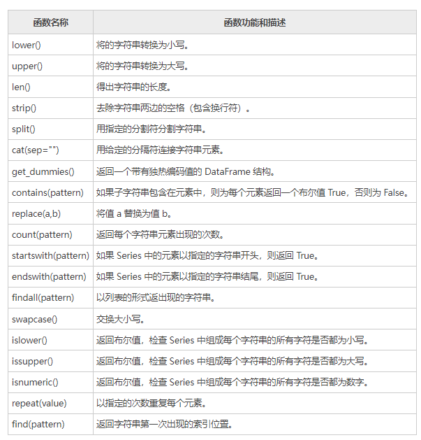

```
注意：上述所有字符串函数全部适用于 DataFrame 对象，同时也可以与 Python 内置的字符串函数一起使用，这些函数在处理 Series/DataFrame 对象的时候会自动忽略缺失值数据（NaN）。
```

##### lower()

```python
import pandas as pd
import numpy as np
s = pd.Series(['C', 'Python', 'java', 'go', np.nan, '1125','javascript'])
print(s.str.lower())
```

输出结果：

```
0             tom
1    william rick
2            john
3         alber@t
4             NaN
5            1234
6      stevesmith
dtype: object
```

##### len()

```python
import pandas as pd
import numpy as np
s = pd.Series(['C', 'Python', 'java', 'go', np.nan, '1125','javascript'])
print(s.str.len())
```

输出结果：

```
0     1.0
1     6.0
2     4.0
3     2.0
4     NaN
5     4.0
6    10.0
dtype: float64
```

##### strip()

```python
import pandas as pd
import numpy as np
s = pd.Series(['C ', ' Python', 'java', 'go', np.nan, '1125 ','javascript'])
print(s.str.strip())
```

输出结果：

```
0             C
1        Python
2          java
3            go
4           NaN
5          1125
6    javascript
dtype: object
```

##### split(pattern)

```python
import pandas as pd
import numpy as np
s = pd.Series(['C ',' Python','java','go','1125 ','javascript'])
print(s.str.split(" "))
```

输出结果：

```
0           [C, ]
1      [, Python]
2          [java]
3            [go]
4        [1125, ]
5    [javascript]
dtype: object
```

##### cat(sep="")

```python
import pandas as pd
import numpy as np
s = pd.Series(['C', 'Python', 'java', 'go', np.nan, '1125','javascript'])#会自动忽略NaN
print(s.str.cat(sep="_"))
```

输出结果：

```
C_Python_java_go_1125_javascript
```

##### get_dummies()

```python
import pandas as pd
import numpy as np
s = pd.Series(['C', 'Python', 'java', 'go', np.nan, '1125','javascript'])
print(s.str.get_dummies())
```

输出结果：

```
   1125  C  Python  go  java  javascript
0     0  1       0   0     0           0
1     0  0       1   0     0           0
2     0  0       0   0     1           0
3     0  0       0   1     0           0
4     0  0       0   0     0           0
5     1  0       0   0     0           0
6     0  0       0   0     0           1
```

##### contains()

检查 Series 中的每个字符，如果字符中包含空格，则返回 True，否则返回 False。示例如下：
输出结果：

```python
import pandas as pd
import numpy as np
s = pd.Series(['C ',' Python','java','go','1125 ','javascript'])
print(s.str.contains(" "))
```

输出结果：

```
0     True
1     True
2    False
3    False
4     True
5    False
dtype: bool
```

##### repeat()

```python
import pandas as pd
import numpy as np
s = pd.Series(['C ',' Python','java','go','1125 ','javascript'])
print(s.str.repeat(3))
```

输出结果：

```
0                            C C C
1              Python Python Python
2                      javajavajava
3                            gogogo
4                   1125 1125 1125
5    javascriptjavascriptjavascript
dtype: object
```

##### startswith()

```python
import pandas as pd
import numpy as np
#若以指定的"j"开头则返回True
s = pd.Series(['C ',' Python','java','go','1125 ','javascript'])
print(s.str.startswith("j"))
```

输出结果：

```
0    False
1    False
2     True
3    False
4    False
5     True
dtype: bool
```

##### find()

```python
import pandas as pd
import numpy as np
s = pd.Series(['C ',' Python','java','go','1125 ','javascript'])
print(s.str.find("j"))
```

输出结果：

```
0   -1
1   -1
2    0
3   -1
4   -1
5    0
dtype: int64
```

如果返回 -1 表示该字符串中没有出现指定的字符。

##### findall()

```python
import pandas as pd
import numpy as np
s = pd.Series(['C ',' Python','java','go','1125 ','javascript'])
print(s.str.findall("j"))
```

输出结果：

```
0     []
1     []
2    [j]
3     []
4     []
5    [j]
dtype: object
```

##### swapcase()

```python
import pandas as pd
import numpy as np
s = pd.Series(['C ',' Python','java','go','1125 ','javascript'])
print(s.str.swapcase())
```

输出结果：

```
0            c
1        pYTHON
2          JAVA
3            GO
4         1125
5    JAVASCRIPT
dtype: object
```

##### isnumeric()

返回一个布尔值，用来判断是否存在数字型字符串。示例如下：

```python
import pandas as pd
import numpy as np
s = pd.Series(['C ',' Python','java','go','1125','javascript'])
print(s.str.isnumeric())
```

输出结果：

```
0    False
1    False
2    False
3    False
4     True
5    False
dtype: bool
```

#### 十三、Pandas设置数据显示格式

在用 Pandas 做数据分析的过程中，总需要打印数据分析的结果，如果数据体量较大就会存在输出内容不全（部分内容省略）或者换行错误等问题。Pandas 为了解决上述问题，允许你对数据显示格式进行设置。下面列出了五个用来设置显示格式的函数，分别是：

- get_option()

- set_option()

- reset_option()

- describe_option()

- option_context()

    它们的功能介绍如下：

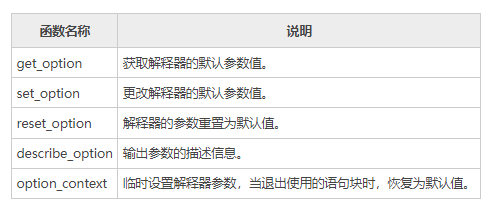

 下面对上述函数分别进行介绍。

##### 1、get_option()

该函数接受单一参数，用来获取显示上限的行数或者列数，示例如下： 

1) display.max_rows

获取显示上限的行数，示例如下：

```python
import pandas as pd
print(pd.get_option("display.max_rows"))
```

输出结果：

```
60
```

2) display.max_columns

获取显示上限的列数，示例如下：

```python
import pandas as pd
print(pd.get_option("display.max_columns"))
```

输出结果：

```
20
```

由此可知，默认值显示上限是（60，20）。

##### 2、set_option()

该函数用来更改要默认显示的行数和列数，示例如下：

1) 修改默认行数

```python
import pandas as pd
pd.set_option("display.max_rows",70)
print(pd.get_option("display.max_rows"))
```

输出结果：

```
70
```

2) 修改默认列数

```python
import pandas as pd
pd.set_option("display.max_columns",40)
print(pd.get_option("display.max_columns"))
```

输出结果：

```
40
```

##### 3、reset_option()

该方法接受一个参数，并将修改后的值设置回默认值。示例如下：

```python
import pandas as pd
pd.reset_option("display.max_rows")
#恢复为默认值
print(pd.get_option("display.max_rows"))
```

输出结果：

```
60
```

##### 4、describe_option()

该方法输出参数的描述信息。示例如下：

```python
import pandas as pd
pd.describe_option("display.max_rows")
```

输出结果：

```
display.max_rows : int
    If max_rows is exceeded, switch to truncate view. Depending on
    `large_repr`, objects are either centrally truncated or printed as
    a summary view. 'None' value means unlimited.

    In case python/IPython is running in a terminal and `large_repr`
    equals 'truncate' this can be set to 0 and pandas will auto-detect
    the height of the terminal and print a truncated object which fits
    the screen height. The IPython notebook, IPython qtconsole, or
    IDLE do not run in a terminal and hence it is not possible to do
    correct auto-detection.
    [default: 60] [currently: 60]
```

##### 5、option_context()

option_context() 上下文管理器，用于临时设置 with 语句块中的默认显示参数。当您退出 with 语句块时，参数值会自动恢复。示例如下：

```python
import pandas as pd
with pd.option_context("display.max_rows",10):
   print(pd.get_option("display.max_rows"))
print(pd.get_option("display.max_rows"))
```

输出结果：

```
10
60
```

 注意：第一个 Print 语句打印 option_context() 设置的临时值。当退出 with 语句块时，第二个 Print 语句打印解释器默认值。

##### 6、常用参数项

最后，对上述函数常用的参数项做以下总结：

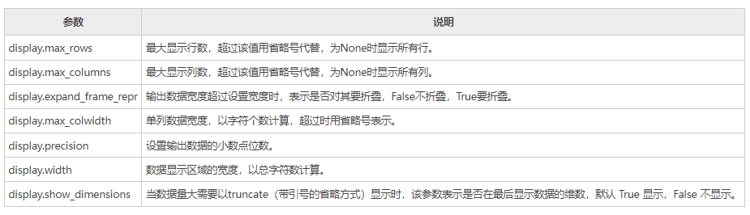

上述参数项，基本上可以满足我们的日常需求。

#### 十四、Pandas loc/iloc用法详解

在数据分析过程中，很多时候需要从数据表中提取出相应的数据，而这么做的前提是需要先“索引”出这一部分数据。虽然通过 Python 提供的索引操作符`"[]"`和属性操作符`"."`可以访问 Series 或者 DataFrame 中的数据，但这种方式只适应与少量的数据，为了解决这一问题，Pandas 提供了两种类型的索引方式来实现数据的访问。

本节就来讲解一下，如何在 Pandas 中使用 loc 函数和 iloc 函数。两种函数说明如下：   

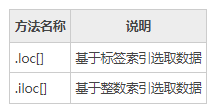

##### 1、.loc[]

df.loc[] 只能使用标签索引，不能使用整数索引。当通过标签索引的切片方式来筛选数据时，它的取值前闭后闭，也就是只包括边界值标签（开始和结束）。
.loc[] 具有多种访问方法，如下所示：

- 一个标量标签
- 标签列表
- 切片对象
- 布尔数组

loc[] 接受两个参数，并以`','` 分隔。第一个位置表示行，第二个位置表示列。示例如下： 

```python
import numpy as np
import pandas as pd
#创建一组数据
data = {'name': ['John', 'Mike', 'Mozla', 'Rose', 'David', 'Marry', 'Wansi', 'Sidy', 'Jack', 'Alic'],
        'age': [20, 32, 29, np.nan, 15, 28, 21, 30, 37, 25],
        'gender': [0, 0, 1, 1, 0, 1, 0, 0, 1, 1],
        'isMarried': ['yes', 'yes', 'no', 'yes', 'no', 'no', 'no', 'yes', 'no', 'no']}
label = ['a', 'b', 'c', 'd', 'e', 'f', 'g', 'h', 'i', 'j']
df = pd.DataFrame(data, index=label)
print(df)
#对行操作
print(df.loc['a':'d',:]) #等同于df.loc['a':'d']
```

输出结果：

```
    name   age  gender isMarried
a   John  20.0       0       yes
b   Mike  32.0       0       yes
c  Mozla  29.0       1        no
d   Rose   NaN       1       yes
e  David  15.0       0        no
f  Marry  28.0       1        no
g  Wansi  21.0       0        no
h   Sidy  30.0       0       yes
i   Jack  37.0       1        no
j   Alic  25.0       1        no
#从a到d,切记包含d
    name   age  gender isMarried
a   John  20.0       0       yes
b   Mike  32.0       0       yes
c  Mozla  29.0       1        no
d   Rose   NaN       1       yes
```

对列进行操作，示例如下：

```python
import numpy as np
import pandas as pd
#创建一组数据
data = {'name': ['John', 'Mike', 'Mozla', 'Rose', 'David', 'Marry', 'Wansi', 'Sidy', 'Jack', 'Alic'],
        'age': [20, 32, 29, np.nan, 15, 28, 21, 30, 37, 25],
        'gender': [0, 0, 1, 1, 0, 1, 0, 0, 1, 1],
        'isMarried': ['yes', 'yes', 'no', 'yes', 'no', 'no', 'no', 'yes', 'no', 'no']}
label = ['a', 'b', 'c', 'd', 'e', 'f', 'g', 'h', 'i', 'j']
df = pd.DataFrame(data, index=label)
print(df.loc[:,'name'])
```

输出结果：

```
a     John
b     Mike
c    Mozla
d     Rose
e    David
f    Marry
g    Wansi
h     Sidy
i     Jack
j     Alic
Name: name, dtype: object
```

对行和列同时操作，示例如下：

```python
import pandas as pd
import numpy as np
df = pd.DataFrame(np.random.randn(8, 4),
index = ['a','b','c','d','e','f','g','h'], columns = ['A', 'B', 'C', 'D'])
print(df.loc[['a','b','f','h'],['A','C']])
```

输出如下：

```
          A         C
a  1.168658  0.008070
b -0.076196  0.455495
f  1.224038  1.234725
h  0.050292 -0.031327
```

布尔值操作，示例如下：

```python
import pandas as pd
import numpy as np
df = pd.DataFrame(np.random.randn(4, 4),index = ['a','b','c','d'], columns = ['A', 'B', 'C', 'D'])
#返回一组布尔值
print(df.loc['b']>0)
```

输出结果：

```
A     True
B     True
C    False
D     True
Name: b, dtype: bool
```

##### 2、 .iloc[]

df.iloc[] 只能使用整数索引，不能使用标签索引，通过整数索引切片选择数据时，前闭后开(不包含边界结束值)。同 Python 和 NumPy 一样，它们的索引都是从 0 开始。
.iloc[] 提供了以下方式来选择数据：

- 1) 整数索引
- 2) 整数列表
- 3) 数值范围

示例如下：

```python
data = {'name': ['John', 'Mike', 'Mozla', 'Rose', 'David', 'Marry', 'Wansi', 'Sidy', 'Jack', 'Alic'],
        'age': [20, 32, 29, np.nan, 15, 28, 21, 30, 37, 25],
        'gender': [0, 0, 1, 1, 0, 1, 0, 0, 1, 1],
        'isMarried': ['yes', 'yes', 'no', 'yes', 'no', 'no', 'no', 'yes', 'no', 'no']}
label = ['a', 'b', 'c', 'd', 'e', 'f', 'g', 'h', 'i', 'j']
df = pd.DataFrame(data, index=label)
print(df)
print(df.iloc[2:,])
```

输出结果：

```
    name   age  gender isMarried
a   John  20.0       0       yes
b   Mike  32.0       0       yes
c  Mozla  29.0       1        no
d   Rose   NaN       1       yes
e  David  15.0       0        no
f  Marry  28.0       1        no
g  Wansi  21.0       0        no
h   Sidy  30.0       0       yes
i   Jack  37.0       1        no
j   Alic  25.0       1        no

name         Mozla
age             29
gender           1
isMarried       no
Name: c, dtype: object
```

再看一组示例：

```python
import pandas as pd
import numpy as np
df = pd.DataFrame(np.random.randn(8, 4), columns = ['A', 'B', 'C', 'D'])
print df.iloc[[1, 3, 5], [1, 3]]
print df.iloc[1:3, :]
print df.iloc[:,1:3]
```

输出结果：

```
          B         D
1  0.773595 -0.206061
3 -1.740403 -0.464383
5  1.046009  0.606808

          A         B         C         D
1 -0.093711  0.773595  0.966408 -0.206061
2 -1.122587 -0.135011  0.546475 -0.551403

          B         C
0  0.623488  3.328406
1  0.773595  0.966408
2 -0.135011  0.546475
3 -1.740403 -0.869073
4  0.591573 -1.463275
5  1.046009  2.330035
6 -0.266607  0.873971
7 -1.059625 -0.405340
```

#### 十五、Python Pandas统计函数

Pandas 的本质是统计学原理在计算机领域的一种应用实现，通过编程的方式达到分析、描述数据的目的。而统计函数则是统计学中用于计算和分析数据的一种工具。在数据分析的过程中，使用统计函数有助于我们理解和分析数据。本节将学习几个常见的统计函数，比如百分比函数、协方差函数、相关系数等。

##### 1、百分比变化(pct_change)

Series 和 DatFrames 都可以使用 pct_change() 函数。该函数将每个元素与其前一个元素进行比较，并计算前后数值的百分比变化。示例如下：

```python
import pandas as pd
import numpy as np
#Series结构
s = pd.Series([1,2,3,4,5,4])
print (s.pct_change())
#DataFrame
df = pd.DataFrame(np.random.randn(5,2))
print(df.pct_change())
```

输出结果：

```
0         NaN
1    1.000000
2    0.500000
3    0.333333
4    0.250000
5   -0.200000
dtype: float64
           0          1
0        NaN        NaN
1  74.779242   0.624260
2  -0.353652  -1.104352
3  -2.422813 -13.994103
4  -3.828316  -1.853092
```

默认情况下，pct_change() 对列进行操作，如果想要操作行，则需要传递参数 axis=1 参数。示例如下：

```python
import pandas as pd
import numpy as np
#DataFrame
df = pd.DataFrame(np.random.randn(3, 2))
print(df.pct_change(axis=1))
```

输出结果：

```
    0         1
0 NaN  3.035670
1 NaN -0.318259
2 NaN  0.227580
```

##### 2、协方差(cov)

Series 对象提供了一个`cov` 方法用来计算 Series 对象之间的协方差。同时，该方法也会将缺失值(NAN )自动排除。 

标准差和方差一般是用来描述一维数据的，但现实生活我们常常遇到含有多维数据的数据集，最简单的大家上学时免不了要统计多个学科的考试成绩。面对这样的数据集，我们当然可以按照每一维独立的计算其方差，但是通常我们还想了解更多，比如，一个男孩子的猥琐程度跟他受女孩子欢迎程度是否存在一些联系啊，嘿嘿~协方差就是这样一种用来度量两个随机变量关系的统计量 , 协方差的结果有什么意义呢？如果结果为正值，则说明两者是正相关的(从协方差可以引出“相关系数”的定义)，也就是说一个人越猥琐就越受女孩子欢迎，嘿嘿，那必须的~结果为负值就说明负相关的，越猥琐女孩子越讨厌，可能吗？如果为0，也是就是统计上说的“相互独立”。 

示例如下：

```python
import pandas as pd
import numpy as np
s1 = pd.Series(np.random.randn(10))
s2 = pd.Series(np.random.randn(10))
print (s1.cov(s2))
```

输出结果：

```
0.20789380904226645
```

当应用于 DataFrame 时，协方差（cov）将计算所有列之间的协方差。 

```python
import pandas as pd
import numpy as np
frame = pd.DataFrame(np.random.randn(10, 5), columns=['a', 'b', 'c', 'd', 'e'])
#计算a与b之间的协方差值
print (frame['a'].cov(frame['b']))
#计算所有数列的协方差值
print (frame.cov())
```

输出结果：

```
-0.37822395480394827
          a         b         c         d         e
a  1.643529 -0.378224  0.181642  0.049969 -0.113700
b -0.378224  1.561760 -0.054868  0.144664 -0.231134
c  0.181642 -0.054868  0.628367 -0.125703  0.324442
d  0.049969  0.144664 -0.125703  0.480301 -0.388879
e -0.113700 -0.231134  0.324442 -0.388879  0.848377
```

##### 3、相关系数(corr)

相关系数显示任意两个 Series 之间的线性关系。Pandas 提供了计算相关性的三种方法，分别是 pearson(default)、spearman() 和 kendall()。

检查两个变量之间变化趋势的方向以及程度，值范围-1到+1，0表示两个变量不相关，正值表示正相关，负值表示负相关，值越大相关性越强 

```python
import pandas as pd
import numpy as np
df = pd.DataFrame(np.random.randn(10, 5), columns=['a', 'b', 'c', 'd', 'e'])
print (df['b'].corr(frame['c']))
print (df.corr())
```

输出结果：

```
0.5540831507407936
          a         b         c         d         e
a  1.000000 -0.500903 -0.058497 -0.767226  0.218416
b -0.500903  1.000000 -0.091239  0.805388 -0.020172
c -0.058497 -0.091239  1.000000  0.115905  0.083969
d -0.767226  0.805388  0.115905  1.000000  0.015028
e  0.218416 -0.020172  0.083969  0.015028  1.000000
```

 注意：如果 DataFrame 存在非数值(NAN），该方法会自动将其删除。

##### 4、排名(rank)

rank() 按照某种规则（升序或者降序）对序列中的元素值排名，该函数的返回值的也是一个序列，包含了原序列中每个元素值的名次。如果序列中包含两个相同的的元素值，那么会为其分配两者的平均排名。示例如下：

```python
import pandas as pd
import numpy as np
#返回5个随机值，然后使用rank对其排名
s = pd.Series(np.random.randn(5), index=list('abcde'))
s['d'] = s['b']
print(s) 
#b/d排名分别为2和3，其平均排名为2.5
print(s.rank())
```

输出结果：

```
a   -0.689585
b   -0.545871
c    0.148264
d   -0.545871
e   -0.205043
dtype: float64

排名后输出:
a    1.0
b    2.5
c    5.0
d    2.5
e    4.0
dtype: float64
```

1) method参数

rank() 提供了 method 参数，可以针对相同数据，进行不同方式的排名。如下所示：

- average：默认值，如果数据相同则分配平均排名；
- min：给相同数据分配最低排名；
- max：给相同数据分配最大排名；
- first：对于相同数据，根据出现在数组中的顺序进行排名。

2) axis&ascening

rank() 有一个`ascening` 参数， 默认为 True 代表升序；如果为 False，则表示降序排名（将较大的数值分配给较小的排名）。 
rank() 默认按行方向排名（axis=0），也可以更改为 axis =1，按列排名。示例如下：

```python
import pandas as pd
import numpy as np
a = pd.DataFrame(np.arange(12).reshape(3,4),columns = list("abdc"))
a =a.sort_index(axis=1,ascending=False)
a.iloc[[1,1],[1,2]] = 6
#按行排名，将相同数值设置为所在行数值的最大排名
print(a.rank(axis=1,method="max"))
```

输出结果：

```
     d    c    b    a
0  3.0  4.0  2.0  1.0
1  4.0  4.0  4.0  1.0
2  3.0  4.0  2.0  1.0
```

与 method="min"进行对比，如下所示：

```python
import pandas as pd
import numpy as np
a = pd.DataFrame(np.arange(12).reshape(3,4),columns = list("abdc"))
a =a.sort_index(axis=1,ascending=False)
a.iloc[[1,1],[1,2]] = 6
#按行排名，将相同数值设置为所在行数值的最小排名
print(a.rank(axis=1,method="min"))
```

输出结果：

```
     d    c    b    a
0  3.0  4.0  2.0  1.0
1  2.0  2.0  2.0  1.0
2  3.0  4.0  2.0  1.0
```

#### 十六、Python Pandas窗口函数

 为了能更好地处理数值型数据，Pandas 提供了几种窗口函数，比如移动函数（rolling）、扩展函数（expanding）和指数加权函数（ewm）。

窗口函数应用场景非常多。举一个简单的例子：现在有 10 天的销售额，而您想每 3 天求一次销售总和，也就说第五天的销售额等于（第三天 + 第四天 + 第五天）的销售额之和，此时窗口函数就派上用场了。 

```
窗口是一种形象化的叫法，这些函数在执行操作时，就如同窗口一样在数据区间上移动。
```

 本节学习主要讲解如何在 DataFrame 和 Series 对象上应用窗口函数。

##### 1、rolling()

rolling() 又称移动窗口函数，它可以与 mean、count、sum、median、std 等聚合函数一起使用。为了使用方便，Pandas 为移动函数定义了专门的方法聚合方法，比如 rolling().mean()、rolling().count()、rolling().sum() 等。其的语法格式如下：

```
rolling(window=n, min_periods=None, center=False)
```

 常用参数说明如下：

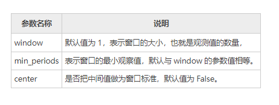

下面看一组示例：

```python
import pandas as pd
import numpy as np
#生成时间序列
df = pd.DataFrame(np.random.randn(8, 4),index = pd.date_range('12/1/2020', periods=8),columns = ['A', 'B', 'C', 'D'])
print(df)
#每3个数求求一次均值
print(df.rolling(window=3).mean())
```

输出结果：

```
                   A         B         C        D
2020-12-01  0.580058 -0.715246  0.440427 -1.106783
2020-12-02 -1.313982  0.068954 -0.906665  1.382941
2020-12-03  0.349844 -0.549509 -0.806577  0.261794
2020-12-04 -0.497054  0.921995  0.232008 -0.815291
2020-12-05  2.658108  0.447783  0.049340  0.329209
2020-12-06 -0.271670 -0.070299  0.860684 -0.095122
2020-12-07 -0.706780 -0.949392  0.679680  0.230930
2020-12-08  0.027379 -0.056543 -1.067625  1.386399

                   A         B         C         D
2020-12-01       NaN       NaN       NaN       NaN
2020-12-02       NaN       NaN       NaN       NaN
2020-12-03 -0.128027 -0.398600 -0.424272  0.179317
2020-12-04 -0.487064  0.147147 -0.493745  0.276481
2020-12-05  0.836966  0.273423 -0.175076 -0.074763
2020-12-06  0.629794  0.433160  0.380677 -0.193734
2020-12-07  0.559886 -0.190636  0.529901  0.155006
2020-12-08 -0.317024 -0.358745  0.157580  0.507402
```

 `window=3`表示是每一列中依次紧邻的每 3 个数求一次均值。当不满足 3 个数时，所求值均为 NaN 值，因此前两列的值为 NaN，直到第三行值才满足要求 window =3。求均值的公式如下所示：

```
(index1+index2+index3)/3
```

##### 2、expanding()

expanding() 又叫扩展窗口函数，扩展是指由序列的第一个元素开始，逐个向后计算元素的聚合值。
下面示例， min_periods = n 表示向后移动 n 个值计求一次平均值：

```python
import pandas as pd
import numpy as np
df = pd.DataFrame(np.random.randn(10, 4),
      index = pd.date_range('1/1/2018', periods=10),
      columns = ['A', 'B', 'C', 'D'])
print (df.expanding(min_periods=3).mean())
```

输出结果：

```
                   A         B         C         D
2020-01-01       NaN       NaN       NaN       NaN
2020-01-02       NaN       NaN       NaN       NaN
2020-01-03 -0.567833  0.258723  0.498782  0.403639
2020-01-04 -0.384198 -0.093490  0.456058  0.459122
2020-01-05 -0.193821  0.085318  0.389533  0.552429
2020-01-06 -0.113941  0.252397  0.214789  0.455281
2020-01-07  0.147863  0.400141 -0.062493  0.565990
2020-01-08 -0.036038  0.452132 -0.091939  0.371364
2020-01-09 -0.043203  0.368912 -0.033141  0.328143
2020-01-10 -0.100571  0.349378 -0.078225  0.225649
```

 设置 min_periods=3，表示至少 3 个数求一次均值，计算方式为 (index0+index1+index2)/3，而 index3 的计算方式是 (index0+index1+index2+index3)/3，依次类推。

##### 3、ewm()

ewm（全称 Exponentially Weighted Moving）表示指数加权移动。ewm() 函数先会对序列元素做指数加权运算，其次计算加权后的均值。该函数通过指定 com、span 或者 halflife 参数来实现指数加权移动。示例如下：

```python
import pandas as pd
import numpy as np
df = pd.DataFrame(np.random.randn(10, 4),
   index = pd.date_range('12/1/2020', periods=10),
   columns = ['A', 'B', 'C', 'D'])
#设置com=0.5，先加权再求均值
print(df.ewm(com=0.5).mean())
```

输出结果：

```
                   A         B         C         D
2020-12-01 -1.511428  1.427826  0.252652  0.093601
2020-12-02 -1.245101 -0.118346  0.170232 -0.207065
2020-12-03  0.131456 -0.271979 -0.679315 -0.589689
2020-12-04 -0.835228  0.094073 -0.973924 -0.081684
2020-12-05  1.279812  1.099368  0.203033  0.019014
2020-12-06  0.132027 -0.625744 -0.145090 -0.318155
2020-12-07  0.820230  0.371620  0.119683 -0.227101
2020-12-08  1.088283 -0.275570  0.358557 -1.050606
2020-12-09  0.538304 -1.288146  0.590358 -0.164057
2020-12-10  0.589177 -1.514472 -0.613158  0.367322
```

在数据分析的过程中，使用窗口函数能够提升数据的准确性，并且使数据曲线的变化趋势更加平滑，从而让数据分析变得更加准确、可靠。

#### 十七、Python Pandas聚合函数

在《[Python Pandas窗口函数](http://c.biancheng.net/pandas/window-functions.html)》一节，我们重点介绍了窗口函数。我们知道，窗口函数可以与聚合函数一起使用，聚合函数指的是对一组数据求总和、最大值、最小值以及平均值的操作，本节重点讲解聚合函数的应用。

#####   1、应用聚合函数

首先让我们创建一个 DataFrame 对象，然后对聚合函数进行应用。

```python
import pandas as pd
import numpy as np
df = pd.DataFrame(np.random.randn(5, 4),index = pd.date_range('12/14/2020', periods=5),columns = ['A', 'B', 'C', 'D'])
print (df)
#窗口大小为3，min_periods 最小观测值为1
r = df.rolling(window=3,min_periods=1)
print(r) 
```

输出结果：

```
                   A         B         C         D
2020-12-14  0.941621  1.205489  0.473771 -0.348169
2020-12-15 -0.276954  0.076387  0.104194  1.537357
2020-12-16  0.582515  0.481999 -0.652332 -1.893678
2020-12-17 -0.286432  0.923514  0.285255 -0.739378
2020-12-18  2.063422 -0.465873 -0.946809  1.590234

Rolling [window=3,min_periods=1,center=False,axis=0]
```

1) 对整体聚合

您可以把一个聚合函数传递给 DataFrame，示例如下：

```python
import pandas as pd
import numpy as np
df = pd.DataFrame(np.random.randn(5, 4),index = pd.date_range('12/14/2020', periods=5),columns = ['A', 'B', 'C', 'D'])
print (df)
#窗口大小为3，min_periods 最小观测值为1
r = df.rolling(window=3,min_periods=1)
#使用 aggregate()聚合操作
print(r.aggregate(np.sum))
```

输出结果：

```
                   A         B         C         D
2020-12-14  0.133713  0.746781  0.499385  0.589799
2020-12-15 -0.777572  0.531269  0.600577 -0.393623
2020-12-16  0.408115 -0.874079  0.584320  0.507580
2020-12-17 -1.033055 -1.185399 -0.546567  2.094643
2020-12-18  0.469394 -1.110549 -0.856245  0.260827

                   A         B         C         D
2020-12-14  0.133713  0.746781  0.499385  0.589799
2020-12-15 -0.643859  1.278050  1.099962  0.196176
2020-12-16 -0.235744  0.403971  1.684281  0.703756
2020-12-17 -1.402513 -1.528209  0.638330  2.208601
2020-12-18 -0.155546 -3.170027 -0.818492  2.863051
```

2) 对任意某一列聚合

```python
import pandas as pd
import numpy as np
df = pd.DataFrame(np.random.randn(5, 4),index = pd.date_range('12/14/2020', periods=5),columns = ['A', 'B', 'C', 'D'])
#窗口大小为3，min_periods 最小观测值为1
r = df.rolling(window=3,min_periods=1)
#对 A 列聚合
print(r['A'].aggregate(np.sum))
```

输出结果：

```
2020-12-14    1.051501
2020-12-15    1.354574
2020-12-16    0.896335
2020-12-17    0.508470
2020-12-18    2.333732
Freq: D, Name: A, dtype: float64
```

3) 对多列数据聚合

```python
import pandas as pd
import numpy as np
df = pd.DataFrame(np.random.randn(5, 4),index = pd.date_range('12/14/2020', periods=5),columns = ['A', 'B', 'C', 'D'])
#窗口大小为3，min_periods 最小观测值为1
r = df.rolling(window=3,min_periods=1)
#对 A/B 两列聚合
print(r['A','B'].aggregate(np.sum))
```

输出结果：

```
                   A         B
2020-12-14  0.639867 -0.229990
2020-12-15  0.352028  0.257918
2020-12-16  0.637845  2.643628
2020-12-17  0.432715  2.428604
2020-12-18 -1.575766  0.969600
```

4) 对单列应用多个函数

```python
import pandas as pd
import numpy as np
df = pd.DataFrame(np.random.randn(5, 4),index = pd.date_range('12/14/2020', periods=5),columns = ['A', 'B', 'C', 'D'])
#窗口大小为3，min_periods 最小观测值为1
r = df.rolling(window=3,min_periods=1)
#对 A列聚合
print(r['A'].aggregate([np.sum,np.mean]))
```

输出结果：

```
                 sum      mean
2020-12-14 -0.469643 -0.469643
2020-12-15 -0.626856 -0.313428
2020-12-16 -1.820226 -0.606742
2020-12-17 -2.007323 -0.669108
2020-12-18 -0.595736 -0.198579
```

5) 对不同列应用多个函数

```python
import pandas as pd
import numpy as np
df = pd.DataFrame(np.random.randn(5, 4),
   index = pd.date_range('12/11/2020', periods=5),
   columns = ['A', 'B', 'C', 'D'])
r = df.rolling(window=3,min_periods=1)
print(r['A','B'].aggregate([np.sum,np.mean]))
```

输出结果：

```
                   A                   B         
                 sum      mean       sum      mean
2020-12-14 -1.428882 -1.428882 -0.417241 -0.417241
2020-12-15 -1.315151 -0.657576 -1.580616 -0.790308
2020-12-16 -2.093907 -0.697969 -2.260181 -0.753394
2020-12-17 -1.324490 -0.441497 -1.578467 -0.526156
2020-12-18 -2.400948 -0.800316 -0.452740 -0.150913
```

6) 对不同列应用不同函数

```python
import pandas as pd
import numpy as np
df = pd.DataFrame(np.random.randn(3, 4),
    index = pd.date_range('12/14/2020', periods=3),
    columns = ['A', 'B', 'C', 'D'])
r = df.rolling(window=3,min_periods=1)
print(r.aggregate({'A': np.sum,'B': np.mean}))
```

输出结果：

```
                   A         B
2020-12-14  0.503535 -1.301423
2020-12-15  0.170056 -0.550289
2020-12-16 -0.086081 -0.140532
```

#### 十八、Python Pandas缺失值处理

在一些数据分析业务中，数据缺失是我们经常遇见的问题，缺失值会导致数据质量的下降，从而影响模型预测的准确性，这对于机器学习和数据挖掘影响尤为严重。因此妥善的处理缺失值能够使模型预测更为准确和有效。

##### 1、为什么会存在缺失值？

前面章节的示例中，我们遇到过很多 NaN 值，关于缺失值您可能会有很多疑问，数据为什么会丢失数据呢，又是从什么时候丢失的呢？通过下面场景，您会得到答案。

其实在很多时候，人们往往不愿意过多透露自己的信息。假如您正在对用户的产品体验做调查，在这个过程中您会发现，一些用户很乐意分享自己使用产品的体验，但他是不愿意透露自己的姓名和联系方式；还有一些用户愿意分享他们使用产品的全部经过，包括自己的姓名和联系方式。因此，总有一些数据会因为某些不可抗力的因素丢失，这种情况在现实生活中会经常遇到。

##### 2、什么是稀疏数据？ 

稀疏数据，指的是在数据库或者数据集中存在大量缺失数据或者空值，我们把这样的数据集称为稀疏数据集。稀疏数据不是无效数据，只不过是信息不全而已，只要通过适当的方法就可以“变废为宝”。

- 由于调查不当产生的稀疏数据；
- 由于天然限制产生的稀疏数据；
- 文本挖掘中产生的稀疏数据。

##### 3、缺失值处理

那么 Pandas 是如何处理缺失值的呢，下面让我们一起看一下。 

```python
import pandas as pd
import numpy as np
df = pd.DataFrame(np.random.randn(5, 3), index=['a', 'c', 'e', 'f','h'])
df = df.reindex(['a', 'b', 'c', 'd', 'e', 'f', 'g', 'h'])
print(df)
```

输出结果：

```
          0         1         2
a  0.187208 -0.951407  0.316340
b       NaN       NaN       NaN
c -0.365741 -1.983977 -1.052170
d       NaN       NaN       NaN
e -1.024180  1.550515  0.317156
f -0.799921 -0.686590  1.383229
g       NaN       NaN       NaN
h -0.207958  0.426733 -0.325951
```

 上述示例，通过使用 reindex（重构索引），我们创建了一个存在缺少值的 DataFrame 对象。

##### 4、检查缺失值

为了使检测缺失值变得更容易，Pandas 提供了 isnull() 和 notnull() 两个函数，它们同时适用于 Series 和 DataFrame 对象。

 

```python
import pandas as pd
import numpy as np
df = pd.DataFrame(np.random.randn(5, 3), index=['a', 'c', 'e', 'f','h'])
df = df.reindex(['a', 'b', 'c', 'd', 'e', 'f', 'g', 'h'])
print(df.isnull())
```

输出结果：

```
       0      1      2
a  False  False  False
b   True   True   True
c  False  False  False
d   True   True   True
e  False  False  False
f  False  False  False
g   True   True   True
h  False  False  False
```

notnull() 函数，使用示例：

```python
import pandas as pd
import numpy as np
df = pd.DataFrame(np.random.randn(5, 3), index=['a', 'c', 'e', 'f','h'])
df = df.reindex(['a', 'b', 'c', 'd', 'e', 'f', 'g', 'h'])
print(df.notnull())
```

输出结果：

```
       0      1      2
a   True   True   True
b  False  False  False
c   True   True   True
d  False  False  False
e   True   True   True
f   True   True   True
g  False  False  False
h   True   True   True
```

df.isnull().any() 用来判断某列是否有缺失值

```
True
```

df.isnull().all() 用来判断某列是否全部为空值 

```
False
```

##### 5、缺失数据计算

计算缺失数据时，需要注意两点：首先数据求和时，将 NA 值视为 0 ，其次，如果要计算的数据为 NA，那么结果就是 NA。示例如下：

```python
import pandas as pd
import numpy as np
df = pd.DataFrame(np.random.randn(5, 3), index=['a', 'c', 'e', 'f','h'],columns=['one', 'two', 'three'])
df = df.reindex(['a', 'b', 'c', 'd', 'e', 'f', 'g', 'h'])
print (df['one'].sum())
```

输出结果：

```
3.4516595395128
```

##### 6、清理并填充缺失值

Pandas 提供了多种方法来清除缺失值。fillna() 函数可以实现用非空数据“填充”NaN 值。

1) 用标量值替换NaN值

下列程序将 NaN 值 替换为了 0，如下所示：

```python
import pandas as pd
import numpy as np
df = pd.DataFrame(np.random.randn(3, 3), index=['a', 'c', 'e'],columns=['one',
'two', 'three'])
df = df.reindex(['a', 'b', 'c'])
print(df)
#用 0 填充 NaN
print (df.fillna(0))
```

输出结果：

```
        one       two     three
a  1.497185 -0.703897 -0.050513
b       NaN       NaN       NaN
c  2.008315  1.342690 -0.255855

        one       two     three
a  1.497185 -0.703897 -0.050513
b  0.000000  0.000000  0.000000
c  2.008315  1.342690 -0.255855
```

当然根据您自己的需求，您也可以用其他值进行填充。

使用均值填充

```python
df = pd.DataFrame(np.random.randn(3, 3), index=['a', 'c', 'e'],columns=['one',
'two', 'three'])
df = df.reindex(['a', 'b', 'c'])
print(df)
print('-------分割线--------')
#使用每列的均值填充
for col in df.columns:
  df[col].fillna(df[col].mean(),inplace=True)
print(df)
```

```
        one       two     three
a  0.771181 -0.013223 -1.199376
b       NaN       NaN       NaN
c  1.106132 -1.149741 -0.688117
-----------分割线------------
        one       two     three
a  0.771181 -0.013223 -1.199376
b  0.938657 -0.581482 -0.943747
c  1.106132 -1.149741 -0.688117
```

2) 向前和向后填充NA

在《[Pandas reindex重建索引](http://c.biancheng.net/pandas/reindexing.html) 》一节，我们介绍了 ffill() 向前填充和 bfill() 向后填充，使用这两个函数也可以处理 NA 值。示例如下： 

```python
import pandas as pd
import numpy as np
df = pd.DataFrame(np.random.randn(5, 3), index=['a', 'c', 'e', 'f','h'],columns=['one', 'two', 'three'])
df = df.reindex(['a', 'b', 'c', 'd', 'e', 'f', 'g', 'h'])
print df.fillna(method='ffill')
```

输出结果：

```
        one       two     three
a  0.871741  0.311057  0.091005
b  0.871741  0.311057  0.091005
c  0.107345 -0.662864  0.826716
d  0.107345 -0.662864  0.826716
e  1.630221  0.482504 -0.728767
f  1.283206 -0.145178  0.109155
g  1.283206 -0.145178  0.109155
h  0.222176  0.886768  0.347820
```

或者您也可以采用向后填充的方法。

3) 使用replace替换通用值

在某些情况下，您需要使用 replace() 将 DataFrame 中的通用值替换成特定值，这和使用 fillna() 函数替换 NaN 值是类似的。示例如下：

```python
import pandas as pd
import numpy as np
df = pd.DataFrame({'one':[10,20,30,40,50,666], 'two':[99,0,30,40,50,60]})
#使用replace()方法
print (df.replace({99:10,666:60,0:20}))
```

输出结果：

```
   one  two
0   10   10
1   20   20
2   30   30
3   40   40
4   50   50
5   60   60
```

##### 7、删除缺失值

如果想删除缺失值，那么使用 dropna() 函数与参数 axis 可以实现。在默认情况下，按照 axis=0 来按行处理，这意味着如果某一行中存在 NaN 值将会删除整行数据。示例如下：

```python
import pandas as pd
import numpy as np
df = pd.DataFrame(np.random.randn(5, 3), index=['a', 'c', 'e', 'f','h'],columns=['one', 'two', 'three'])
df = df.reindex(['a', 'b', 'c', 'd', 'e', 'f', 'g', 'h'])
print(df)
#删除缺失值
print (df.dropna())
```

输出结果：

```
        one       two     three
a -2.025435  0.617616  0.862096
b       NaN       NaN       NaN
c -1.710705  1.780539 -2.313227
d       NaN       NaN       NaN
e -2.347188 -0.498857 -1.070605
f -0.159588  1.205773 -0.046752
g       NaN       NaN       NaN
h -0.549372 -1.740350  0.444356

        one       two     three
a -2.025435  0.617616  0.862096
c -1.710705  1.780539 -2.313227
e -2.347188 -0.498857 -1.070605
f -0.159588  1.205773 -0.046752
h -0.549372 -1.740350  0.444356
```

axis = 1 表示按列处理，处理结果是一个空的 DataFrame 对象。

#### 十九、Pandas groupby分组操作详解

在数据分析中，经常会遇到这样的情况：根据某一列（或多列）标签把数据划分为不同的组别，然后再对其进行数据分析。比如，某网站对注册用户的性别或者年龄等进行分组，从而研究出网站用户的画像（特点）。在 Pandas 中，要完成数据的分组操作，需要使用 groupby() 函数，它和 SQL 的`GROUP BY`操作非常相似。 

在划分出来的组（group）上应用一些统计函数，从而达到数据分析的目的，比如对分组数据进行聚合、转换，或者过滤。这个过程主要包含以下三步：   

- 拆分（Spliting）：表示对数据进行分组；
- 应用（Applying）：对分组数据应用聚合函数，进行相应计算；
- 合并（Combining）：最后汇总计算结果。

 下面对 groupby() 函数的应用过程进行具体的讲解。

##### 1、创建DataFrame对象

首先我们创建一个 DataFrame 对象，下面数据描述了某班学生，计算机选修课的考试成绩：

```python
import pandas as pd 
import numpy as np 
data = {'Name': ['John', 'Helen', 'Sona', 'Ella'], 
   'score': [82, 98, 91, 87], 
   'option_course': ['C#','Python','Java','C']} 
df = pd.DataFrame(data)
print(df)  
```

输出结果：

```
    Name  score   option_course
0   John     82            C#
1  Helen     98        Python
2   Sona     91          Java
3   Ella     87             C
```

##### 2、创建groupby分组对象

使用 groupby() 可以沿着任意轴分组。您可以把分组时指定的键（key）作为每组的组名，方法如下所示：

- df.groupby("key")
- df.groupby("key",axis=1)
- df.groupby(["key1","key2"])

通过上述方法对 DataFrame 对象进行分组操作：

```python
import pandas as pd
import numpy as np
data = {'Name': ['John', 'Helen', 'Sona', 'Ella'],
   'score': [82, 98, 91, 87],
   'option_course': ['C#','Python','Java','C']}
df = pd.DataFrame(data)
print(df)
#生成分组groupby对象
print(df.groupby('score'))
```

输出结果：

```
<pandas.core.groupby.generic.DataFrameGroupBy object at 0x0000021DE9A89640>
```

##### 3、查看分组结果

1) groups查看分组结果

通过调用`groups` 属性查看分组结果： 

```python
import pandas as pd
import numpy as np
data = {'Name': ['John', 'Helen', 'Sona', 'Ella','Tom'],
   'score': [82, 98, 91, 87,82],
   'option_course': ['C#','Python','Java','C','js']}
df = pd.DataFrame(data)
#查看分组
print(df.groupby('score').groups)
```

输出结果：

```
{82: Int64Index([0], dtype='int64'), 
87: Int64Index([3], dtype='int64'), 
91: Int64Index([2], dtype='int64'), 
98: Int64Index([1], dtype='int64')}
```

2) 多个列标签分组

当然也可以指定多个列标签进行分组，示例如下：

```python
import pandas as pd
import numpy as np
data = {'Name': ['John', 'Helen', 'Sona', 'Ella'],
   'score': [82, 98, 91, 87],
   'option_course': ['C#','Python','Java','C']}
df = pd.DataFrame(data)
#查看分组
print(df.groupby(['Name','score']).groups)
```

输出结果：

```
{('Ella', 87): Int64Index([3], dtype='int64'), 
('Helen', 98): Int64Index([1], dtype='int64'), 
('John', 82): Int64Index([0], dtype='int64'), 
('Sona', 91): Int64Index([2], dtype='int64')}
```

通过 get_group() 方法可以选择组内的具体数据项：

```python
import pandas as pd
import numpy as np
data = {'Name': ['John', 'Helen', 'Sona', 'Ella'],
   'score': [82, 98, 91, 87],
   'option_course': ['C#','Python','Java','C']}
df = pd.DataFrame(data)
#根据score来分组
grouped=df.groupby('score')
#根据对应组的数据值，选择一个组
print(grouped.get_group(91))
```

输出结果：

```
   Name  score option_course
2  Sona     91          Java
```

##### 4、遍历分组数据

通过以下方法来遍历分组数据，示例如下：

```python
import pandas as pd
import numpy as np
data = {'Name': ['John', 'Helen', 'Sona', 'Ella'],
   'score': [82, 98, 91, 87],
   'option_course': ['C#','Python','Java','C']}
df = pd.DataFrame(data)
#查看分组
grouped=df.groupby('score')
for label, option_course in grouped:
#其中key代表分组后字典的键，也就是score
    print(label)
#字典对应的值选修的科目
    print(option_course)
```

输出结果：

```
82
   Name  score   option_course
0  John     82            C#
87
   Name  score   option_course
3  Ella     87             C
91
   Name  score   option_course
2  Sona     91          Java
98
    Name  score  option_course
1  Helen     98        Python
```

如上所示， groupby 对象的组名称与 score 中的的元素值一一对应。

##### 5、应用聚合函数

当您在创建 groupby 对象时，通过 agg() 函数可以对分组对象应用多个聚合函数： 

```python
import pandas as pd 
import numpy as np 
data = {'name': ['John', 'Helen', 'Sona', 'Ella'], 
   'score': [82, 98, 91, 87], 
   'option_course': ['C#','Python','Java','C']} 
df = pd.DataFrame(data)
grouped=df.groupby('name')
#应用一个聚合函数求均值
print(grouped['score']).agg(np.mean)
```

输出结果：

```
name
Ella     87
Helen    98
John     82
Sona     91
Name: score, dtype: int64
```

当然，您也可以一次性应有多个聚合函数，示例如下：

```python
import pandas as pd
import numpy as np
data = {'name': ['John', 'Helen', 'Sona', 'Ella'],
   'score': [82, 98, 91, 87],
   'option_course': ['C#','Python','Java','C']}
df = pd.DataFrame(data)
grouped=df.groupby('name')
print(grouped['score'].agg([np.size,np.mean,np.std]))
```

输出结果：

```
       size  mean  std
name                 
Ella      1    87  NaN
Helen     1    98  NaN
John      1    82  NaN
Sona      1    91  NaN
```

##### 6、组的转换操作（略）

在组的行或列上可以执行转换操作，最终会返回一个与组大小相同的索引对象。

dataframe.agg():只做聚合操作， 可同时运用多个聚合函数，或为各列分配不同的聚合函数 
dataframe.apply() 作用对象是dataframe， 跟**自定义函数**，包括简单的求和函数以及复杂series间的交互函数，不能直接使用agg（）函数和python内置函数，例如sum、max、min、'count‘等方法 
dataframe.transform（）对dataframe的每个[series](https://so.csdn.net/so/search?q=series&spm=1001.2101.3001.7020)做transform操作，返回的结构与原dataframe一致  不能跟自定义的series间交互函数 

示例如下：

```python
import pandas as pd
import numpy as np
df = pd.DataFrame({'种类':['水果','水果','水果','蔬菜','蔬菜','肉类','肉类'],
                '产地':['朝鲜','中国','缅甸','中国','菲律宾','韩国','中国'],
                '水果':['橘子','苹果','哈密瓜','番茄','椰子','鱼肉','牛肉'],
                '数量':[3,5,5,3,2,15,9],
                '价格':[2,5,12,3,4,18,20]})
#分组求均值，水果、蔬菜、肉类
#对可执行计算的数值列求均值
print(df.groupby('种类').transform(np.mean))
#transform()直接应用demean，实现去均值操作
demean = lambda arr:arr-arr.mean()
print(df.groupby('种类').transform(demean))
#自定义函数
# 返回分组的前n行数据
def get_rows(df,n): 
     #从1到n行的所有列
    return df.iloc[:n,:]
#分组后的组名作为行索引
print(df.groupby('种类').apply(get_rows,n=1))
```

输出结果：

```
      数量         价格
0   4.333333   6.333333
1   4.333333   6.333333
2   4.333333   6.333333
3   2.500000   3.500000
4   2.500000   3.500000
5  12.000000  19.000000
6  12.000000  19.000000

      数量        价格
0 -1.333333 -4.333333
1  0.666667 -1.333333
2  0.666667  5.666667
3  0.500000 -0.500000
4 -0.500000  0.500000
5  3.000000 -1.000000
6 -3.000000  1.000000

      种类  产地  水果  数量  价格
种类                     
水果 0  水果  朝鲜  橘子   3   2
肉类 5  肉类  韩国  鱼肉  15  18
蔬菜 3  蔬菜  中国  番茄   3   3
```

##### 7、组的数据过滤操作（略）

通过 filter() 函数可以实现数据的筛选，该函数根据定义的条件过滤数据并返回一个新的数据集。
下面，筛选出参加比赛超过两次的球队（包含两次）：

```python
import pandas as pd
import numpy as np
data = {'Team': ['Riders', 'Riders', 'Devils', 'Devils', 'Kings',
   'kings', 'Kings', 'Kings', 'Riders', 'Royals', 'Royals', 'Riders'],
   'Rank': [1, 2, 2, 3, 3,4 ,1 ,1,2 , 4,1,2],
   'Year': [2014,2015,2014,2015,2014,2015,2016,2017,2016,2014,2015,2017],
   'Points':[874,789,863,663,741,802,756,788,694,701,812,698]}
df = pd.DataFrame(data)
#定义lambda函数来筛选数据
print(df.groupby('Team').filter(lambda x: len(x) >= 2))
```

输出结果：

```
      Team  Rank  Year  Points
0   Riders     1  2014     874
1   Riders     2  2015     789
4    Kings     3  2014     741
6    Kings     1  2016     756
7    Kings     1  2017     788
8   Riders     2  2016     694
11  Riders     2  2017     698
```

#### 二十、Pandas merge合并操作

Pandas 提供的 merge() 函数能够进行高效的合并操作，这与 SQL 关系型数据库的 MERGE 用法非常相似。从字面意思上不难理解，merge 翻译为“合并”，指的是将两个 DataFrame 数据表按照指定的规则进行连接，最后拼接成一个新的 DataFrame 数据表。

 merge() 函数的法格式如下：  

```python
pd.merge(left, right, how='inner', on=None, left_on=None, right_on=None,left_index=False, right_index=False, sort=True,suffixes=('_x', '_y'), copy=True)
```

 参数说明，如下表所示：

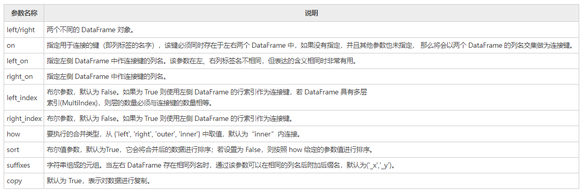

注意：Pandas 库的 merge() 支持各种内外连接，与其相似的还有 join() 函数（默认为左连接）。

下面创建两个不同的 DataFrame，然后对它们进行合并操作：

```python
import pandas as pd 
left = pd.DataFrame({ 
   'id':[1,2,3,4], 
   'Name': ['Smith', 'Maiki', 'Hunter', 'Hilen'], 
   'subject_id':['sub1','sub2','sub4','sub6']}) 
right = pd.DataFrame({ 
    'id':[1,2,3,4], 
   'Name': ['William', 'Albert', 'Tony', 'Allen'], 
   'subject_id':['sub2','sub4','sub3','sub6']}) 
print (left) 
print (right)  
```

输出如下：

```
   id    Name subject_id
0   1   Smith       sub1
1   2   Maiki       sub2
2   3  Hunter       sub4
3   4   Hilen       sub6

   id     Name subject_id
0   1  William       sub2
1   2   Albert       sub4
2   3     Tony       sub3
3   4    Allen       sub6
```

1) 在单个键上进行合并操作

通过 on 参数指定一个连接键，然后对上述 DataFrame 进行合并操作：

```python
import pandas as pd 
left = pd.DataFrame({ 
   'id':[1,2,3,4], 
   'Name': ['Smith', 'Maiki', 'Hunter', 'Hilen'], 
   'subject_id':['sub1','sub2','sub4','sub6']}) 
right = pd.DataFrame({ 
    'id':[1,2,3,4], 
   'Name': ['William', 'Albert', 'Tony', 'Allen'], 
   'subject_id':['sub2','sub4','sub3','sub6']})
#通过on参数指定合并的键
print(pd.merge(left,right,on='id'))
```

输出结果：

```
   id  Name_x subject_id_x   Name_y subject_id_y
0   1   Smith         sub1  William         sub2
1   2   Maiki         sub2   Albert         sub4
2   3  Hunter         sub4     Tony         sub3
3   4   Hilen         sub6    Allen         sub6
```

2) 在多个键上进行合并操作

下面示例，指定多个键来合并上述两个 DataFrame 对象：

```python
import pandas as pd 
left = pd.DataFrame({ 
   'id':[1,2,3,4], 
   'Name': ['Smith', 'Maiki', 'Hunter', 'Hilen'], 
   'subject_id':['sub1','sub2','sub4','sub6']}) 
right = pd.DataFrame({ 
    'id':[1,2,3,4], 
   'Name': ['Bill', 'Lucy', 'Jack', 'Mike'], 
   'subject_id':['sub2','sub4','sub3','sub6']}) 
print(pd.merge(left,right,on=['id','subject_id']))
```

输出结果：

```
   id Name_x subject_id Name_y
0   4  Hilen       sub6   Mike
```

##### 1)、使用how参数合并

通过`how` 参数可以确定 DataFrame 中要包含哪些键，如果在左表、右表都不存的键，那么合并后该键对应的值为 NaN。为了便于大家学习，我们将 how 参数和与其等价的 SQL 语句做了总结： 

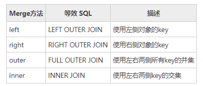

1) left join

```python
import pandas as pd 
left = pd.DataFrame({ 
   'id':[1,2,3,4], 
   'Name': ['Smith', 'Maiki', 'Hunter', 'Hilen'], 
   'subject_id':['sub1','sub2','sub4','sub6']}) 
right = pd.DataFrame({ 
    'id':[1,2,3,4], 
   'Name': ['Bill', 'Lucy', 'Jack', 'Mike'], 
   'subject_id':['sub2','sub4','sub3','sub6']}) 
#以left侧的subject_id为键
print(pd.merge(left,right,on='subject_id',how="left"))
```

输出结果：

```
   id_x  Name_x subject_id  id_y Name_y
0     1   Smith       sub1   NaN    NaN
1     2   Maiki       sub2   1.0   Bill
2     3  Hunter       sub4   2.0   Lucy
3     4   Hilen       sub6   4.0   Mike
```

##### 2) right join

```python
import pandas as pd 
left = pd.DataFrame({ 
   'id':[1,2,3,4], 
   'Name': ['Smith', 'Maiki', 'Hunter', 'Hilen'], 
   'subject_id':['sub1','sub2','sub4','sub6']}) 
right = pd.DataFrame({ 
    'id':[1,2,3,4], 
   'Name': ['Bill', 'Lucy', 'Jack', 'Mike'], 
   'subject_id':['sub2','sub4','sub3','sub6']}) 
#以right侧的subject_id为键
print(pd.merge(left,right,on='subject_id',how="right"))
```

输出结果：

```
   id_x  Name_x subject_id  id_y Name_y
0   2.0   Maiki       sub2     1   Bill
1   3.0  Hunter       sub4     2   Lucy
2   4.0   Hilen       sub6     4   Mike
3   NaN     NaN       sub3     3   Jack
```

##### 3) outer join(并集)

```python
import pandas as pd 
left = pd.DataFrame({ 
   'id':[1,2,3,4], 
   'Name': ['Smith', 'Maiki', 'Hunter', 'Hilen'], 
   'subject_id':['sub1','sub2','sub4','sub6']}) 
right = pd.DataFrame({ 
    'id':[1,2,3,4], 
   'Name': ['Bill', 'Lucy', 'Jack', 'Mike'], 
   'subject_id':['sub2','sub4','sub3','sub6']}) 
#求出两个subject_id的并集，并作为键
print(pd.merge(left,right,on='subject_id',how="outer"))
```

输出结果：

```
   id_x  Name_x subject_id  id_y Name_y
0   1.0   Smith       sub1   NaN    NaN
1   2.0   Maiki       sub2   1.0   Bill
2   3.0  Hunter       sub4   2.0   Lucy
3   4.0   Hilen       sub6   4.0   Mike
4   NaN     NaN       sub3   3.0   Jack
```

##### 4) inner join(交集)

```python
import pandas as pd 
left = pd.DataFrame({ 
   'id':[1,2,3,4], 
   'Name': ['Smith', 'Maiki', 'Hunter', 'Hilen'], 
   'subject_id':['sub1','sub2','sub4','sub6']}) 
right = pd.DataFrame({ 
    'id':[1,2,3,4], 
   'Name': ['Bill', 'Lucy', 'Jack', 'Mike'], 
   'subject_id':['sub2','sub4','sub3','sub6']}) 
#求出两个subject_id的交集，并将结果作为键
print(pd.merge(left,right,on='subject_id',how="inner"))
```

输出结果：

```
   id_x  Name_x subject_id  id_y Name_y
0     2   Maiki       sub2     1   Bill
1     3  Hunter       sub4     2   Lucy
2     4   Hilen       sub6     4   Mike
```

####  二十一、Pandas concat连接操作

 Pandas 通过 concat() 函数能够轻松地将 Series 与 DataFrame 对象组合在一起，函数的语法格式如下：

```python
 pd.concat(objs,axis=0,join='outer',join_axes=None,ignore_index=False)
```

  参数说明如下所示：

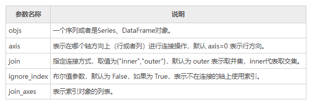

##### 1、concat()

concat() 函数用于沿某个特定的轴执行连接操作。下面让我们创建不同的对象，并对其进行连接。

```python
import pandas as pd
a= pd.DataFrame({'A': ['A0', 'A1', 'A2', 'A3'],
                    'B': ['B0', 'B1', 'B2', 'B3'],
                    'C': ['C0', 'C1', 'C2', 'C3'],
                    'D': ['D0', 'D1', 'D2', 'D3']},
                    index=[0, 1, 2, 3])
b= pd.DataFrame({'A': ['A4', 'A5', 'A6', 'A7'],
                    'B': ['B4', 'B5', 'B6', 'B7'],
                    'C': ['C4', 'C5', 'C6', 'C7'],
                    'D': ['D4', 'D5', 'D6', 'D7']})
#连接a与b
print(pd.concat([a,b]))
```

输出结果：

```
    A   B   C   D
0  A0  B0  C0  D0
1  A1  B1  C1  D1
2  A2  B2  C2  D2
3  A3  B3  C3  D3
4  A4  B4  C4  D4
5  A5  B5  C5  D5
6  A6  B6  C6  D6
7  A7  B7  C7  D7
```

如果想把指定的键与 DataFrame 对象连接，您可以使用 keys 参数来实现。如下所示：

```python
import pandas as pd
a= pd.DataFrame({'A': ['A0', 'A1', 'A2', 'A3'],
                    'B': ['B0', 'B1', 'B2', 'B3'],
                    'C': ['C0', 'C1', 'C2', 'C3'],
                    'D': ['D0', 'D1', 'D2', 'D3']},
                    index=[0, 1, 2, 3])
b= pd.DataFrame({'A': ['A4', 'A5', 'A6', 'A7'],
                    'B': ['B4', 'B5', 'B6', 'B7'],
                    'C': ['C4', 'C5', 'C6', 'C7'],
                    'D': ['D1', 'D2', 'D5', 'D6']},
                     index=[2,3,4,5])
#连接a与b,并给a，b连接一个指定的键
print(pd.concat([a,b],keys=['x','y']))
```

输出结果：

```
      A   B   C   D
x 0  A0  B0  C0  D0
  1  A1  B1  C1  D1
  2  A2  B2  C2  D2
  3  A3  B3  C3  D3
y 2  A4  B4  C4  D1
  3  A5  B5  C5  D2
  4  A6  B6  C6  D5
  5  A7  B7  C7  D6
```

上述示中，可以看出行索引 index 存在重复使用的现象，如果想让输出的行索引遵循依次递增的规则，那么需要将 ignore_index 设置为 True。

```python
import pandas as pd
a= pd.DataFrame({'A': ['A0', 'A1', 'A2', 'A3'],
                    'B': ['B0', 'B1', 'B2', 'B3'],
                    'C': ['C0', 'C1', 'C2', 'C3'],
                    'D': ['D0', 'D1', 'D2', 'D3']},
                    index=[0, 1, 2, 3])
b= pd.DataFrame({'A': ['A4', 'A5', 'A6', 'A7'],
                    'B': ['B4', 'B5', 'B6', 'B7'],
                    'C': ['C4', 'C5', 'C6', 'C7'],
                    'D': ['D1', 'D2', 'D5', 'D6']},
                     index=[2,3,4,5])
#连接a与b,设置 ignore_index 等于 True
print(pd.concat([a,b],keys=['x','y'],ignore_index=True))
```

输出结果：

```
    A   B   C   D
0  A0  B0  C0  D0
1  A1  B1  C1  D1
2  A2  B2  C2  D2
3  A3  B3  C3  D3
4  A4  B4  C4  D1
5  A5  B5  C5  D2
6  A6  B6  C6  D5
7  A7  B7  C7  D6
```

 注意：此时的索引顺序被改变了，而且键 keys 指定的键也被覆盖了。

如果您想要沿着 axis=1 添加两个对象，那么将会追加新的列。 

```python
import pandas as pd
a= pd.DataFrame({'A': ['A0', 'A1', 'A2', 'A3'],
                    'B': ['B0', 'B1', 'B2', 'B3'],
                    'C': ['C0', 'C1', 'C2', 'C3'],
                    'D': ['D0', 'D1', 'D2', 'D3']},
                    index=[0, 1, 2, 3])
b= pd.DataFrame({'A': ['A4', 'A5', 'A6', 'A7'],
                    'B': ['B4', 'B5', 'B6', 'B7'],
                    'C': ['C4', 'C5', 'C6', 'C7'],
                    'D': ['D1', 'D2', 'D5', 'D6']},
                     index=[4,5,6,7])
#沿着 axis=1，连接a与b
print(pd.concat([a,b],axis=1))
```

输出结果：

```python
     A    B    C    D    A    B    C    D
0   A0   B0   C0   D0  NaN  NaN  NaN  NaN
1   A1   B1   C1   D1  NaN  NaN  NaN  NaN
2   A2   B2   C2   D2  NaN  NaN  NaN  NaN
3   A3   B3   C3   D3  NaN  NaN  NaN  NaN
4  NaN  NaN  NaN  NaN   A4   B4   C4   D1
5  NaN  NaN  NaN  NaN   A5   B5   C5   D2
6  NaN  NaN  NaN  NaN   A6   B6   C6   D5
7  NaN  NaN  NaN  NaN   A7   B7   C7   D6
```

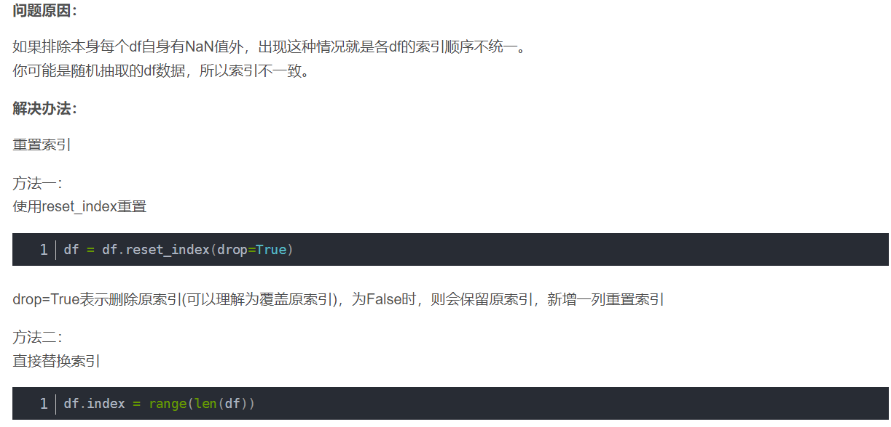

##### 2、append()

如果要连接 Series 和 DataFrame 对象，有一个最方便、快捷的方法，那就是 append() 方法。该方法沿着 axis=0 （行方向）进行操作。

```python
import pandas as pd
a= pd.DataFrame({'A': ['A0', 'A1', 'A2', 'A3'],
                    'B': ['B0', 'B1', 'B2', 'B3'],
                    'C': ['C0', 'C1', 'C2', 'C3'],
                    'D': ['D0', 'D1', 'D2', 'D3']},
                    index=[0, 1, 2, 3])
b= pd.DataFrame({'A': ['A4', 'A5', 'A6', 'A7'],
                    'B': ['B4', 'B5', 'B6', 'B7'],
                    'C': ['C4', 'C5', 'C6', 'C7'],
                    'D': ['D1', 'D2', 'D5', 'D6']},
                     index=[4,5,6,7])
#沿着 axis=0，使用 apppend()方法连接a与b
print(a.append(b))
```

输出结果：

```
    A   B   C   D
0  A0  B0  C0  D0
1  A1  B1  C1  D1
2  A2  B2  C2  D2
3  A3  B3  C3  D3
4  A4  B4  C4  D1
5  A5  B5  C5  D2
6  A6  B6  C6  D5
7  A7  B7  C7  D6
```

当然 append() 函数也可接收多个对象，示例如下：

```python
a= pd.DataFrame({'A': ['A0', 'A1', 'A2', 'A3'],
                    'B': ['B0', 'B1', 'B2', 'B3'],
                    'C': ['C0', 'C1', 'C2', 'C3'],
                    'D': ['D0', 'D1', 'D2', 'D3']},
                    index=[0, 1, 2, 3])
b= pd.DataFrame({'A': ['A4', 'A5', 'A6', 'A7'],
                    'B': ['B4', 'B5', 'B6', 'B7'],
                    'C': ['C4', 'C5', 'C6', 'C7'],
                    'D': ['D1', 'D2', 'D5', 'D6']},
                     index=[4,5,6,7])
c= pd.DataFrame({'A': ['A4', 'A5', 'A6', 'A7'],
                    'B': ['B8', 'B9', 'B10', 'B7'],
                    'C': ['C9', 'C8', 'C7', 'C6'],
                    'D': ['D8', 'D5', 'D7', 'D6']},
                     index=[8,9,10,11])
print(a.append(b,c,a))
```

输出结果：

```
    A    B   C   D
0   A0   B0  C0  D0
1   A1   B1  C1  D1
2   A2   B2  C2  D2
3   A3   B3  C3  D3
4   A4   B4  C4  D1
5   A5   B5  C5  D2
6   A6   B6  C6  D5
7   A7   B7  C7  D6
8   A4   B8  C9  D8
9   A5   B9  C8  D5
10  A6   B10 C7  D7
11  A7   B7  C6  D6
0   A0   B0  C0  D0
1   A1   B1  C1  D1
2   A2   B2  C2  D2
3   A3   B3  C3  D3
```

#### 二十二、Python Pandas时间序列详解

顾名思义，时间序列（time series），就是由时间构成的序列，它指的是在一定时间内按照时间顺序测量的某个变量的取值序列，比如一天内的温度会随时间而发生变化，或者股票的价格会随着时间不断的波动，这里用到的一系列时间，就可以看做时间序列。时间序列包含三种应用场景，分别是：

- 特定的时刻（timestamp），也就是时间戳；
- 固定的日期（period），比如某年某月某日；
- 时间间隔（interval），每隔一段时间具有规律性；


在处理时间序列的过程中，我们一般会遇到两个问题，第一，如何创建时间序列；第二，如何更改已生成时间序列的频率。 Pandas 为解决上述问题提供了一套简单、易用的方法。

下面用 Python 内置的 datetime 模块来获取当前时间，通过该模块提供的`now()` 方法即可实现。 

```python
from datetime import datetime
#数据类型为datetime
print(datetime.now())
```

 输出结果：

```
2020-12-16 16:36:18.791297
```

##### 1、创建时间戳

TimeStamp（时间戳） 是时间序列中的最基本的数据类型，它将数值与时间点完美结合在一起。Pandas 使用下列方法创建时间戳：

```python
import pandas as pd
print (pd.Timestamp('2017-03-01'))
```

 输出结果：

```
2017-03-01 00:00:00
```

同样，可以将整型或浮点型表示的时间转换为时间戳。默认的单位是纳秒(时间戳单位)，示例如下：

```python
import pandas as pd
print(pd.Timestamp(1587687255,unit='s'))
```

输出结果：

```
2022-03-19 14:26:39
```

##### 2、创建时间范围

通过 date_range() 方法可以创建某段连续的时间或者固定间隔的时间时间段。该函数提供了三个参数，分别是：

- start：开始时间
- end：结束时间
- freq：时间频率，默认为 "D"（天）


示例如下：

```python
import pandas as pd
#freq表示时间频率，每30min变化一次
print(pd.date_range("9:00", "18:10", freq="30min").time)

pd.date_range('2022-10-1','2022-12-31',freq='B')
```

输出结果：

```
[datetime.time(9, 0) datetime.time(9, 30) datetime.time(10, 0)
datetime.time(10, 30) datetime.time(11, 0) datetime.time(11, 30)
datetime.time(12, 0) datetime.time(12, 30) datetime.time(13, 0)
datetime.time(13, 30) datetime.time(14, 0) datetime.time(14, 30)
datetime.time(15, 0) datetime.time(15, 30) datetime.time(16, 0)
datetime.time(16, 30) datetime.time(17, 0) datetime.time(17, 30)
datetime.time(18, 0)]
```

##### 3、更改时间频率

```python
import pandas as pd
#修改为按小时
print(pd.date_range("6:10", "11:45", freq="H").time)
```

输出结果：

```
[datetime.time(6, 10) datetime.time(7, 10) datetime.time(8, 10)
datetime.time(9, 10) datetime.time(10, 10) datetime.time(11, 10)]
```

##### 4、转化为时间戳（略）

您可以使用 to_datetime() 函数将 series 或 list 转换为日期对象，其中 list 会转换为`DatetimeIndex` 。示例如下： 

```python
import pandas as pd
print(pd.to_datetime(pd.Series(['Jun 3, 2020','2020-12-10', None])))
```

输出结果：

```
0   2020-06-03
1   2020-12-10
2          NaT
dtype: datetime64[ns]
```

 注意：NaT 表示的不是时间 ，它等效于 NaN。

最后再来看一个示例： 

```python
import pandas as pd
#传入list，生成Datetimeindex
print(pd.to_datetime(['Jun 31, 2020','2020-12-10', None]))
```

输出结果：

```
DatetimeIndex(['2020-06-03', '2020-12-10', 'NaT'], dtype='datetime64[ns]', freq=None)
```

##### 5、频率和周期转换(略)

Time Periods 表示时间跨度，一段时间周期，它被定义在 Pandas Periods 类中，通过该类提供的方法可以实现将频率转换为周期。比如 Periods() 方法，可以将频率 "M"（月）转换为 Period（时间段）。
下面示例，使用 asfreq() 和 start 参数，打印 "01" ，若使用 end 参数，则打印 "31"。示例如下：

```python
import pandas as pd 
x = pd.Period('2014', freq='M')
#start参数
x.asfreq('D', 'start')
#end参数
x.asfreq('D', 'end')
```

输出结果:

```
Period('2014-01-01', 'D')
Period('2014-01-31', 'D')
```

 对于常用的时间序列频率，Pandas 为其规定了一些字符串别名，我们将这些别名称为“offset（偏移量）”。如下表所示：

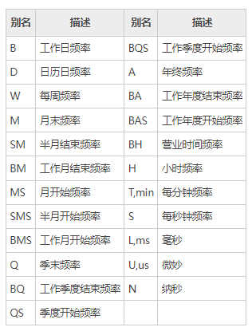

##### 6、时间周期计算

周期计算，指的是对时间周期进行算术运算，所有的操作将在“频率”的基础上执行。

```python
import pandas as pd 
#S表示秒
x = pd.Period('2014', freq='S')  
x 
```

输出结果：

```
Period('2014-01-01 00:00:00', 'S')
```

执行计算示例：

```python
import pandas as pd 
x = pd.Period('2014', freq='S')
#加1s的时间python
print(x+1)
```

输出结果：

```
Period('2014-01-01 00:00:01', 'S')
```

再看一组完整的示例：

```python
#定义时期period，默认freq="Y"年份
p1=pd.Period('2020')
p2=pd.Period('2019')
#使用f''格式化输出
print(f'p1={p1}年')
print(f'p2={p2}年')
print(f'p1和p2间隔{p1-p2}年')
#f''表示字符串格式化输出
print(f'五年前是{p1-5}年')
```

输出结果：

```
p1=2020年
p2=2019年
p1和p2间隔<YearEnd: month=12>年
五年前是2015年
```

##### 7、创建时间周期（略）

我们可以使用 period_range() 方法来创建时间周期范围。示例如下：

```python
import pandas as pd
#Y表示年
p = pd.period_range('2016','2018', freq='Y')
p
```

输出结果：

```
PeriodIndex(['2016', '2017', '2018'], dtype='period[A-DEC]', freq='A-DEC')
```

##### 8、时间序列转换（略）

如果想要把字符串日期转换为 Period，首先需要将字符串转换为日期格式，然后再将日期转换为 Period。示例如下：

```python
# 创建时间序列
index=pd.date_range("2020-03-17","2020-03-30",freq="1.5H")
#随机选取4个互不相同的数
loc=np.random.choice(np.arange(len(index)),size=4,replace=False)
loc.sort()
ts_index=index[loc]
ts_index
pd_index=ts_index.to_periods('D')
pd_index()
```

输出结果：

```
DatetimeIndex(['2020-03-17 12:00:00', '2020-03-22 04:30:00',
               '2020-03-27 03:00:00', '2020-03-30 00:00:00'],
              dtype='datetime64[ns]', freq=None)

PeriodIndex(['2020-03-17', '2020-03-19', '2020-03-19', '2020-03-27'], dtype='period[D]', freq='D')
```

使用 to_timestamp() 能够将 Period 时期转换为时间戳（timestamp），示例如下：

```python
import pandas as pd
p1=pd.Periods("2020-2-3")
p1.to_timestamp()
```

输出结果：

```
Timestamp('2020-02-03 00:00:00')
```

##### 9、创建日期范围

Pandas 提供了用来创建日期序列的函数 date_range()，该函数的默认频率为 "D"， 也就是“天”。日期序列只包含年、月、日，不包含时、分、秒。
下面是一组简单的示例，如下所示：

```python
import pandas as pd
print(pd.date_range('12/15/2020', periods=10))
```

输出结果：

```
DatetimeIndex(['2020-12-15', '2020-12-16', '2020-12-17', '2020-12-18',
               '2020-12-19', '2020-12-20', '2020-12-21', '2020-12-22',
               '2020-12-23', '2020-12-24'],
              dtype='datetime64[ns]', freq='D')
```

当我们使用 date_range() 来创建日期范围时，该函数包含结束的日期，用数学术语来说就是区间左闭右闭，即包含起始值，也包含结束值。示例如下：

```python
import pandas as pd
#建议使用Python的datetime模块创建时间
start = pd.datetime(2019, 1, 1)
end = pd.datetime(2019, 1, 5)
print(pd.date_range(start,end))
```

输出结果：

```
DatetimeIndex(['2019-01-01', '2019-01-02', '2019-01-03', '2019-01-04','2019-01-05']
,dtype='datetime64[ns]', freq='D')
```

##### 10、更改日频率

使用下列方法可以修改频率，比如按“天”为按“月”，示例如下：

```python
import pandas as pd
print(pd.date_range('12/15/2011', periods=5,freq='M'))
```

输出结果：

```
DatetimeIndex(['2020-12-31', '2021-01-31', '2021-02-28', '2021-03-31',
               '2021-04-30'],dtype='datetime64[ns]', freq='M')
```

##### 11、工作日时间

bdate_range() 表示创建工作日的日期范围，它与 date_range() 不同，它不包括周六、周日。

```python
import pandas as pd
print(pd.bdate_range('11/25/2020', periods=8))
```

输出结果：

```
DatetimeIndex(['2020-11-25', '2020-11-26', '2020-11-27', '2020-11-28','2020-11-29', '2020-11-30', '2020-12-01', '2020-12-02'],dtype='datetime64[ns]', freq='D')
```

上述方法中，date_range() 默认频率是日历日，而 bdate_range() 的默认频率是工作日。

#### 二十三、Pandas日期时间格式化

当进行数据分析时，我们会遇到很多带有日期、时间格式的数据集，在处理这些数据集时，可能会遇到日期格式不统一的问题，此时就需要对日期时间做统一的格式化处理。比如“Wednesday, June 6, 2020”可以写成“6/6/20”，或者写成“06-06-2020。

##### 1、日期格式化符号

 在对时间进行格式化处理时，它们都有固定的表示格式，比如小时的格式化符号为`%H` ,分钟简写为`%M` ，秒简写为`%S`。下表对常用的日期格式化符号做了总结： 

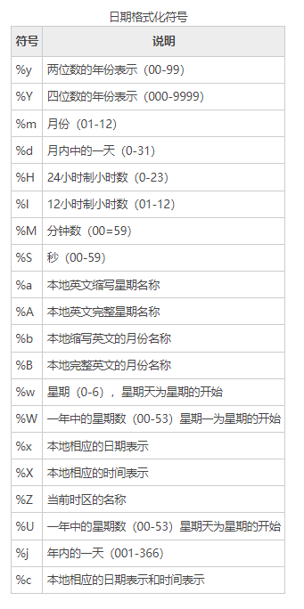

##### 2、Python处理

Python 内置的 strptime() 方法能够将字符串日期转换为 datetime 类型，下面看一组示例：

```python
from datetime import datetime
#将日期定义为字符串    
date_str1 = 'Wednesday,July18,2020' 
date_str2 = '18/7/20' 
date_str3 = '18-07-2020'  
#将日期转化为datetime对象 
dmy_dt1 = datetime.strptime(date_str1, '%A,%B%d,%Y') 
dmy_dt2 = datetime.strptime(date_str2, '%d/%m/%y') 
dmy_dt3 = datetime.strptime(date_str3, '%d-%m-%Y')  
#处理为相同格式，并打印输出
print(dmy_dt1) 
print(dmy_dt2) 
print(dmy_dt3) 
```

输出结果：

```
2020-07-18 00:00:00
2020-07-18 00:00:00
2020-07-18 00:00:00
```

 注意：strftime() 可以将 datetime 类型转换为字符串类型，恰好与 strptime() 相反。

##### 3、Pandas处理

除了使用 Python 内置的 strptime() 方法外，你还可以使用 Pandas 模块的 pd.to_datetime() 和 pd.DatetimeIndex() 进行转换。

1) to_datetime()

通过 to_datetime() 直接转换为 datetime 类型

```python
import pandas as pd
import numpy as np
date = ['2012-05-06 11:00:00','2012-05-16 11:00:00']
pd_date=pd.to_datetime(date)
df=pd.Series(np.random.randn(2),index=pd_date)
```

输出结果：

```
2012-05-06 11:00:00    0.189865
2012-05-16 11:00:00    1.052456
dtype: float64
```

2) DatetimeIndex()

使用 Datetimeindex() 函数设置时间序，示例如下：

```python
date = pd.DatetimeIndex(['1/1/2008', '1/2/2008', '1/3/2008', '1/4/2008', '1/5/2008'])
dt = pd.Series(np.random.randn(5),index = date)
print(dt)
```

输出结果：

```
2008-01-01    1.965619
2008-01-02   -2.897374
2008-01-03    0.625929
2008-01-04    1.204926
2008-01-05    1.755680
dtype: float64
```

#### 二十四、Padans Timedelta时间差(略)

Timedelta 表示时间差（或者时间增量），我们可以使用不同的时间单位来表示它，比如，天、小时、分、秒。时间差的最终的结果可以是正时间差，也可以是负时间差。
本节主要介绍创建 Timedelta （时间差）的方法以及与时间差相关的运算法则。

##### 1、字符串

通过传递字符串可以创建 Timedelta 对象，示例如下：

```python
import pandas as pd
print(pd.Timedelta('5 days 8 hours 6 minutes 59 seconds'))
```

输出结果：

```
5 days 08:06:59
```

##### 2、整数

通过传递整数值和`unit参数也可以创建一个 Timedelta 对象。`

```python
import pandas as pd
print(pd.Timedelta(19,unit='h'))
```

输出结果：

```
0 days 19:00:00
```

##### 3、数据偏移量

数据偏移量， 比如，周(weeks)、天(days)、小时(hours)、分钟(minutes)、秒(milliseconds)、毫秒、微秒、纳秒都可以使用。

```python
import pandas as pd
print (pd.Timedelta(days=2,hours=6))
```

输出结果：

```
2 days 06:00:00
```

##### 4、to_timedelta()

 您可以使用`pd.to_timedelta()`方法，将具有 timedelta 格式的值 (标量、数组、列表或 Series）转换为 Timedelta 类型。如果输入是 Series，则返回 Series；如果输入是标量，则返回值也为标量，其他情况输出 TimedeltaIndex。示例如下： 

```python
import pandas as pd
print(pd.to_timedelta(['1 days 06:05:01.00003', '15.5us', 'nan']))
print(pd.to_timedelta(np.arange(5), unit='s'))
```

输出结果：

```
TimedeltaIndex(['1 days 06:05:01.000030', '0 days 00:00:00.000015', NaT],dtype='timedelta64[ns]', freq=None)

TimedeltaIndex(['0 days 00:00:00', '0 days 00:00:01', '0 days 00:00:02','0 days 00:00:03', 
'0 days 00:00:04'],dtype='timedelta64[ns]', freq=None)
```

##### 5、算术操作

通过对`datetime64[ns]``datetime64[ns]` 类型的时间序列或时间戳做算术运算，其运算结果依然是`datetime64[ns]`数据类型。接下来，我们创建一个带有 Timedelta 与 datetime 的 DataFrame 对象，并对其做一些算术运算。 

```python
import pandas as pd
s = pd.Series(pd.date_range('2020-1-1', periods=5, freq='D'))
#推导式用法
td = pd.Series([ pd.Timedelta(days=i) for i in range(5)])
df = pd.DataFrame(dict(A = s, B = td))
print(df)
```

输出结果：

```
           A      B
0 2020-01-01 0 days
1 2020-01-02 1 days
2 2020-01-03 2 days
3 2020-01-04 3 days
4 2020-01-05 4 days
```

##### 6、加法运算

```python
import pandas as pd
s = pd.Series(pd.date_range('20120-1-1', periods=3, freq='D'))
td = pd.Series([ pd.Timedelta(days=i) for i in range(3) ])
df = pd.DataFrame(dict(A = s, B = td))
#加法运算
df['C']=df['A']+df['B']
print(df)
```

输出结果：

```
           A      B          C
0 2020-01-01 0 days 2020-01-01
1 2020-01-02 1 days 2020-01-03
2 2020-01-03 2 days 2020-01-05
```

##### 7、减法运算

```python
import pandas as pd
s = pd.Series(pd.date_range('2012-1-1', periods=3, freq='D'))
td = pd.Series([ pd.Timedelta(days=i) for i in range(3) ])
df = pd.DataFrame(dict(A = s, B = td))
df['C']=df['A']+df['B']
df['D']=df['C']-df['B']
print(df)
```

输出结果：

```
           A      B          C          D
0 2019-01-01 0 days 2019-01-01 2019-01-01
1 2019-01-02 1 days 2019-01-03 2019-01-02
2 2019-01-03 2 days 2019-01-05 2019-01-03
```

#### 二十五、Pandas sample随机抽样

 随机抽样，是统计学中常用的一种方法，它可以帮助我们从大量的数据中快速地构建出一组数据分析模型。在 Pandas 中，如果想要对数据集进行随机抽样，需要使用 sample() 函数。

sample() 函数的语法格式如下：  

```python
DataFrame.sample(n=None, frac=None, replace=False, weights=None, random_state=None, axis=None)
```

 参数说明如下表所示：

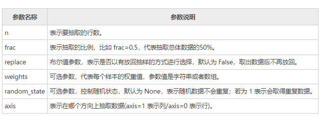

该函数返回与数据集类型相同的新对象，相当于 numpy.random.choice()。实例如下：

```python
import pandas as pd  
dict = {'name':["Jack", "Tom", "Helen", "John"],'age': [28, 39, 34, 36],'score':[98,92,91,89]} 
info = pd.DataFrame(dict)
#默认随机选择两行
info.sample(n=2)
#随机选择两列
info.sample(n=2,axis=1)
```

输出结果：

```
   name  age  score
3  John   36     89
0  Jack   28     98

   score   name
0     98   Jack
1     92    Tom
2     91  Helen
3     89   John
```

再来看一组示例：

```python
import pandas as pd
info = pd.DataFrame({'data1': [2, 6, 8, 0], 'data2': [2, 5, 0, 8], 'data3': [12, 2, 1, 8]}, index=['John', 'Parker', 'Smith', 'William'])
info
#随机抽取3个数据
info['data1'].sample(n=3)
#总体的50%
info.sample(frac=0.5, replace=True)
#data3序列为权重值，并且允许重复数据出现
info.sample(n=2, weights='data3', random_state=1)
```

输出结果：

```
随机选择3行数据：
William    0
Smith      8
Parker     6
Name: data1, dtype: int64

         data1  data2  data3
John         2      2     12
William      0      8      8

         data1  data2  data3
John         2      2     12
William      0      8      8
```

#### 二十六、Pandas resample数据重采样

 数据重采样是将时间序列从一个频率转换至另一个频率的过程，它主要有两种实现方式，分别是降采样和升采样，降采样指将高频率的数据转换为低频率，升采样则与其恰好相反，说明如下：

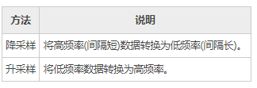

 Pandas 提供了 resample() 函数来实现数据的重采样。

##### 1、降采样

通过 resample() 函数完成数据的降采样，比如按天计数的频率转换为按月计数。

```python
import pandas as pd
import numpy as np
rng = pd.date_range('1/1/2021',periods=100,freq='D')
ts = pd.Series(np.random.randn(len(rng)),index=rng)
#降采样后并聚合
ts.resample('M').mean() 
```

输出结果：

```
2021-01-31    0.210353
2021-02-28   -0.058859
2021-03-31   -0.182952
2021-04-30    0.205254
Freq: M, dtype: float64
```

如果您只想看到月份，那么您可以设置`kind=period`

```python
ts.resample('M',kind='period').mean()
```

输出结果：

```
2021-01   -0.153121
2021-02    0.136231
2021-03   -0.238975
2021-04   -0.309502
Freq: M, dtype: float64
```

##### 2、升采样

升采样是将低频率（时间间隔）转换为高频率，示例如下：

```python
import pandas as pd
import numpy as np
#生成一份时间序列数据
rng = pd.date_range('1/1/2021', periods=20, freq='3D')
ts = pd.Series(np.random.randn(len(rng)), index=rng)
print(ts.head())
#使用asfreq()在原数据基础上实现频率转换
ts.resample('D').asfreq().head()
```

输出结果：

```
升采样前：
2021-01-01    0.608716
2021-01-04    1.097451
2021-01-07   -1.280173
2021-01-10   -0.175065
2021-01-13    1.046831
Freq: 3D, dtype: float64
升采样后：
2021-01-01    0.608716
2021-01-02         NaN
2021-01-03         NaN
2021-01-04    1.097451
2021-01-05         NaN
Freq: D, dtype: float64
```

##### 3、频率转换

asfreq() 方法不仅能够实现频率转换，还可以保留原频率对应的数值，同时它也可以单独使用，示例如下：

```python
index = pd.date_range('1/1/2021', periods=6, freq='T')
series = pd.Series([0.0, None, 2.0, 3.0,4.0,5.0], index=index)
df = pd.DataFrame({'s':series})
print(df.asfreq("45s"))
```

输出结果：

```
                     num
2021-01-01 00:00:00  0.0
2021-01-01 00:00:45  NaN
2021-01-01 00:01:30  NaN
2021-01-01 00:02:15  NaN
2021-01-01 00:03:00  3.0
2021-01-01 00:03:45  NaN
2021-01-01 00:04:30  NaN
```

##### 4、插值处理

从上述示例不难看出，升采样的结果会产生缺失值，那么就需要对缺失值进行处理，一般有以下几种处理方式：

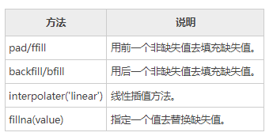

下面使用插值方法处理 NaN 值，示例如下：

```python
import pandas as pd
import numpy as np
#创建时间序列数据
rng = pd.date_range('1/1/2021', periods=20, freq='3D')
ts = pd.Series(np.random.randn(len(rng)), index=rng)
print(ts.resample('D').asfreq().head())
#使用ffill处理缺失值
ts.resample('D').asfreq().ffill().head()
```

输出结果：

```
2021-01-01    0.555580
2021-01-02         NaN
2021-01-03         NaN
2021-01-04   -0.079324
2021-01-05         NaN
Freq: D, dtype: float64

#插值处理，注意对比
2021-01-01    0.555580
2021-01-02    0.555580
2021-01-03    0.555580
2021-01-04   -0.079324
2021-01-05   -0.079324
Freq: D, dtype: float64
```

#### 二十七、Python Pandas分类对象

通常情况下，数据集中会存在许多同一类别的信息，比如相同国家、相同行政编码、相同性别等，当这些相同类别的数据多次出现时，就会给数据处理增添许多麻烦，导致数据集变得臃肿，不能直观、清晰地展示数据。

针对上述问题，Pandas 提供了分类对象（Categorical Object），该对象能够实现有序排列、自动去重的功能，但是它不能执行运算。本节，我们了解一下分类对象的使用。

##### 1、对象创建

我们可以通过多种方式创建分类对象，下面介绍以下两种方法：

1) 指定dtype创建 

```python
import pandas as pd
s = pd.Series(["a","b","c","a"], dtype="category")
print(s)
```

输出结果：

```
0    a
1    b
2    c
3    a
dtype: category
Categories (3, object): [a, b, c]
```

通过上述示例，您可能会注意到，虽然传递给 Series 四个元素值，但是它的类别为 3，这是因为 a 的类别存在重复。

2) pd.Categorical

通过 Category 的构造函数，您可以创建一个类别对象。构造函数，如下所示：

```
pandas.Categorical(values, categories, ordered)
```

values：以列表的形式传参，表示要分类的值。

ordered：布尔值，默认为 False，若为 Ture，表示对分类的数据进行排序。

dtype：返回一个 category 类型，表示分类对象。

示例如下：

```python
import pandas as pd
#自动按a、b、c分类
cat = pd.Categorical(['a', 'b', 'c', 'a', 'b', 'c'])
print(cat)
```

输出结果：

```
[a, b, c, a, b, c]
Categories (3, object): [a, b, c]
```

再看一组示例：

```python
import pandas as pd
cat=pd.Categorical(['a','b','c','a','b','c','d'], ['c', 'b', 'a'])
print(cat)
```

输出结果：

```
[a, b, c, a, b, c, NaN]
Categories (3, object): [c, b, a]
```

 上述示例中，第二个参数值表示类别，当列表中不存在某一类别时，会自动将类别值设置为 NA。

通过指定`ordered=True`来实现有序分类。示例如下： 

```python
import pandas as pd
cat=pd.Categorical(['a','b','c','a','b','c','d'], ['c', 'b', 'a'],ordered=True)
print(cat)
#求最小值
print(cat.min())
```

输出结果：

```
[a, b, c, a, b, c, NaN]
Categories (3, object): [c < b < a]
c
```

##### 2、获取统计信息

对已经分类的数据使用 describe() 方法，您会得到和数据统计相关的摘要信息。

```python
import pandas as pd
import numpy as np
cat = pd.Categorical(["a", "c", "c", np.nan], categories=["b", "a", "c"])
df = pd.DataFrame({"cat":cat, "s":["a", "c", "c", np.nan]})
print(df.describe())
print(df["cat"].describe())
```

输出结果：

```
       cat  s
count    3  3
unique   2  2
top      c  c
freq     2  2

count     3
unique    2
top       c
freq      2
Name: cat, dtype: object
```

3、获取类别属性

使用`obj.categories` 命令可以获取对象的类别信息。示例如下： 

```python
import pandas as pd
import numpy as np
s = pd.Categorical(["a", "c", "c", np.nan], categories=["b", "a", "c"])
print (s.categories)
```

输出结果：

```
Index(['b', 'a', 'c'], dtype='object')
```

通过 obj.order 可以获取 order 指定的布尔值：

```python
import pandas as pd
import numpy as np
cat = pd.Categorical(["a", "c", "c", np.nan], categories=["b", "a", "c"])
#False表示未指定排序
print (cat.ordered)
```

输出结果：

```
False
```

##### 3、重命名类别

要想对类别实现重命名，可以通过 Series.cat.categories 来实现的，示例如下：

```python
import pandas as pd
s = pd.Series(["a","b","c","a"], dtype="category")
#对类名重命名
s.cat.categories = ["Group %s" % g for g in s.cat.categories]
print(s.cat.categories)
```

输出结果：

```
Index(['Group a', 'Group b', 'Group c'], dtype='object')
```

##### 4、追加新类别

使用 s.cat.add_categories() 方法，可以追加新类别。

```python
import pandas as pd
s = pd.Series(["a","b","c","a"], dtype="category")
#追加新类别
s = s.cat.add_categories([5])
#查看现有类别
print(s.cat.categories)
```

输出结果：

```
Index(['a', 'b', 'c', 5], dtype='object')
```

##### 5、删除类别

使用 remove_categories() 方法，可以删除不需要的类别。示例如下：

```python
import pandas as pd
s = pd.Series(["a","b","c","a"], dtype="category")
#原序列
print(s)
#删除后序列
print(s.cat.remove_categories("a"))
```

输出结果

```
0    a
1    b
2    c
3    a
dtype: category
Categories (3, object): [a, b, c]

0    NaN
1      b
2      c
3    NaN
dtype: category
Categories (2, object): [b, c]
```

##### 6、分类对象比较

在下述两种情况下，我们可以对分类对象进行比较：

- 当两个类别对象长度相同时，可以进行比较运算；
- 当两个类别的 ordered 均等于 True，并且类别相同时，可以进行比较运算，比如 ==，！=，>，>=，< 和 <=。


示例如下：

```python
import pandas as pd
s1=['a','a','b','d','c']
#当满足两个类别长度相同时
ss0=pd.Categorical(s1,categories=['a','d','b','c'])
ss1 = pd.Categorical(s1)
print(ss0==ss1)
```

输出结果：

```
array([ True,  True,  True,  True,  True])
```

 示例如下：
import pandas as pd 

```python
s1=['a','a','b','d','c']
s2=['a','b','b','d','c']
#满足上述第二个条件，类别相同，并且ordered均为True
ss0=pd.Categorical(s1,categories=['a','d','b','c'],ordered=True)
ss1 = pd.Categorical(s2,categories=['a','d','b','c'],ordered=True)
print(ss0<ss1)
```

输出结果：

```
array([False,  True, False, False, False])
```

#### 二十八、Python Pandas绘图教程

Pandas 在数据分析、数据可视化方面有着较为广泛的应用，Pandas 对 Matplotlib 绘图软件包的基础上单独封装了一个`plot()`接口，通过调用该接口可以实现常用的绘图操作。本节我们深入讲解一下 Pandas 的绘图操作。

Pandas 之所以能够实现了数据可视化，主要利用了 Matplotlib 库的 plot() 方法，它对 plot() 方法做了简单的封装，因此您可以直接调用该接口。下面看一组简单的示例： 

```python
import pandas as pd
import numpy as np
#创建包含时间序列的数据
df = pd.DataFrame(np.random.randn(8,4),index=pd.date_range('2/1/2020',periods=8), columns=list('ABCD'))
df.plot()
```

 输结果图，如下所示：

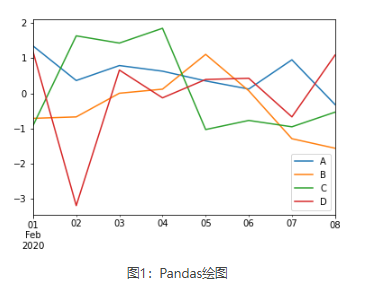

如上图所示，如果行索引中包含日期，Pandas 会自动调用 gct().autofmt_xdate() 来格式化 x 轴。
除了使用默认的线条绘图外，您还可以使用其他绘图方式，如下所示：

- 柱状图：bar() 或 barh()
- 直方图：hist()
- 箱状箱：box()
- 区域图：area()
- 散点图：scatter()

通过关键字参数`kind` 可以把上述方法传递给 plot()。 

##### 1、柱状图

创建一个柱状图，如下所示：

```python
import pandas as pd
import numpy as np
df = pd.DataFrame(np.random.rand(10,4),columns=['a','b','c','d','e'])
#或使用df.plot(kind="bar")
df.plot.bar()
```

 输出结果：

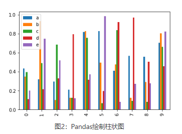

通过设置参数`stacked=True` 可以生成柱状堆叠图，示例如下： 

```python
import pandas as pd
import numpy as np
df = pd.DataFrame(np.random.rand(10,5),columns=['a','b','c','d','e'])
df.plot(kind="bar",stacked=True)
#或者使用df.plot.bar(stacked="True")
```

 输出结果：

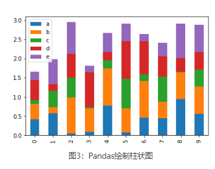

如果要绘制水平柱状图，您可以使用以下方法：

```python
import pandas as pd
import numpy as np
df = pd.DataFrame(np.random.rand(10,4),columns=['a','b','c','d'])
print(df)
df.plot.barh(stacked=True)
```

 输出结果：

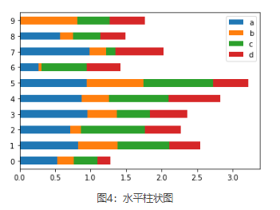

##### 2、直方图

 plot.hist() 可以实现绘制直方图，并且它还可以指定 bins（构成直方图的箱数）。

```python
import pandas as pd
import numpy as np
df = pd.DataFrame({'A':np.random.randn(100)+2,'B':np.random.randn(100),'C':
np.random.randn(100)-2}, columns=['A', 'B', 'C'])
print(df)
#指定箱数为15
df.plot.hist(bins=15)
```

 输出结果：

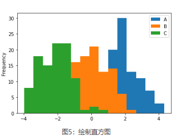

给每一列数据都绘制一个直方图，需要使以下方法：

```python
import pandas as pd
import numpy as np
df = pd.DataFrame({'A':np.random.randn(100)+2,'B':np.random.randn(100),'C':
np.random.randn(100)-2,'D':np.random.randn(100)+3},columns=['A', 'B', 'C','D'])
#使用diff绘制
df.diff().hist(color="r",alpha=0.5,bins=15)
```

 输出结果：

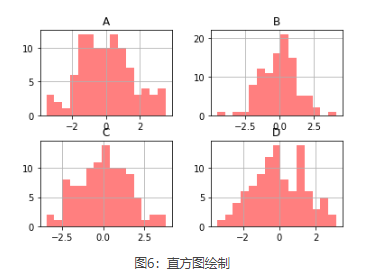

##### 3、箱型图

通过调用 Series.box.plot() 、DataFrame.box.plot() 或者 DataFrame.boxplot() 方法来绘制箱型图，它将每一列数据的分布情况，以可视化的图像展现出来。

```python
import pandas as pd
import numpy as np
df = pd.DataFrame(np.random.rand(10, 4), columns=['A', 'B', 'C', 'D'])
df.plot.box()
```

 输出结果：

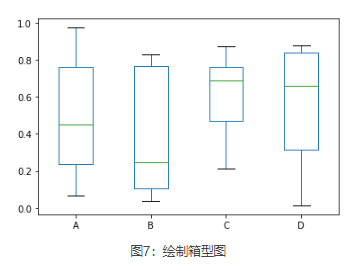

##### 4、区域图

您可以使用 Series.plot.area() 或 DataFrame.plot.area() 方法来绘制区域图。

```python
import pandas as pd
import numpy as np
df = pd.DataFrame(np.random.rand(5, 4), columns=['a', 'b', 'c', 'd'])
df.plot.area()
```

 输出结果：

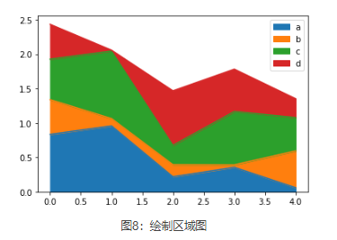

##### 5、散点图

使用 DataFrame.plot.scatter() 方法来绘制散点图，如下所示：

```python
import pandas as pd
import numpy as np
df = pd.DataFrame(np.random.rand(30, 4), columns=['a', 'b', 'c', 'd'])
df.plot.scatter(x='a',y='b')
```

 输出结果：

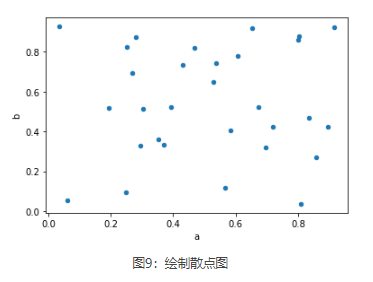

##### 6、饼状图

饼状图可以通过 DataFrame.plot.pie() 方法来绘制。示例如下：

```python
import pandas as pd
import numpy as np
df = pd.DataFrame(3 * np.random.rand(4), index=['go', 'java', 'c++', 'c'], columns=['L'])
df.plot.pie(subplots=True)
```

 输出结果：

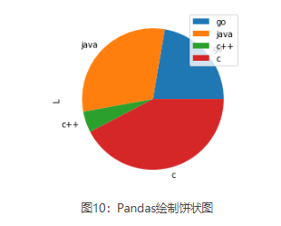

#### 二十九、Python Pandas读取文件

当使用 Pandas 做数据分析的时，需要读取事先准备好的数据集，这是做数据分析的第一步。Panda 提供了多种读取数据的方法：

- read_csv() 用于读取文本文件
- read_json() 用于读取 json 文件
- read_sql_query() 读取 sql 语句的，


本节将对上述方法做详细介绍。

##### 1、CSV文件读取

CSV 又称逗号分隔值文件，是一种简单的文件格式，以特定的结构来排列表格数据。 CSV 文件能够以纯文本形式存储表格数据，比如电子表格、数据库文件，并具有数据交换的通用格式。CSV 文件会在 Excel 文件中被打开，其行和列都定义了标准的数据格式。
将 CSV 中的数据转换为 DataFrame 对象是非常便捷的。和一般文件读写不一样，它不需要你做打开文件、读取文件、关闭文件等操作。相反，您只需要一行代码就可以完成上述所有步骤，并将数据存储在 DataFrame 中。

下面进行实例演示，首先您需要创建一组数据，并将其保存为 CSV 格式，数据如下：

```
Name,Hire Date,Salary,Leaves Remaining 
John Idle,08/15/14,50000.00,10 
Smith Gilliam,04/07/15,65000.00,6 
Parker Chapman,02/21/14,45000.00,7 
Jones Palin,10/14/13,70000.00,3 
Terry Gilliam,07/22/14,48000.00,9 
Michael Palin,06/28/13,66000.00,8  

```

 注意：将上述数据保存到`.txt`的文本文件中，然后将文件的扩展名后缀修改为 csv，即可完成 csv 文件的创建。

接下来，我们使用下列代码读写数据： 

```python
import pandas 
#仅仅一行代码就完成了数据读取，但是注意文件路径不要写错
df = pandas.read_csv('C:/Users/Administrator/Desktop/hrd.csv') 
print(df)  
```

输出结果：

```
             Name Hire Date   Salary  Leaves Remaining 
0       John Idle  08/15/14  50000.0                  10
1   Smith Gilliam  04/07/15  65000.0                   6
2  Parker Chapman  02/21/14  45000.0                   7
3     Jones Palin  10/14/13  70000.0                   3
4   Terry Gilliam  07/22/14  48000.0                   9
5   Michael Palin  06/28/13  66000.0                   8
```

在下一节会对 read_csv() 函数做详细讲解。

##### 2、json读取文件

您可以通过下列方法来读取一个 json 文件，如下所示：

```python
import pandas as pd 
data = pd.read_json('C:/Users/Administrator/Desktop/hrd.json')  
print(data)  
```

输出结果：

```
             Name Hire Date   Salary  Leaves Remaining 
0       John Idle  08/15/14  50000.0                  10
1   Smith Gilliam  04/07/15  65000.0                   6
2  Parker Chapman  02/21/14  45000.0                   7
3     Jones Palin  10/14/13  70000.0                   3
4   Terry Gilliam  07/22/14  48000.0                   9
5   Michael Palin  06/28/13  66000.0                   8
```

##### 3、SQL数据库读取

如果想要从 SQL 数据库读取数据，首先您应该使用 Python 和数据库建立连接，然后将查询语句传递给 read_sql_query() 方法，下面做简单地演示：

1) 安装pysqlite3模块

```
pip install pysqlite3
```

2) 建立数据连接

```python
import sqlite3 
con = sqlite3.connect("database.db")  
```

3) 数据库读取数据

在 SQLite 数据库中创建一张信息表，您可以随意添加一些信息，最后使用下列方法读取数据即可：

```
#con参数指定操作数据库的引擎，可以指定，也可默认
df = pd.read_sql_query("SELECT * FROM information",con) 
```

#### 三十、Pandas csv读写文件

 在《[Python Pandas读取文件](http://c.biancheng.net/pandas/file-operate.html)》中，我们讲解了多种用 Pandas 读写文件的方法。本节我们讲解如何应用这些方法 。

我们知道，文件的读写操作属于计算机的 IO 操作，Pandas IO 操作提供了一些读取器函数，比如 pd.read_csv()、pd.read_json 等，它们都返回一个 Pandas 对象。

在 Pandas 中用于读取文本的函数有两个，分别是： read_csv() 和 read_table() ，它们能够自动地将表格数据转换为 DataFrame 对象。其中 read_csv 的语法格式，如下： 

```python
pandas.read_csv(filepath_or_buffer, sep=',', delimiter=None, header='infer',names=None, index_col=None, usecols=None)
```

  下面，新建一个 txt 文件，并添加以下数据：

```
ID,Name,Age,City,Salary
1,Jack,28,Beijing,22000
2,Lida,32,Shanghai,19000
3,John,43,Shenzhen,12000
4,Helen,38,Hengshui,3500
```

将 txt 文件另存为 person.csv 文件格式，直接修改文件扩展名即可。接下来，对此文件进行操作。

##### 1、read_csv()

read_csv() 表示从 CSV 文件中读取数据，并创建 DataFrame 对象。

```python
import pandas as pd
#需要注意文件的路径
df=pd.read_csv("C:/Users/Administrator/Desktop/person.csv")
print (df)
```

输出结果：

```
   ID   Name  Age      City  Salary
0   1   Jack   28   Beijing   22000
1   2   Lida   32  Shanghai   19000
2   3   John   43  Shenzhen   12000
3   4  Helen   38  Hengshui    3500
```

1) 自定义索引

在 CSV 文件中指定了一个列，然后使用`index_col`

```python
import pandas as pd
df=pd.read_csv("C:/Users/Administrator/Desktop/person.csv",index_col=['ID'])
print(df)
```

输出结果：

```
     Name  Age      City  Salary
ID                             
1    Jack   28   Beijing   22000
2    Lida   32  Shanghai   19000
3    John   43  Shenzhen   12000
4   Helen   38  Hengshui    3500
```

2) 查看每一列的dtype

```python
import pandas as pd
#转换salary为float类型
df=pd.read_csv("C:/Users/Administrator/Desktop/person.csv",dtype={'Salary':np.float64})
print(df.dtypes)
```

输出结果：

```
ID          int64
Name       object
Age         int64
City       object
Salary    float64
dtype: object
```

注意：默认情况下，Salary 列的 dtype 是 int 类型，但结果显示其为 float 类型，因为我们已经在上述代码中做了类型转换。

3) 更改文件标头名

使用 names 参数可以指定头文件的名称。

```python
import pandas as pd
df=pd.read_csv("C:/Users/Administrator/Desktop/person.csv",names=['a','b','c','d','e'])
print(df)
```

输出结果：

```
    a      b    c         d       e
0  ID   Name  Age      City  Salary
1   1   Jack   28   Beijing   22000
2   2   Lida   32  Shanghai   19000
3   3   John   43  Shenzhen   12000
4   4  Helen   38  Hengshui    3500
```

注意：文件标头名是附加的自定义名称，但是您会发现，原来的标头名（列标签名）并没有被删除，此时您可以使用`header` 参数来删除它。 
通过传递标头所在行号实现删除，如下所示：

```python
import pandas as pd
df=pd.read_csv("C:/Users/Administrator/Desktop/person.csv",names=['a','b','c','d','e'],header=0)
print(df)
```

输出结果：

```
   a      b   c         d      e
0  1   Jack  28   Beijing  22000
1  2   Lida  32  Shanghai  19000
2  3   John  43  Shenzhen  12000
3  4  Helen  38  Hengshui   3500
```

假如原标头名并没有定义在第一行，您也可以传递相应的行号来删除它。

4) 跳过指定的行数

`skiprows`参数表示跳过指定的行数。

```python
import pandas as pd
df=pd.read_csv("C:/Users/Administrator/Desktop/person.csv",skiprows=2)
print(df)
```

输出结果：

```
   2   Lida  32  Shanghai  19000
0  3   John  43  Shenzhen  12000
1  4  Helen  38  Hengshui   3500
```

注意：包含标头所在行。

##### 2、to_csv()

Pandas 提供的 to_csv() 函数用于将 DataFrame 转换为 CSV 数据。如果想要把 CSV 数据写入文件，只需向函数传递一个文件对象即可。否则，CSV 数据将以字符串格式返回。
下面看一组简单的示例：

```python
import pandas as pd 
data = {'Name': ['Smith', 'Parker'], 'ID': [101, 102], 'Language': ['Python', 'JavaScript']} 
info = pd.DataFrame(data) 
print('DataFrame Values:\n', info) 
#转换为csv数据
csv_data = info.to_csv() 
print('\nCSV String Values:\n', csv_data)  
```

输出结果：

```python
DataFrame:
      Name   ID    Language
0   Smith  101      Python
1  Parker  102  JavaScript

csv数据:
,Name,ID,Language
0,Smith,101,Python
1,Parker,102,JavaScript
```

指定 CSV 文件输出时的分隔符，并将其保存在 pandas.csv 文件中，代码如下：

```python
import pandas as pd
#注意：pd.NaT表示null缺失数据
data = {'Name': ['Smith', 'Parker'], 'ID': [101, pd.NaT], 'Language': ['Python', 'JavaScript']}
info = pd.DataFrame(data)
csv_data = info.to_csv("C:/Users/Administrator/Desktop/pandas.csv",sep='|')
```

#### 三十一、Pandas Excel读写操作详解

Excel 是由微软公司开发的办公软件之一，它在日常工作中得到了广泛的应用。在数据量较少的情况下，Excel 对于数据的处理、分析、可视化有其独特的优势，因此可以显著提升您的工作效率。但是，当数据量非常大时，Excel 的劣势就暴露出来了，比如，操作重复、数据分析难等问题。Pandas 提供了操作 Excel 文件的函数，可以很方便地处理 Excel 表格。

##### 1、to_excel()

通过 to_excel() 函数可以将 Dataframe 中的数据写入到 Excel 文件。

 如果想要把单个对象写入 Excel 文件，那么必须指定目标文件名；如果想要写入到多张工作表中，则需要创建一个带有目标文件名的`ExcelWriter`对象，并通过`sheet_name`参数依次指定工作表的名称。

to_ecxel() 语法格式如下： 

```python
DataFrame.to_excel(excel_writer, sheet_name='Sheet1', na_rep='', float_format=None, columns=None, header=True, index=True, index_label=None, startrow=0, startcol=0, engine=None, merge_cells=True, encoding=None, inf_rep='inf', verbose=True, freeze_panes=None) 
```

 下表列出函数的常用参数项，如下表所示：

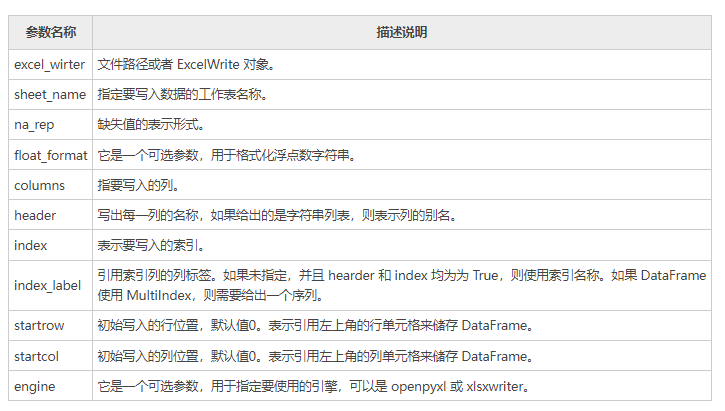

下面看一组简单的示例：

```python
import pandas as pd
#创建DataFrame数据
info_website = pd.DataFrame({'name': ['编程帮', 'c语言中文网', '微学苑', '92python'],
     'rank': [1, 2, 3, 4],
     'language': ['PHP', 'C', 'PHP','Python' ],
     'url': ['www.bianchneg.com', 'c.bianchneg.net', 'www.weixueyuan.com','www.92python.com' ]})
#创建ExcelWrite对象
writer = pd.ExcelWriter('website.xlsx')
info_website.to_excel(writer)
writer.save()
print('输出成功')
```

 上述代码执行后会自动生成 website.xlsx 文件，文件内容如下：

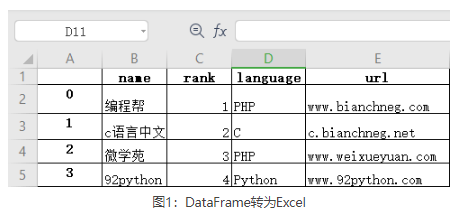


##### 2、read_excel()

如果您想读取 Excel 表格中的数据，可以使用 read_excel() 方法，其语法格式如下：

```python
pd.read_excel(io, sheet_name=0, header=0, names=None, index_col=None,
              usecols=None, squeeze=False,dtype=None, engine=None,
              converters=None, true_values=None, false_values=None,
              skiprows=None, nrows=None, na_values=None, parse_dates=False,
              date_parser=None, thousands=None, comment=None, skipfooter=0,
              convert_float=True, **kwds)
```

 下表对常用参数做了说明：

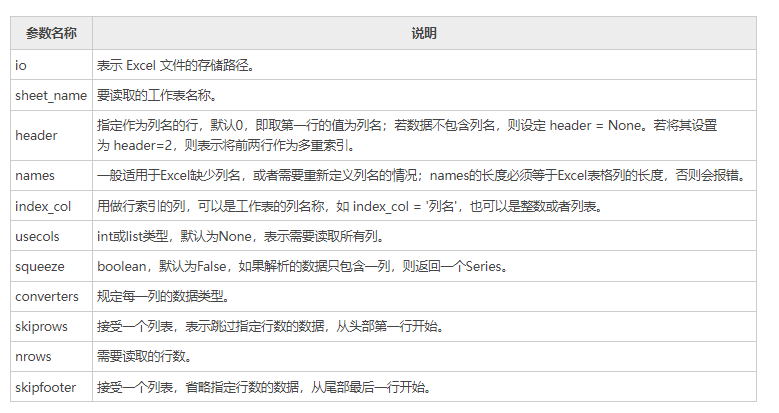

示例如下所示：

```python
import pandas as pd
#读取excel数据
df = pd.read_excel('website.xlsx',index_col='name',skiprows=[2])
#处理未命名列
df.columns = df.columns.str.replace('Unnamed.*', 'col_label')
print(df)
```

输出结果：

```
           col_label     rank    language          agelimit
name                                                 
编程帮           0         1        PHP       www.bianchneg.com
微学苑           2         3        PHP       www.weixueyuan.com
92python        3         4        Python    www.92python.com
```

再看一组示例：

```python
import pandas as pd
#读取excel数据
#index_col选择前两列作为索引列
#选择前三列数据，name列作为行索引
df = pd.read_excel('website.xlsx',index_col='name',index_col=[0,1],usecols=[1,2,3])
#处理未命名列，固定用法
df.columns = df.columns.str.replace('Unnamed.*', 'col_label')
print(df)
```

输出结果：

```
                   language
name      rank        
编程帮       1          PHP
c语言中文网   2           C
微学苑       3          PHP
92python    4         Python
```

#### 三十二、Pandas index操作索引

索引（index）是 Pandas 的重要工具，通过索引可以从 DataFame 中选择特定的行数和列数，这种选择数据的方式称为“子集选择”。
在 Pandas 中，索引值也被称为标签（label），它在 Jupyter 笔记本中以粗体字进行显示。索引可以加快数据访问的速度，它就好比数据的书签，通过它可以实现数据的快速查找。

##### 1、创建索引

通过示例对 index 索引做进一步讲解。下面创建一个带有 index 索引的数据，并使用 read_csv() 这些读取数据：

```python
import pandas as pd    
data = pd.read_csv("person.csv") 
print(data) 
```

输出结果：

```
   ID   Name  Age      City  Salary
0   1   Jack   28   Beijing   22000
1   2   Lida   32  Shanghai   19000
2   3   John   43  Shenzhen   12000
3   4  Helen   38  Hengshui    3500
```

通过列索引（标签）读取多列数据。

```python
import pandas as pd  
#设置"Name"为行索引    
data = pd.read_csv("person.csv", index_col ="Name")   
# 通过列标签选取多列数据  
a = data[["City","Salary"]]
print(a)
```

输出结果：

```
           City  Salary
Name                  
Jack    Beijing   22000
Lida   Shanghai   19000
John   Shenzhen   12000
Helen  Hengshui    3500
```

再看一组简单的示例：

```python
import pandas as pd  
info =pd.read_csv("person.csv", index_col ="Name")
#获取单列数据，或者以列表的形式传入["Salary"] 
a =info["Salary"] 
print(a)
```

输出结果：

```
       Salary
Name        
Jack    22000
Lida    19000
John    12000
Helen    3500
```

##### 2、设置索引

set_index() 将已存在的列标签设置为 DataFrame 行索引。除了可以添加索引外，也可以替换已经存在的索引。比如您也可以把 Series 或者一个 DataFrme 设置成另一个 DataFrame 的索引。示例如下：

```python
info = pd.DataFrame({'Name': ['Parker', 'Terry', 'Smith', 'William'],  'Year': [2011, 2009, 2014, 2010], 
'Leaves': [10, 15, 9, 4]})
#设置Name为行索引
print(info.set_index('Name'))
```

输出结果：

```
         Year  Leaves
Name                
Parker   2011      10
Terry    2009      15
Smith    2014       9
William  2010       4
```

##### 3、重置索引

您可以使用 reset_index() 来恢复初始行索引，示例如下：

```python
import pandas as pd
import numpy as np
info = pd.DataFrame([('William', 'C'), 
('Smith', 'Java'), 
('Parker', 'Python'), 
('Phill', np.nan)], 
index=[1, 2, 3, 4], 
columns=('name', 'Language')) 
print(info)
print(info.reset_index())
```

输出结果：

```
重置前：
     name    Language
1  William        C
2    Smith     Java
3   Parker   Python
4    Phill      NaN
重置后：
   index     name    Language
0      1  William        C
1      2    Smith     Java
2      3   Parker   Python
3      4    Phill      NaN
```

#### 三十三、Pandas分层索引入门教程

 分层索引（Multiple Index）是 Pandas 中非常重要的索引类型，它指的是在一个轴上拥有多个（即两个以上）索引层数，这使得我们可以用低维度的结构来处理更高维的数据。比如，当想要处理三维及以上的高维数据时，就需要用到分层索引。

分层索引的目的是用低维度的结构（Series 或者 DataFrame）更好地处理高维数据。通过分层索引，我们可以像处理二维数据一样，处理三维及以上的数据。分层索引的存在使得分析高维数据变得简单，让抽象的高维数据变得容易理解，同时它比废弃的 Panel 结构更容易使用。

Pandas 可以通过 MultiIndex() 方法来创建分层索引对象，该对象本质上是一个元组序列，序列中每一个元组都是唯一的。下面介绍几种创建分层索引的方式。 

##### 1、创建分层索引

1) 直接创建

通过 MultiIndex() 的`levels` 参数能够直接创建分层索引，示例如下： 

```python
import pandas as pd 
import numpy as np 
#为leves传递一个1行5列的二维数组
df=pd.MultiIndex(levels=[[np.nan, 2, pd.NaT, None, 5]], codes=[[4, -1, 1, 2, 3, 4]]) 
print(df.levels)
print(df)
```

输出结果：

```
[[nan, 2, NaT, None, 5]]

MultiIndex([(  5,),
            (nan,),
            (  2,),
            (nan,),
            (nan,),
            (  5,)],
           )
```

上述代码中，`levels``codes`参数用来创建层级索引，这里只有一层，该层的索引值分别是 np.nan, 2, NaT, None, 5；`codes`表示按参数值对层级索引值排序（与 levels 中的值相对应），也就说 codes 中数值是 leves 序列的下标索引。需要注意，这里的 -1 代表 NaN。

2) 从元组创建

通过 from_tuples() 实现从元组创建分层索引。

```python
#创建元组序列
arrays = [['it', 'it', 'of', 'of', 'for', 'for', 'then', 'then'], 
['one', 'two', 'one', 'two', 'one', 'two', 'one', 'two']] 
#使用zip()函数创建元组
tuples = list(zip(*arrays)) 
print(tuples)
```

输出结果如下：

```
[('it', 'one'),
('it', 'two'),
('of', 'one'),
('of', 'two'),
('for', 'one'),
('for', 'two'),
('then', 'one'),
('then', 'two')]
```

然后使用 tuples 创建分层索引，如下所示：

```python
import pandas as pd
#创建了两层索引，并使用names对它们命名 
index = pd.MultiIndex.from_tuples(tuples, names=['first', 'second'])
print(index)
```

输出结果：

```
MultiIndex([(  'it', 'one'),
            (  'it', 'two'),
            (  'of', 'one'),
            (  'of', 'two'),
            ( 'for', 'one'),
            ( 'for', 'two'),
            ('then', 'one'),
            ('then', 'two')],
           names=['first', 'second'])
```

3) 从DataFrame对象创建

通过 from_frame() 创建分层索引，示例如下：

```python
#首先创建一个 DataFrame。
import pandas as pd
df = pd.DataFrame([['bar', 'one'], ['bar', 'two'],
                   ['foo', 'one'], ['foo', 'two']],
                  columns=['first', 'second'])
#然后使用 from_frame()创建分层索引。
index = pd.MultiIndex.from_frame(df)
#将index应用于Series
s=pd.Series(np.random.randn(4), index=index)
print(s)
```

输出结果：

```
first  second
bar    one       1.151928
       two      -0.694435
foo    one      -1.701611
       two      -0.486157
dtype: float64
```

4) 笛卡尔积创建

笛卡尔积（又称直积）是数学运算的一种方式，下面使用 from_product() 笛卡尔积创建分层索引。

```python
import pandas as pd
#构建数据
numbers = [0, 1, 2]
language = ['Python', 'Java']
#经过笛卡尔积处理后会得到6中组合方式
index = pd.MultiIndex.from_product([numbers, language],names=['number', 'language'])
#将分层索引对象应用于Series
dk_er=pd.Series(np.random.randn(6), index=index)
print(dk_er)
```

输出结果：

```
number  language
0       Python     -0.319739
        Java        1.599170
1       Python     -0.010520
        Java        0.262068
2       Python     -0.124177
        Java        0.315120
dtype: float64
```

5) 数组创建分层索引

通过 from_array() 方法，同样可以创建分层索引。示例如下：

```python
import pandas as pd
df=pd.MultiIndex.from_arrays([['a', 'a', 'b', 'b'],[1, 2, 1, 2]])
df
```

输出结果：

```
MultiIndex([('a', 1),
            ('a', 2),
            ('b', 1),
            ('b', 2)],
           )
```

##### 2、应用分层索引

下面示例讲解了如何在 DataFrame 中应用分层索引。

```python
import pandas as pd 
import numpy as np
#创建一个数组
arrays = [[0, 0, 1, 1], ['A', 'B', 'A', 'B']]
#从数组创建
index=pd.MultiIndex.from_arrays(arrays, names=('number', 'letter'))
print(index)
```

输出结果

```
MultiIndex([(0, 'A'),
            (0, 'B'),
            (1, 'A'),
            (1, 'B')],
           names=['number', 'letter'])
```

上述示例中，第一层为 number，该层有 0、1 两个元素，第二层为 letter，有两个字母 A 和 B。
下面把已经创建的分层索引应用到 DataFrame 中，如下所示：

```python
import pandas as pd 
import numpy as np
#创建一个数组
arrays = [[0, 0, 1, 1], ['A', 'B', 'A', 'B']]
index=pd.MultiIndex.from_arrays(arrays, names=('number', 'letter'))
#在行索引位置应用分层索引
df=pd.DataFrame([{'a':11, 'b':22}], index=index)
print(df)
```

输出结果：

```
                a   b
number letter       
0      A       11  22
       B       11  22
1      A       11  22
       B       11  22
```

通过 set_index() 可以将 DataFrame 的已有列的标索设置为 index 行索引，示例如下：

```python
import pandas as pd
df= pd.DataFrame({'a': range(5), 'b': range(5, 0, -1),
                  'c': ['one', 'one', 'one', 'two', 'two'],
                  'd': [0, 1, 2, 0, 1]})
print(df)
df1=df.set_index(['a','d'],drop=False)
print(df1)
df1=df.set_index(['a','d'],drop=False,append=Ture)
print(df2)
```

输出结果：

```
转换前：
   a  b    c  d
0  0  5  one  0
1  1  4  one  1
2  2  3  one  2
3  3  2  two  0
4  4  1  two  1
转换后：
     a  b    c  d
a d             
0 0  0  5  one  0
1 1  1  4  one  1
2 2  2  3  one  2
3 0  3  2  two  0
4 1  4  1  two  1
带append参数：
       a  b    c  d
  a d            
0 0 0  0  5  one  0
1 1 1  1  4  one  1
2 2 2  2  3  one  2
3 3 0  3  2  two  0
4 4 1  4  1  two  1
```

通过 set_index() 将列索引转换为了分层行索引，其中 drop=False 表示更新索引的同时，不删除 a、d 列；同时，该函数还提供了一个 append = Ture 参数表示不添加默认的整数索引值（0到4）

##### 3、分层索引切片取值

下面讲解分层索引切片取值操作，示例如下：

1) 分层行索引操作

```python
import pandas as pd
#构建多层索引
tuple = [('湖人',2008),('步行者',2008),
      ('湖人',2007),('凯尔特人',2007),
   ('篮网',2007),('热火',2008)]
salary = [10000,20000,11000,30000,19000,22000]
#其次应用于DataFrame
index = pd.MultiIndex.from_tuples(tuple)
s = pd.Series(salary, index=index)
print(s)
#切片取值
print(s['湖人',2007])
print(s['湖人'])
print(s[:,2008])
#比较value
print(s[s<=20000])
```

输出结果：

```
湖人    2008    10000
步行者   2008    20000
湖人    2007    11000
凯尔特人  2007    30000
篮网    2007    19000
热火    2008    22000
dtype: int64

湖人队2007年工资：
11000

湖人队的工资：
2008    10000
2007    11000
dtype: int64

2008年所有队伍工资：
湖人     10000
步行者    20000
热火     22000
dtype: int64

小于等于20000的年份和队伍：
湖人   2008    10000
步行者  2008    20000
湖人   2007    11000
篮网   2007    19000
dtype: int64
```

2) 行、列多层索引操作

下面看一种更加复杂的情况，就是行、列同时存在多层索引时候，应该如何通过切片取值。示例如下：

```python
df = pd.DataFrame(np.arange(1,13).reshape((4, 3)),
               index=[['a', 'a', 'b', 'b'], [1, 2, 1, 2]],
               columns=[['Jack', 'Jack', 'Helen'],
              ['Python', 'Java', 'Python']])
#选择同一层级的索引,切记不要写成['Jack','Helen']
print(df[['Jack','Helen']])
#在不同层级分别选择索引
print(df['Jack','Python'])
#iloc整数索引
print(df.iloc[:3,:2])
#loc列标签索引
print(df.loc[:,('Helen','Python')])
```

输出结果：

```
      Jack       Helen
    Python Java Python
a 1      1    2      3
  2      4    5      6
b 1      7    8      9
  2     10   11     12

a  1     1
   2     4
b  1     7
   2    10
Name: (Jack, Python), dtype: int32

      Jack    
    Python Java
a 1      1    2
  2      4    5
b 1      7    8

a  1     3
   2     6
b  1     9
   2    12
Name: (Helen, Python), dtype: int32
```

##### 4、聚合函数应用

通过给`level` 传递参数值，您可以指定在哪个层上进行聚合操作，比如求和、求均值等。示例如下： 

```python
import pandas as pd 
df = pd.DataFrame(np.arange(1,13).reshape((4, 3)),
               index=[['a', 'a', 'b', 'b'], [1, 2, 1, 2]],
               columns=[['Jack', 'Jack', 'Helen'],
              ['Python', 'Java', 'Python']])
#第一步，给行列层级起名字
df.index.names=['key1','key2']
df.columns.names=['name','course']
print(df.sum(level='key2'))
print(df.mean(level="course",axis=1))
```

输出结果：

```
#对key2层1/2对应的元素值求和
name     Jack       Helen
course Python Java Python
key2                    
1           8   10     12
2          14   16     18

#axis=1沿着水平方向求均值
course     Python  Java
key1 key2             
a    1          2     2
     2          5     5
b    1          8     8
     2         11    11
```

在数据分析的过程中，我们把大部分时间都花费在数据的准备和预处理上，Pandas 作为一个灵活、高效的数据预处理工具，提供了诸多数据处理的方法，分层索引（Multiple Index）就是其中之一，分层索引（或多层索引）是 Pandas 的基本特性，它能够增强 Pands 数据预处理的能力。

对于 Series 结构来说，通过给`index` 参数传递一个二维数组就可以创建一个具有两层索引的 MultiIndex 对象，示例如下： 

```python
import pandas as pd 
info = pd.Series([11, 14, 17, 24, 19, 32, 34, 27],
index = [['x', 'x', 'x', 'x', 'y', 'y', 'y', 'y'],
['obj1', 'obj2', 'obj3', 'obj4', 'obj1', 'obj2', 'obj3', 'obj4']]) 
print(info)
```

输出结果：

```
x  obj1    11
   obj2    14
   obj3    17
   obj4    24
y  obj1    19
   obj2    32
   obj3    34
   obj4    27
dtype: int64
```

上述示例，创建了两个层级的索引，即 (x, y) 和 (obj1，…， obj4)，您可以使用 'index' 命令查看索引。

info.index

输出结果：

```
MultiIndex([('x', 'obj1'),
            ('x', 'obj2'),
            ('x', 'obj3'),
            ('x', 'obj4'),
            ('y', 'obj1'),
            ('y', 'obj2'),
            ('y', 'obj3'),
            ('y', 'obj4')],
           )
```

此外，您还可以基于内部索引层（也就是'obj'）来选择数据。如下所示：

```
info [:,'obj2' ]
```

输出结果：

```
x    14
y    32
dtype: int64
```

##### 5、局部索引

局部索引可以理解为：从分层索引中选择特定索引层的一种方法。比如在下列数据中，选择所有`'y'` 索引指定的数据，示例如下： 

```python
import pandas as pd 
info = pd.Series([11, 14, 17, 24, 19, 32, 34, 27], 
index = [['x', 'x', 'x', 'x', 'y', 'y', 'y', 'y'], 
['obj1', 'obj2', 'obj3', 'obj4', 'obj1', 'obj2', 'obj3', 'obj4']]) 
info['y']
```

输出结果：

```
obj1    19
obj2    32
obj3    34
obj4    27
dtype: int64
```

当然您也可以基于内层索引选择数据。

##### 6、行索引层转换为列索引

unstack() 用来将行索引转变成列索引，相当于转置操作。通过 unstack() 可以将 Series（一维序列）转变为 DataFrame（二维序列）。示例如下：

```python
import pandas as pd 
info = pd.Series([11, 14, 17, 24, 19, 32, 34, 27], 
index = [['x', 'x', 'x', 'x', 'y', 'y', 'y', 'y'], 
['obj1', 'obj2', 'obj3', 'obj4', 'obj1', 'obj2', 'obj3', 'obj4']]) 
#行索引标签默认是最外层的 x, y
#0代表第一层索引，而1代表第二层
print(info.unstack(0))
```

输出结果：

```
       x   y
obj1  11  19
obj2  14  32
obj3  17  34
obj4  24  27
```

从示例可以看出，unstack(0) 表示选择第一层索引作为列，unstack(1) 表示选择第二层，如下所示：

```python
import pandas as pd 
info = pd.Series([11, 14, 17, 24, 19, 32, 34, 27], 
index = [['x', 'x', 'x', 'x', 'y', 'y', 'y', 'y'], 
['obj1', 'obj2', 'obj3', 'obj4', 'obj1', 'obj2', 'obj3', 'obj4']]) 
print(info.unstack(1))
```

输出结果：

```
   obj1  obj2  obj3  obj4
x    11    14    17    24
y    19    32    34    27
```

##### 7、列索引实现分层

我们知道，列索引存在于 DataFrame 结构中，下面创建一个 DataFrame 来演示列索引如何实现分层。

```python
import numpy as np  
info = pd.DataFrame(np.arange(12).reshape(4, 3), 
index = [['a', 'a', 'b', 'b'], ['one', 'two', 'three', 'four']],  
columns = [['num1', 'num2', 'num3'], ['x', 'y', 'x']] )  
print(info)
```

输出结果：

```
        num1 num2 num3
           x    y    x
a one      0    1    2
  two      3    4    5
b three    6    7    8
  four     9   10   11
```

查看所有列索引：

```
info.columns
```

输出结果：

```
MultiIndex([('num1', 'x'),
            ('num2', 'y'),
            ('num3', 'x')],)
```

##### 8、交换层和层排序

1) 交换层

通过 swaplevel() 方法轻松地实现索引层交换，示例如下：

```python
import pandas as pd
frame = pd.DataFrame(np.arange(12).reshape((4, 3)),
                  index=[['a', 'a', 'b', 'b'], [1, 2, 1, 2]],
                  columns=[['Ohio', 'Ohio', 'Colorado'],
                           ['Green', 'Red', 'Green']])
#设置index的levels名称                         
frame.index.names = ['key1', 'key2']
#设置columns的levels名称
frame.columns.names = ['state','color']
#交换key1层与key层
frame.swaplevel('key1','key2')
```

输出结果：

```
state      Ohio     Colorado
color     Green Red    Green
key2 key1                  
1    a        0   1        2
2    a        3   4        5
1    b        6   7        8
2    b        9  10       11
```

2) 层排序

通过 sort_index() 的`level` 参数实现对层的排序。下面示例，按“key1”的字母顺序重新排序。 

```python
import pandas as pd
frame = pd.DataFrame(np.arange(12).reshape((4, 3)),
                  index=[['a', 'a', 'b', 'b'], [1, 2, 1, 2]],
                  columns=[['Ohio', 'Ohio', 'Colorado'],
                           ['Green', 'Red', 'Green']])
#设置index的levels的名称，key1 与 key2分别对应不同的层                         
frame.index.names = ['key1', 'key2']
#设置columns的levels的名称
frame.columns.names = ['state','color']
print(frame.sort_index(level='key1'))
```

输出结果：

```
state      Ohio     Colorado
color     Green Red    Green
key1 key2                  
a    1        0   1        2
     2        3   4        5
b    1        6   7        8
     2        9  10       11
```

##### 三十四、Pandas执行SQL操作

 我们知道，使用 SQL 语句能够完成对 table 的增删改查操作，Pandas 同样也可以实现 SQL 语句的基本功能。本节主要讲解 Pandas 如何执行 SQL 操作。

首先加载一个某连锁咖啡厅地址分布的数据集，通过该数据集对本节内容进行讲解。  

```python
import pandas as pd
url = 'C:/Users/Administrator/Desktop/coffee/kafei.xlsx'
coffee_df=pd.read_excel(url)
coffee_df.head()
```

输出结果如下：

```
   address                                    category           id                     tel
0 北京市东城区南竹竿胡同2号1幢2层30212号银河SOHOC座  娱乐休闲:咖啡厅  1874263549184796345   010-85179080
1 北京市东城区东直门内大街277-31号档口              娱乐休闲:咖啡厅  1461638360847848424   400-669-2002
2 北京市东城区王府井东街8号澳门中心L117商场102室      娱乐休闲:咖啡厅  1308505235389562852   400-010-0100
3 北京市东城区前门大街108号底商                    娱乐休闲:咖啡厅   15442844740539053384
4 北京市东城区和平里西街51号雍和宫壹中心A座负一层     娱乐休闲:咖啡厅    2357391864111641256  4000100100
```

##### 1、SELECT

在 SQL 中，SELECT 查询语句使用逗号 把要查询的每个字段分开，当然您也可以使用`*`来选择所有的字段。如下所示： 

```sql
SELECT address, category, id, tel FROM tips LIMIT 5;
```

 对于 Pandas 而言，要完成 SELECT 查询，需要把数据集每一列（columns）的名称传递给 DataFrame 对象。如下所示：

```sql
coffee_df[['address','category','id','tel']].head()
```

下面代码是 Pandas 执行 SELECT 查询的完整程序：

```python
import pandas as pd
url = 'C:/Users/Administrator/Desktop/coffee/kafei.xlsx'
coffee_df=pd.read_excel(url)
#只查看尾3行
coffee_df[['address', 'category', 'id', 'tel']].tail(3)
```

输出结果如下：

```
      address                                           category         id                    tel
28912 新疆维吾尔自治区北屯市芳园路69-2-12                 娱乐休闲:咖啡厅   7443833746160692626
28913 新疆维吾尔自治区北屯市北屯购物公园7-1-7               娱乐休闲:咖啡厅  15288143245642241877
28914 新疆维吾尔自治区可克达拉市人民西路与育才路交叉口西北50米 娱乐休闲:咖啡厅   17884214706482955
```

 假如您传入的是一个空列表， 那最终结果将输出所有的行索引标签。

##### 2、WHERE

SQL 中的条件查询是通过 WHERE 子句完成的。格式如下所示：

```sql
SELECT * FROM coffee_df WHERE tel = '010-85179080';
```

 然而 DataFrame 可以通过多种方式实现条件筛选，最直观的方法是通过布尔索引：

```sql
coffee_df[coffee_df['id'] == '1461638360847848424']
```

完整程序如下：

```python
import pandas as pd
url = 'C:/Users/Administrator/Desktop/coffee/kafei.xlsx'
coffee_df=pd.read_excel(url)
coffee_df[coffee_df['tel'] == '400-010-0100'].head(5)
```

输出结果如下：

```
address                                        category      id                  tel
2 北京市东城区王府井东街8号澳门中心L117商场102室      娱乐休闲:咖啡厅 1308505235389562852 400-010-0100
5 北京市东城区崇文门外大街3号崇文新世界百货一期南门一层  娱乐休闲:咖啡厅 3294587167648650139 400-010-0100
6 北京市东城区东四北大街265号文化金融大厦1层大堂       娱乐休闲:咖啡厅 3046481700882245722 400-010-0100
7 北京市东城区珠市口东大街2号丰泰中心1层              娱乐休闲:咖啡厅 3218554253235914037 400-010-0100
9 北京市东城区怡生健身居然大厦店休闲区                娱乐休闲:咖啡厅 3141197020974020427 400-010-0100
```

上面的语句通过布尔运算将 True 或 False 对象传递给 DataFrame 对象，然后返回所有为 True 的行。

##### 3、GroupBy

在 SQL 语句中，通过 GroupBy 操作可以获取 table 中一组记录的计数。示例如下：

```sql
SELECT id, count(*) FROM tips GROUP BY id;
```

 而 Pandas 可通过以下代码实现：

```sql
coffe_df.groupby('id').size()
```

完整的程序如下所示：

```python
import pandas as pd
url = 'C:/Users/Administrator/Desktop/coffee/kafei.xlsx'
coffee_df=pd.read_excel(url)
print(coffee_df.groupby('id').size())
```

输出结果：

```
id
938817537566269         1
1343221331916894        1
2068013370184103        1
2147497429057385        1
4021181356852391        1
                       ..
18443951046631684378    1
18444337559943971606    1
18444494959108924300    1
18445005868173060838    1
18446259420330511125    1
Length: 23240, dtype: int64
```

##### 4、LIMIT

在 SQL 中，LIMIT 语句主要起到限制作用，比如查询前 n 行记录：

```
SELECT * FROM coffee_df LIMIT n;
```

而在 Pandas 中，您可以通过 head() 来实现（默认前 5 行），示例如下：

```python
import pandas as pd
url = 'C:/Users/Administrator/Desktop/coffee/kafei.xlsx'
coffee_df=pd.read_excel(url)
coffee_df[['address',  'tel']].head(3)
```

输出结果：

```
  address                                       tel
0 北京市东城区南竹竿胡同2号1幢2层30212号银河SOHOC座   010-85179080
1 北京市东城区东直门内大街277-31号档口               400-669-2002
2 北京市东城区王府井东街8号澳门中心L117商场102室       400-010-0100
```

#### 三十五、Pandas和NumPy的比较

我们知道 Pandas 是在 NumPy 的基础构建而来，因此，熟悉 NumPy 可以更加有效的帮助我们使用 Pandas。

NumPy 主要用 C语言编写，因此，在计算还和处理一维或多维数组方面，它要比 Python 数组快得多。关于 NumPy 的学习，可以参考《[Python NumPy教程](http://c.biancheng.net/numpy/)》。  

##### 1、创建数组

数组的主要作用是在一个变量中存储多个值。NumPy 可以轻松地处理多维数组，示例如下:

```python
import numpy as np
arr = np.array([2, 4, 6, 8, 10, 12])
print(type(arr))
print ("打印新建数组: ",end="")
#使用for循环读取数据 
for l in range (0,5): 
    print (arr[l], end=" ")
```

输出结果：

```
<class 'numpy.ndarray'>
打印新建数组: 2 4 6 8 10
```

虽然 Python 本身没有数组这个说法，不过 Python 提供一个 array 模块，用于创建数字、字符类型的数组，它能够容纳字符型、整型、浮点型等基本类型。示例如下：

```python
import array
#注意此处的 'l' 表示有符号int类型 
arr = array.array('l', [2, 4, 6, 8, 10, 12])
print(type(arr))
print ("新建数组: ",end="") 
for i in range (0,5): 
    print (arr[i], end=" ") 
```

输出结果：

```
<class 'array.array'>
新建数组: 2 4 6 8 10
```

##### 2、布尔索引

布尔索引是 NumPy 的重要特性之一，通常与 Pandas 一起使用。它的主要作用是过滤 DataFrame 中的数据，比如布尔值的掩码操作。
下面示例展示了如何使用布尔索引访问 DataFrame 中的数据。

 首先创建一组包含布尔索引的数据，如下所示： 

```python
import pandas as pd 
dict = {'name':["Smith", "William", "Phill", "Parker"],  
        'age': ["28", "39", "34", "36"]}  
info = pd.DataFrame(dict, index = [True, True, False, True])  
print(info)
```

输出结果：

```
          name age
True     Smith  28
True   William  39
False    Phill  34
True    Parker  36
```

然后使用`.loc` 访问索引为 True 的数据。示例如下： 

```python
import pandas as pd   
dict = {'name':["Smith", "William", "Phill", "Parker"],  
        'age': ["28", "39", "34", "36"]}  
info = pd.DataFrame(dict, index = [True, True, False, True])
#返回所有为 True的数据     
print(info.loc[True]) 
```

输出结果：

```
         name age
True    Smith  28
True  William  39
True   Parker  36
```

##### 3、重塑数组形状

在不改变数组数据的情况下，对数组进行变形操作，即改变数组的维度，比如 2*3（两行三列）的二维数组变维 3*2（三行两列）的二维数组。变形操作可以通过 reshape() 函数实现。
示例如下：

```python
import numpy as np 
arr = np.arange(16) 
print("原数组: \n", arr) 
arr = np.arange(16).reshape(2, 8) 
print("\n变形后数组:\n", arr) 
arr = np.arange(16).reshape(8 ,2) 
print("\n变形后数组:\n", arr)
```

输出结果：

 原数组:

```
[ 0  1  2  3  4  5  6  7  8  9 10 11 12 13 14 15]

变形后数组:
[[ 0  1  2  3  4  5  6  7]
[ 8  9 10 11 12 13 14 15]]

变形后数组:
[[ 0  1]
[ 2  3]
[ 4  5]
[ 6  7]
[ 8  9]
[10 11]
[12 13]
[14 15]]
```

##### 4、Pdans与NumPy区别

 Pandas 和 NumPy 被认为是科学计算与机器学习中必不可少的库，因为它们具有直观的语法和高性能的矩阵计算能力。下面对 Pandas 与 NumPy 进行简单的总结，如下表所示：

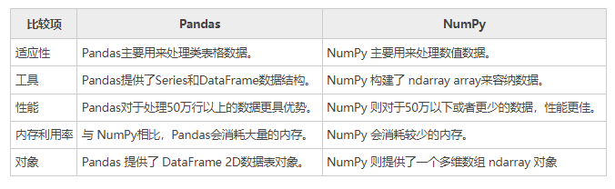

##### 5、转换ndarray数组

在某些情况下，需要执行一些 NumPy 数值计算的高级函数，这个时候您可以使用 to_numpy() 函数，将 DataFrame 对象转换为 NumPy ndarray 数组，并将其返回。函数的语法格式如下：

```
DataFrame.to_numpy(dtype=None, copy=False)   
```

参数说明如下：

- dtype：可选参数，表示数据类型；
- copy：布尔值参数，默认值为 Fales，表示返回值不是其他数组的视图。


下面使用示例，了解该函数的使用方法。示例 1：

```python
info = pd.DataFrame({"P": [2, 3], "Q": [4.0, 5.8]})
#给info添加R列 
info['R'] = pd.date_range('2020-12-23', periods=2)
print(info)
#将其转化为numpy数组 
n=info.to_numpy()
print(n)
print(type(n))
```

输出结果：

```
[[2 4.0 Timestamp('2020-12-23 00:00:00')]
[3 5.8 Timestamp('2020-12-24 00:00:00')]]
```

可以通过 type 查看其类型，输出如下：

```
numpy.ndarray
```

示例2：

```python
import pandas as pd 
#创建DataFrame对象
info = pd.DataFrame([[17, 62, 35],[25, 36, 54],[42, 20, 15],[48, 62, 76]], 
columns=['x', 'y', 'z']) 
print('DataFrame\n----------\n', info) 
#转换DataFrame为数组array
arr = info.to_numpy() 
print('\nNumpy Array\n----------\n', arr) 
```

输出结果：

```
DataFrame
----------
     x   y   z
0  17  62  35
1  25  36  54
2  42  20  15
3  48  62  76

Numpy Array
----------
[[17 62 35]
[25 36 54]
[42 20 15]
[48 62 76]]
```

#### 三十六、Pandas使用的注意事项

 Pandas 基于 NumPy 构建，它遵循 NumPy 设定的一些规则。因此，当您在使用 Pandas 时，需要额外留意一些事项，避免出现一些不必要的错误。

##### 1、if语句使用

在 if 语句中，如果您需要将 Pandas 对象转换为布尔值时，需要格外留意，这种操作会引起 ValueError 异常， 下面通过一组示例做简单说明： 

```python
import pandas as pd
if pd.Series([False, True, False]):
   print('I am True')
```

输出结果：

```
ValueError
....
ValueError: The truth value of a Series is ambiguous. Use a.empty, a.bool(), a.item(), a.any() or a.all().
```

从输出结果可以看出，上述代码引发了 ValueError 错误，并告诉我们 Series 的真值是不明确的。下面对其进行了简单分析：
如果 if 语句判断为 True，可能是认为它的长度并不是 0，反之 if 语句判断为 Fasle，可能是认为 Series 的数据值中包含了 False 值，因此是真还是假，无法判断，所以此处抛出了 ValueError 错误。

 上述代码给出的修改建议，如下所示： 

```python
import pandas as pd
#使用 any()方法解决
if pd.Series([False, True, False]).any():
   print("I am 编程帮 www.biancheng.com")
```

输出结果：

```
I am 编程帮 www.biancheng.com
```

如果要是计算布尔元素的 Series 对象，那么您可以使用 bool() 方法进行修改，如下所示：

```python
import pandas as pd
print(pd.Series([False]).bool())
```

输出结果：

```
False
```

##### 2、布尔运算

如果在 Pandas 对象中使用==和！=  这样的布尔运算符时，将返回一个布尔序列，示例如下： 

```python
import pandas as pd
s = pd.Series(range(4))
#返回布尔值序列，行索引为3的位置为True
print(s==3)
```

输出结果：

```
0    False
1    False
2    False
3    True
dtype: bool
```

##### 3、isin()操作

isin() 也会返回一个布尔序列，它用来判断元素值是否包含在的 Series 序列中。示例如下：

```python
import pandas as pd
s = pd.Series(list('abc'))
s = s.isin(['a', 'c', 'e'])
print(s)
```

输出结果：

```
0    True
1    False
2    True
dtype: bool
```

##### 4、reindex()操作

reindex() 函数表示重置行索引，该方法会生成新的 Pandas 对象，示例如下：

```python
import pandas as pd
import numpy as np
#index行索引使用字符和数字混合的形式
df = pd.DataFrame(np.random.randn(6, 4), columns=['one', 'two', 'three','four'],index=['a','b',2,3,'e',5])
print (df)
#数字与字符混合后取数据
print (df.reindex(['a','b',5]))
print (df.reindex([2,'e']))
```

输出结果：

```
        one       two     three      four
a  0.727276 -0.360391  0.381606  1.195126
b -1.974803  0.009088 -1.065647  0.628699
2  0.156798 -1.116029  1.020673 -0.215485
3 -1.310007  0.601206  0.417439  0.049863
e  0.232375  0.235999 -1.886337 -0.421110
5  0.488758  0.108129 -1.405737  2.375517

        one       two     three      four
a  0.727276 -0.360391  0.381606  1.195126
b -1.974803  0.009088 -1.065647  0.628699
5  0.488758  0.108129 -1.405737  2.375517

        one       two     three      four
2  0.156798 -1.116029  1.020673 -0.215485
e  0.232375  0.235999 -1.886337 -0.421110
```