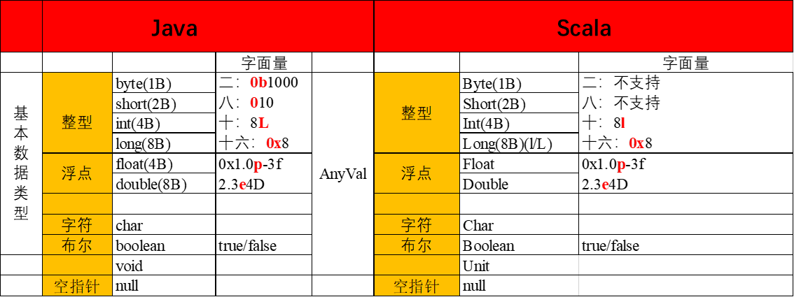
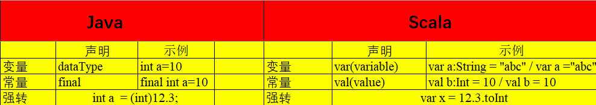

# 基本数据类型与字面量

`Scala`的数据类型包括：`Byte`、`Char`、`Short`、`Int`、`Long`、`Float`、`Double`和`Boolean`（注意首字母大写）

和`Java`不同的是，在`Scala`中，这些类型都是“类”，并且都是包`scala`的成员，比如，`Int`的全名是`scala.Int`。对于字符串，`Scala`用`java.lang.String`类来表示字符串。



# 变量



`var`与`val`是指变量的指向是不是可变的。

# 操作符

##### 操作符

算术运算符：`+`、`-`、`*` 、`/`、`%`；

关系运算符：`>`、`<`、`==`、`!=`、`>=`、`<=`

逻辑运算符：`&&`、`||`、`!`；

位运算符：`&`、`|`、`^`、`~`;

赋值运算符：`=`及其与其它运算符结合的扩展赋值运算符，例如`+=`、`%=`

##### 操作符优先级

算术运算符` >` 关系运算符 `>` 逻辑运算符 `>` 赋值运算符

##### 其他

在Scala中操作符就是函数，比如： `5+3` 的本质是 `5.+(3)`

只有一个参数的函数，都可以使用中缀表达式的方式调用；

比如： 输出`[1,5)`之间的正整数可以使用函数 `1.until(5)` ，中缀表达式形式可写为： `1 until 5`  。

##### 富包装类

对于基本数据类型，Scala提供了除上述操作符外的方法，这些方法是在富包装类中定义。**Int**`-->`**RichInt**,  **String**` -->  `**RichString**， 这些类位于`scala.runtime`包中。`基本数据类型`可以自动通过`隐式转换`直接调用`富包装类`中的方法。


# 输入输出

## 控制台输入输出

### 输入

从控制台读入数据方法：`readInt`、`readDouble`、`readByte`、`readShort`、`readFloat`、`readLong`、`readChar`、 `readBoolean`及`readLine`，分别对应9种基本数据类型，其中前8种方法没有参数，`readLine`可以不提供参数，也可以带一个字符串参数的提示。

所有这些函数都属于对象`scala.io.StdIn`的方法，使用前必须导入，或者直接用全称进行调用。

```scala
scala> import scala.io.StdIn._
import scala.io.StdIn._
// String
scala> var name = readLine
name: String = quqingyuan
scala> var name = readLine("please input your name")
please input your namename: String = quqingyuan

// Int
scala> var age = readInt
age: Int = 30

// Float
scala> var score = readFloat
score: Float = 85.5
```

### 输出

```scala
scala> print(name)
quqingyuan
scala> println(age)
30

scala> printf("my name is %s, %d years old, my spark score is %f", name,age,score)
my name is quqingyuan, 30 years old, my spark score is 85.500000
```

## 文件输入输出

### 输出

```scala
import java.io.PrintWriter
val outputFile = new PrintWriter("/home/zhangsan/studybigdata.cn")
outputFile.println("studybigdata")
outputFile.println("www.studybigdata.cn")
outputFile.close()
```

### 输入

```scala
scala> import scala.io.Source
import scala.io.Source

scala> val inputFile = Source.fromFile("/home/zhangsan/studybigdata.cn")
inputFile: scala.io.BufferedSource = <iterator>

scala> val lines = inputFile.getLines //拿到迭代器
lines: Iterator[String] = <iterator>

scala> for(line <- lines){println(line)} //迭代输出每行内容
studybigdata
www.studybigdata.cn
```


# 控制结构

## 判断

与`Java`中的`if`循环语法基本一致。

##### 常规语法

```scala
val score = readInt
if (score >= 90) {
    println("优秀")
} else if (score >= 80) {
    println("良好")
} else if (score >= 60) {
    println("及格")
}
```

##### if表达式赋值

不同的是，可以将表达式的值赋值给一个变量。

```scala
val score = readInt
val level: String = {
    if (score >= 90) {
        "优秀"
    } else if (score >= 80) {
        "良好"
    } else if (score >= 60) {
        "及格"
    } else {
        "不及格"
    }
}
println("成绩等级为："+level)
```

如果返回值的类型不确定，可以去掉类型声明`String`。

##### 测试

```
55
成绩等级为：不及格
```

## 循环

### while循环

##### while

```scala
    var i = 0
    var sum = 0
    while (i < 100) {
      i = i + 1
      sum = sum + i
    }
    println(sum)
```

##### do  while

```scala
    var i = 0
    var sum = 0
    do {
      i = i + 1
      sum = sum + i
    } while (i < 100)

    println(sum)
```

### for循环

#### 常规遍历

```scala
    val range = 1 until 10 by 2
    for (i <- range) {
      println(i)
    }
```

#### 遍历中加过滤条件

```scala
    val range = 1 until 10
    for (i <- range if i%2==0) {
      println(i)
    }
```

#### 多重遍历

|       | 0    | 1    | 2    |
| ----- | ---- | ---- | ---- |
| **0** | `1`  | `2`  | `3`  |
| **1** | `4`  | `5`  | `6`  |

```scala
    var x = 0
    val twoDim = Array.ofDim[Int](2, 3)
    for (i <- 0 until 2; j <- 0 until 3) {
      x = x + 1
      twoDim(i)(j) = x
    }
```

#### for集合推导式

##### 语法

`for (变量 <- 表达式) yield {语句块}`

```scala
val subset = for(i <- 1 until 10 if i%2==0) yield {i}
println(subset)
```


## 异常处理

```scala
try {
  val myArray = new Array[Int](2)
  myArray(0) = 0
  myArray(1) = 1
//      myArray(2) = 2
  val x = myArray(1)/myArray(0)

}catch {
  case ex:ArrayIndexOutOfBoundsException => println("数组越界");
  case ex:ArithmeticException => println("除数为零")
}
```

## 循环控制

Scala中没有提供`break`和`continue`关键字。

在`Scala`中对循环进行控制，需要使用`scala.util.control.Breaks`类中的两个方法`breakable`和`break`。

```scala
import util.control.Breaks._
```

### 跳出循环

相当于`Java`中的`break`

```scala
    breakable{
      for (i <- 1 until 5){
        if (i > 2) break
        println(i)
      }
    }
```

### 跳过后续操作，继续循环

相当于`Java`中的`continue`

```scala
    for (i <- 1 to 5){
      breakable{
        if (i==2){
          break
        }
        println(i)
      }
    }
```


