<h1 style="color:red; text-align:center;color:red;">Spark</h1>


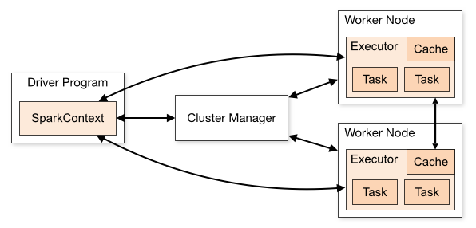

| Term            | Meaning                                                      |
| :-------------- | :----------------------------------------------------------- |
| `Application`   | User program built on Spark. Consists of a *driver program* and *executors* on the cluster. |
| Application jar | A jar containing the user's Spark application. In some cases users will want to create an "uber jar" containing their application along with its dependencies. The user's jar should never include Hadoop or Spark libraries, however, these will be added at runtime. |
| `Driver`        | The process running the `main() function` of the application and `creating the SparkContext` |
| Cluster manager | An external service for acquiring resources on the cluster (e.g. standalone manager, Mesos, YARN) |
| Deploy mode     | Distinguishes where the driver process runs. In "cluster" mode, the framework launches the driver inside of the cluster. In "client" mode, the submitter launches the driver outside of the cluster. |
| Worker node     | Any node that can run application code in the cluster        |
| `Executor`      | A process launched for an application on a worker node, that runs tasks and keeps data in memory or disk storage across them. Each application has its own executors. |
| Task            | A unit of work that will be sent to one executor             |
| Job             | A parallel computation consisting of multiple tasks that gets spawned in response to a Spark action (e.g. `save`, `collect`); you'll see this term used in the driver's logs. |
| Stage           | Each job gets divided into smaller sets of tasks called *stages* that depend on each other (similar to the map and reduce stages in MapReduce); you'll see this term used in the driver's logs. |

# 环境部署

> **官方文档**
>
> https://spark.apache.org/docs/2.4.8/
>
> **下载地址**
>
> https://archive.apache.org/dist/spark/spark-2.4.8/
>
> **安装目录**
>
> `/opt/bigdata/spark`
>
> **部署规划**
>
> `node0`：Local (Linux File System & HDFS)
>
> `node1` `node2` `node3`  配置为`spark`集群。
>
> 


<iframe id="embed_dom" name="embed_dom" frameborder="0" style="display:block;width:525px; height:400px;" src="https://www.processon.com/embed/62083c165653bb06de331e3c"></iframe>


在`/opt/`目录下创建`bigdata`目录，并修改目录的所有者和所属组为`zhangsan`，我们将`spark`安装到该目录中。

```shell
# 创建/opt/bigdata/spark文件夹
# !!! 注意： 因为普通用户没有权限在/opt/目录写数据，所有本次操作使用的是root账户。
[root@node0 ~]# mkdir /opt/bigdata/spark

# 修改/opt/bigdata/spark文件夹及子文件夹的所有者所属组为zhangsan
[root@node0 ~]# chown -R zhangsan:zhangsan /opt/bigdata/spark
[root@node0 ~]# ls -al /opt/bigdata/
total 0
drwxr-xr-x. 3 zhangsan zhangsan 19 Feb 15 08:38 .
drwxr-xr-x. 3 root   root   21 Feb 15 08:38 ..
drwxr-xr-x. 2 zhangsan zhangsan  6 Feb 15 08:38 spark

# 退出root账号
[root@node0 ~]# exit
exit
```

使用`xftp`等文件传输工具，将`spark`安装包上传到`CentOS 7`系统的`/opt/bigdata/spark`目录中。


---

## [本地运行](#Local)

### 读写Linux

本地运行模式开箱即用，只需要[`Java`环境]()，无需其他任何配置。此时，只能读写本机`Linux文件系统`中的文件，无法读写`HDFS`。

#### 		解压

```shell
[zhangsan@node0 ~]$ cd /opt/bigdata/spark/
[zhangsan@node0 spark]$ tar -zxf spark-2.4.8-bin-hadoop2.7.tgz
[zhangsan@node0 spark]$ ll
total 230372
drwxr-xr-x. 13 zhangsan zhangsan       211 May  8  2021 spark-2.4.8-bin-hadoop2.7
-rw-rw-r--.  1 zhangsan zhangsan 235899716 Feb 15 08:42 spark-2.4.8-bin-hadoop2.7.tgz
[zhangsan@node0 spark]$ ln -s spark-2.4.8-bin-hadoop2.7 default
[zhangsan@node0 spark]$ ll
total 230372
lrwxrwxrwx.  1 zhangsan zhangsan        25 Feb 15 08:42 default -> spark-2.4.8-bin-hadoop2.7
drwxr-xr-x. 13 zhangsan zhangsan       211 May  8  2021 spark-2.4.8-bin-hadoop2.7
-rw-rw-r--.  1 zhangsan zhangsan 235899716 Feb 15 08:42 spark-2.4.8-bin-hadoop2.7.tgz
```

#### 配置

无需配置。

#### 		启动

```shell
[zhangsan@node0 spark]$ cd default/bin/
[zhangsan@node0 bin]$ rm -rf *.cmd # 删除Windows平台的脚本（可选）

# 启动 spark-shell 交互式环境（scala语言）
[zhangsan@node0 bin]$ ./spark-shell --master local[*]
22/02/13 12:50:45 WARN NativeCodeLoader: Unable to load native-hadoop library for your platform... using builtin-java classes where applicable

# 可通过此 web 界面查看 spark job 的运行情况
Spark context Web UI available at http://node0:4040
# local[*] 表示使用所有计算资源
Spark context available as 'sc' (master = local[*], app id = local-1644727904419).
Spark session available as 'spark'.
Welcome to
      ____              __
     / __/__  ___ _____/ /__
    _\ \/ _ \/ _ `/ __/  '_/
   /___/ .__/\_,_/_/ /_/\_\   version 2.4.8
      /_/
         
Using Scala version 2.11.12 (Java HotSpot(TM) 64-Bit Server VM, Java 1.8.0_202)
```

可通过spark web界面查job的启动情况，网页中看不到job的运行情况，因为我们还没有执行spark job。

```http
http://node0:4040
```

本地模式只有一个进程启动。

```shell
[zhangsan@node0 ~]$ jps
18371 SparkSubmit
20020 Jps
[zhangsan@node0 ~]$ 
```

#### Master参数

| --master参数        | 说明                                                         |
| ------------------- | ------------------------------------------------------------ |
| `local`             | 使用`一个Worker线程`本地化运行Spark                          |
| `local[k]`          | 使用`K个Worker线程`本地化运行Spark                           |
| `local[*]`          | 使用`* 个Worker线程`本地化运行Spark(`* =机器的CPU核数`)（默认） |
| `spark://HOST:PORT` | 连接到指定的`Standalone集群`。`HOST`参数是`Spark Master`的`hostname`或`IP`，默认端口是`7077。` |
| `mesos://HOST:PORT` | 连接到指定的`Mesos集群`。`HOST`参数是`Moses Master`的`hostname`或`IP`，默认端口是`5050`  。 |
| `yarn`              | 默认以`客户端模式`连接到`YARN集群`，集群位置由环境变量`YARN_CONF_DIR`决定 。 |

`Spark2.0`以前，`yarn`分为`yarn-client`与`yarn-cluster`

`Spark2.0`以后，设置`--deploy-mode=[client/cluster]`以不同模式连接到`YARN集群`

#### 		案例 - wordcount

```shell
hello
study bigdata
hello study bigdata
```

```scala
scala> var wordcount = sc.textFile("/home/zhangsan/bigdata.txt").flatMap(line => line.split(" ")).map(word => (word,1)).reduceByKey(_+_)

scala> wordcount.collect()
res0: Array[(String, Int)] = Array((hello,2), (bigdata,2), (study,2))         
```

打开web http://node0:4040 界面，可以查看`Job`的运行情况，此地址为`driver`执行任务的查看地址。


可以看到该`Job`包括两个`stage`

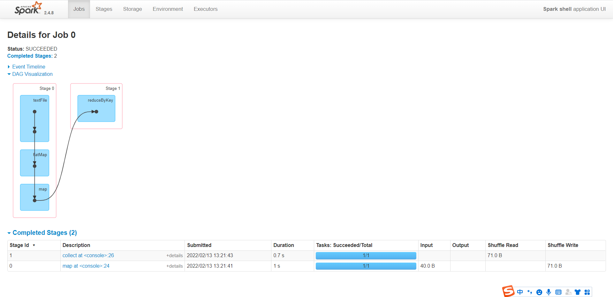

直接解压运行，`spark`只能读写本地`Linux`文件系统；接下来我们配置`spark`，让其能够读写`HDFS`。


### 读写HDFS

接下来的实验中，我们需要使用`Spark`读写`HDFS`，因此，我们需要完成[`Hadoop`伪分布式环境的搭建]()。

#### 	配置文件

Spark配置文件`spark-env.sh`中添加如下行即可。

```shell
# 进入spark配置文件存放目录
[zhangsan@node0 ~]$ cd /opt/bigdata/spark/default/conf/

# 重命名配置文件模板
[zhangsan@node0 conf]$ mv spark-env.sh.template spark-env.sh

[zhangsan@node0 conf]$ vim spark-env.sh

# 修改 HADOOP_CONF_DIR配置项
HADOOP_CONF_DIR=/opt/bigdata/hadoop/default/etc/hadoop
```

#### 	测试

##### 		格式化名称节点

```shell
[zhangsan@node0 ~]$ hadoop namenode -format
```

##### 		启动Hadoop

```shell
[zhangsan@node0 ~]$ start-all.sh 
```

##### 		创建文件夹

```shell
[zhangsan@node0 ~]$ hdfs dfs -mkdir /input
```

##### 		上传测试数据

```shell
[zhangsan@node0 ~]$ hdfs dfs -put bigdata.txt /input
```

##### 		wordcount

`$SPARK_HOME/bin`

```scala
scala> var wordcount = sc.textFile("hdfs:///input/bigdata.txt").flatMap(line => line.split(" ")).map(word => (word,1)).reduceByKey(_+_)
wordcount: org.apache.spark.rdd.RDD[(String, Int)] = ShuffledRDD[11] at reduceByKey at <console>:24

scala> wordcount.collect()
res3: Array[(String, Int)] = Array((hello,2), (bigdata,2), (study,2))
```

##### 		退出

```scala
scala> :quit
```


在以上两个步骤中，我们使用了`spark-shell`命令进入了交互式编程环境，编程语言为`scala`。那如何使用`Python`语言进行`Spark`编程呢？可以使用 `$SPARK_HOME/bin/pyspark` 命令。


### pyspark

`CentOS 7` 自带的`Python`版本为`2.x`，`Python2.x`已经不被官方支持了。因此，我们安装一个`Python3`环境，那如何在`Linux`发行版`CentOS 7`中安装`Python3`呢 ？

#### Python3安装

##### 			下载Anaconda

```http
https://www.anaconda.com/products/individual
```

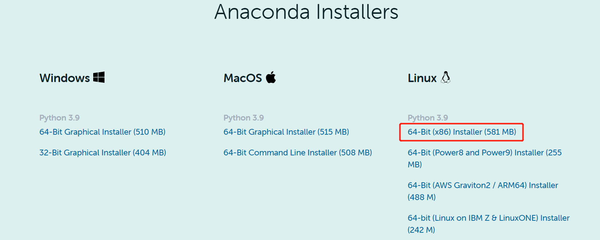

##### 	安装Anaconda

```shell
[zhangsan@node0 ~]$ chmod +x Anaconda3-2021.11-Linux-x86_64.sh 
[zhangsan@node0 ~]$ ./Anaconda3-2021.11-Linux-x86_64.sh 

# 统一安装到/opt/bigdata/目录下
Anaconda3 will now be installed into this location:
/home/zhangsan/anaconda3
[/home/zhangsan/anaconda3] >>> /opt/bigdata/anaconda3

# 输入yes初始化Anaconda
installation finished.
Do you wish the installer to initialize Anaconda3
by running conda init? [yes|no]
[no] >>> yes
```

##### 		环境变量激活

```shell
[zhangsan@node0 ~]$ source .bashrc 
(base) [zhangsan@node0 ~]$ 
```

> 如果你的终端没有出现base，应该是你没有初始化anaconda，这样的话，用户张三使用的依然是系统自带的Python2.x，可以使用下面的方式手动初始化。

###### 手动初始化

```shell
# 1. 把ANACONDA3_HOME加入环境变量; $ANACONDA3_HOME/bin 加入PATH
[zhangsan@node0 ~]$vim ~/.bashrc
export ANACONDA3_HOME=/opt/bigdata/anaconda3
export PATH=$ANACONDA3_HOME/bin:$PATH

# 2. source 一下环境变量配置文件，这样的话，我们可以使用bin里面的可执行文件了
[zhangsan@node0 ~]$source ~/.bashrc

# 3. 使用source执行一下anaconda3的activate脚本
[zhangsan@node0 ~]$source /opt/bigdata/anaconda3/bin/activate
# 4. 初始化
[zhangsan@node0 ~]$conda init
```


##### 		配置软件源

```shell
(base) [zhangsan@node0 ~]$ conda config --set show_channel_urls yes
(base) [zhangsan@node0 ~]$ vim .condarc 
```

配置如下

```http
channels:
  - defaults
show_channel_urls: true
channel_alias: https://mirrors.tuna.tsinghua.edu.cn/anaconda
default_channels:
  - https://mirrors.tuna.tsinghua.edu.cn/anaconda/pkgs/main
  - https://mirrors.tuna.tsinghua.edu.cn/anaconda/pkgs/free
  - https://mirrors.tuna.tsinghua.edu.cn/anaconda/pkgs/r
  - https://mirrors.tuna.tsinghua.edu.cn/anaconda/pkgs/pro
  - https://mirrors.tuna.tsinghua.edu.cn/anaconda/pkgs/msys2
custom_channels:
  conda-forge: https://mirrors.tuna.tsinghua.edu.cn/anaconda/cloud
  msys2: https://mirrors.tuna.tsinghua.edu.cn/anaconda/cloud
  bioconda: https://mirrors.tuna.tsinghua.edu.cn/anaconda/cloud
  menpo: https://mirrors.tuna.tsinghua.edu.cn/anaconda/cloud
  pytorch: https://mirrors.tuna.tsinghua.edu.cn/anaconda/cloud
  simpleitk: https://mirrors.tuna.tsinghua.edu.cn/anaconda/cloud
```

##### 		新建Python环境

```shell
(base) [zhangsan@node0 ~]$ conda create -n python37 python=3.7
# 切换环境
(base) [zhangsan@node0 ~]$ conda activate python37

# 设置zhangsan用户的默认Python环境
(python37) [zhangsan@node3 ~]$ vim .bashrc 
conda activate python37
```

此时，我们完成了`CentOS`系统下`Python3.7`的安装。


#### 配置文件

##### spark-env.sh

```shell
SPARK_LOCAL_IP=127.0.0.1
PYSPARK_DRIVER_PYTHON=/opt/bigdata/anaconda3/envs/python37/bin/python
PYSPARK_PYTHON=/opt/bigdata/anaconda3/envs/python37/bin/python
```


#### 		启动PySpark

```shell
(python37) [zhangsan@node0 ~]$ cd /opt/bigdata/spark/default/bin/
(python37) [zhangsan@node0 bin]$ ./pyspark 
Python 3.7.11 (default, Jul 27 2021, 14:32:16) 
... ...
```

#### 		WordCount

```python
>>> sc.textFile('hdfs:///input/bigdata.txt').flatMap(lambda x: x.split(" ")).map(lambda x: (x,1)).reduceByKey(lambda a,b: a+b).collect()
[('bigdata', 2), ('hello', 2), ('study', 2)]   
```

### spark-submit

```shell
(python37) [zhangsan@node0 bin]$ ./spark-submit /opt/bigdata/spark/default/examples/src/main/python/pi.py 
```


## [伪分布式](#Pseudo)

### [Standalone](#Standalone)
#### 	配置

包括 `Hadoop`配置，Master, Worker的通信地址和Web UI的地址

##### spark-env.sh（Server）

```shell
# 如果Worker提示JAVA_HOME is not set, 在此文件配置一下JAVA_HOME
# JAVA_HOME=${JAVA_HOME}
PYSPARK_DRIVER_PYTHON=/opt/bigdata/anaconda3/envs/python37/bin/python
PYSPARK_PYTHON=/opt/bigdata/anaconda3/envs/python37/bin/python

HADOOP_CONF_DIR=/opt/bigdata/hadoop/default/etc/hadoop #读写HDFS
SPARK_MASTER_HOST=node0  # Master节点
SPARK_WORKER_CORES=1 # core
SPARK_WORKER_MEMORY=1g # 内存
# 日志服务器HistoryServer会去指定的位置读取执行事件日志
SPARK_HISTORY_OPTS="-Dspark.history.fs.logDirectory=hdfs://node0:9000/shared/spark-logs"
```

##### spark-default-conf（Client）

```shell
(python37) [zhangsan@node0 conf]$ mv spark-defaults.conf.template spark-defaults.conf
(python37) [zhangsan@node0 conf]$ vim spark-defaults.conf
# spark.master                     spark://node0:7077

# spark applications 执行的事件日志会存放到指定的位置
spark.eventLog.enabled           true
spark.eventLog.dir               hdfs://node0:9000/shared/spark-logs
```

##### Slave

```shell
(python37) [zhangsan@node1 conf]$ mv slaves.template slaves
(python37) [zhangsan@node1 conf]$ vim slaves 
localhost
```

#### 	启动Spark集群

##### 	启动HDFS

```shell
(python37) [zhangsan@node0 sbin]$ start-dfs.sh 
```

##### 启动History Server

```
# 启动HistoryServer
(python37) [zhangsan@node0 sbin]$ ./start-history-server.sh 
```

##### 	启动Spark

启动`Master`和`Worker`

```shell
(python37) [zhangsan@node0 sbin]$ ./start-all.sh 
(python37) [zhangsan@node1 sbin]$ jps
5393 `Worker`
5300 `Master`
4582 NodeManager
5447 Jps
4216 SecondaryNameNode
4376 ResourceManager
4027 DataNode
3871 NameNode
14845 `HistoryServer`
```

#### 	Web UI查看

可以在`windows`系统中配置一下`hosts`映射。

```http
# C:\Windows\System32\drivers\etc\hosts
192.168.179.100	node0
```

**Master : 8080**

**Worker : 8081**

**HistoryServer：18080**

**Driver：4040**

#### 	测试

```shell
(python37) [zhangsan@node0 bin]$ ./pyspark --master spark://node0:7077
Python 3.7.11 (default, Jul 27 2021, 14:32:16) 
[GCC 7.5.0] :: Anaconda, Inc. on linux
Type "help", "copyright", "credits" or "license" for more information.
22/02/15 12:41:57 WARN util.NativeCodeLoader: Unable to load native-hadoop library for your platform... using builtin-java classes where applicable
Setting default log level to "WARN".
To adjust logging level use sc.setLogLevel(newLevel). For SparkR, use setLogLevel(newLevel).
22/02/15 12:41:59 WARN spark.SparkContext: Please ensure that the number of slots available on your executors is limited by the number of cores to task cpus and not another custom resource. If cores is not the limiting resource then dynamic allocation will not work properly!
Welcome to
      ____              __
     / __/__  ___ _____/ /__
    _\ \/ _ \/ _ `/ __/  '_/
   /__ / .__/\_,_/_/ /_/\_\   version 3.0.3
      /_/

Using Python version 3.7.11 (default, Jul 27 2021 14:32:16)
SparkSession available as 'spark'.
# 转换算子，不触发计算
# 动作算子Action，触发计算
>>> sc.textFile("hdfs:///input/bigdata.txt").flatMap(lambda line : line.split(" ")).map(lambda word : (word,1)).reduceByKey(lambda a,b : a+b).collect()
[('bigdata', 2), ('hello', 2), ('study', 2)]    
```

可以在 http://node0:4040 下查看`driver`下job的运行情况。

 


### [Spark On YARN](#SparkOnYARN)

#### 配置

`Spark`的`Master`由`YARN`的`ResourceManager`替代，`Worker`由`NodeManager`替代。

##### spark-env.sh

```shell
HADOOP_CONF_DIR=/opt/bigdata/hadoop/default/etc/hadoop
YARN_CONF_DIR=/opt/bigdata/hadoop/default/etc/hadoop
# 日志服务器HistoryServer配置
SPARK_HISTORY_OPTS="-Dspark.history.fs.logDirectory=hdfs://node0:9000/shared/spark-logs"
```

##### spark-defaults.conf

```shell
(python37) [zhangsan@node0 conf]$ vim spark-defaults.conf
# spark.master                     spark://node0:7077

# spark app执行的事件日志会存放到指定的位置
spark.eventLog.enabled           true
spark.eventLog.dir               hdfs://node0:9000/shared/spark-logs
# spark包位置
spark.yarn.archive               hdfs://node0:9000/shared/spark-archive
```

将`spark`的`jar`包上传到`HDFS`

```shell
# 在hdfs上创建目录hdfs:node0:9000/shared/spark-archive
(python37) [zhangsan@node0 default]$ hdfs dfs -mkdir /shared/spark-archive

# 将$SPARK_HOME/spark/jars/*.jar上传到hdfs
(python37) [zhangsan@node0 default]$ hdfs dfs -put jars/* /shared/spark-archive
```

#### 运行SparkApp

`Spark Application`有两种运行模式，`Client`和`Cluster`。可以通过 `--deploy-mode=client/cluster`来指定。在提交`Application`的时候，可以告诉`YARN`需要的计算资源。

##### Client模式

`Client`模式，`driver`运行在客户端进程中；

**实验**

```shell
(python37) [zhangsan@node1 default]$ bin/pyspark --master yarn --deploy-mode client 
```


##### Cluster模式

`Cluster`模式，`driver`运行在`YARN`容器中`ApplicationMaster`。

### Mesos

略。


## [集群部署](#Fully_Distributed)

如要继续如下步骤，请完成[`Hadoop`全分布式环境]()的搭建。

集群规划

|       | Hadoop                                          | spark                               |
| ----- | ----------------------------------------------- | ----------------------------------- |
| node1 | `NameNode`, `SecondNameNode`, `ResourceManager` | `Master`, `Worker`, `HistoryServer` |
| node2 | `DataNode`, `NodeManager`                       | `Worker`                            |
| node3 | `DataNode`,` NodeManager`                       | `Worker`                            |

为三台机器[安装`Python3.7`]()环境。

### Standalone

#### 	Spark配置

包括 `Hadoop`配置，`Master`, `Worker`的通信地址和`Web UI`的地址

##### spark-env.sh（Server）

##### spark-default-conf（Client）

与`伪分布式-Standalone`配置基本一致，

此处我们的`Master`运行在`node1`节点上，`Namenode`运行在`node1`节点上。

因此需要修改一下`node0`为`node1`，

##### Slave

```shell
(python37) [zhangsan@node1 conf]$ mv slaves.template slaves
(python37) [zhangsan@node1 conf]$ vim slaves 
node1
node2
node3
```

将修改好的`spark`分发到其他两个节点。

```shell
(python37) [zhangsan@node1 bigdata]$ scp -r spark node3:`pwd`/
```


#### 	启动

##### 	启动HDFS

```shell
(python37) [zhangsan@node1 sbin]$ start-dfs.sh 
```

##### 	启动Spark

启动Master和Worker

**node1**

```shell
# 启动HistoryServer
(python37) [zhangsan@node1 sbin]$ ./start-history-server.sh 

# 启动Master和所有Worker
(python37) [zhangsan@node1 sbin]$ ./start-all.sh 
(python37) [zhangsan@node1 sbin]$ jps
5393 Worker
5300 Master
4582 NodeManager
5447 Jps
4216 SecondaryNameNode
4376 ResourceManager
4027 DataNode
3871 NameNode
14845 HistoryServer
```

**node2**

```shell
(python37) [zhangsan@node2 bigdata]$ jps
4417 Worker
3826 DataNode
4476 Jps
3966 NodeManager
```

**node3**

```shell
(python37) [zhangsan@node3 bigdata]$ jps
3928 NodeManager
4441 Jps
4378 Worker
3788 DataNode
```


#### 	Web UI查看

可以在`windows`系统中配置一下`hosts`映射。

```http
# C:\Windows\System32\drivers\etc\hosts
192.168.179.100	node0
192.168.179.101	node1
192.168.179.102	node2
192.168.179.103	node3
```


**Master : 8080**

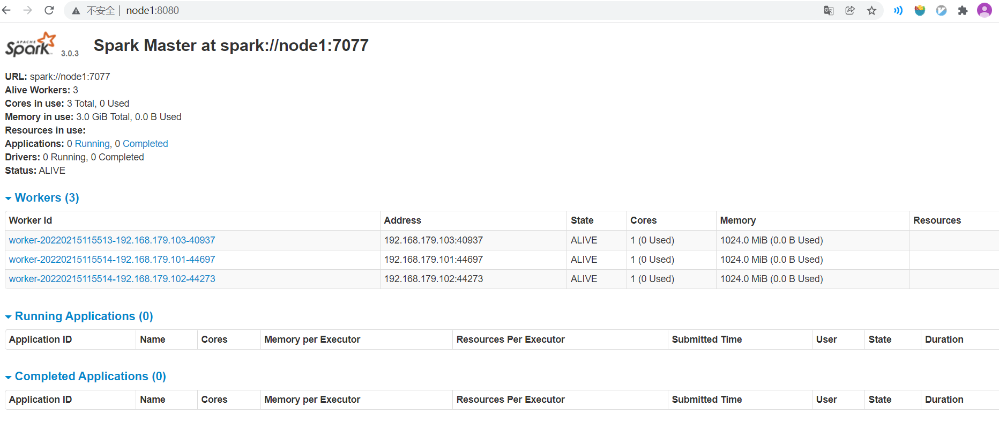


**Worker : 8081**

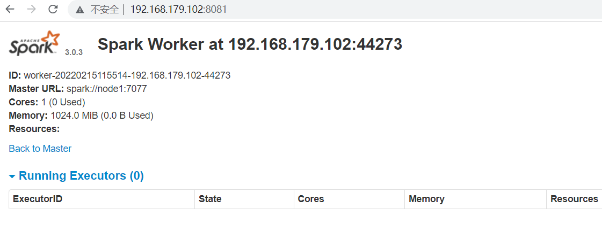

#### 	测试集群

```shell
(python37) [zhangsan@node1 bin]$ ./pyspark --master spark://node1:7077
Python 3.7.11 (default, Jul 27 2021, 14:32:16) 
[GCC 7.5.0] :: Anaconda, Inc. on linux
Type "help", "copyright", "credits" or "license" for more information.
22/02/15 12:41:57 WARN util.NativeCodeLoader: Unable to load native-hadoop library for your platform... using builtin-java classes where applicable
Setting default log level to "WARN".
To adjust logging level use sc.setLogLevel(newLevel). For SparkR, use setLogLevel(newLevel).
22/02/15 12:41:59 WARN spark.SparkContext: Please ensure that the number of slots available on your executors is limited by the number of cores to task cpus and not another custom resource. If cores is not the limiting resource then dynamic allocation will not work properly!
Welcome to
      ____              __
     / __/__  ___ _____/ /__
    _\ \/ _ \/ _ `/ __/  '_/
   /__ / .__/\_,_/_/ /_/\_\   version 3.0.3
      /_/

Using Python version 3.7.11 (default, Jul 27 2021 14:32:16)
SparkSession available as 'spark'.
>>> sc.textFile("/input/bigdata.txt").flatMap(lambda line : line.split(" ")).map(lambda word : (word,1)).reduceByKey(lambda a,b : a+b).collect()
[('bigdata', 2), ('hello', 2), ('study', 2)]    
```

可以在 http://node1:4040 下查看`driver`下job的运行情况。

 

### Spark On YARN

`Spark On YARN`， 只需要在一个节点上部署`Spark`，`Spark`的`Master`由`YARN`的`ResourceManager`替代，`Worker`由`NodeManager`替代。

##### spark-env.sh

##### spark-defaults.conf

与`伪分布式-YARN`配置基本一致，不同的是，此处我们的`Namenode`运行在`node1`节点上，因此需要修改一下`node0`为`node1`，


## Jupyter notebook

```bash
(python37) [zhangsan@node0 ~]$ pip install jupyter notebook
```


```bash
(python37) [zhangsan@node0 ~]$ pip install jupyter notebook
(python37) [zhangsan@node0 ~]$ jupyter notebook --generate-config
(python37) [zhangsan@node0 ~]$ vim ~/.jupyter/jupyter_notebook_config.py 
```


```properties
c.NotebookApp.ip = '0.0.0.0'
c.NotebookApp.token = ''
c.NotebookApp.allow_origin = '*' ＃允许所有起源
```

```bash
(python37) [zhangsan@node0 ~]$ jupyter notebook
```


## Windows开发环境

### Python版

#### Anaconda

下载地址：

`https://www.anaconda.com/products/individual#Downloads`


```powershell
# 此命令将会在用户目录产生一个conda配置文件，名字为.condarc
(base) PS C:\Users\xiaoqu> conda config --set show_channel_urls yes

# 使用记事本打开conda的配置文件.condarc
(base) PS C:\Users\xiaoqu> notepad .\.condarc

# 加入如下配置（原内容清空）
channels:
  - defaults
show_channel_urls: true
channel_alias: https://mirrors.tuna.tsinghua.edu.cn/anaconda
default_channels:
  - https://mirrors.tuna.tsinghua.edu.cn/anaconda/pkgs/main
  - https://mirrors.tuna.tsinghua.edu.cn/anaconda/pkgs/free
  - https://mirrors.tuna.tsinghua.edu.cn/anaconda/pkgs/r
  - https://mirrors.tuna.tsinghua.edu.cn/anaconda/pkgs/pro
  - https://mirrors.tuna.tsinghua.edu.cn/anaconda/pkgs/msys2
custom_channels:
  conda-forge: https://mirrors.tuna.tsinghua.edu.cn/anaconda/cloud
  msys2: https://mirrors.tuna.tsinghua.edu.cn/anaconda/cloud
  bioconda: https://mirrors.tuna.tsinghua.edu.cn/anaconda/cloud
  menpo: https://mirrors.tuna.tsinghua.edu.cn/anaconda/cloud
  pytorch: https://mirrors.tuna.tsinghua.edu.cn/anaconda/cloud
  simpleitk: https://mirrors.tuna.tsinghua.edu.cn/anaconda/cloud
```


```powershell
# 创建一个Python 3.7 的环境，环境名称命名为python37
(base) PS C:\Users\xiaoqu> conda create -n python37 python=3.7

# 查看本机Python环境列表
(base) PS C:\Users\xiaoqu> conda env list

# 激活python37环境
(base) PS C:\Users\xiaoqu> conda activate python37

# 安装PySpark类库
(python37) PS C:\Users\xiaoqu> conda install pyspark
```

#### PyCharm

##### 安装PyCharm

本文使用的是`PyCharm 2021.2.2 Professional`版本。

下载地址：

`https://www.jetbrains.com/pycharm/download/other.html`

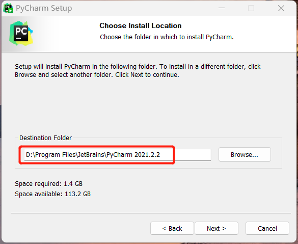

激活略。

##### 配置PyCharm

###### 使用本地Python解释器

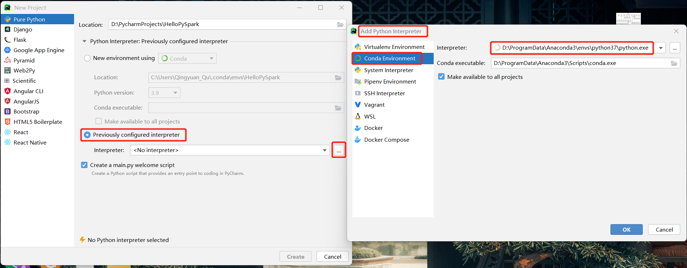

###### 使用集群Python解释器

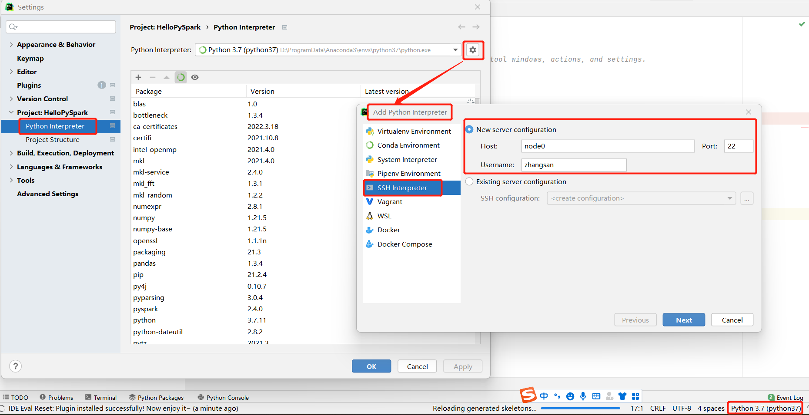

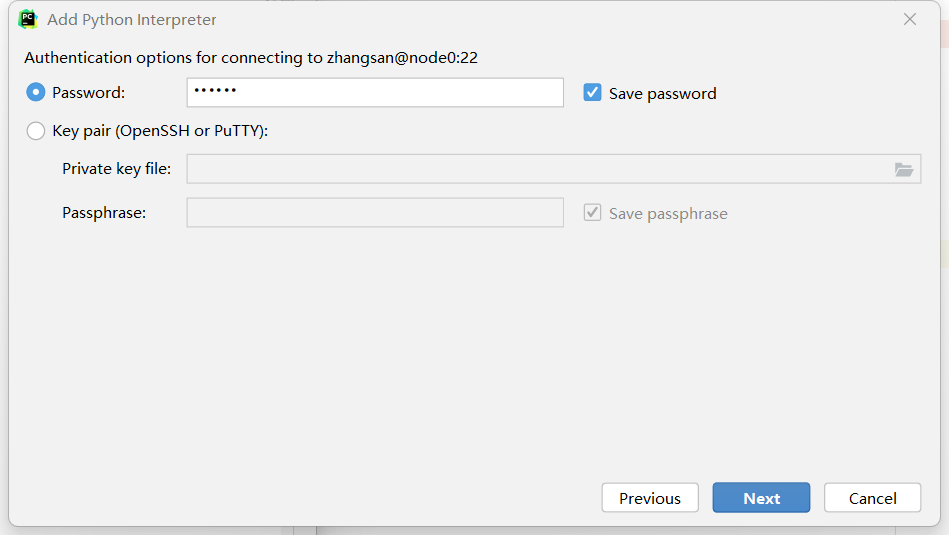

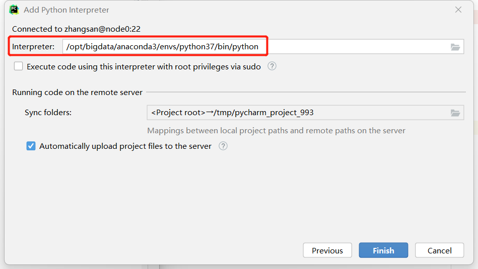

在服务器的`Python`环境中安装`PySpark`类库：

- 在线安装`PySpark`

```shell
(python37) [zhangsan@node0 ~]$ pip install pyspark==2.4.8
```

- 本地安装`PySpark`

```shell
(python37) [zhangsan@node0 ~]$ cd /opt/bigdata/spark/default/python
(python37) [zhangsan@node0 python]$ python setup.py install
Finished processing dependencies for pyspark==2.4.8
```


#### [Application提交](#Spark_Submit)

- 在`HDFS`创建文件`bigdata.txt`
- 代码编写

- `bin/spark-submit ~/wordcount.py`

##### Local

本地运行，可在`HistoryServer`看到执行情况

```shell
from pyspark import SparkContext, SparkConf

if __name__ == '__main__':
    conf = SparkConf().setMaster("local[*]").setAppName('wordcount')
    sc = SparkContext(conf=conf)
    result = sc.textFile("hdfs://node0:9000/user/zhangsan/bigdata.txt").flatMap(lambda line: line.split(" ")).\
        map(lambda word:(word,1)).reduceByKey(lambda a,b:a+b).collect()
    print(result)
```

##### Standalone

```python
from pyspark import SparkContext, SparkConf

if __name__ == '__main__':
    conf = SparkConf().setMaster("spark://node0:7077").setAppName('wordcount')
    sc = SparkContext(conf=conf)
    result = sc.textFile("hdfs://node0:9000/user/zhangsan/bigdata.txt").flatMap(lambda line: line.split(" ")).\
        map(lambda word:(word,1)).reduceByKey(lambda a,b:a+b).collect()
    print(result)
```

##### YARN

###### YARN Client

```python
from pyspark import SparkContext, SparkConf

if __name__ == '__main__':
    conf = SparkConf().setMaster("yarn").set("deployMode","client").setAppName('wordcount')
    sc = SparkContext(conf=conf)
    result = sc.textFile("hdfs://node0:9000/user/zhangsan/bigdata.txt").flatMap(lambda line: line.split(" ")).\
        map(lambda word:(word,1)).reduceByKey(lambda a,b:a+b).collect()
    print(result)
```

###### YARN Cluster

```python
from pyspark import SparkContext, SparkConf

if __name__ == '__main__':
    conf = SparkConf().setMaster("yarn").set("deployMode","cluster").setAppName('wordcount')
    sc = SparkContext(conf=conf)
    result = sc.textFile("hdfs://node0:9000/user/zhangsan/bigdata.txt").flatMap(lambda line: line.split(" ")).\
        map(lambda word:(word,1)).reduceByKey(lambda a,b:a+b).collect()
    print(result)
```


### Scala版

#### 查看Scala版本

```shell
[zhangsan@node0 bin]$ ./spark-shell 
Spark context Web UI available at http://node0:4040
Spark context available as 'sc' (master = local[*], app id = local-1648259787148).
Spark session available as 'spark'.
Welcome to
      ____              __
     / __/__  ___ _____/ /__
    _\ \/ _ \/ _ `/ __/  '_/
   /___/ .__/\_,_/_/ /_/\_\   version 2.4.8
      /_/
Using Scala version 2.11.12 (Java HotSpot(TM) 64-Bit Server VM, Java 1.8.0_202)
```


#### 使用IDEA新建`scala`工程

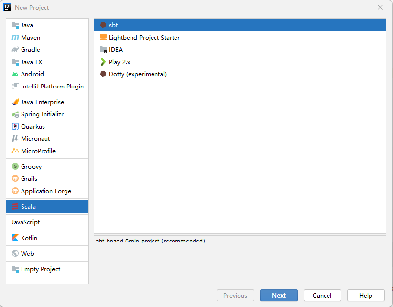

#### 配置工程属性

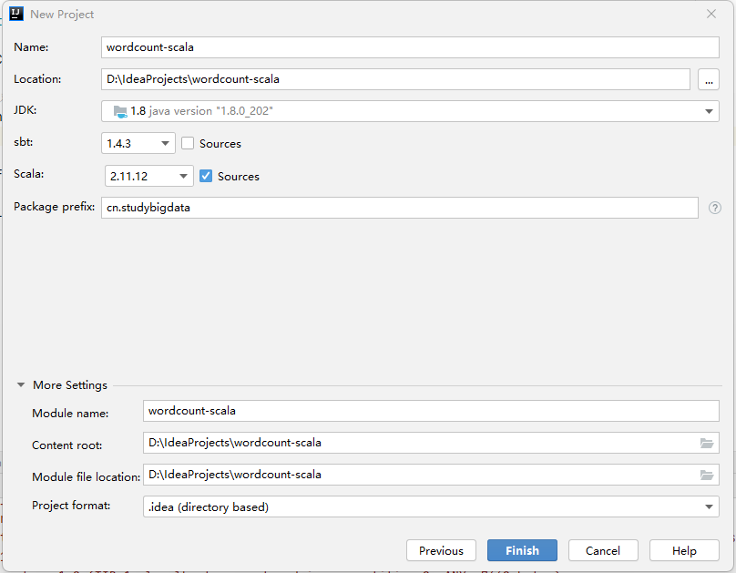

#### 代码编写

```scala
package com.studybigdata

import org.apache.spark.{SparkConf, SparkContext}

object WordCountScala {
  def main(args: Array[String]): Unit = {

    val conf = new SparkConf().setAppName("WordCountScala").setMaster("local");
    val sc = new SparkContext(conf)

    val result = sc.textFile("hdfs://node0:9000/user/zhangsan/bigdata.txt").flatMap(_.split(" ")).map((_, 1)).reduceByKey(_ + _)
    result.foreach(println)
    sc.stop()
  }
}
```
#### Local-Jars

##### 引入Jar包


##### 配置`Spark`类库


(bigdata,2)
(study,3)
```


#### Local-Maven

无须上一步引入Spark里的Jars包，直接通过Maven引入。

```xml
	<properties>
        <scala.minor.version>2.11</scala.minor.version>
        <scala.complete.version>${scala.minor.version}.12</scala.complete.version>
        <spark.version>2.4.8</spark.version>
    </properties>
    
    <dependencies>
        <dependency>
            <groupId>org.apache.spark</groupId>
            <artifactId>spark-core_${scala.minor.version}</artifactId>
            <version>${spark.version}</version>
            <scope>compile</scope>
        </dependency>
    </dependencies>
```


#### YARN

##### 代码编写

```scala
import org.apache.spark.{SparkConf, SparkContext}

object WordCountScala {
  def main(args: Array[String]): Unit = {

    val conf = new SparkConf().setAppName("WordCountScala")
    val sc = new SparkContext(conf)

    //WordCount
    val result = sc.textFile(args(0)).flatMap(_.split(" ")).map((_, 1)).reduceByKey(_ + _)

    //结果输出到container的日志中
    result.foreach(println)

    //结果输出到HDFS
    result.saveAsTextFile(args(1))

    //结果收集: 
    //collect() 会将结果收集到Driver的内存中
    //在Client模式下，Driver运行在客户端进程中，因此println会将收集的结果输出到控制台；
    //在Cluster模式下，Driver在AM内，collect会将结果输出到AM所在Container的日志中。
    result.collect().foreach(println)

    sc.stop()
  }
}
```


##### 打包

https://www.jianshu.com/p/8a0799201685

**`Build -->  Build Artifacts --> Build`**

##### Cluster

###### 执行

```shell
(python37) [zhangsan@node0 bin]$ ./spark-submit  --master yarn --deploy-mode cluster --class com.studybigdata.WordCountScala  wordcount_artifact.jar hdfs://node0:9000/user/zhangsan/bigdata.txt hdfs://node0:9000/user/zhangsan/out
```

```shell
22/03/26 14:45:19 INFO yarn.YarnAllocator: Launching container container_1648172380450_0024_01_000002 on host node0 for executor with ID 1

22/03/26 14:45:20 INFO yarn.YarnAllocator: Launching container container_1648172380450_0024_01_000003 on host node0 for executor with ID 2
```

###### 结果输出到Container日志

- Container-1


- Container-2

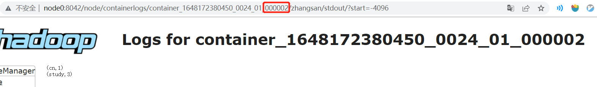

- Container-3


###### 结果输出到HDFS

```shell
(python37) [zhangsan@node0 bin]$ hdfs dfs -cat out/part-00000
(bigdata,2)
(python37) [zhangsan@node0 bin]$ hdfs dfs -cat out/part-00001
(cn,1)
(study,3)
```


##### Client

###### 执行

```shell
(python37) [zhangsan@node0 bin]$ ./spark-submit --master yarn --deploy-mode client --class com.studybigdata.WordCountScala  wordcount_artifact.jar hdfs://node0:9000/user/zhangsan/bigdata.txt hdfs://node0:9000/user/zhangsan/out
```

###### 结果输出到控制台

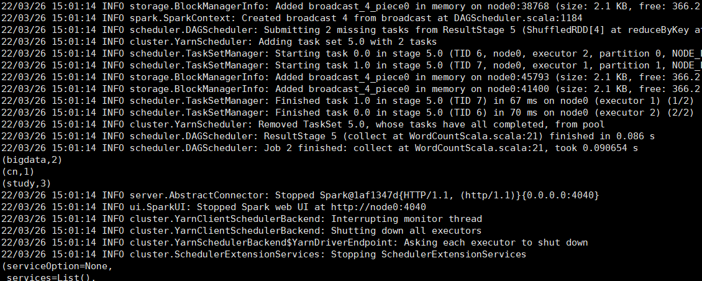

###### 结果输出到Container日志

略。

###### 结果输出到HDFS

略。
