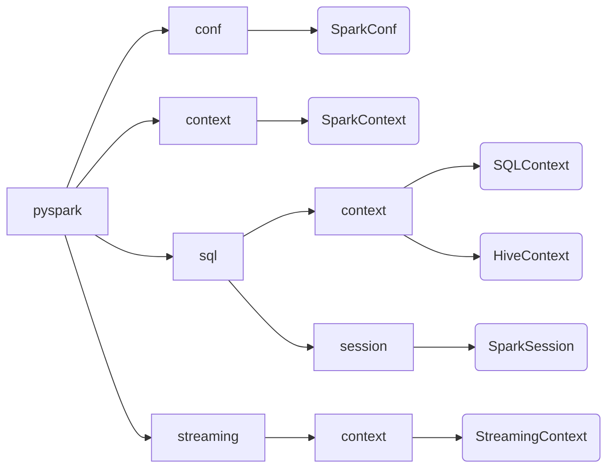

## 类间关系





## SparkSession的构造

- A

```python
sc = SparkContext("local", "spark_session_train")
spark = SparkSession(sparkContext=sc)
```

- B

```python
spark = SparkSession.builder.master("local").appName("spark_session_train").getOrCreate()

sc = spark.sparkContext # 如果想使用SparkContext，可通过SparkSession获取。
```


## DataFrame构造

#### 列表

```python
data = [('Alice', 21), ('Bob', 24)]
# peopel_df = spark.createDataFrame(data, ["name", "age"])
peopel_df = spark.createDataFrame(data, "name:string, age:int")  # Schema指定数据类型
peopel_df.show()
peopel_df.printSchema()
```


#### 字典


```python
print(spark.createDataFrame([{'name': 'alice', 'age': 1}, {'name': 'zhangsan', 'age': 2}]).collect())
```


#### RDD

```python
rdd = sc.parallelize([('zhangsan', 18),('lisi', 20)])
spark.createDataFrame(rdd)
```


#### CSV

##### 读取CSV

```python
sales_df = spark.read.option("header", "true").csv(r"file:///C:\Users\Qingyuan_Qu\PycharmProjects\pythonProject\data\sales_data.csv")
sales_df.printSchema()
sales_df.show(5)
```

##### 写入CSV

- 直接保存

```python
sales_df.repartition(1).write.csv(r"file:///C:\Users\Qingyuan_Qu\PycharmProjects\pythonProject\data\sales_data_new.csv")
```

- 转为`Pandas`中的`DataFrame`

```python
sales_df.toPandas().to_csv(r"C:\Users\Qingyuan_Qu\PycharmProjects\pythonProject\data\sales_data_new.csv")
```

> https://stackoverflow.com/questions/31385363/how-to-export-a-table-dataframe-in-pyspark-to-csv


#### MySQL

复制`mysql-connector-java-8.0.22.jar`到 `$SPARK_HOME/jars`

##### 读取MySQL

```python
mysql_url = "jdbc:mysql://localhost:3306/database_study"
prop = {'user': "root",
        'password': "123456",
        'driver': 'com.mysql.cj.jdbc.Driver',
        'serverTimezone': 'UTC'
       }
sales_data = spark.read.jdbc(url=mysql_url, table='sales_data', properties=prop)
sales_data.show()
```

##### 写入MySQL

```python
mysql_url = "jdbc:mysql://localhost:3306/database_study"
prop = {'user': "root",
        'password': "123456",
        'driver': 'com.mysql.cj.jdbc.Driver',
        'serverTimezone': 'UTC'
       }
sales_df.write.jdbc(url=mysql_url, table='sales_data', properties=prop, mode="overwrite")
```


#### Schema

##### 构造Schema

```python
from pyspark.sql.types import *

movies_schema = StructType([StructField("user", StringType(), True),
                            StructField("movie", StringType(), True),
                            StructField("rating", StringType(), True)])
movies_df = spark.read.csv(r"file:///C:\data\movies.csv", sep='\t',schema=movies_schema)
```

##### 查看Schema

```python
movies_df.printSchema()
```

## DataFrame注册为临时表

```python
sales_df.registerTempTable("sales_table")
```

## DataFrame与SQL

```python
import os

from pyspark.sql import SparkSession

if __name__ == '__main__':
    os.environ['HADOOP_HOME'] = "D:\green-soft\hadoop-2.7.3"
    os.environ["SPARK_HOME"] = "D:\green-soft\spark-2.4.8-bin-hadoop2.7"

    spark = SparkSession.builder.master("local").appName("spark_session_train").getOrCreate()

    sales_df = spark.read.option("header", "true").csv(r"file:///C:\data\sales_data.csv")
    zip_df = spark.read.option("header", "true").csv(r"file:///C:\data\Zip_data.csv")

    mysql_url = "jdbc:mysql://localhost:3306/database_study"
    prop = {'user': "root",
            'password': "123456",
            'driver': 'com.mysql.cj.jdbc.Driver',
            'serverTimezone': 'UTC'
            }

    sales_df.write.jdbc(url=mysql_url, properties=prop, mode="overwrite", table='sales_table')
    zip_df.write.jdbc(url=mysql_url, properties=prop, mode="overwrite", table='zip_table')

    sales_df.registerTempTable("sales_table")
    zip_df.registerTempTable("zip_table")

    # 统计元组数
    spark.sql("select count(*) counts from sales_table").show()
    # 查询全部数据
    spark.sql("select * from sales_table").show()
    # 查询指定的列，增加计算字段
    spark.sql("SELECT ORDERNUMBER, PRODUCTCODE,(2022-YEAR_ID) FROM sales_table").show()

    # 过滤
    sales_df.filter("YEAR_ID='2003'").show()
    spark.sql("select * from sales_table where YEAR_ID='2003'").show()

    # 排序
    sales_df.select("ORDERNUMBER","PRODUCTCODE",(2022-sales_df.YEAR_ID)).orderBy('YEAR_ID').show(5)
    spark.sql("select ORDERNUMBER, PRODUCTCODE, (2022-YEAR_ID) FROM sales_table ORDER BY YEAR_ID").show(5)

    # 去重
    sales_df.select('PRODUCTCODE').distinct().show()
    spark.sql("SELECT DISTINCT YEAR_ID FROM sales_table").show()

    # 分组
    sales_df.select('PRODUCTCODE').groupby('PRODUCTCODE').count().show()
    spark.sql("SELECT PRODUCTCODE, COUNT(*) FROM sales_table GROUP BY PRODUCTCODE").show()

    # 连接
    joined_df = sales_df.join(zip_df, sales_df.CITY == zip_df.CITY, "left_outer")

    join_sql = '''
            SELECT
            s.*, z.POSTALCODE
        FROM
            sales_table s
        LEFT JOIN zip_table z ON s.CITY = Z.CITY
'''
    spark.sql(join_sql).show(5)
```

