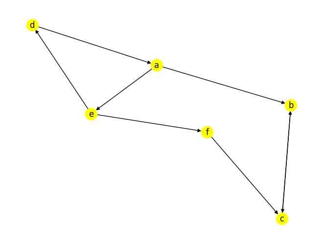
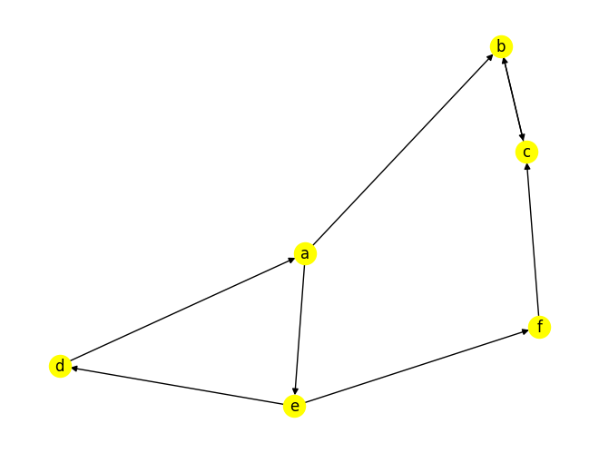

# Spark GraphFrames

> 官方文档：https://graphframes.github.io/graphframes/docs/_site/quick-start.html
>
> 源码：https://github.com/graphframes/graphframes
>
> 练习：https://docs.databricks.com/_static/notebooks/graphframes-user-guide-py.html


### 安装

##### Pip安装graphframes库

```shell
(python37) PS C:\Users\Qingyuan_Qu> pip3 install graphframes
```

##### Java依赖包

- 在线下载

```shell
# 默认会下载到用户目录的`.ivy`文件夹内。
(python37) PS C:\Users\Qingyuan_Qu> pyspark --packages graphframes:graphframes:0.8.2-spark2.4-s_2.11
```

- spark-packages.org

```http
https://spark-packages.org/package/graphframes/graphframes
```

下载完，移动到`$SPARK_HOME/jars`文件夹内。


### 初始化环境

```python
import networkx as nx
import matplotlib.pyplot as plt
from pyspark.sql import SparkSession
from graphframes import GraphFrame
```


```python
spark = SparkSession.builder.appName("hello graphframes").master('local[*]').getOrCreate()
```

    23/06/08 07:10:14 WARN SparkContext: Another SparkContext is being constructed (or threw an exception in its constructor).  This may indicate an error, since only one SparkContext may be running in this JVM (see SPARK-2243). The other SparkContext was created at:
    org.apache.spark.api.java.JavaSparkContext.<init>(JavaSparkContext.scala:58)
    sun.reflect.NativeConstructorAccessorImpl.newInstance0(Native Method)
    sun.reflect.NativeConstructorAccessorImpl.newInstance(NativeConstructorAccessorImpl.java:62)
    sun.reflect.DelegatingConstructorAccessorImpl.newInstance(DelegatingConstructorAccessorImpl.java:45)
    java.lang.reflect.Constructor.newInstance(Constructor.java:423)
    py4j.reflection.MethodInvoker.invoke(MethodInvoker.java:247)
    py4j.reflection.ReflectionEngine.invoke(ReflectionEngine.java:357)
    py4j.Gateway.invoke(Gateway.java:238)
    py4j.commands.ConstructorCommand.invokeConstructor(ConstructorCommand.java:80)
    py4j.commands.ConstructorCommand.execute(ConstructorCommand.java:69)
    py4j.GatewayConnection.run(GatewayConnection.java:238)
    java.lang.Thread.run(Thread.java:748)


### 图的构造


```python
vertices = spark.createDataFrame([
 ("a", "Alice", 34),
 ("b", "Bob", 36),
 ("c", "Charlie", 30),
 ("d", "David", 29),
 ("e", "Esther", 32),
 ("f", "Fanny", 36),
 ("g", "Gabby", 60)], ["id", "name", "age"])

edges = spark.createDataFrame([
 ("a", "b", "friend"),
 ("b", "c", "follow"),
 ("c", "b", "follow"),
 ("f", "c", "follow"),
 ("e", "f", "follow"),
 ("e", "d", "friend"),
# ("e", "c", "friend"),
 ("d", "a", "friend"),
 ("a", "e", "friend")
], ["src", "dst", "relationship"])
```


```python
g=GraphFrame(vertices,edges)
print(g)
```

    GraphFrame(v:[id: string, name: string ... 1 more field], e:[src: string, dst: string ... 1 more field])

### 图的保存

```python
g.vertices.write.parquet("file:///home/zhangsan/graph/vertices")
g.edges.write.parquet("file:///home/zhangsan/graph/edges")

v = spark.read.parquet("file:///home/zhangsan/graph/vertices")
e = spark.read.parquet("file:///home/zhangsan/graph/edges")
g = GraphFrame(v,e)

g.vertices.show()
g.edges.show()
```


### 图的展示


```python
# 图展示
def plot_graph(es):
    g = nx.DiGraph()
    for row in es.select('src','dst').collect():
        g.add_edge(row['src'],row['dst'])

    nx.draw(g, with_labels=True, node_color='yellow')
plot_graph(g.edges)
plt.show()
```


​    

​    


### 度(Degree)


```python
g.vertices.show()
g.edges.show()
g.degrees.show()
g.inDegrees.show()
g.outDegrees.show()
```

    +---+-------+---+
    | id|   name|age|
    +---+-------+---+
    |  a|  Alice| 34|
    |  b|    Bob| 36|
    |  c|Charlie| 30|
    |  d|  David| 29|
    |  e| Esther| 32|
    |  f|  Fanny| 36|
    |  g|  Gabby| 60|
    +---+-------+---+
    
    +---+---+------------+
    |src|dst|relationship|
    +---+---+------------+
    |  a|  b|      friend|
    |  b|  c|      follow|
    |  c|  b|      follow|
    |  f|  c|      follow|
    |  e|  f|      follow|
    |  e|  d|      friend|
    |  d|  a|      friend|
    |  a|  e|      friend|
    +---+---+------------+
    
    +---+------+
    | id|degree|
    +---+------+
    |  f|     2|
    |  e|     3|
    |  d|     2|
    |  c|     3|
    |  b|     3|
    |  a|     3|
    +---+------+
    
    +---+--------+
    | id|inDegree|
    +---+--------+
    |  f|       1|
    |  e|       1|
    |  d|       1|
    |  c|       2|
    |  b|       2|
    |  a|       1|
    +---+--------+
    
    +---+---------+
    | id|outDegree|
    +---+---------+
    |  f|        1|
    |  e|        2|
    |  d|        1|
    |  c|        1|
    |  b|        1|
    |  a|        2|
    +---+---------+


### 模式查找


```python
help(GraphFrame.find)
```

    Help on function find in module graphframes.graphframe:
    
    find(self, pattern)
        Motif finding.
        
        See Scala documentation for more details.
        
        :param pattern:  String describing the motif to search for.
        :return:  DataFrame with one Row for each instance of the motif found


```python
g.find('(x)-[e]->(y);(y)-[e2]->(z)').show()
```

    +----------------+--------------+----------------+--------------+----------------+
    |               x|             e|               y|            e2|               z|
    +----------------+--------------+----------------+--------------+----------------+
    |  [a, Alice, 34]|[a, e, friend]| [e, Esther, 32]|[e, f, follow]|  [f, Fanny, 36]|
    |  [d, David, 29]|[d, a, friend]|  [a, Alice, 34]|[a, e, friend]| [e, Esther, 32]|
    |  [a, Alice, 34]|[a, e, friend]| [e, Esther, 32]|[e, d, friend]|  [d, David, 29]|
    | [e, Esther, 32]|[e, f, follow]|  [f, Fanny, 36]|[f, c, follow]|[c, Charlie, 30]|
    |[c, Charlie, 30]|[c, b, follow]|    [b, Bob, 36]|[b, c, follow]|[c, Charlie, 30]|
    |  [a, Alice, 34]|[a, b, friend]|    [b, Bob, 36]|[b, c, follow]|[c, Charlie, 30]|
    |  [f, Fanny, 36]|[f, c, follow]|[c, Charlie, 30]|[c, b, follow]|    [b, Bob, 36]|
    |    [b, Bob, 36]|[b, c, follow]|[c, Charlie, 30]|[c, b, follow]|    [b, Bob, 36]|
    |  [d, David, 29]|[d, a, friend]|  [a, Alice, 34]|[a, b, friend]|    [b, Bob, 36]|
    | [e, Esther, 32]|[e, d, friend]|  [d, David, 29]|[d, a, friend]|  [a, Alice, 34]|
    +----------------+--------------+----------------+--------------+----------------+


```python
g.find('(x)-[e]->(y);(x)-[e2]->(z)').show()

motifs = g.find('(x)-[e1]->(y);(y)-[]->(x)')
motifs.show()
motifs.filter("y.age>30").show()
```


### 广度优先搜索BFS


```python
help(GraphFrame.bfs)
```

    Help on function bfs in module graphframes.graphframe:
    
    bfs(self, fromExpr, toExpr, edgeFilter=None, maxPathLength=10)
        Breadth-first search (BFS).
        
        See Scala documentation for more details.
        
        :return: DataFrame with one Row for each shortest path between matching vertices.


- fromExpr: 通过表达式指定搜索起点  
- toExpr: 通过表达式指定搜索终点 
- edgeFilter: 需要忽略的边  
- maxPathLength: 路径的最大长度


```python
paths = g.bfs("name='Esther'","name='Bob'")
paths.show()
```

​                                                                                    

    +---------------+--------------+--------------+--------------+----------------+--------------+------------+
    |           from|            e0|            v1|            e1|              v2|            e2|          to|
    +---------------+--------------+--------------+--------------+----------------+--------------+------------+
    |[e, Esther, 32]|[e, f, follow]|[f, Fanny, 36]|[f, c, follow]|[c, Charlie, 30]|[c, b, follow]|[b, Bob, 36]|
    |[e, Esther, 32]|[e, d, friend]|[d, David, 29]|[d, a, friend]|  [a, Alice, 34]|[a, b, friend]|[b, Bob, 36]|
    +---------------+--------------+--------------+--------------+----------------+--------------+------------+


```python
paths = g.bfs("name='Esther'","name='Bob'",edgeFilter = "relationship != 'friend'")
paths.show()
```

    [Stage 1789:=======================================>            (152 + 8) / 200]
    
    +---------------+--------------+--------------+--------------+----------------+--------------+------------+
    |           from|            e0|            v1|            e1|              v2|            e2|          to|
    +---------------+--------------+--------------+--------------+----------------+--------------+------------+
    |[e, Esther, 32]|[e, f, follow]|[f, Fanny, 36]|[f, c, follow]|[c, Charlie, 30]|[c, b, follow]|[b, Bob, 36]|
    +---------------+--------------+--------------+--------------+----------------+--------------+------------+


​                                                                                    

### 最短路径（Dijkstra）


```python
help(GraphFrame.shortestPaths)
```

    Help on function shortestPaths in module graphframes.graphframe:
    
    shortestPaths(self, landmarks)
        Runs the shortest path algorithm from a set of landmark vertices in the graph.
        
        See Scala documentation for more details.
        
        :param landmarks: a set of one or more landmarks
        :return: DataFrame with new vertices column "distances"


忽略边的权重，返回所有顶点到目标顶点的最短距离，不会返回完整的路径。


```python
paths = g.shortestPaths(landmarks=["a","c"])
paths.show()
```

​                                                                                    

    +---+-------+---+----------------+
    | id|   name|age|       distances|
    +---+-------+---+----------------+
    |  g|  Gabby| 60|              []|
    |  b|    Bob| 36|        [c -> 1]|
    |  e| Esther| 32|[c -> 2, a -> 2]|
    |  a|  Alice| 34|[a -> 0, c -> 2]|
    |  f|  Fanny| 36|        [c -> 1]|
    |  d|  David| 29|[a -> 1, c -> 3]|
    |  c|Charlie| 30|        [c -> 0]|
    +---+-------+---+----------------+

```python
paths = g.shortestPaths(landmarks=["a","d"])
paths.show()
paths.filter("id='a'").show()
print(paths.filter("id='a'").rdd.map(lambda x:x[3]['d']).collect())

paths = g.shortestPaths(landmarks=["a","f"])
paths.show()
paths.filter("id='a'").show()
print(paths.filter("id='a'").rdd.map(lambda x:x[3]['f']).collect())
```


### 三角形计数


```python
g.triangleCount().show()
```

​                                                                                    

    +-----+---+-------+---+
    |count| id|   name|age|
    +-----+---+-------+---+
    |    0|  g|  Gabby| 60|
    |    0|  f|  Fanny| 36|
    |    1|  e| Esther| 32|
    |    1|  d|  David| 29|
    |    0|  c|Charlie| 30|
    |    0|  b|    Bob| 36|
    |    1|  a|  Alice| 34|
    +-----+---+-------+---+


### 连通分量

#### 连通分量(无向图)


```python
sc = spark.sparkContext
sc.setCheckpointDir("./")
g.connectedComponents().show()
```

​                                                                                    

    +---+-------+---+------------+
    | id|   name|age|   component|
    +---+-------+---+------------+
    |  a|  Alice| 34|412316860416|
    |  b|    Bob| 36|412316860416|
    |  c|Charlie| 30|412316860416|
    |  d|  David| 29|412316860416|
    |  e| Esther| 32|412316860416|
    |  f|  Fanny| 36|412316860416|
    |  g|  Gabby| 60|146028888064|
    +---+-------+---+------------+


#### 强连通分量(有向图)


```python
g.stronglyConnectedComponents(maxIter=10).show()
```

​                                                                                    

    +---+-------+---+-------------+
    | id|   name|age|    component|
    +---+-------+---+-------------+
    |  g|  Gabby| 60| 146028888064|
    |  b|    Bob| 36|1047972020224|
    |  e| Esther| 32| 670014898176|
    |  a|  Alice| 34| 670014898176|
    |  f|  Fanny| 36| 412316860416|
    |  d|  David| 29| 670014898176|
    |  c|Charlie| 30|1047972020224|
    +---+-------+---+-------------+


```python
plot_graph(g.edges)
plt.show()
```


​    

​    

### PageRank


```python
result = g.pageRank(resetProbability=0.15,maxIter=10)
result.vertices.show()
```

    +---+-------+---+-------------------+
    | id|   name|age|           pagerank|
    +---+-------+---+-------------------+
    |  g|  Gabby| 60|0.17073170731707318|
    |  b|    Bob| 36| 2.7025217677349773|
    |  e| Esther| 32| 0.3613490987992571|
    |  a|  Alice| 34| 0.4485115093698443|
    |  f|  Fanny| 36|0.32504910549694244|
    |  d|  David| 29|0.32504910549694244|
    |  c|Charlie| 30| 2.6667877057849627|
    +---+-------+---+-------------------+


### Google PageRank

```python
# Google Web PageRank
from pyspark.sql.types import *

# filePath = "file:///mnt/d/PycharmProjects/pythonProject/spark_graphframes/web-Google.txt"
filePath = r"D:\PycharmProjects\pythonProject\data\web-Google.txt"


schema = StructType([StructField('src', LongType(), True), StructField('dst', LongType(), True)])
edges = spark.read.load(filePath, format='csv', delimiter='\t', schema=schema, mode='DROPMALFORMED')
edges.cache()

srcVertices = edges.select(edges.src)
destVertices = edges.select(edges.dst)

vertices = srcVertices.union(destVertices).distinct().withColumnRenamed('src', 'id')
vertices.show()

from graphframes import GraphFrame

g = GraphFrame(vertices, edges)
rank = g.pageRank(resetProbability=0.15, maxIter=5)
rank.vertices.show()
rank.edges.show()
```

