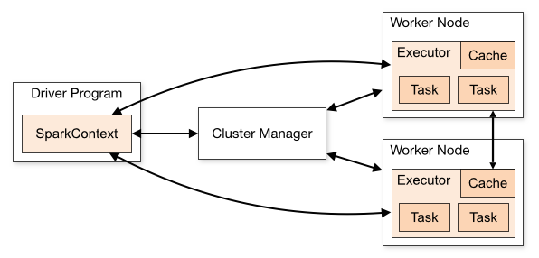
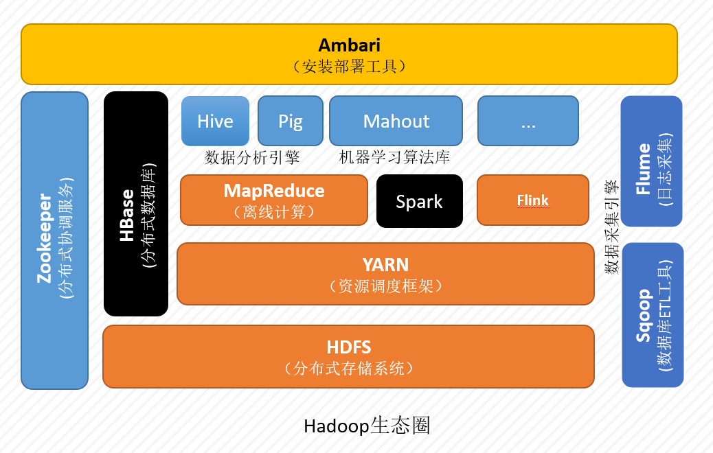
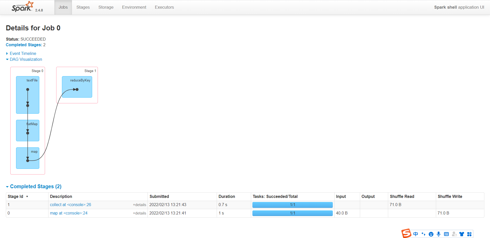

<h1 style="color:red; text-align:center;color:red;">Spark环境搭建（一）Local模式</h1>




| Term            | Meaning                                                      |
| :-------------- | :----------------------------------------------------------- |
| `Application`   | User program built on Spark. Consists of a *driver program* and *executors* on the cluster. |
| Application jar | A jar containing the user's Spark application. In some cases users will want to create an "uber jar" containing their application along with its dependencies. The user's jar should never include Hadoop or Spark libraries, however, these will be added at runtime. |
| `Driver`        | The process running the `main() function` of the application and `creating the SparkContext` |
| Cluster manager | An external service for acquiring resources on the cluster (e.g. standalone manager, Mesos, YARN) |
| Deploy mode     | Distinguishes where the driver process runs. In "cluster" mode, the framework launches the driver inside of the cluster. In "client" mode, the submitter launches the driver outside of the cluster. |
| Worker node     | Any node that can run application code in the cluster        |
| `Executor`      | A process launched for an application on a worker node, that runs tasks and keeps data in memory or disk storage across them. Each application has its own executors. |
| Task            | A unit of work that will be sent to one executor             |
| Job             | A parallel computation consisting of multiple tasks that gets spawned in response to a Spark action (e.g. `save`, `collect`); you'll see this term used in the driver's logs. |
| Stage           | Each job gets divided into smaller sets of tasks called *stages* that depend on each other (similar to the map and reduce stages in MapReduce); you'll see this term used in the driver's logs. |

# 环境部署

> **官方文档**
>
> https://spark.apache.org/docs/2.4.8/
>
> **下载地址**
>
> https://archive.apache.org/dist/spark/spark-2.4.8/
>
> **安装目录**
>
> `/opt/bigdata/spark`
>
> **部署规划**
>
> `node0`：Local (Linux File System & HDFS)
>
> `node1` `node2` `node3`  配置为`spark`集群。
>
> 


<iframe id="embed_dom" name="embed_dom" frameborder="0" style="display:block;width:525px; height:400px;" src="https://www.processon.com/embed/62083c165653bb06de331e3c"></iframe>



在`/opt/`目录下创建`bigdata`目录，并修改目录的所有者和所属组为`zhangsan`，我们将`spark`安装到该目录中。

```shell
# 创建/opt/bigdata/spark文件夹
# !!! 注意： 因为普通用户没有权限在/opt/目录写数据，所有本次操作使用的是root账户。
[root@node0 ~]# mkdir /opt/bigdata/spark

# 修改/opt/bigdata/spark文件夹及子文件夹的所有者所属组为zhangsan
[root@node0 ~]# chown -R zhangsan:zhangsan /opt/bigdata/spark
[root@node0 ~]# ls -al /opt/bigdata/
total 0
drwxr-xr-x. 3 zhangsan zhangsan 19 Feb 15 08:38 .
drwxr-xr-x. 3 root   root   21 Feb 15 08:38 ..
drwxr-xr-x. 2 zhangsan zhangsan  6 Feb 15 08:38 spark

# 退出root账号
[root@node0 ~]# exit
exit
```

使用`xftp`等文件传输工具，将`spark`安装包上传到`CentOS 7`系统的`/opt/bigdata/spark`目录中。


---

## 本地运行

### 读写Linux

本地运行模式开箱即用，只需要[`Java`环境]()，无需其他任何配置。此时，只能读写本机`Linux文件系统`中的文件，无法读写`HDFS`。

#### 		解压

```shell
[zhangsan@node0 ~]$ cd /opt/bigdata/spark/
[zhangsan@node0 spark]$ tar -zxf spark-2.4.8-bin-hadoop2.7.tgz
[zhangsan@node0 spark]$ ll
total 230372
drwxr-xr-x. 13 zhangsan zhangsan       211 May  8  2021 spark-2.4.8-bin-hadoop2.7
-rw-rw-r--.  1 zhangsan zhangsan 235899716 Feb 15 08:42 spark-2.4.8-bin-hadoop2.7.tgz
[zhangsan@node0 spark]$ ln -s spark-2.4.8-bin-hadoop2.7 default
[zhangsan@node0 spark]$ ll
total 230372
lrwxrwxrwx.  1 zhangsan zhangsan        25 Feb 15 08:42 default -> spark-2.4.8-bin-hadoop2.7
drwxr-xr-x. 13 zhangsan zhangsan       211 May  8  2021 spark-2.4.8-bin-hadoop2.7
-rw-rw-r--.  1 zhangsan zhangsan 235899716 Feb 15 08:42 spark-2.4.8-bin-hadoop2.7.tgz
```

#### 配置

无需配置。

#### 		启动

```shell
[zhangsan@node0 spark]$ cd default/bin/
[zhangsan@node0 bin]$ rm -rf *.cmd # 删除Windows平台的脚本（可选）

# 启动 spark-shell 交互式环境（scala语言）
[zhangsan@node0 bin]$ ./spark-shell --master local[*]
22/02/13 12:50:45 WARN NativeCodeLoader: Unable to load native-hadoop library for your platform... using builtin-java classes where applicable

# 可通过此 web 界面查看 spark job 的运行情况
Spark context Web UI available at http://node0:4040
# local[*] 表示使用所有计算资源
Spark context available as 'sc' (master = local[*], app id = local-1644727904419).
Spark session available as 'spark'.
Welcome to
      ____              __
     / __/__  ___ _____/ /__
    _\ \/ _ \/ _ `/ __/  '_/
   /___/ .__/\_,_/_/ /_/\_\   version 2.4.8
      /_/
         
Using Scala version 2.11.12 (Java HotSpot(TM) 64-Bit Server VM, Java 1.8.0_202)
```

可通过spark web界面查job的启动情况，网页中看不到job的运行情况，因为我们还没有执行spark job。

```http
http://node0:4040
```

本地模式只有一个进程启动。

```shell
[zhangsan@node0 ~]$ jps
18371 SparkSubmit
20020 Jps
[zhangsan@node0 ~]$ 
```

#### Master参数

| --master参数        | 说明                                                         |
| ------------------- | ------------------------------------------------------------ |
| `local`             | 使用`一个Worker线程`本地化运行Spark                          |
| `local[k]`          | 使用`K个Worker线程`本地化运行Spark                           |
| `local[*]`          | 使用`* 个Worker线程`本地化运行Spark(`* =机器的CPU核数`)（默认） |
| `spark://HOST:PORT` | 连接到指定的`Standalone集群`。`HOST`参数是`Spark Master`的`hostname`或`IP`，默认端口是`7077。` |
| `mesos://HOST:PORT` | 连接到指定的`Mesos集群`。`HOST`参数是`Moses Master`的`hostname`或`IP`，默认端口是`5050`  。 |
| `yarn`              | 默认以`客户端模式`连接到`YARN集群`，集群位置由环境变量`YARN_CONF_DIR`决定 。 |

`Spark2.0`以前，`yarn`分为`yarn-client`与`yarn-cluster`

`Spark2.0`以后，设置`--deploy-mode=[client/cluster]`以不同模式连接到`YARN集群`

#### 		案例 - wordcount

```shell
hello
study bigdata
hello study bigdata
```

```scala
scala> var wordcount = sc.textFile("/home/zhangsan/bigdata.txt").flatMap(line => line.split(" ")).map(word => (word,1)).reduceByKey(_+_)

scala> wordcount.collect()
res0: Array[(String, Int)] = Array((hello,2), (bigdata,2), (study,2))         
```

打开web http://node0:4040 界面，可以查看`Job`的运行情况，此地址为`driver`执行任务的查看地址。


可以看到该`Job`包括两个`stage`



直接解压运行，`spark`只能读写本地`Linux`文件系统；接下来我们配置`spark`，让其能够读写`HDFS`。


### 读写HDFS

接下来的实验中，我们需要使用`Spark`读写`HDFS`，因此，我们需要完成[`Hadoop`伪分布式环境的搭建]()。

#### 	配置文件

Spark配置文件`spark-env.sh`中添加如下行即可。

```shell
# 进入spark配置文件存放目录
[zhangsan@node0 ~]$ cd /opt/bigdata/spark/default/conf/

# 重命名配置文件模板
[zhangsan@node0 conf]$ mv spark-env.sh.template spark-env.sh

[zhangsan@node0 conf]$ vim spark-env.sh

# 修改 HADOOP_CONF_DIR配置项
HADOOP_CONF_DIR=/opt/bigdata/hadoop/default/etc/hadoop
```

#### 	测试

##### 		格式化名称节点

```shell
[zhangsan@node0 ~]$ hadoop namenode -format
```

##### 		启动Hadoop

```shell
[zhangsan@node0 ~]$ start-all.sh 
```

##### 		创建文件夹

```shell
[zhangsan@node0 ~]$ hdfs dfs -mkdir /input
```

##### 		上传测试数据

```shell
[zhangsan@node0 ~]$ hdfs dfs -put bigdata.txt /input
```

##### 		wordcount

`$SPARK_HOME/bin`

```scala
scala> var wordcount = sc.textFile("hdfs:///input/bigdata.txt").flatMap(line => line.split(" ")).map(word => (word,1)).reduceByKey(_+_)
wordcount: org.apache.spark.rdd.RDD[(String, Int)] = ShuffledRDD[11] at reduceByKey at <console>:24

scala> wordcount.collect()
res3: Array[(String, Int)] = Array((hello,2), (bigdata,2), (study,2))
```

##### 		退出

```scala
scala> :quit
```
