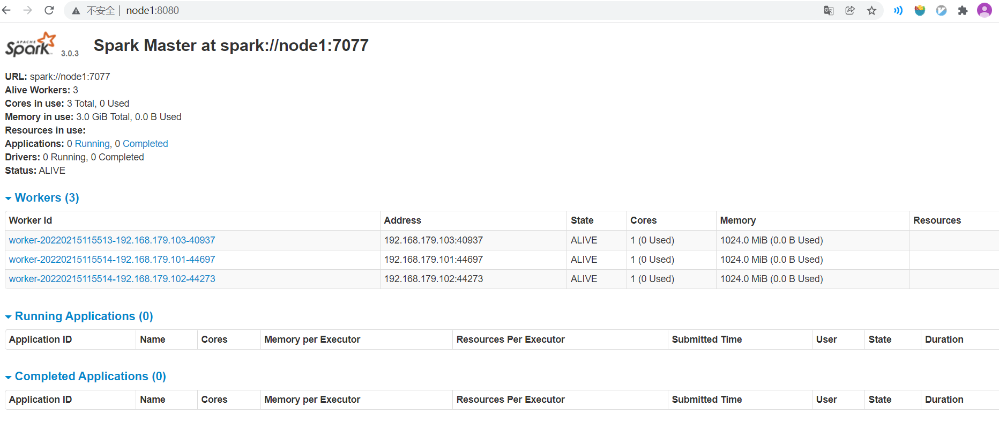
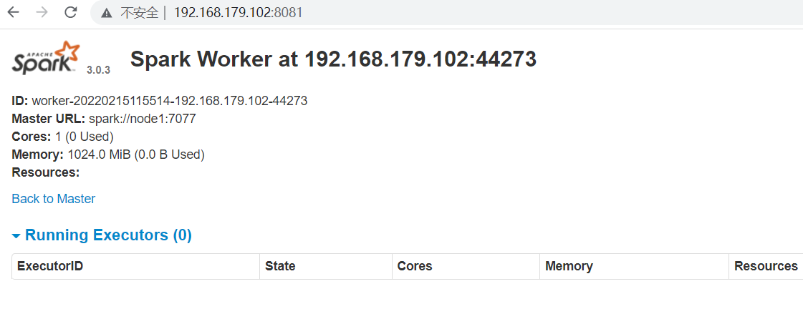

<h1 style="color:red; text-align:center;color:red;">Spark环境搭建（二）Standalone模式</h1>

## 伪分布式

#### 	配置

包括 `Hadoop`配置，Master, Worker的通信地址和Web UI的地址

##### spark-env.sh（Server）

```shell
# 如果Worker提示JAVA_HOME is not set, 在此文件配置一下JAVA_HOME
# JAVA_HOME=${JAVA_HOME}

HADOOP_CONF_DIR=/opt/bigdata/hadoop/default/etc/hadoop #读写HDFS
SPARK_MASTER_HOST=node0  # Master节点
# 日志服务器HistoryServer会去指定的位置读取执行事件日志
SPARK_HISTORY_OPTS="-Dspark.history.fs.logDirectory=hdfs://node0:9000/shared/spark-logs"
```

##### spark-default-conf（Client）

```shell
[zhangsan@node0 conf]$ mv spark-defaults.conf.template spark-defaults.conf
[zhangsan@node0 conf]$ vim spark-defaults.conf
spark.master                     spark://node0:7077

# spark applications 执行的事件日志会存放到指定的位置
spark.eventLog.enabled           true
spark.eventLog.dir               hdfs://node0:9000/shared/spark-logs
```

##### Slave

```shell
[zhangsan@node1 conf]$ mv slaves.template slaves
[zhangsan@node1 conf]$ vim slaves 
localhost
```

#### 	启动Spark集群

##### 	启动HDFS

```shell
[zhangsan@node0 sbin]$ start-dfs.sh 
```

##### 启动History Server

```
# 启动HistoryServer
[zhangsan@node0 sbin]$ ./start-history-server.sh 
```

##### 	启动Spark

启动`Master`和`Worker`

```shell
[zhangsan@node0 sbin]$ ./start-all.sh 
[zhangsan@node1 sbin]$ jps
5393 Worker
5300 Master
4582 NodeManager
5447 Jps
4216 SecondaryNameNode
4376 ResourceManager
4027 DataNode
3871 NameNode
14845 HistoryServer
```

#### 	Web UI查看

可以在`windows`系统中配置一下`hosts`映射。

```http
# C:\Windows\System32\drivers\etc\hosts
192.168.179.100	node0
```

**Master : 8080**

**Worker : 8081**

**HistoryServer：18080**

**Driver：4040**

#### 	测试

```shell
[zhangsan@node0 bin]$ ./spark-shell --master spark://node0:7077
[GCC 7.5.0] :: Anaconda, Inc. on linux
Type "help", "copyright", "credits" or "license" for more information.
22/02/15 12:41:57 WARN util.NativeCodeLoader: Unable to load native-hadoop library for your platform... using builtin-java classes where applicable
Setting default log level to "WARN".
To adjust logging level use sc.setLogLevel(newLevel). For SparkR, use setLogLevel(newLevel).
22/02/15 12:41:59 WARN spark.SparkContext: Please ensure that the number of slots available on your executors is limited by the number of cores to task cpus and not another custom resource. If cores is not the limiting resource then dynamic allocation will not work properly!
Welcome to
      ____              __
     / __/__  ___ _____/ /__
    _\ \/ _ \/ _ `/ __/  '_/
   /__ / .__/\_,_/_/ /_/\_\   version 3.0.3
      /_/

Using Python version 3.7.11 (default, Jul 27 2021 14:32:16)
SparkSession available as 'spark'.
# 转换算子，不触发计算
# 动作算子Action，触发计算
>>> var wordcount = sc.textFile("hdfs:///input/bigdata.txt").flatMap(line => line.split(" ")).map(word => (word,1)).reduceByKey(_+_)
wordcount: org.apache.spark.rdd.RDD[(String, Int)] = ShuffledRDD[11] at reduceByKey at <console>:24

scala> wordcount.collect()
res3: Array[(String, Int)] = Array((hello,2), (bigdata,2), (study,2))
```

可以在 http://node0:4040 下查看`driver`下job的运行情况。


## 集群部署

#### 	Spark配置

包括 `Hadoop`配置，`Master`, `Worker`的通信地址和`Web UI`的地址

##### spark-env.sh（Server）

##### spark-default-conf（Client）

与`伪分布式-Standalone`配置基本一致，

此处我们的`Master`运行在`node1`节点上，`Namenode`运行在`node1`节点上。

因此需要修改一下`node0`为`node1`，

##### Slave

```shell
[zhangsan@node1 conf]$ mv slaves.template slaves
[zhangsan@node1 conf]$ vim slaves 
node1
node2
node3
```

将修改好的`spark`分发到其他两个节点。

```shell
[zhangsan@node1 bigdata]$ scp -r spark node3:`pwd`/
```


#### 	启动

##### 	启动HDFS

```shell
[zhangsan@node1 sbin]$ start-dfs.sh 
```

##### 	启动Spark

启动Master和Worker

**node1**

```shell
# 启动HistoryServer
[zhangsan@node1 sbin]$ ./start-history-server.sh 

# 启动Master和所有Worker
[zhangsan@node1 sbin]$ ./start-all.sh 
[zhangsan@node1 sbin]$ jps
5393 Worker
5300 Master
4582 NodeManager
5447 Jps
4216 SecondaryNameNode
4376 ResourceManager
4027 DataNode
3871 NameNode
14845 HistoryServer
```

**node2**

```shell
[zhangsan@node2 bigdata]$ jps
4417 Worker
3826 DataNode
4476 Jps
3966 NodeManager
```

**node3**

```shell
[zhangsan@node3 bigdata]$ jps
3928 NodeManager
4441 Jps
4378 Worker
3788 DataNode
```


#### 	Web UI查看

可以在`windows`系统中配置一下`hosts`映射。

```http
# C:\Windows\System32\drivers\etc\hosts
192.168.179.100	node0
192.168.179.101	node1
192.168.179.102	node2
192.168.179.103	node3
```


**Master : 8080**




**Worker : 8081**



#### 	测试集群

```shell
[zhangsan@node1 bin]$ ./spark-shell --master spark://node1:7077

scala> var wordcount = sc.textFile("hdfs:///input/bigdata.txt").flatMap(line => line.split(" ")).map(word => (word,1)).reduceByKey(_+_)
wordcount: org.apache.spark.rdd.RDD[(String, Int)] = ShuffledRDD[11] at reduceByKey at <console>:24

scala> wordcount.collect()
res3: Array[(String, Int)] = Array((hello,2), (bigdata,2), (study,2))  
```

可以在 http://node1:4040 下查看`driver`下job的运行情况。