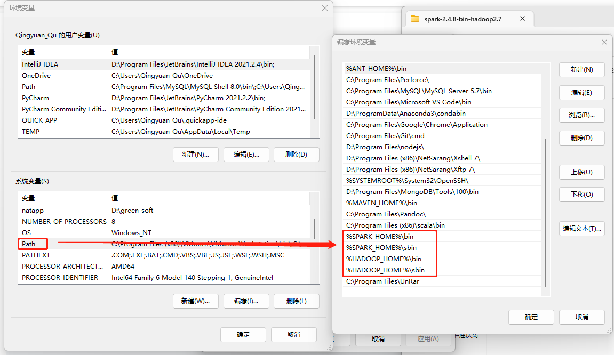
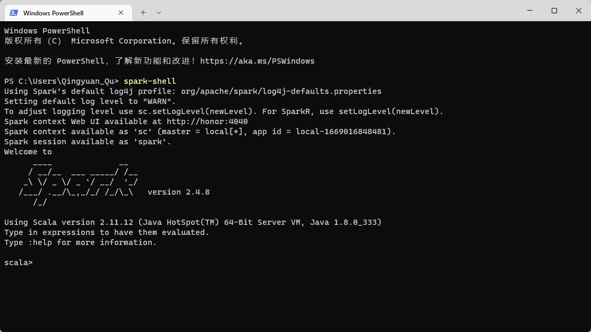
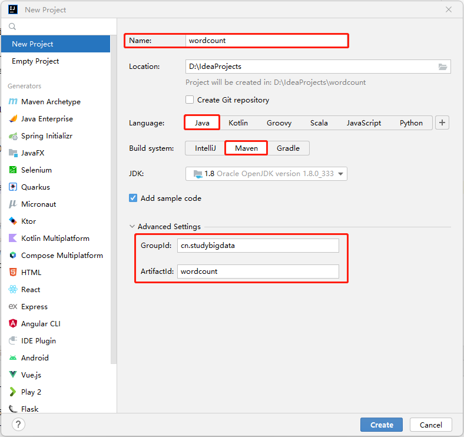
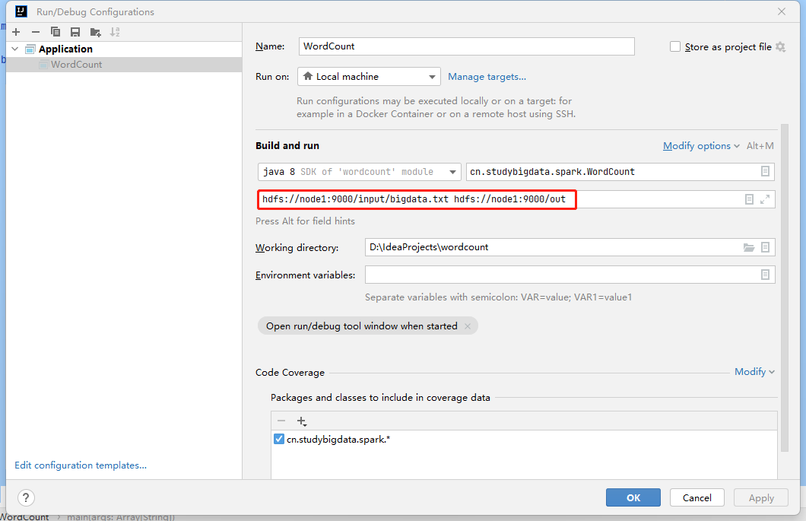

<h1 style="color:red; text-align:center;color:red;">Spark环境搭建（四）Spark开发环境搭建</h1>


## Windows练习环境

### Hadoop

解压完Hadoop后，使用该网站中的`bin`目录替换掉原来的`bin`目录。

```http
https://github.com/cdarlint/winutils
```

#### 环境变量

- **HADOOP_HOME**

- **PATH**

将 `HADOOP_HOME/sbin` 及	 `HADOOP_HOME/bin` 目录追加到`PATH`变量后。

### Spark

- **SPARK_HOME**

- **PATH**

将 `SPARK_HOME/sbin` 及 `SPARK_HOME/bin` 目录追加到`PATH`变量后。



### Spark-Shell



## 项目创建

### 查看Scala版本

```shell
[zhangsan@node0 bin]$ ./spark-shell 
Spark context Web UI available at http://node0:4040
Spark context available as 'sc' (master = local[*], app id = local-1648259787148).
Spark session available as 'spark'.
Welcome to
      ____              __
     / __/__  ___ _____/ /__
    _\ \/ _ \/ _ `/ __/  '_/
   /___/ .__/\_,_/_/ /_/\_\   version 2.4.8
      /_/
Using `Scala version 2.11.12` (Java HotSpot(TM) 64-Bit Server VM, Java 1.8.0_202)
```


### 创建项目



创建完项目后，为了表示这是一个`scala`项目，我们把自动生成的`java`目录重命名为`scala`。

#### pom.xml

```xml
    <properties>
        <maven.compiler.source>8</maven.compiler.source>
        <maven.compiler.target>8</maven.compiler.target>
        <scala.minor.version>2.11</scala.minor.version>
        <scala.complete.version>${scala.minor.version}.12</scala.complete.version>
        <spark.version>2.4.8</spark.version>
    </properties>

    <dependencies>
        <dependency>
            <groupId>org.apache.spark</groupId>
            <artifactId>spark-core_${scala.minor.version}</artifactId>
            <version>${spark.version}</version>
            <scope>compile</scope>
        </dependency>
    </dependencies>

    <build>
        <!--  指定scala目录是源码存放目录 -->
        <sourceDirectory>src/main/scala</sourceDirectory>
        <plugins>
            <plugin>
                <groupId>org.scala-tools</groupId>
                <!-- maven-scala-plugin插件:  使用maven编译、运行scala代码-->
                <artifactId>maven-scala-plugin</artifactId>
                <version>2.15.2</version>
                <executions>
                    <execution>
                        <goals>
                            <goal>compile</goal>
                        </goals>
                    </execution>
                </executions>
            </plugin>
        </plugins>
    </build>
```


#### WordCount.scala

```scala
//  包名
package com.studybigdata.spark

import org.apache.spark.{SparkConf, SparkContext}

object WordCount {
  def main(args: Array[String]): Unit = {

    val conf = new SparkConf().setAppName("WordCount").setMaster("local")
    val sc = new SparkContext(conf)

    //WordCount
    val result = sc.textFile(args(0)).flatMap(_.split(" ")).map((_, 1)).reduceByKey(_ + _)

    //结果输出到container的日志中
    result.foreach(println)

    //结果输出到HDFS
    result.saveAsTextFile(args(1))

    //结果收集:
    //collect() 会将结果收集到Driver的内存中
    //在Client模式下，Driver运行在客户端进程中，因此println会将收集的结果输出到控制台；
    //在Cluster模式下，Driver在AM内，collect会将结果输出到AM所在Container的日志中。
    result.collect().foreach(println)

    sc.stop()
  }
}
```


### 数据准备

```shell
[zhangsan@node1 ~]$ hdfs dfs -cat /input/bigdata.txt
www
www study
www study big
www study big data
www study big data cn
```

### 在IDEA中运行

#### 设置运行模式

```scala
val conf = new SparkConf().setAppName("WordCount").setMaster("local")
```

#### 设置HDFS用户

因为`Windows`用户`Qingyuan_Qu`没有权限读写`HDFS`, 此处我们设置用户为`zhangsan`，在`main`方法中加入如下配置。

```scala
System.setProperty("HADOOP_USER_NAME", "zhangsan")
```

#### 设置启动参数

```shell
hdfs://node1:9000/input/bigdata.txt hdfs://node1:9000/out
```



#### 控制台输出结果

```shell
(www,5)
(big,3)
(data,2)
(cn,1)
(study,4)
```


## 打包运行

`mvn clean package`

### Local模式

```shell
[zhangsan@node1 default]$ bin/spark-submit --master local --class com.studybigdata.spark.WordCount  ~/wordcount-1.0-SNAPSHOT.jar hdfs://node1:9000/input/bigdata.txt hdfs://node1:9000/out
```

### Standalone模式

```shell
[zhangsan@node1 default]$ bin/spark-submit --master spark://node1:7077 --class com.studybigdata.spark.WordCount  ~/wordcount-1.0-SNAPSHOT.jar hdfs://node1:9000/input/bigdata.txt hdfs://node1:9000/out
```


### Spark On YARN

启动`Hadoop`的历史日志服务器

```shell
[zhangsan@node1 default]$ sbin/mr-jobhistory-daemon.sh start historyserver
```


#### Client模式

```shell
[zhangsan@node1 default]$ bin/spark-submit --master yarn --deploy-mode client --class com.studybigdata.spark.WordCount  ~/wordcount-1.0-SNAPSHOT.jar hdfs://node1:9000/input/bigdata.txt hdfs://node1:9000/out
```

因为我们在代码中，将所有`Container`的结果收集到了`Driver`，且`Driver`运行在客户端进程中，所以会在屏幕上输入汇总后的结果。

```scala
    //结果收集:
    //collect() 会将结果收集到Driver的内存中
    //在Client模式下，Driver运行在客户端进程中，因此println会将收集的结果输出到控制台；
    //在Cluster模式下，Driver在AM内，collect会将结果输出到AM所在Container的日志中。
    result.collect().foreach(println)
```

##### `Driver`输出(屏幕):

对应的进程名：`SparkSubmit`

```shell
22/11/22 16:35:01 INFO scheduler.DAGScheduler: Job 2 finished: collect at WordCount.scala:29, took 0.219469 s
(big,3)
(data,2)
(www,5)
(cn,1)
(study,4)
```

##### `Executor-1`输出

对应的进程名：`CoarseGrainedExecutorBackend`

```
(www,5)
(cn,1)
(study,4)
```

##### `Executor-2`输出

对应的进程名：`CoarseGrainedExecutorBackend`

```
(big,3)
(data,2)
```

#### Cluster模式

```shell
[zhangsan@node1 default]$ bin/spark-submit --master yarn --deploy-mode cluster --class com.studybigdata.spark.WordCount  ~/wordcount-1.0-SNAPSHOT.jar hdfs://node1:9000/input/bigdata.txt hdfs://node1:9000/out
```

在这种情况下，我们无法在屏幕上看到输出的结果，因为`Driver`运行在`YARN`的`Container`中。

##### `Driver`输出

对应的进程名：`ApplicationMaster`

```scala
(big,3)
(data,2)
(www,5)
(cn,1)
(study,4)
```

##### `Executor-1`输出

对应的进程名：`CoarseGrainedExecutorBackend`

```
(big,3)
(data,2)
```

##### `Executor-2`输出

对应的进程名：`CoarseGrainedExecutorBackend`

```
(www,5)
(cn,1)
(study,4)
```

