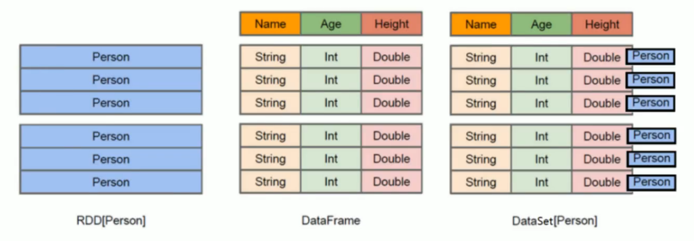
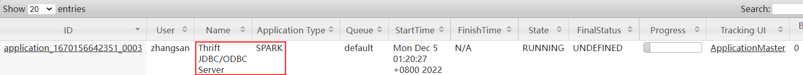
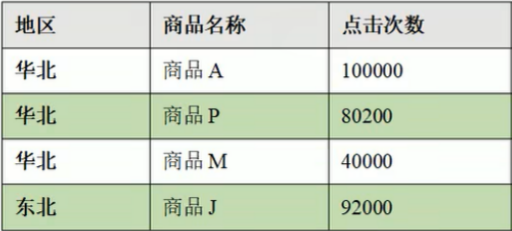

# Spark DataFrame & Spark SQL

## 环境初始化

```scala
val conf = new SparkConf().setAppName("Spark SQL").setMaster("local[*]")
val spark = SparkSession.builder().config(conf).getOrCreate()
import spark.implicits._
```

## 测试数据

`spark项目` - `org.apache.spark.spark-examples_2.11`模块下自带的测试数据。

## DataFrame构造

```scala
import org.apache.spark.sql._
import org.apache.spark.sql.types._

val sparkSession = new org.apache.spark.sql.SparkSession(sc)

val schema =
StructType(StructField("name", StringType, false)::StructField("age", IntegerType, true) :: Nil)
val people = sc.textFile("people.txt").map(_.split(",")).map(p => Row(p(0), p(1).trim.toInt))
val dataFrame = sparkSession.createDataFrame(people, schema)
```

## DataFrame读取与保存

### 读取

- `spark.read.format("json").load("/employees.json")`

- `spark.read.json("/employees.json")`

- `spark.read.load("/people.parquet")` //只能读`parquet`类型的文件

### 保存

- `df.write.format("csv").save("/target/employees.csv")`
- `df.write.json("/target/employees.json")`
- `df.write.save("/target/user.csv")` // 只能保存为`parquet`类型的文件

### 其他参数

#### Mode

```scala
.mode(SaveMode.Append)
.mode(SaveMode.Overrite)
.mode(SaveMode.Ignore)
...
```

#### Option

##### 读取CSV文件时，指定分隔符、表头等

```scala
// 指定读取参数
scala> spark.read.option("sep",";").option("header","true").option("inferSchema","true").csv("/people.csv").show
```

##### 读取MySQL时，指定连接字符串

```scala
df.write
.format("jdbc")
.option("url", "jdbc:mysql://localhost:3306/data_etl?serverTimezone=Asia/Shanghai")
.option("dbtable", "test")
.option("user", "root")
.option("password", "123456")
.mode(SaveMode.Append)
.save()
//记得在maven中添加mysql-connector-java依赖

scala> spark.read.format("jdbc").option("url","jdbc:mysql://192.168.179.1/data_etl").option("dbtable","salary").option("user","root").option("password","123456").load.show()
+----+----+----------+-----+
|姓名|性别|        QQ| 工资|
+----+----+----------+-----+
|张三|null|    123456| 6000|
|李四|   F| 123456789| 2900|
|王五|   M|882993ad23|21000|
|赵六|   F|   2222222| 5000|
|孙七|   M|       125| 4100|
+----+----+----------+-----+
```

## DSL与SQL

领域特定语言(`DSL`, `Domain Specified Language`)

### 小练习

#### 数据

```json
{"id": 1, "name": "Ella", "age": "36"}
{"id": 2, "name": "Bob", "age": "29"}
{"id": 3, "name": "Jack", "age": "29"}
{"id": 4, "name": "Jim", "age": "28"}
{"id": 4, "name": "Jim", "age": "28"}
{"id": 5, "name": "Damon"}
{"id": 5, "name": "Damon"}
```

#### 问题

1. 打印`DataFrame`的`Schema`
2. 查询总记录数
3. 查询所有数据
4. 查询所有数据，去除重复数据；
5. 查询所有数据，打印时去除`id`字段
6. 筛选出`age>30`的员工记录
7. 将数据按照年龄分组，统计每组的人数
8. 将数据按`age`升序排列
9. 将数据按`age`降序排列
10. 取出前`3`行数据
11. 查询所有记录的`name`列，并为列取别名为`username`
12. 查询年龄`age`的平均值（`null`不参与计算）
13. 查询年龄`age`的最小值

#### DSL

```scala
# 1. 打印DataFrame的Schema
scala> df.printSchema

# 2. 查询总记录数
scala> df.count

# 3. 查询所有数据
scala> df.select("*").show

# 4. 查询所有数据，去除重复数据；
scala> df.distinct.show

# 5. 查询所有数据，打印时去除id字段
scala> df.distinct().select("name","age").show()

# 6. 筛选出age>30的员工记录
scala> df.distinct.filter("age>30").show

# 7. 将数据按照年龄分组，统计每组的人数
scala> df.distinct.groupBy("age").count.show

# 8. 将数据按age升序排列
scala> df.distinct.sort("age").show

# 9. 将数据按age降序排列
scala> df.distinct.orderBy($"age".desc).show

# 10. 取出前3行数据
scala> df.show(3)

# 11. 查询所有记录的name列，并为列取别名为username
scala> df.select($"name".as("username")).show

# 12. 查询年龄age的平均值（null不参与计算）
scala> df.distinct.select(avg("age")).show

# 13. 查询年龄age的最小值
scala> df.select(min("age")).show
```


> 注意，上面的`$`是一个函数，需要 `import spark.implicits._`

#### SQL

```SPARQL
scala> df.createTempView("people")
scala> df.createOrReplaceTempView("people")
scala> df.createOrReplaceGlobalTempView("people")
scala> spark.newSession.sql("select * from global_temp.people").show

scala> spark.sql("select * from people").show

scala> sql("select count(*) from people").show

scala> sql("select distinct(*) from people").show

... ...
```

##### 直接将文件作为查询数据源

```scala
scala> spark.sql("select * from json.`/resources/people.json`").show
22/12/02 07:55:47 WARN metastore.ObjectStore: Failed to get database json, returning NoSuchObjectException
+----+-------+
| age|   name|
+----+-------+
|null|Michael|
|  30|   Andy|
|  19| Justin|
+----+-------+

scala> spark.sql("select * from parquet.`/resources/users.parquet`").show
22/12/02 07:57:02 WARN metastore.ObjectStore: Failed to get database parquet, returning NoSuchObjectException
+------+--------------+----------------+
|  name|favorite_color|favorite_numbers|
+------+--------------+----------------+
|Alyssa|          null|  [3, 9, 15, 20]|
|   Ben|           red|              []|
+------+--------------+----------------+
```

## RDD|DataFrame|DataSet



- Spark 1.0  RDD
- Spark 1.3  DataFrame
- Spark 1.6  DataSet

### 隐式转换

```scala
import spark.implicits._
```

> 此处`spark`不是包名，而是`SparkSession`类对象`spark`的名字。

### DataFram与DataSet的区别

`DataSet`是具有强类型的数据集合，可以直接访问元素的属性如`item.prop`。

##### PersonRDD

```scala
scala> val personRDD = spark.sparkContext.parallelize(List(("zhangsan",10),("lisi",20),("wangwu",30)))
```

##### PersonDF

```scala
scala> val personDF = personRDD.toDF("name","age")
personDF: org.apache.spark.sql.DataFrame = [name: string, age: int]

val personDF: DataFrame = personRDD.map(x => Person(x._1, x._2)).toDF()
```

##### PersonDS

```scala
scala> case class Person(name:String, age:Int) //样例类，样例类不能放在与toDS相同的方法内。
defined class Person

scala> val personDS = personRDD.map(t=>Person(t._1,t._2)).toDS
personDS: org.apache.spark.sql.Dataset[Person] = [name: string, age: int]
```

##### 按属性取值

```scala
scala> personDF.foreach(p=>println(p.name))
<console>:26: error: value name is not a member of org.apache.spark.sql.Row
       personDF.foreach(p=>println(p.name)) // 失败

scala> personDF.foreach(p=>println(p(0))) //只能按索引取值
zhangsan
lisi
wangwu

scala> personDS.foreach(p=>println(p.name))
wangwu
lisi
zhangsan
```

> 即使把`Person`构成的`RDD`转换成`DF`
>
> ` val personDF = personRDD.map(t=>Person(t._1,t._2)).toDF`
>
> 此处仍无法使用`p.name`取值。

### DataFrame与DataSet互转

```scala
scala> personDF.as[Person]
res84: org.apache.spark.sql.Dataset[Person] = [name: string, age: int]

scala> personDS.toDF
res88: org.apache.spark.sql.DataFrame = [name: string, age: int]
```

### DataFrame、DataSet转RDD

```scala
df.rdd
ds.rdd
```

## 用户自定义函数UDF

### 需求

输出`PersonDF`中的所有记录，姓名格式化输出，格式为： `Name: zhangan`

```scala
+--------------------+---+
|UDF:prefixName(name)|age|
+--------------------+---+
|       name:zhangsan| 10|
|           name:lisi| 20|
|         name:wangwu| 30|
+--------------------+---+
```

尝试一下：

```SPARQL
scala> personDF.createOrReplaceTempView("person")
scala> spark.sql("select "name:"+name,age from person")
<console>:1: error: identifier expected but string literal found.
```

结果提示`ERROR`。

### UDF定义

`UDF: UserDefinedFunction`

```scala
scala> spark.udf.register("prefixName",(name:String)=>("name:"+name))
res101: org.apache.spark.sql.expressions.UserDefinedFunction = UserDefinedFunction(<function1>,StringType,Some(List(StringType)))
```

### UDF使用

```SPARQL
scala> spark.sql("select prefixName(name),age from person").show
+--------------------+---+
|UDF:prefixName(name)|age|
+--------------------+---+
|       name:zhangsan| 10|
|           name:lisi| 20|
|         name:wangwu| 30|
+--------------------+---+
```


## 用户自定义聚合函数UDAF

### 梳理

##### 初始值

- var total = 0

- var count = 0

##### 缓冲区

- total = total + row
- count  = count + 1

##### 平均值

- total  / count  

### 具体代码

##### DataFrame

```scala
val df = personRDD.toDF("name", "age")
```

##### main

```scala
df.createOrReplaceTempView("person")
spark.udf.register("ageAvg",new AvgUDAD())
spark.sql("select ageAvg(age) from person").show
```

##### AvgUDAD

```scala
class AvgUDAD extends UserDefinedAggregateFunction {
  //输入数据类型
  override def inputSchema: StructType = {
    StructType(Array(StructField("age", LongType)))
  }

  override def bufferSchema: StructType = {
    StructType(Array(StructField("total", LongType), StructField("count", LongType)))
  }

  //返回值类型
  override def dataType: DataType = LongType
  //确定性
  override def deterministic: Boolean = true

  override def initialize(buffer: MutableAggregationBuffer): Unit = {
    buffer(0) = 0L //total
    buffer(1) = 0L //count
//    buffer.update(0,0L)
//    buffer.update(1,0L)
  }

  //缓冲区
  override def update(buffer: MutableAggregationBuffer, input: Row): Unit = {
    buffer.update(0,buffer.getLong(0)+input.getLong(0)) //total
    buffer.update(1,buffer.getLong(1)+1) // count
  }

  //分布式数据集，可能有多个缓冲区，将多个缓冲区合并
  override def merge(buffer1: MutableAggregationBuffer, buffer2: Row): Unit = {
    buffer1.update(0, buffer1.getLong(0)+buffer2.getLong(0)) //total
    buffer1.update(1, buffer1.getLong(1)+buffer2.getLong(1)) //count
  }

  // 计算平均值
  override def evaluate(buffer: Row): Any = {
    buffer.getLong(0)/buffer.getLong(1) //total/count
  }
}
```

### UDAF-强类型(DSL)

##### DF转DS

因为`DataFrame`不支持强类型，将`DF`转为`DataSet`

```scala
case class Person(name:String, age:Long)
val ds = df.as[Person]
```

##### UDAF类

```scala
// 缓冲区类
case class Buff(var total: Long, var count: Long)

//根据 in, buffer, out 构造 聚合类 AvgUDAD
class AvgUDAD extends Aggregator[Person, Buff, Long] {
  override def zero: Buff = Buff(0L, 0L)

  override def reduce(b: Buff, a: Person): Buff = {
    b.total = b.total + a.age
    b.count = b.count + 1
    b
  }

  override def merge(b1: Buff, b2: Buff): Buff = {
    b1.total = b1.total+b2.total
    b1.count = b1.count+b2.count
    b1
  }

  override def finish(reduction: Buff): Long = reduction.total/reduction.count

  // 缓冲区编码
  override def bufferEncoder: Encoder[Buff] = Encoders.product
  // 输出编码
  override def outputEncoder: Encoder[Long] = Encoders.scalaLong
}
```

##### 使用UDAF

```scala
// 将UDAF类转换为查询的列对象
val column: TypedColumn[Person, Long] = new AvgUDAD().toColumn
ds.select(column).show()
```


### UDAF-强类型(SQL)

`SQL`是弱类型操作，`Aggregator`是强类型操作，`Spark2.x`中不支持两者的结合使用。`Spark 3.0`中可以使用`SQL`结合强类型的`UDAF`，使用`functions.udaf(new AvgUDAD())`进行转换。

##### 缓冲区类

```scala
case class Buff(var total: Long, var count: Long)
```

##### UDAF

```scala
//根据 in, buffer, out 构造 聚合类 AvgUDAD
class AvgUDAD extends Aggregator[Long, Buff, Long] {
    
  override def zero: Buff = Buff(0L, 0L)

  override def reduce(b: Buff, a: Long): Buff = {
    b.total = b.total + a
    b.count = b.count + 1
    b
  }

  override def merge(b1: Buff, b2: Buff): Buff = {
    b1.total = b1.total+b2.total
    b1.count = b1.count+b2.count
    b1
  }

  override def finish(reduction: Buff): Long = reduction.total/reduction.count

  // 缓冲区编码
  override def bufferEncoder: Encoder[Buff] = Encoders.product
  // 输出编码
  override def outputEncoder: Encoder[Long] = Encoders.scalaLong
}
```

##### 使用UDAF

```scala
df.createOrReplaceTempView("person")
spark.udf.register("ageAvg",  functions.udaf(new AvgUDAD())) //调用方式发生了变化
spark.sql("select ageAvg(age) from person").show
```

## Spark内置Hive

### 临时表

```scala
scala> val df = spark.read.json("/resources/employees.json")
df: org.apache.spark.sql.DataFrame = [name: string, salary: bigint]


scala> df.createOrReplaceTempView("employees")

scala> spark.sql("show tables").show
+--------+---------+-----------+
|database|tableName|isTemporary|
+--------+---------+-----------+
| default|  bigdata|      false|
|        |employees|       true|
+--------+---------+-----------+
```

### 创建表

```scala
scala> spark.sql("create table bigdata(id int)")
22/12/02 08:17:25 WARN metastore.HiveMetaStore: Location: file:/home/zhangsan/spark-warehouse/bigdata specified for non-external table:bigdata
res28: org.apache.spark.sql.DataFrame = []

scala> spark.sql("show tables").show
+--------+---------+-----------+
|database|tableName|isTemporary|
+--------+---------+-----------+
| default|  bigdata|      false|
+--------+---------+-----------+
```

此操作，会在用户目录下创建一个名字为`spark-warehouse`的目录。

### 准备数据

```shell
[zhangsan@node0 ~]$ cat data.txt 
1
2
3
4
5
```

### 加载数据

```hive
scala> spark.sql("load data local inpath '/home/zhangsan/data.txt' into table bigdata")
```


### 查询表

```SPARQL
scala> spark.sql("select * from bigdata").show
+---+
| id|
+---+
|  1|
|  2|
|  3|
|  4|
|  5|
+---+
```

## 操作外置Hive

### Hive安装

略。

### 配置

#### 服务器环境配置

##### hive-site.xml

复制到`SPARK_HOME/conf/`目录内

##### mysql-connector-driver

复制到`SPARK_HOME/jars/`目录内

#### 开发环境配置

##### jar包

```xml
<dependency>
    <groupId>org.apache.spark</groupId>
    <artifactId>spark-hive_${scala.binary.version}</artifactId>
    <version>2.4.8</version>
</dependency>
<dependency>
    <groupId>mysql</groupId>
    <artifactId>mysql-connector-java</artifactId>
    <version>8.0.29</version>
</dependency>
```

##### resources

将文件`$HIVE_HOME/conf/hive-site.xml`，放到项目的`resources`目录中。

##### 启用HiveSupport

```scala
val spark = SparkSession.builder().enableHiveSupport().config(conf).getOrCreate()
spark.sql("show tables").show()
```

### 操作

```SPARQL
scala> sql("show tables").show
+--------+---------+-----------+
|database|tableName|isTemporary|
+--------+---------+-----------+
| default|  bigdata|      false|
| default|  student|      false|
+--------+---------+-----------+
```

此处的student表来自于hive文档。

### Spark-SQL 

```SPARQL
spark-sql (default)> show tables;

database	tableName	isTemporary
default	student	false
```

展示不美观，而且每次启动都会产生一个Application。

### Beeline

#### Hadoop

##### core-site.xml

```xml
<property>
    <name>hadoop.proxyuser.zhangsan.hosts</name>
    <value>*</value>
</property>
<property>
    <name>hadoop.proxyuser.zhangsan.groups</name>
    <value>*</value>
</property>
```

#### spark

##### 启动thriftserver

```shell
[zhangsan@node1 default]$ sbin/start-thriftserver.sh 
```

启动后，可以在`YARN WebUI`界面看到此应用程序



服务端口： 10000

##### beeline连接thriftserver

```shell
[zhangsan@node1 default]$ bin/beeline -u jdbc:hive2://node2:10000 -n zhangsan
Connecting to jdbc:hive2://node2:10000
22/12/04 00:55:44 INFO jdbc.Utils: Supplied authorities: node2:10000
22/12/04 00:55:44 INFO jdbc.Utils: Resolved authority: node2:10000
22/12/04 00:55:44 INFO jdbc.HiveConnection: Will try to open client transport with JDBC Uri: jdbc:hive2://node2:10000
Connected to: Apache Hive (version 2.3.9)
Driver: Hive JDBC (version 1.2.1.spark2)
Transaction isolation: TRANSACTION_REPEATABLE_READ
Beeline version 1.2.1.spark2 by Apache Hive
```

##### beeline使用

```SPARQL
0: jdbc:hive2://node2:10000> select * from student;
```

##### beeline退出

```http
0: jdbc:hive2://node0:10000> !quit
Closing: 0: jdbc:hive2://node0:10000
```


### 项目实践

##### 实验数据

产品信息表：`product_info`

城市信息表：`city_info`

用户访问表： `user_visit_action`

##### 需求

计算各地区中点击量排名前三的商品。



##### 创建数据库

```SPARQL
0: jdbc:hive2://node2:10000> create database sale;
No rows affected (2.248 seconds)
0: jdbc:hive2://node2:10000> show databases;
+----------------+--+
| database_name  |
+----------------+--+
| default        |
| sale           |
+----------------+--+
2 rows selected (0.649 seconds)
```


##### 准备数据

创建表，载入数据：

```scala
val sparkConf = new SparkConf().setMaster("local[*]").setAppName("sparkSQL")
val spark = SparkSession.builder().enableHiveSupport().config(sparkConf).getOrCreate()

spark.sql("use sale")

// 准备数据
spark.sql(
    """
    |CREATE TABLE `user_visit_action`(
    |  `date` string,
    |  `user_id` bigint,
    |  `session_id` string,
    |  `page_id` bigint,
    |  `action_time` string,
    |  `search_keyword` string,
    |  `click_category_id` bigint,
    |  `click_product_id` bigint,
    |  `order_category_ids` string,
    |  `order_product_ids` string,
    |  `pay_category_ids` string,
    |  `pay_product_ids` string,
    |  `city_id` bigint)
    |row format delimited fields terminated by '\t'
    """.stripMargin)

spark.sql(
    """
    |load data local inpath 'datas/user_visit_action.txt' into table sale.user_visit_action
    """.stripMargin)

spark.sql(
    """
    |CREATE TABLE `product_info`(
    |  `product_id` bigint,
    |  `product_name` string,
    |  `extend_info` string)
    |row format delimited fields terminated by '\t'
    """.stripMargin)

spark.sql(
    """
    |load data local inpath 'datas/product_info.txt' into table sale.product_info
    """.stripMargin)

spark.sql(
    """
    |CREATE TABLE `city_info`(
    |  `city_id` bigint,
    |  `city_name` string,
    |  `area` string)
    |row format delimited fields terminated by '\t'
    """.stripMargin)

spark.sql(
    """
    |load data local inpath 'datas/city_info.txt' into table sale.city_info
    """.stripMargin)
```


##### 计算各地区排名前三的商品

```scala
val conf = new SparkConf().setAppName("Spark SQL").setMaster("local[*]")
val spark = SparkSession.builder().enableHiveSupport().config(conf).getOrCreate()
import spark.implicits._

spark.sql("use sale")

// 表连接，[ area(city_info), product_name(product_info), click_product_id(user_visit_action)]
// 根据 count(click_product_id) 得到click_count
spark.sql(
    """
        |SELECT
        |	u.user_id,
        |	c.area,
        |	c.city_name,
        |	p.product_name
        |FROM
        |	user_visit_action u
        |JOIN city_info c ON u.city_id = c.city_id
        |JOIN product_info p ON p.product_id = u.click_product_id
        |""".stripMargin).createOrReplaceTempView("sale_info")

// 分组[area, product_name]，点击量统计
spark.sql(
    """
        |select area, product_name, count(*) as click_count from sale_info GROUP BY area, product_name
        |""".stripMargin).createOrReplaceTempView("area_product_count")

// 根据area点击量排名
spark.sql(
    """
        |select *, rank() over(partition by area order by click_count desc) as rank
        |from area_product_count
        |""".stripMargin).createOrReplaceTempView("area_product_count_rank")

// 选取前三
spark.sql(
    """
        |select * from area_product_count_rank
        |where rank <= 3
        |""".stripMargin).show(false)

spark.close()
```


