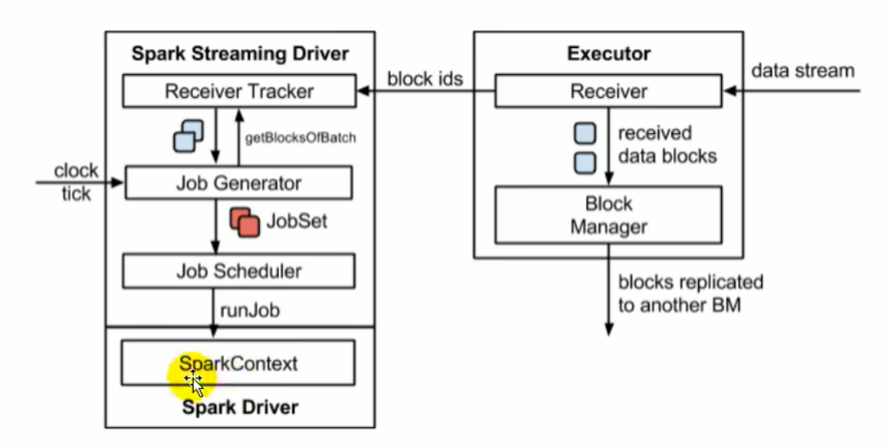
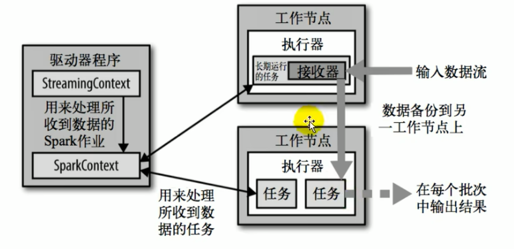
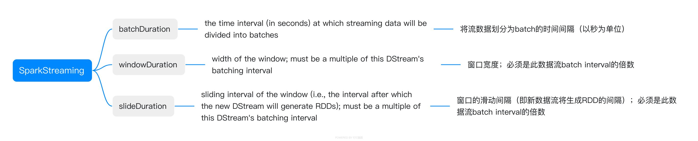
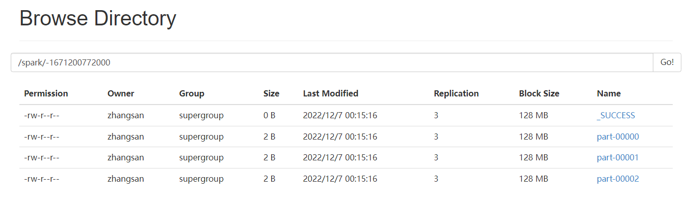

# Spark Steaming

## Streaming

准实时(s)， 微批次






## Wordcount

##### 测试数据1

```shell
[root@node0 ~]# yum -y install nc
[zhangsan@node0 conf]$ nc -lp 9998
```


##### 测试数据2

```java
package com.studybigdata.spark.streaming;

import java.io.IOException;
import java.io.OutputStream;
import java.net.ServerSocket;
import java.net.Socket;
import java.nio.charset.StandardCharsets;

public class StreamingMockData {
    public static void main(String[] args) throws IOException, InterruptedException {

        ServerSocket sc = new ServerSocket(9998);

        System.out.println("等待链接... ...");
        Socket accept = sc.accept();
        System.out.println("客户端链接成功：" + accept.getLocalAddress());

        OutputStream outputStream = accept.getOutputStream();

        while (true) {

            String[] lines = new String[]{"spark", "spark spark streaming", "spark scala scala"};

            for (String line : lines) {
                String outString = line + "\n";
                System.out.println(outString);
                outputStream.write(outString.getBytes(StandardCharsets.UTF_8));
                Thread.sleep(1000);
            }
        }
    }
}
```

##### 实验代码

```scala
package com.studybigdata.spark.streaming

import org.apache.spark.storage.StorageLevel
import org.apache.spark.streaming.dstream.DStream
import org.apache.spark.streaming.{Seconds, StreamingContext}
import org.apache.spark.{SparkConf, SparkContext}

object StreamingWordcount {

  def main(args: Array[String]): Unit = {
    val sparkConf: SparkConf = new SparkConf().setAppName("Spark_Streaming_Window").setMaster("local[*]")
    val sc: SparkContext = new SparkContext(sparkConf)
    sc.setLogLevel("ERROR")

    val ssc: StreamingContext = new StreamingContext(sc, Seconds(1))
    val stream: DStream[String] = ssc.socketTextStream("localhost", 9998, StorageLevel.MEMORY_AND_DISK)

    val words: DStream[String] = stream.flatMap(_.split(" "))
    val wordOne: DStream[(String, Int)] = words.map((_, 1))
    val result: DStream[(String, Int)] = wordOne.reduceByKey(_ + _)
    result.print()
    ssc.start()
    ssc.awaitTermination()
  }
}
```


## 自定义Receiver

### 定义

```scala
class MyReceiver extends Receiver[String](StorageLevel.MEMORY_ONLY) {
  private var flag = true

  override def onStart(): Unit = {

    new Thread() {
      override def run(): Unit = {
        while (true) {
          store("a b c")
          Thread.sleep(500)
        }
      }
    }.start()
  }

  override def onStop(): Unit = {
    flag = false
  }
}
```

### 使用

```scala
val value: ReceiverInputDStream[String] = ssc.receiverStream(new MyReceiver)
value.print()
```

## 有状态操作

### 数据流的总词频

之前的例子中，我们计算的是每个窗口的词频统计结果；但是我们如何统计数据流的`总词频`呢？

我们需要对以下两种数据进行合并。

- 当前窗口的词频 `(key, count)`
- 历史汇总的词频 `(key, total)`

### 缓冲区的存放位置

历史汇总的词频存放到什么地方呢? 需要指定一个检查点。

```scala
ssc.checkpoint("wc_cp")
```

### updateStateByKey

```scala
val stream: ReceiverInputDStream[String] = ssc.socketTextStream("node0", 9998)

val words: DStream[String] = stream.flatMap(_.split(" "))
val wordOne: DStream[(String, Int)] = words.map((_, 1))

// updateStateByKey：接收的数据需要是键值对类型

// (某个词) 当前窗口的词频： current
// (某个词) 历史汇总的词频： buffer
val totalWordCount: DStream[(String, Int)] = wordOne.updateStateByKey(
    (current: Seq[Int], buffer: Option[Int]) => {
        val total: Int = buffer.getOrElse(0) + current.sum
        Option(total)
    })

totalWordCount.print()
```

## Join

**DStream** join **DStream**

```scala
val ssc = new StreamingContext(sc, Seconds(3))

val stream1: ReceiverInputDStream[String] = ssc.socketTextStream("node0", 9998)
val stream2: ReceiverInputDStream[String] = ssc.socketTextStream("node0", 9999)

val kv_stream_1 = stream1.map((_,1))
val kv_stream_2 = stream2.map((_,1))

kv_stream_1.join(kv_stream_2).print()
```

## Transform

**DStream** join **RDD**

```scala
// 黑名单：value=true表示加入了黑名单
val black_rdd: RDD[(String, Boolean)] = sc.parallelize(List(("zhangsan", true), ("lisi", true), ("wangwu", false), ("zhaoliu", false)))

// (zhangsan,1)
// (zhangsan,true)
// (zhangsan,(1, true))
// (wangwu,(1,false))
val value: DStream[(String, Int)] = stream.map((_, 1))
value.transform(
  rdd => {
    val result: RDD[(String, (Int, Option[Boolean]))] = rdd.leftOuterJoin(black_rdd)
    val white_list: RDD[(String, (Int, Option[Boolean]))] = result.filter(record=>(record._2._2.getOrElse(false)==false))
    white_list
  }
).print()
```


## 窗口

### 窗口分类



> https://alidocs.dingtalk.com/mind/edit?docKey=oeLbnjGZ7pWJqaNY&dentryKey=6Kl2LYgAACVm7lLz&type=m&mode=2&sheetId=sheet1

使用`Window`函数实现`窗口`操作：

当`窗口时间 = 批时间`时，窗口好像在滚动；

当`窗口时间 = (1+N) * 批时间`时，窗口好像在滑动；

当`窗口时间 = (1+N) * 批时间，滑动时间 = 窗口时间`时，窗口好像在滚动。

#### 测试数据

本代码实现的功能：

`每秒`从字符串数组`["a", "b", "c", "d", "e", "f", "g", "h", "i", "j", "k", "l", "m", "n", "o", "p"]`中顺序取出一个字符，和当前时间拼成格式如`14:47:19-a`的字符串，发送到本机的`9998`端口。

```java
package com.studybigdata.spark.streaming;

import java.io.IOException;
import java.io.OutputStream;
import java.net.ServerSocket;
import java.net.Socket;
import java.nio.charset.StandardCharsets;
import java.text.SimpleDateFormat;
import java.util.Date;

public class SocketServer {
    public static void main(String[] args) throws IOException, InterruptedException {

        ServerSocket sc = new ServerSocket(9998);

        System.out.println("等待链接... ...");
        Socket accept = sc.accept();
        System.out.println("客户端链接成功：" + accept.getLocalAddress());

        OutputStream outputStream = accept.getOutputStream();

        while (true) {

            String[] lines = new String[]{"a", "b", "c", "d", "e", "f", "g", "h", "i", "j", "k", "l", "m", "n", "o", "p"};

            for (String line : lines) {
                String dataDate = SimpleDateFormat.getTimeInstance().format(new Date());

                String outString = dataDate + "-" + line + "\n";
                System.out.println(outString);

                outputStream.write(outString.getBytes(StandardCharsets.UTF_8));
                Thread.sleep(1000);
            }
        }
    }
}
```

#### 滑动窗口

##### 实验代码

```scala
val ssc: StreamingContext = new StreamingContext(sc, Seconds(2))
ssc.checkpoint("./")
val stream: DStream[String] = ssc.socketTextStream("localhost", 9998).window(Seconds(4))
stream.print()
```

##### 实验结果

```shell
-------------------------------------------
Time: 1670763076000 ms
-------------------------------------------
20:51:11-b
20:51:12-c
20:51:13-d
20:51:15-e

-------------------------------------------
Time: 1670763078000 ms
-------------------------------------------
20:51:13-d
20:51:15-e
20:51:16-f
20:51:17-g

-------------------------------------------
Time: 1670763080000 ms
-------------------------------------------
20:51:16-f
20:51:17-g
20:51:18-h
20:51:19-i
```


#### 滚动窗口

##### 实验代码

```scala
val ssc: StreamingContext = new StreamingContext(sc, Seconds(2))
ssc.checkpoint("./")
val stream: DStream[String] = ssc.socketTextStream("localhost", 9998).window(Seconds(4),Seconds(4))
stream.print()
```

##### 实验结果

```shell
-------------------------------------------
Time: 1670762482000 ms
-------------------------------------------
20:41:19-a
20:41:20-b
20:41:21-c

-------------------------------------------
Time: 1670762486000 ms
-------------------------------------------
20:41:22-d
20:41:23-e
20:41:24-f
20:41:25-g

-------------------------------------------
Time: 1670762490000 ms
-------------------------------------------
20:41:26-h
20:41:27-i
20:41:28-j
20:41:29-k

-------------------------------------------
Time: 1670762494000 ms
-------------------------------------------
20:41:30-l
20:41:31-m
20:41:32-n
20:41:33-o
```

## DStream输出

> 无输出，则产生异常

##### Print

##### SaveAsTextFiles

```scala
stream.saveAsTextFiles("hdfs://node0:9000/spark/")
```



##### saveAsObjectFiles


##### foreachRDD

因为`Streaming`无输出，会产生异常。因此，在使用`foreachRDD`时，要有保存动作。

## 优雅的关闭

```scala
new Thread() {
  override def run(): Unit = {

    val uri = new URI("hdfs://node0:9000/")
    val conf = new Configuration
    val user = "zhangsan"
    val fs: FileSystem = FileSystem.get(uri, conf, user)
      
    while (true) {
      val exist: Boolean = fs.exists(new Path("/user/zhangsan/bigdata.txt"))
      if (exist) {
        println("exist.. ...")
        ssc.stop(true, true)
        System.exit(0)
      }
      println("wait.. ...")
      Thread.sleep(2000)
    }
  }
}.start()
```


