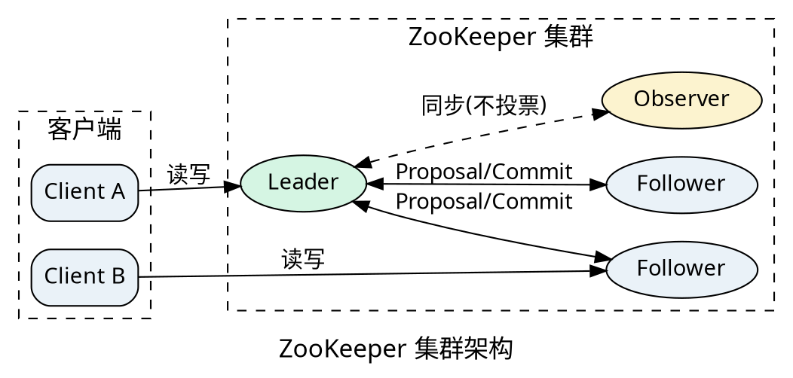
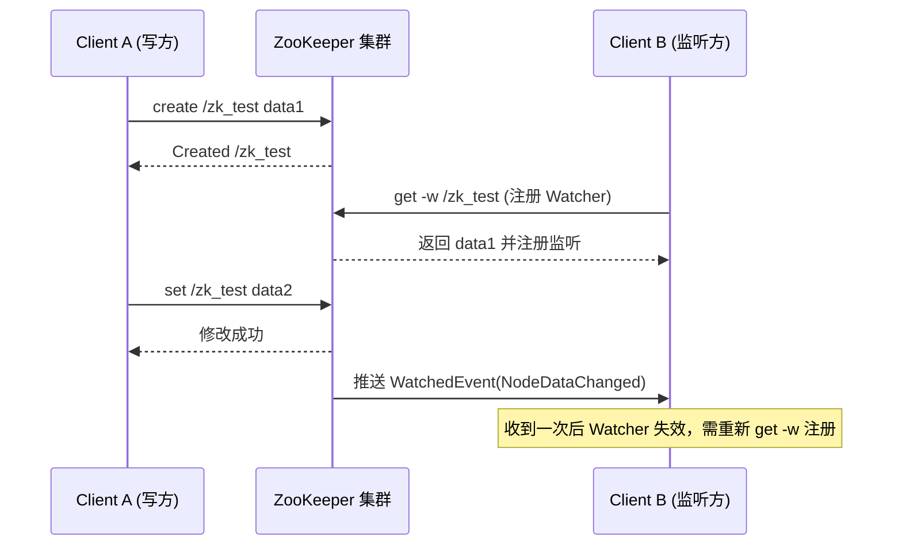
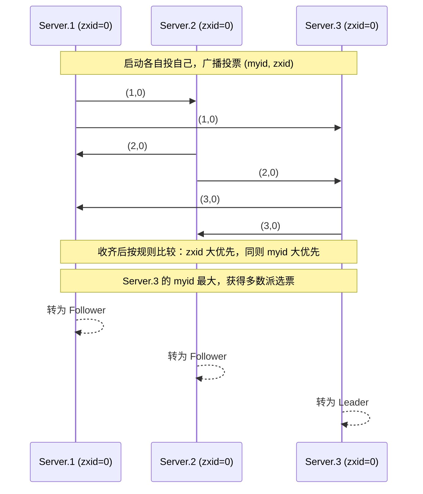

<div class="cover"><h1>ZooKeeper 原理</h1><p>第3章 · 分布式协调服务的核心机制（基于 3.5.7）</p></div>

## 3.1 ZooKeeper 概述

ZooKeeper 是一个开源的分布式协调服务框架，为分布式应用提供统一命名、配置管理、分布式锁与集群管理。本章先建立整体认知，端口与集群角色详见[部署篇](Zookeeper.md)。

### 3.1.1 核心特点

- 顺序一致性：来自客户端的更新按发送顺序被应用（全局 zxid 有序）
- 原子性：更新要么成功要么失败，不存在部分结果
- 单一系统映像：无论连到哪个 Server，客户端看到的数据视图一致（写经 Leader 达成多数派）
- 可靠性：数据写入多数派后即持久，崩溃后可恢复
- 最终一致性（实时性）：在时间窗口内保证读到最新数据，Watch 通知近实时
- 高吞吐读：所有 Server 都可服务读请求，读压力被分摊到全体

### 3.1.2 集群架构

ZooKeeper 以集群方式运行：一个 Leader 负责写与广播，多个 Follower 参与投票与读，Observer 可扩展读能力但不参与投票。客户端可连任意节点，写请求统一转交 Leader。



### 3.1.3 典型应用场景

| 场景 | 做法 | 说明 |
| --- | --- | --- |
| 统一命名服务 | 用路径当全局唯一名字 | 如服务注册发现 |
| 配置管理 | 节点存配置，Watch 变更 | 改一处全员生效 |
| 集群上下线感知 | 临时节点 + Watch | 成员宕机自动消失 |
| 分布式锁 | 临时顺序节点抢建 | 避免惊群效应 |
| 分布式队列 | 顺序节点入队 | 全局单调递增序号 |
| Master 选主 | 抢建唯一临时节点 | 呼应部署篇 ZKFC |

## 3.2 数据模型与节点

ZooKeeper 把全量数据放在内存、组织成类似文件系统的 ZNode 树。理解 ZNode 是理解监听、选举、HA 等一切上层机制的地基。

### 3.2.1 ZNode 的特点

- 既是「文件」又是「目录」：节点可存数据，也可有子节点（临时节点除外）
- 数据量小：默认上限约 1MB，设计用于存元数据/配置，不是数据库
- 带版本号：dataVersion / cVersion / aVersion，写操作带版本号实现乐观锁
- 有 Stat 元数据：创建/修改事务 id、时间戳、子节点数等
- 路径全局唯一，以 `/` 分隔，如 `/service/order`

### 3.2.2 树形结构

类似文件系统层级，根是 `/`。常见布局：

```
/
├── /zookeeper            (ZK 内部节点，存放配额等)
├── /hbase                (HBase 用，如 /hbase/master 选主节点)
├── /kafka                (Kafka 用，如 broker/consumer 注册)
└── /zk_demo
    └── /zk_demo/task_0000000001
```

路径常带序号（顺序节点），用于生成全局单调递增的 id。

### 3.2.3 节点类型

| 类型 | 可含子节点 | 生命周期 | 典型用途 |
| --- | --- | --- | --- |
| PERSISTENT 持久 | 是 | 会话结束不删 | 配置、命名 |
| EPHEMERAL 临时 | 否 | 会话断开即删 | 成员上下线、选主 |
| PERSISTENT_SEQUENTIAL 持久顺序 | 是 | 持久 + 名后递增序号 | 队列、全局 id |
| EPHEMERAL_SEQUENTIAL 临时顺序 | 否 | 临时 + 序号 | 分布式锁 |
| CONTAINER 容器(3.5+) | 是 | 子节点全删后延时自删 | 树形容器 |
| TTL 节点(3.5+，需开启) | 是 | 超时无改无子则删 | 过期清理 |

临时节点不能有子节点；序号节点名后追加 10 位递增数字。

### 3.2.4 Stat 状态字段

每次 `stat` 看到的元数据，是理解 ZAB 与选举的关键：

| 字段 | 含义 |
| --- | --- |
| czxid | 创建该节点的事务 id |
| mzxid | 最后一次修改该节点的事务 id |
| ctime / mtime | 创建 / 修改时间(ms) |
| version | 数据版本（每次 setData +1） |
| cversion | 子节点版本（增删子节点 +1） |
| aversion | ACL 版本 |
| ephemeralOwner | 临时节点所属会话 id；否则 0 |
| dataLength | 数据字节数 |
| numChildren | 子节点数 |
| pzxid | 最近一次子节点列表变更的事务 id |

zxid 越大表示事务越新——这是 3.3 选举比较的核心依据。

### 3.2.5 Watcher 监听机制

Watcher 是 ZK「变更通知」的核心：客户端读取时注册监听，服务端数据变化时推送一次性事件。



要点：

- 一次性：触发后 Watcher 失效，需再次注册
- 事件类型：NodeCreated / NodeDeleted / NodeDataChanged / NodeChildrenChanged
- 会话状态：SyncConnected / Disconnected / Expired 等
- `get -w` 为 3.5 客户端语法（旧版用 `stat -w` / `ls -w`）

呼应部署篇：HMaster 选主正是「抢建临时节点 + 其余 Watch 该节点」。

### 3.2.6 ACL 权限控制

ACL = `scheme:id:permission`，每个节点可配多组；默认 `world:anyone:cdrwa`（开放）。

权限位：

- c create 创建子节点
- r read 读节点与子节点列表
- w write 更新节点数据
- d delete 删除子节点
- a admin 设置本节点 ACL

scheme：

| scheme | 含义 |
| --- | --- |
| world | 默认 `world:anyone:cdrwa` |
| auth | 已认证会话（明文用户，不写 id） |
| digest | 用户名:密码摘要授权 |
| ip | 按客户端 IP 授权 |
| super | 超级管理员，跳过 ACL 校验 |

### 3.2.7 命令行操作

端口 2181（客户端）、集群角色与启动命令见[部署篇](Zookeeper.md)。下面是常用 zkCli 命令：

```bash
# 连接集群（任一节点均可）
zkCli.sh -server node1:2181

# 创建持久节点
create /zk_demo "hello"

# 创建临时节点（会话断开即删，常用于选主/上下线）
create -e /zk_demo/online "node1"

# 创建顺序节点（名后追加 10 位递增序号）
create -s /zk_demo/task "job"

# 读取数据并注册监听（3.5 语法 get -w）
get -w /zk_demo

# 查看子节点列表
ls /zk_demo

# 修改数据
set /zk_demo "world"

# 删除节点（须无子节点）
delete /zk_demo/online

# 查看节点 Stat 元数据
stat /zk_demo
```

命令解读：`-e` 临时、`-s` 顺序，二者可组合（如 `-e -s`）；`get -w` 一次注册监听；`delete` 只能删无子节点的节点，删子树需先递归。

### 3.2.8 原生 Java API

原生 API 核心是 `org.apache.zookeeper.ZooKeeper`，连接回调用 Watcher，写操作显式给 ACL 与节点模式。

```java
import org.apache.zookeeper.*;
import org.apache.zookeeper.data.Stat;
import java.util.concurrent.CountDownLatch;

public class ZkDemo {
    private static final String CONNECT = "node1:2181,node2:2181,node3:2181";
    private static final CountDownLatch connected = new CountDownLatch(1);

    public static void main(String[] args) throws Exception {
        ZooKeeper zk = new ZooKeeper(CONNECT, 5000, event -> {
            if (event.getState() == Watcher.Event.KeeperState.SyncConnected) {
                connected.countDown();          // 连接事件一次性，触发后需重注册
            }
        });
        connected.await();

        // 创建持久节点（原生 API 需显式给 ACL 与模式）
        zk.create("/zk_demo", "hello".getBytes(),
                ZooDefs.Ids.OPEN_ACL_UNSAFE, CreateMode.PERSISTENT);

        // 注册 Watcher 读取数据（一次性）
        byte[] data = zk.getData("/zk_demo", new Watcher() {
            public void process(WatchedEvent e) {
                System.out.println("事件: " + e.getType() + " @ " + e.getPath());
            }
        }, new Stat());
        System.out.println("data=" + new String(data));

        zk.close();
    }
}
```

代码解读：`OPEN_ACL_UNSAFE` 即 `world:anyone:cdrwa`；`CreateMode.PERSISTENT` 对应持久节点，可换 `EPHEMERAL` / `PERSISTENT_SEQUENTIAL` 等；`getData` 的 Watcher 与 `get -w` 等价，触发后同样需重注册。

## 3.3 一致性协议与选举

写请求必须被集群「原子广播」到多数派并有序应用；Leader 崩溃后要快速选出新 Leader 且数据不丢。这套机制由 ZAB 协议与 Leader 选举保证。

### 3.3.1 ZAB 协议概述

- ZAB（ZooKeeper Atomic Broadcast）是专为 ZK 设计的主备原子广播协议
- 目标：保证所有正常 Server 以相同顺序应用来自 Leader 的写事务（类 Paxos，但面向主备复制）
- 核心保证：消息有序、不丢已提交事务、Leader 切换后新 Leader 拥有全部已提交事务

### 3.3.2 两种基本模式

- 消息广播模式（Broadcast）：正常工作期，Leader 收写请求→生成 Proposal→广播→收多数派 Ack→Commit
- 崩溃恢复模式（Recovery）：Leader 失效或启动初期，先选主、再把新 Leader 数据与集群对齐，然后切回广播

### 3.3.3 崩溃恢复的四阶段


- 选举：各 Server 投票选出候选 Leader
- 发现：新 Leader 收集各 Follower 的 epoch 与事务，确定谁的数据最新
- 同步：新 Leader 把缺失事务补发给 Follower，使全员数据对齐
- 广播：进入正常工作，开始处理写请求

### 3.3.4 Leader 选举机制

ZK 3.5 使用 Fast Leader Election（TCP，快速选举）。

- 每张选票 = (myid, zxid, epoch)
- 比较规则：epoch 大优先 → zxid 大优先 → myid 大优先
- 某 Server 获得「多数派（> 半数）」相同选票即成为 Leader



以 3 节点（zxid 相同）为例：Server.3 的 myid 最大 → 当选 Leader；其余转 Follower。zxid 更大者优先，因此新 Leader 必含全部已提交事务，保证不丢数据。

<div class="end"><h1>小结</h1><p>数据模型（ZNode / 临时节点 / Watcher / ACL）是地基，ZAB 与 Leader 选举是让集群在写一致与高可用之间取得平衡的上层机制；二者共同支撑了配置管理、选主、分布式锁等典型场景。</p></div>
