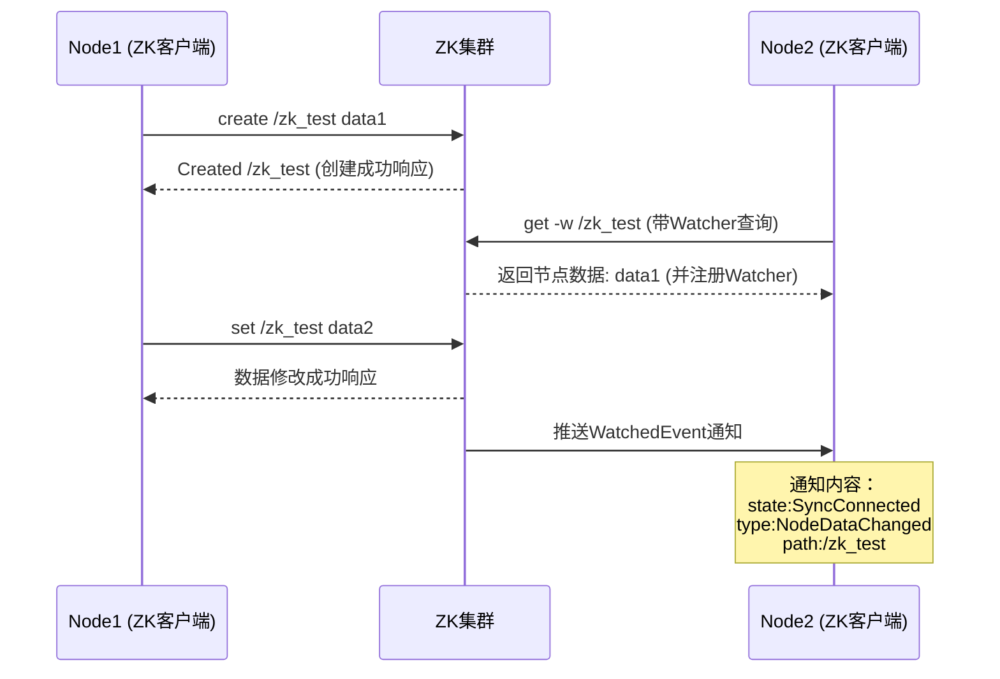

<h1 style="color:red; text-align:center">ZooKeeper</h1>

## 环境部署

> **官方文档**
>
> https://zookeeper.apache.org/doc/rx.y.z/index.html
>
> **下载地址**
>
> https://archive.apache.org/dist/zookeeper/zookeeper-x.y.z/
>
> **安装目录**
>
> `/opt/bigdata/zookeeper`
>
> **部署规划**
>
> `node0`单节点；
>
> `node1` `node2` `node3`  配置为`zookeeper`集群。


### Standalone模式

#### 	下载

使用`xftp`上传安装包或者通过`wget`等工具在线下载。

```shell
[zhangsan@node0 ~]$ cd /opt/bigdata/zookeeper/
# 此处使用wget在线下载

# 3.5.7
[zhangsan@node0 zookeeper]$ wget https://archive.apache.org/dist/zookeeper/zookeeper-3.5.7/apache-zookeeper-3.5.7-bin.tar.gz
```

#### 解压

```shell
[zhangsan@node0 bigdata]$ cd zookeeper/
[zhangsan@node0 zookeeper]$ ll
total 36796
-rw-rw-r--. 1 zhangsan zhangsan 37676320 Mar  1 22:09 apache-zookeeper-3.5.7-bin.tar.gz
[zhangsan@node0 zookeeper]$ tar -zxf apache-zookeeper-3.5.7-bin.tar.gz 

# 创建软连接（可选）
# 目的是，如果我在目录/opt/bigdata/zookeeper/下安装多个版本的zookeeper，我的环境变量文件无需修改，只需要修改default软连接的指向，让其指向我想使用的版本。
[zhangsan@node0 zookeeper]$ ln -s apache-zookeeper-3.5.7-bin default
[zhangsan@node0 zookeeper]$ ll
total 36800
lrwxrwxrwx.  1 zhangsan zhangsan       16 Mar  1 22:17 default -> apache-zookeeper-3.5.7-bin
```

#### 	配置

##### zoo.cfg

```shell
# 在 ZOOKEEPER_HOME 目录下创建个data文件夹
[zhangsan@node0 default]$ mkdir data

[zhangsan@node0 zookeeper]$ cd apache-zookeeper-3.5.7-bin/conf/
[zhangsan@node0 conf]$ cp zoo_sample.cfg zoo.cfg
[zhangsan@node0 conf]$ vim zoo.cfg 
# 修改配置项
dataDir=/opt/bigdata/zookeeper/default/data 
```

##### 环境变量

配置环境变量文件`~/.bash_profile`

```shell
export ZOOKEEPER_HOME=/opt/bigdata/zookeeper/default/
export PATH=$ZOOKEEPER_HOME/bin:$PATH
```

记得`source`一下，让环境变量生效。

```shell
[zhangsan@node0 ~]$ source .bash_profile 
```

#### 启动

```shell
[zhangsan@node0 ~]$ zkServer.sh start
[zhangsan@node0 ~]$ jps
4064 Jps
4027 QuorumPeerMain

[zhangsan@node0 ~]$ zkServer.sh status
ZooKeeper JMX enabled by default
Using config: /usr/zookeeper/apache-zookeeper-3.5.7-bin/bin/../conf/zoo.cfg
Mode: standalone
```

#### 	停止

```shell
[zhangsan@node0 ~]$ zkServer.sh stop
```


### 副本模式

> https://zookeeper.apache.org/doc/rx.y.z/zookeeperStarted.html#sc_RunningReplicatedZooKeeper

|               | **服务器node1** | **服务器node2** | **服务器node3** |
| ------------- | --------------- | --------------- | --------------- |
| **Zookeeper** | Zookeeper       | Zookeeper       | Zookeeper       |

#### 配置

在第一个节点上配置`ZooKeeper`配置文件`zoo.cfg`和环境变量文件`~/.bash_profile`。

##### zoo.cfg

```shell
[zhangsan@node1 conf]$ cat zoo.cfg 
# The number of milliseconds of each tick
tickTime=2000
# The number of ticks that the initial 
# synchronization phase can take
initLimit=10
# The number of ticks that can pass between 
# sending a request and getting an acknowledgement
syncLimit=5

dataDir=/opt/bigdata/zookeeper/default/data

# 对客户端提供服务端口
clientPort=2181

# server.x=nodename:节点通信端口:选举端口
server.1=node1:2888:3888
server.2=node2:2888:3888
server.3=node3:2888:3888
```

使用`scp`命令分发配置文件到其他节点。

在每个节点的`/opt/bigdata/zookeeper/default/data`的目录下创建一个`myid`文件，内容为server.`x`中的`x`。

##### 环境变量

环境变量文件`~/.bash_profile`与单节点配置相同。配置完成后，将环境变量文件`~/.bash_profile`，分发到其他节点。分发完成后，记得`source`一下，让其生效。

#### 集群启动

启动方式同单节点，需要在每个节点启动`zkServer.sh start`。查看启动状态：

##### node1

```shell
[zhangsan@node1 conf]$ zkServer.sh status
ZooKeeper JMX enabled by default
Using config: /opt/bigdata/zookeeper/default/bin/../conf/zoo.cfg
Mode: follower
```

##### node2

```shell
[zhangsan@node2 default]$ zkServer.sh status
ZooKeeper JMX enabled by default
Using config: /opt/bigdata/zookeeper/default/bin/../conf/zoo.cfg
Mode: leader
```

##### node3

```bash
[zhangsan@node3 default]$ zkServer.sh status
ZooKeeper JMX enabled by default
Using config: /opt/bigdata/zookeeper/default/bin/../conf/zoo.cfg
Mode: follower
```

可以看到`node2`被选举为`leader`。

#### ZK集群启动停止脚本

`/home/zhangsan/bin/zk.sh`

```bash
#!/bin/bash

case $1 in
"start"){
	for i in node1 node2 node3
	do
        echo ---------- zookeeper $i 启动 ------------
		ssh $i "zkServer.sh start"
	done
};;
"stop"){
	for i in node1 node2 node3
	do
        echo ---------- zookeeper $i 停止 ------------    
		ssh $i "zkServer.sh stop"
	done
};;
"status"){
	for i in node1 node2 node3
	do
        echo ---------- zookeeper $i 状态 ------------    
		ssh $i "zkServer.sh status"
	done
};;
esac
```

记得为脚本增加可执行权限。

## 基础使用

##### 连接

```bash
(base) [zhangsan@node1 ~]$ zkCli.sh -server node1:2181
Connecting to node1:2181
```

##### 节点列表

```bash
[zk: node1:2181(CONNECTED) 20] ls /
[hbase, kafka, zookeeper]
```

##### 节点创建

```bash
[zk: node1:2181(CONNECTED) 21] create /zk_test data1
Created /zk_test
```

##### 节点查询

```bash
[zk: node1:2181(CONNECTED) 23] get /zk_test
data1
```

##### 节点修改

```bash
[zk: node1:2181(CONNECTED) 24] set /zk_test data2
[zk: node1:2181(CONNECTED) 25] get /zk_test
data2
```

##### 节点删除

```bash
[zk: node1:2181(CONNECTED) 26] delete /zk_test
[zk: node1:2181(CONNECTED) 27] ls /
[hbase, kafka, zookeeper]
```


##### ZK通知



在**node1**创建新的节点`zk_test=data1`

```bash
[zk: node1:2181(CONNECTED) 28] create /zk_test data1
Created /zk_test
```

在**node2**设置watcher，监控 `/zk_test` 节点变化

```shell
[zk: node2:2181(CONNECTED) 4] get -w /zk_test
data1
```

在**node1**为 `/zk_test`设置一个新的值

```shell
[zk: node1:2181(CONNECTED) 29] set /zk_test data2
```

在**node2**收到了节点数据改变的通知：

```bash
[zk: node2:2181(CONNECTED) 5]
WATCHER::

WatchedEvent state:SyncConnected type:NodeDataChanged path:/zk_test
```

## ZKFC

Zookeeper Failover Controller，简称ZKFC，是故障切换 

假如 一个HBase集群中，一个`Active`状态的`HMaster`，两个backup状态的`HMaster`，如果，活跃状态的Master挂了（意味着zookeeper上的`/hbase/master`这个临时节点没了），两个Backup状态的Master会收到通知，他们俩竞选老大。

如何竞选？就是谁成功在`zookeeper`上创建`/hbase/master`这个节点，谁就是老大；
